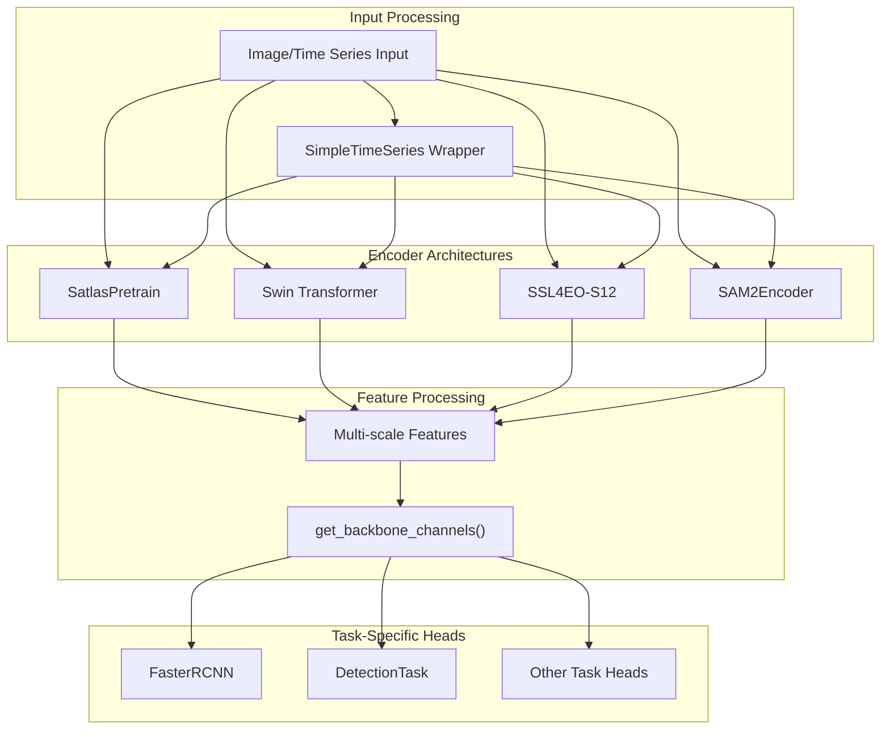
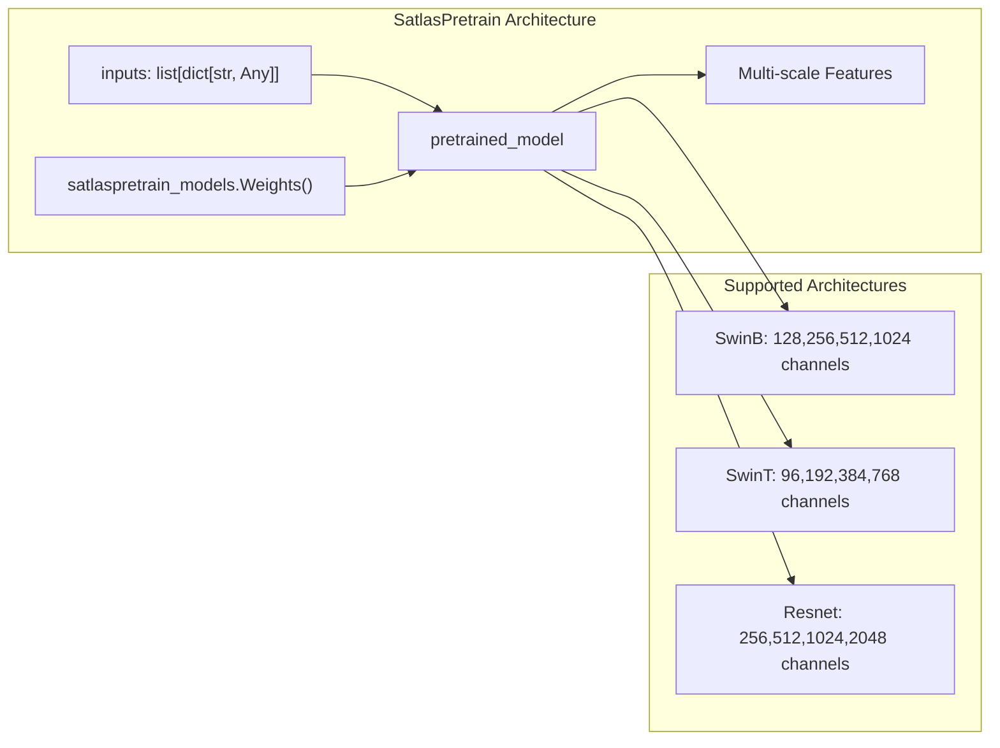
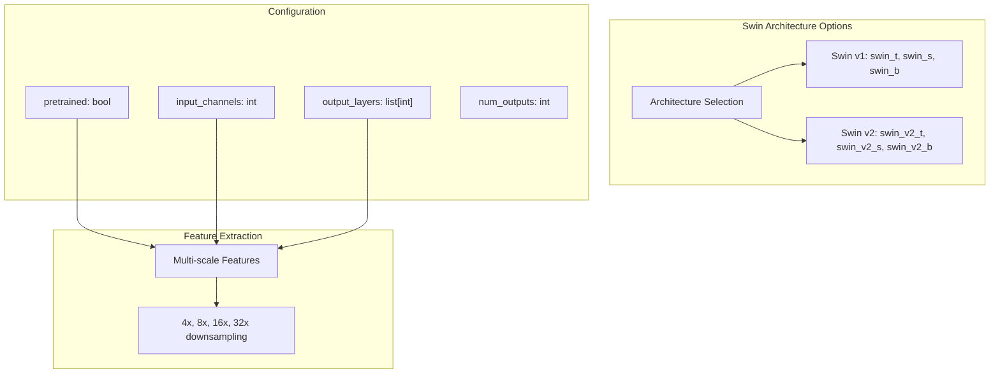
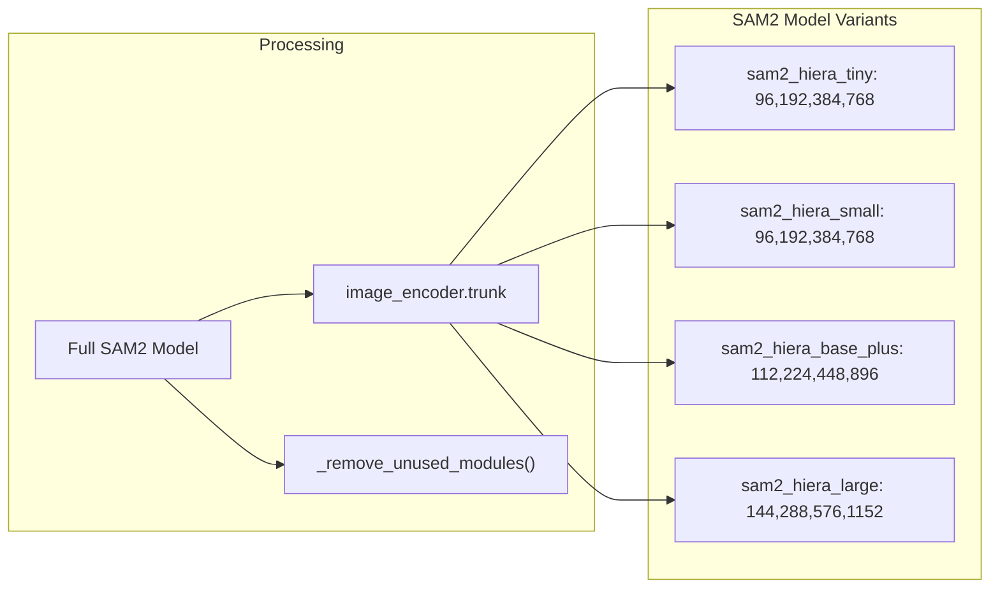
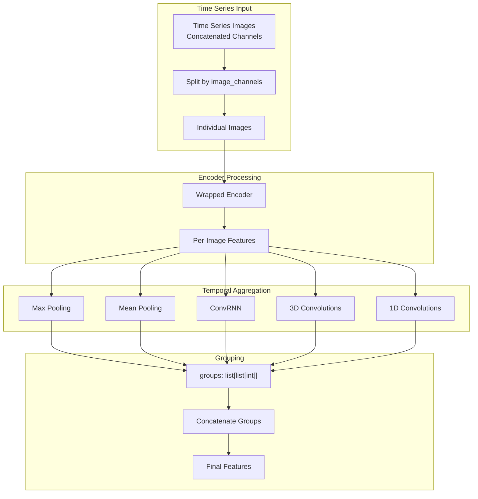
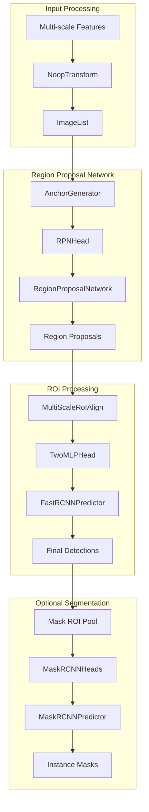
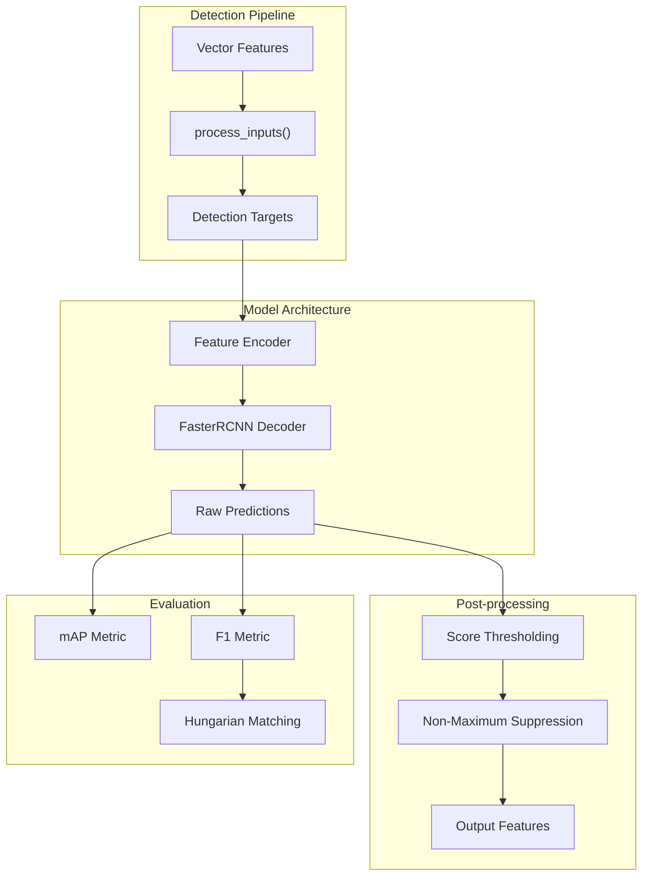

<!-- source: DeepWiki mcp.deepwiki.com · repo allenai/rslearn · page 7.2 Model Architectures · fetched 2026-10-26 -->

# Model Architectures

<details>
<summary>Relevant source files</summary>

The following files were used as context for generating this wiki page:

- [rslearn/models/faster_rcnn.py](rslearn/models/faster_rcnn.py)
- [rslearn/models/sam2_enc.py](rslearn/models/sam2_enc.py)
- [rslearn/models/satlaspretrain.py](rslearn/models/satlaspretrain.py)
- [rslearn/models/simple_time_series.py](rslearn/models/simple_time_series.py)
- [rslearn/models/ssl4eo_s12.py](rslearn/models/ssl4eo_s12.py)
- [rslearn/models/swin.py](rslearn/models/swin.py)
- [rslearn/train/tasks/detection.py](rslearn/train/tasks/detection.py)
- [tests/unit/train/tasks/test_detection.py](tests/unit/train/tasks/test_detection.py)

</details>


This document covers the model architectures available in the rslearn framework, including encoders, time series models, and task-specific decoders. These architectures form the backbone of the machine learning pipeline and can be combined in various ways to handle different remote sensing tasks.

For information about training these models, see [Training Framework](#7.1). For details on specific tasks that use these architectures, see [Tasks and Metrics](#7.3).

## Architecture Overview

The rslearn framework implements a modular architecture system where encoders extract features from imagery and specialized decoders/heads produce task-specific outputs. The system supports both single-image and time series processing.



Sources: [rslearn/models/simple_time_series.py](), [rslearn/models/satlaspretrain.py](), [rslearn/models/swin.py](), [rslearn/models/ssl4eo_s12.py](), [rslearn/models/sam2_enc.py](), [rslearn/models/faster_rcnn.py](), [rslearn/train/tasks/detection.py]()

## Encoder Architectures

### SatlasPretrain Models

The `SatlasPretrain` class provides access to pretrained models from the Satlas project, offering high-quality remote sensing representations.



**Key Features:**
- Supports SwinB, SwinT, and ResNet architectures
- Optional Feature Pyramid Network (FPN) integration
- Pretrained on large-scale remote sensing datasets
- Multi-scale feature extraction at 4x, 8x, 16x, 32x downsampling

**Usage Pattern:**
```python
# Example configuration
encoder = SatlasPretrain(
    model_identifier="satlas-model-v1-swinb",
    fpn=True
)
```

Sources: [rslearn/models/satlaspretrain.py:9-76]()

### Swin Transformer Models

The `Swin` class implements Swin Transformer architectures using torchvision, supporting both ImageNet pretraining and custom input channels.



**Channel Configurations:**
| Architecture | Scale | Channels |
|--------------|-------|----------|
| swin_b, swin_v2_b | 4x, 8x, 16x, 32x | 128, 256, 512, 1024 |
| swin_t, swin_s, swin_v2_t, swin_v2_s | 4x, 8x, 16x, 32x | 96, 192, 384, 768 |

Sources: [rslearn/models/swin.py:17-157]()

### SSL4EO-S12 Models

The `Ssl4eoS12` class provides access to self-supervised pretrained models from the SSL4EO-S12 project.

**Architecture Details:**
- Currently supports ResNet50 backbone
- Adapted for 13-channel input (Sentinel-2 bands)
- Multi-scale feature output at 4x, 8x, 16x, 32x downsampling
- Channel configuration: 256, 512, 1024, 2048

Sources: [rslearn/models/ssl4eo_s12.py:9-101]()

### SAM2 Encoder

The `SAM2Encoder` extracts the image encoder from SegmentAnything2 models for feature extraction.



Sources: [rslearn/models/sam2_enc.py:11-107]()

## Time Series Processing

### SimpleTimeSeries Wrapper

The `SimpleTimeSeries` class wraps any encoder to handle temporal sequences of imagery, providing multiple aggregation strategies.



**Aggregation Operations:**

| Operation | Description | Use Case |
|-----------|-------------|----------|
| `max` | Temporal max pooling | Highlight peak values |
| `mean` | Temporal mean pooling | Average temporal behavior |
| `convrnn` | Convolutional RNN | Sequential temporal modeling |
| `conv3d` | 3D convolutions | Spatiotemporal features |
| `conv1d` | 1D convolutions per pixel | Per-pixel temporal modeling |

**Grouping System:**
The `groups` parameter allows combining different temporal subsets. For example, comparing before/after images:
```python
# Group images 0-2 as "before", images 3-5 as "after"
groups = [[0, 1, 2], [3, 4, 5]]
```

Sources: [rslearn/models/simple_time_series.py:8-235]()

## Task-Specific Decoders

### Faster R-CNN Detection Head

The `FasterRCNN` class implements object detection using the Faster R-CNN architecture with multi-scale feature input.



**Key Parameters:**
- `downsample_factors`: Resolution of input feature maps
- `num_channels`: Channels in feature maps (must be consistent)
- `anchor_sizes`: Anchor configurations for different scales
- `instance_segmentation`: Enable Mask R-CNN capabilities
- `box_score_thresh`: Confidence threshold for inference

Sources: [rslearn/models/faster_rcnn.py:50-215]()

## Integration with Detection Tasks

The detection models integrate with the `DetectionTask` class to provide complete object detection pipelines.



**Detection Task Features:**
- Supports both point and bounding box detection
- Configurable class filtering and unknown category handling
- Multiple evaluation metrics (mAP, F1, precision, recall)
- Flexible box size and clipping options
- Hungarian matching for evaluation

Sources: [rslearn/train/tasks/detection.py:38-597](), [tests/unit/train/tasks/test_detection.py:8-78]()

## Common Interface Pattern

All encoder architectures follow a consistent interface pattern:

```python
class EncoderInterface:
    def forward(self, inputs: list[dict[str, Any]]) -> list[torch.Tensor]:
        """Return multi-scale feature maps"""
        
    def get_backbone_channels(self) -> list[tuple[int, int]]:
        """Return (downsample_factor, channels) for each scale"""
```

This standardized interface allows encoders to be used interchangeably and wrapped with `SimpleTimeSeries` for temporal processing.

Sources: [rslearn/models/satlaspretrain.py:63-75](), [rslearn/models/swin.py:92-129](), [rslearn/models/ssl4eo_s12.py:54-73](), [rslearn/models/sam2_enc.py:100-106](), [rslearn/models/simple_time_series.py:123-138]()

---

