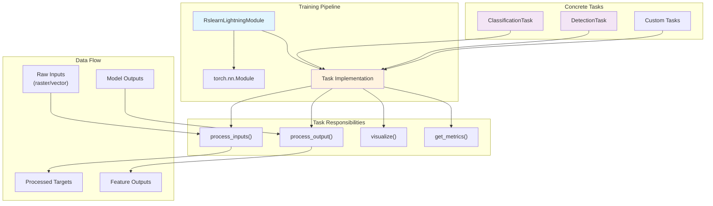
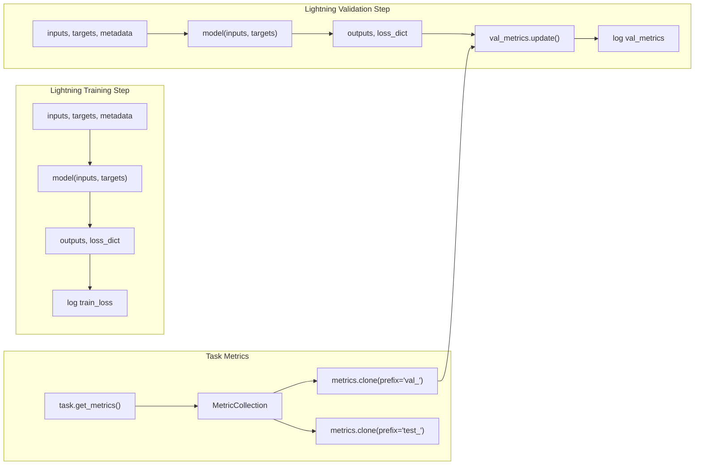
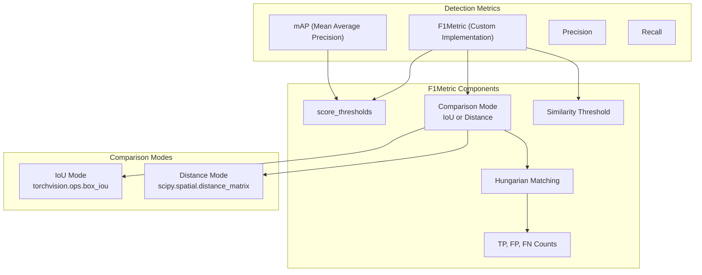
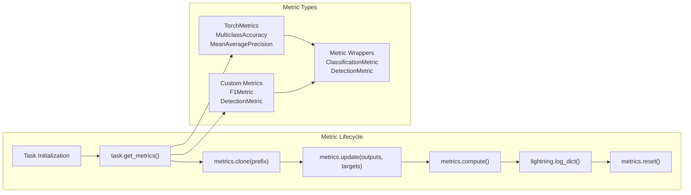

<!-- source: DeepWiki mcp.deepwiki.com · repo allenai/rslearn · page 7.3 Tasks and Metrics · fetched 2026-10-26 -->

# Tasks and Metrics

Relevant source files

The following files were used as context for generating this wiki page:

- [rslearn/models/faster_rcnn.py](rslearn/models/faster_rcnn.py)
- [rslearn/train/lightning_module.py](rslearn/train/lightning_module.py)
- [rslearn/train/tasks/classification.py](rslearn/train/tasks/classification.py)
- [rslearn/train/tasks/detection.py](rslearn/train/tasks/detection.py)
- [tests/unit/train/tasks/test_classification.py](tests/unit/train/tasks/test_classification.py)
- [tests/unit/train/tasks/test_detection.py](tests/unit/train/tasks/test_detection.py)

This document covers the task and metrics system in rslearn, which defines machine learning objectives and their evaluation criteria. Tasks encapsulate the logic for processing inputs/outputs and computing losses, while metrics provide standardized evaluation during training and inference.

For information about the overall training framework and PyTorch Lightning integration, see [Training Framework](#7.1). For details about model architectures that work with these tasks, see [Model Architectures](#7.2).

## Task System Overview

The rslearn task system provides a standardized interface for different machine learning objectives. Each task handles input processing, target preparation, loss computation, output processing, visualization, and metrics definition.

Sources: [rslearn/train/lightning_module.py:74-141](), [rslearn/train/tasks/classification.py:23-79](), [rslearn/train/tasks/detection.py:38-123]()

## Task Integration with Lightning Module

The `RslearnLightningModule` coordinates tasks with the PyTorch Lightning training framework. Tasks are responsible for defining metrics and processing data, while the Lightning module handles the training loop.

Sources: [rslearn/train/lightning_module.py:136-141](), [rslearn/train/lightning_module.py:184-246](), [rslearn/train/lightning_module.py:217-246]()

## Classification Tasks

The `ClassificationTask` handles window-level classification problems where each spatial window receives a single class label.

### Classification Task Configuration

| Parameter | Type | Description |
|-----------|------|-------------|
| `property_name` | `str` | Property name containing class labels |
| `classes` | `list` | List of class names or IDs |
| `filters` | `list[tuple[str, str]]` | Feature property filters |
| `read_class_id` | `bool` | Read integer class IDs instead of names |
| `allow_invalid` | `bool` | Allow windows without labels |
| `skip_unknown_categories` | `bool` | Skip unknown class labels |
| `positive_class` | `str` | Positive class for binary classification |
| `positive_class_threshold` | `float` | Threshold for positive class prediction |

Sources: [rslearn/train/tasks/classification.py:26-79]()

### Classification Data Processing

```mermaid
graph TD
    subgraph "Input Processing"
        RAW_FEATURES["Feature List"]
        FILTER_PROPS["Apply Property Filters"]
        EXTRACT_CLASS["Extract Class Label"]
        CLASS_TENSOR["torch.Tensor class, valid"]
    end
    
    subgraph "Output Processing"
        MODEL_LOGITS["Model Logits"]
        SOFTMAX["torch.nn.functional.softmax()"]
        THRESHOLD["Apply positive_class_threshold"]
        OUTPUT_FEATURE["Feature with class property"]
    end
    
    subgraph "Loss Computation"
        CLASS_HEAD["ClassificationHead"]
        CROSS_ENTROPY["cross_entropy loss"]
        MASK_INVALID["Mask invalid examples"]
    end
    
    RAW_FEATURES --> FILTER_PROPS
    FILTER_PROPS --> EXTRACT_CLASS
    EXTRACT_CLASS --> CLASS_TENSOR
    
    MODEL_LOGITS --> SOFTMAX
    SOFTMAX --> THRESHOLD
    THRESHOLD --> OUTPUT_FEATURE
    
    CLASS_HEAD --> CROSS_ENTROPY
    CROSS_ENTROPY --> MASK_INVALID
```

Sources: [rslearn/train/tasks/classification.py:98-154](), [rslearn/train/tasks/classification.py:156-196](), [rslearn/train/tasks/classification.py:267-301]()

### Classification Metrics

The classification task provides accuracy and optional F1 metrics:

- **Accuracy**: Uses `MulticlassAccuracy` from torchmetrics
- **F1 Score**: Configurable per-class or averaged F1, precision, recall
- **Custom Thresholds**: Support for binary classification with custom decision thresholds

Sources: [rslearn/train/tasks/classification.py:229-264](), [rslearn/train/tasks/classification.py:303-355]()

## Detection Tasks

The `DetectionTask` handles object detection with bounding boxes or point locations. It supports both point geometries (with fixed box sizes) and polygon/rectangle geometries.

### Detection Task Configuration

| Parameter | Type | Description |
|-----------|------|-------------|
| `property_name` | `str` | Property containing class labels |
| `classes` | `list[str]` | Object class names |
| `box_size` | `int` | Fixed box size for point geometries |
| `clip_boxes` | `bool` | Clip boxes to image bounds |
| `exclude_by_center` | `bool` | Exclude boxes by center location |
| `score_threshold` | `float` | Confidence threshold for predictions |
| `enable_map_metric` | `bool` | Enable mAP computation |
| `enable_f1_metric` | `bool` | Enable F1 score computation |
| `f1_metric_thresholds` | `list[list[float]]` | Score thresholds for F1 |

Sources: [rslearn/train/tasks/detection.py:41-123]()

### Detection Data Processing Pipeline

```mermaid
graph TD
    subgraph "Input Processing"
        VECTOR_FEATURES["Vector Features"]
        EXTRACT_GEOMETRY["Extract Geometry"]
        COMPUTE_BOXES["Compute Bounding Boxes"]
        CLIP_FILTER["Clip and Filter Boxes"]
        BOX_TENSORS["boxes, labels tensors"]
    end
    
    subgraph "Box Processing Logic"
        POINT_GEOM["Point Geometry"]
        POLY_GEOM["Polygon Geometry"]  
        FIXED_SIZE["box_size parameter"]
        BOUNDS_EXTRACT["shp.bounds"]
        CENTER_CALC["centroid ± box_size"]
    end
    
    subgraph "Output Processing"
        MODEL_DETECTIONS["Model Detections<br/>boxes, scores, labels"]
        SCORE_FILTER["score > score_threshold"]
        CREATE_FEATURES["Create Feature Objects"]
        OUTPUT_FEATURES["List[Feature]"]
    end
    
    VECTOR_FEATURES --> EXTRACT_GEOMETRY
    EXTRACT_GEOMETRY --> COMPUTE_BOXES
    COMPUTE_BOXES --> CLIP_FILTER
    CLIP_FILTER --> BOX_TENSORS
    
    POINT_GEOM --> CENTER_CALC
    POLY_GEOM --> BOUNDS_EXTRACT
    FIXED_SIZE --> CENTER_CALC
    
    MODEL_DETECTIONS --> SCORE_FILTER
    SCORE_FILTER --> CREATE_FEATURES
    CREATE_FEATURES --> OUTPUT_FEATURES
```

Sources: [rslearn/train/tasks/detection.py:124-244](), [rslearn/train/tasks/detection.py:246-285]()

### Detection Metrics System

The detection task implements specialized metrics for object detection evaluation:

Sources: [rslearn/train/tasks/detection.py:335-376](), [rslearn/train/tasks/detection.py:429-596]()

## Custom F1 Metric for Detection

The detection task includes a sophisticated F1 metric implementation that handles object detection matching:

### Matching Algorithm

1. **Score Filtering**: Filter predictions by confidence threshold
2. **Similarity Computation**: Compute IoU or distance between predicted and ground truth boxes
3. **Hungarian Assignment**: Use `scipy.optimize.linear_sum_assignment` for optimal matching
4. **TP/FP/FN Counting**: Count true positives, false positives, false negatives

### F1Metric Parameters

| Parameter | Type | Description |
|-----------|------|-------------|
| `num_classes` | `int` | Number of object classes |
| `score_thresholds` | `list[float]` | Confidence score thresholds to evaluate |
| `cmp_mode` | `str` | `"iou"` or `"distance"` for box matching |
| `cmp_threshold` | `float` | Minimum IoU or maximum distance for match |
| `flatten_classes` | `bool` | Compute metrics across all classes combined |
| `metric_mode` | `str` | Return `"f1"`, `"precision"`, or `"recall"` |

Sources: [rslearn/train/tasks/detection.py:429-465](), [rslearn/train/tasks/detection.py:485-596]()

## Metrics Integration

All task metrics integrate seamlessly with PyTorch Lightning's logging system:

Sources: [rslearn/train/lightning_module.py:136-141](), [rslearn/train/tasks/classification.py:303-355](), [rslearn/train/tasks/detection.py:379-427]()

## Visualization Support

Tasks provide visualization capabilities for debugging and analysis:

### Classification Visualization
- Overlays predicted and ground truth class labels on input images
- Uses PIL ImageDraw for text rendering

### Detection Visualization  
- Draws bounding boxes with class-specific colors
- Separate visualizations for ground truth (`"gt"`) and predictions (`"pred"`)
- Applies score thresholding for prediction visualization

Sources: [rslearn/train/tasks/classification.py:198-227](), [rslearn/train/tasks/detection.py:287-333]()

## Task Extension

To implement custom tasks, extend the base task interface and implement:

1. `process_inputs()`: Convert raw data to model-compatible format
2. `process_output()`: Convert model outputs to feature representations  
3. `get_metrics()`: Define task-specific metrics
4. `visualize()`: Create debugging visualizations

The task system is designed for extensibility while maintaining consistent integration with the training pipeline.

Sources: [rslearn/train/tasks/task.py]() (referenced but not provided), [rslearn/train/lightning_module.py:118-119]()

---

