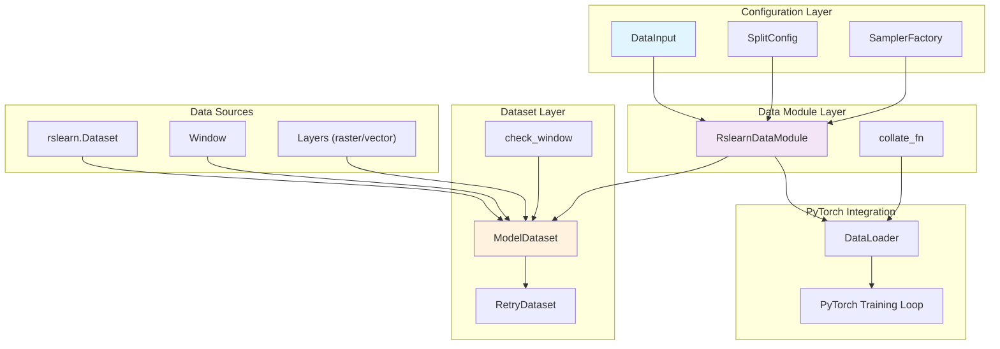
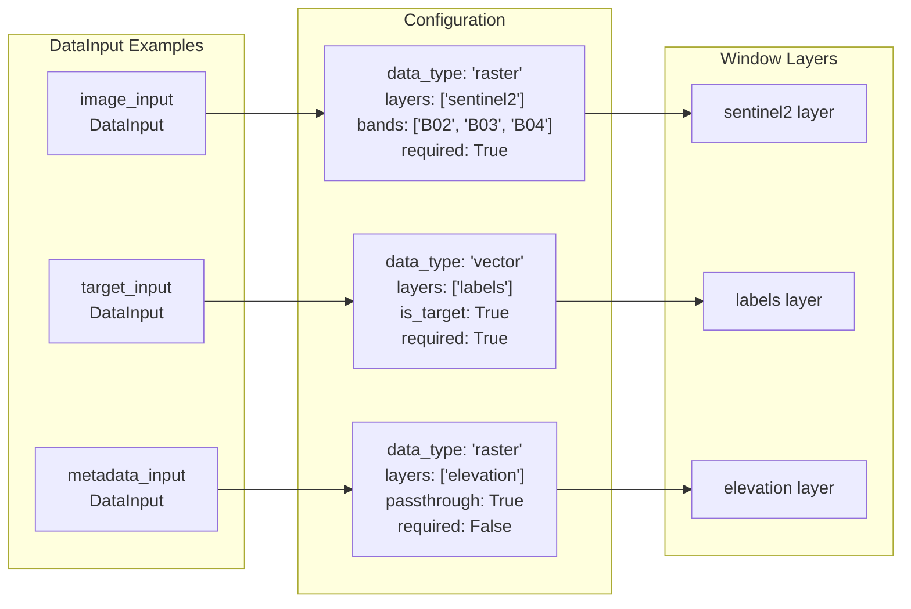
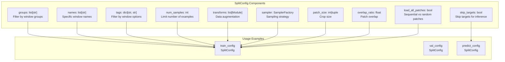
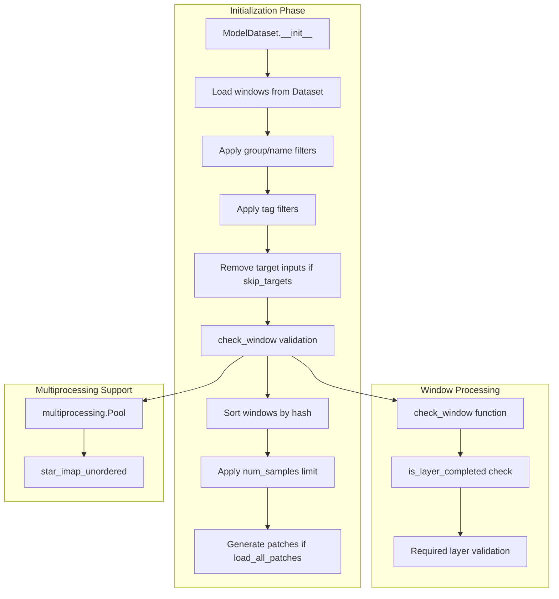
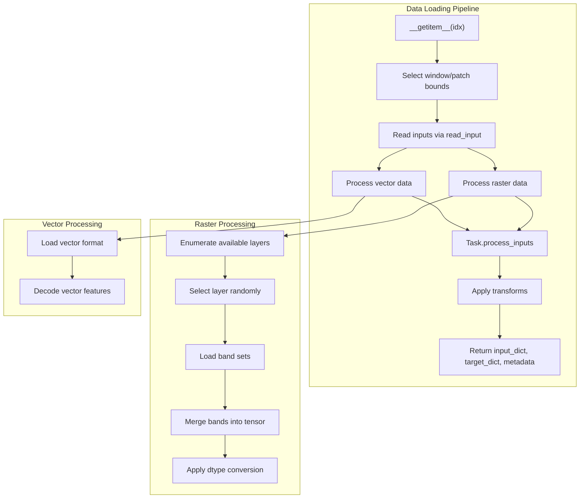
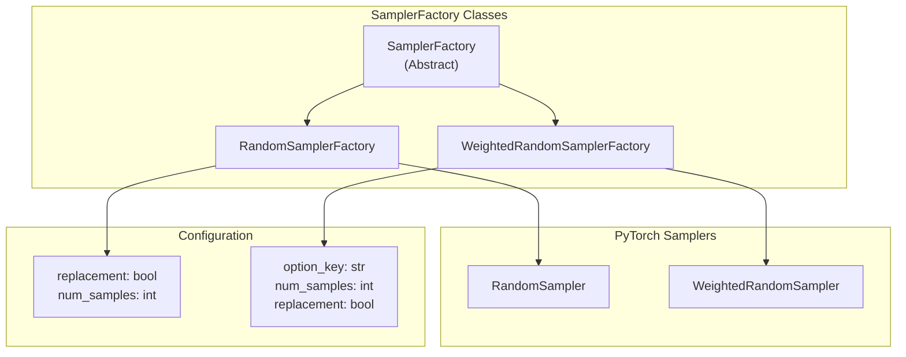
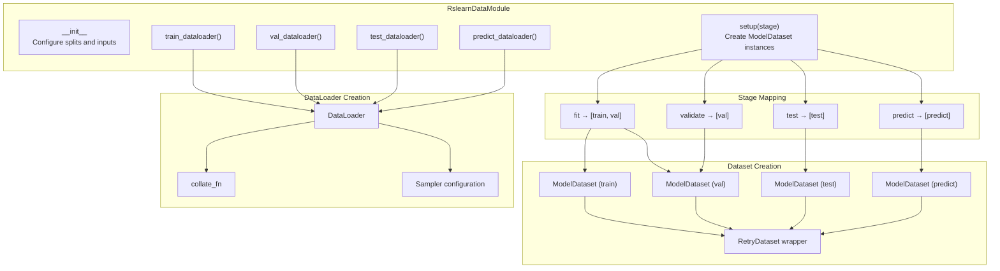
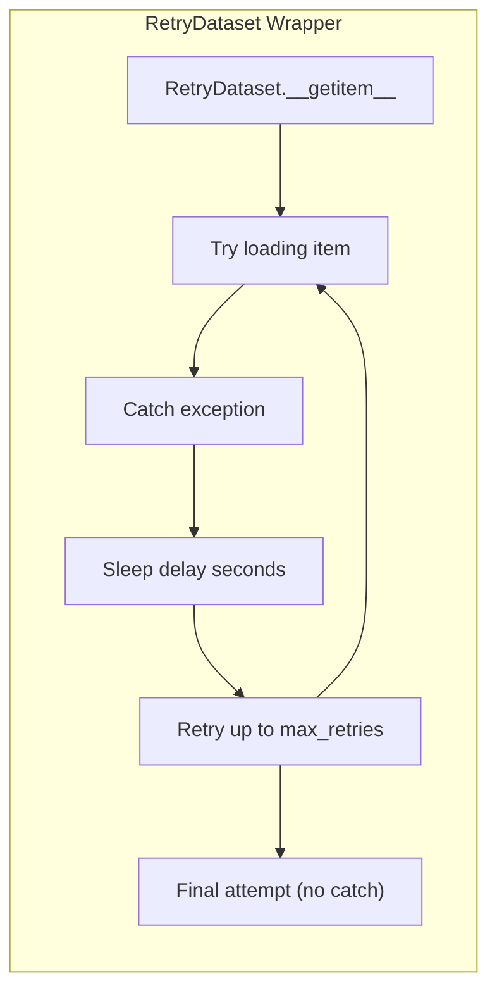

<!-- source: DeepWiki mcp.deepwiki.com · repo allenai/rslearn · page 7.4 Data Loading for Training · fetched 2026-10-26 -->

# Data Loading for Training

<details>
<summary>Relevant source files</summary>

The following files were used as context for generating this wiki page:

- [rslearn/train/callbacks/freeze_unfreeze.py](rslearn/train/callbacks/freeze_unfreeze.py)
- [rslearn/train/data_module.py](rslearn/train/data_module.py)
- [rslearn/train/dataset.py](rslearn/train/dataset.py)
- [rslearn/train/transforms/transform.py](rslearn/train/transforms/transform.py)
- [rslearn/utils/array.py](rslearn/utils/array.py)
- [rslearn/utils/mp.py](rslearn/utils/mp.py)
- [tests/integration/train/test_freeze_unfreeze.py](tests/integration/train/test_freeze_unfreeze.py)
- [tests/integration/train/test_transforms.py](tests/integration/train/test_transforms.py)

</details>


This document covers the data loading system for machine learning training in rslearn. The system provides PyTorch-compatible datasets and data modules that load remote sensing data from rslearn datasets into formats suitable for model training. 

For information about the broader machine learning framework and training orchestration, see [Training Framework](#7.1). For details about data processing and storage systems that prepare data for training, see [Data Processing and Storage](#6).

## Overview

The data loading system consists of several key components that work together to provide efficient, configurable data loading for training:

- `ModelDataset` - PyTorch dataset implementation that reads from rslearn datasets
- `RslearnDataModule` - Lightning DataModule that coordinates data loading across splits
- `DataInput` - Specifications for what data to read from each window
- `SplitConfig` - Configuration for train/validation/test splits
- Sampling factories for different data sampling strategies
- Transform integration for data augmentation

## Core Data Loading Architecture



**Data Loading Architecture**
Sources: [rslearn/train/data_module.py:1-171](), [rslearn/train/dataset.py:1-683]()

## Data Input Specifications

The `DataInput` class defines what data should be loaded from each window for training. It specifies the data type, source layers, and loading configuration.

| Property | Type | Description |
|----------|------|-------------|
| `data_type` | `str` | Either "raster" or "vector" |
| `layers` | `list[str]` | Layer names to read from |
| `bands` | `list[str]` | Bands to read (raster only) |
| `required` | `bool` | Skip windows missing these layers |
| `passthrough` | `bool` | Include in model input even if not used by task |
| `is_target` | `bool` | Whether this represents a training target |
| `dtype` | `DType` | Data type for loading |



**DataInput Configuration Flow**
Sources: [rslearn/train/dataset.py:112-148]()

## Split Configuration System

The `SplitConfig` class allows different configuration for train, validation, and test splits. This enables flexible data loading strategies across different phases of training.

### Core SplitConfig Properties



**SplitConfig Architecture**
Sources: [rslearn/train/dataset.py:150-248]()

### Patch Loading Strategies

The system supports flexible patch loading for handling large images:

- **Random patches**: Sample random crops during training for data augmentation
- **Sequential patches**: Load all possible patches from each window systematically
- **Overlapping patches**: Configure overlap between adjacent patches

Sources: [rslearn/train/dataset.py:402-433]()

## ModelDataset Implementation

The `ModelDataset` class is the core PyTorch dataset that loads data from rslearn datasets. It handles window filtering, data reading, and transform application.

### Dataset Initialization Flow



**ModelDataset Initialization**
Sources: [rslearn/train/dataset.py:285-433](), [rslearn/train/dataset.py:250-279](), [rslearn/utils/mp.py:33-48]()

### Data Loading Process

When `__getitem__` is called, the dataset performs the following operations:



**Data Loading Process**
Sources: [rslearn/train/dataset.py:439-631]()

## Sampling Strategies

The system provides several sampling strategies through the `SamplerFactory` pattern:

### Available Samplers



**Sampling Architecture**
Sources: [rslearn/train/dataset.py:30-109]()

The `WeightedRandomSamplerFactory` reads weights from window options, enabling custom sampling strategies based on data characteristics or training requirements.

## RslearnDataModule Integration

The `RslearnDataModule` coordinates data loading across training phases and integrates with PyTorch Lightning:

### DataModule Architecture



**RslearnDataModule Flow**
Sources: [rslearn/train/data_module.py:32-171]()

### DataLoader Configuration

The data module automatically configures PyTorch DataLoaders with appropriate settings:

- **Batch size and workers**: Configurable parallelization
- **Collation**: Custom `collate_fn` that preserves dict structure
- **Sampling**: Applies split-specific samplers or default shuffling
- **Persistence**: Enables persistent workers when using multiprocessing

Sources: [rslearn/train/data_module.py:107-122](), [rslearn/train/data_module.py:16-29]()

## Error Handling and Reliability

The `RetryDataset` wrapper provides robustness against transient data loading errors:



**Error Handling Flow**
Sources: [rslearn/train/dataset.py:637-683]()

## Transform Integration

The data loading system integrates with the transform system for data augmentation:

- Transforms are configured per split in `SplitConfig`
- Applied after task processing but before returning data
- Supports sequential composition of multiple transforms
- Works with both input and target dictionaries

The `Sequential` transform chains multiple transforms together, while the base `Transform` class provides utilities for working with nested dictionaries.

Sources: [rslearn/train/dataset.py:307-310](), [rslearn/train/dataset.py:626](), [rslearn/train/transforms/transform.py:9-129]()

## Usage Patterns

### Basic Configuration

```python
# Define what data to load
image_input = DataInput("raster", ["sentinel2"], bands=["B02", "B03", "B04"])
target_input = DataInput("vector", ["labels"], is_target=True)

# Configure splits
train_config = SplitConfig(
    groups=["train"],
    transforms=[SomeAugmentation()],
    patch_size=256,
    sampler=RandomSamplerFactory(num_samples=10000)
)

# Create data module
data_module = RslearnDataModule(
    inputs={"image": image_input, "targets": target_input},
    task=MyTask(),
    path="path/to/dataset",
    train_config=train_config
)
```

This configuration pattern is commonly used throughout the codebase for setting up training data loading.

Sources: [tests/integration/train/test_freeze_unfreeze.py:59-69](), [tests/integration/train/test_transforms.py:10-27]()

---

