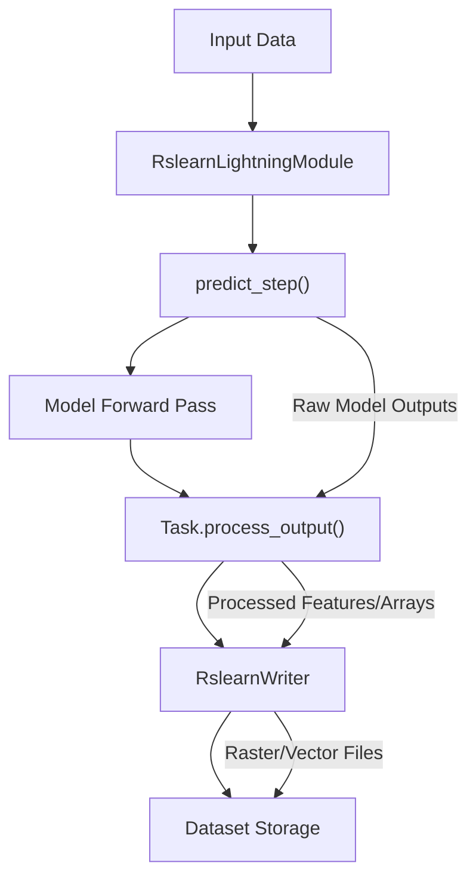
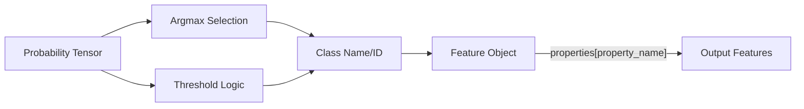
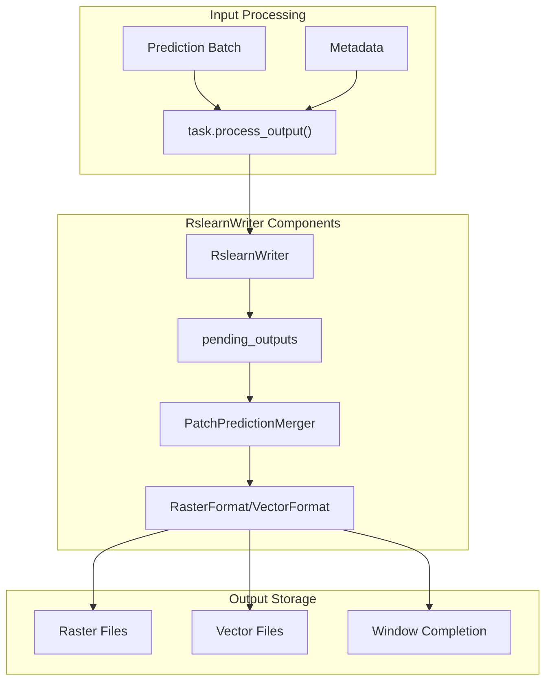
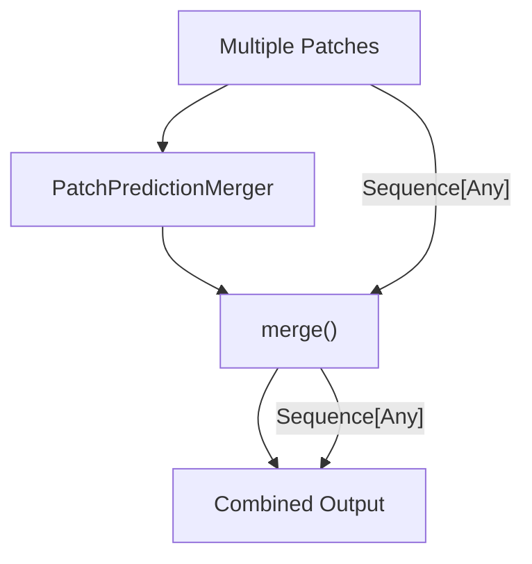
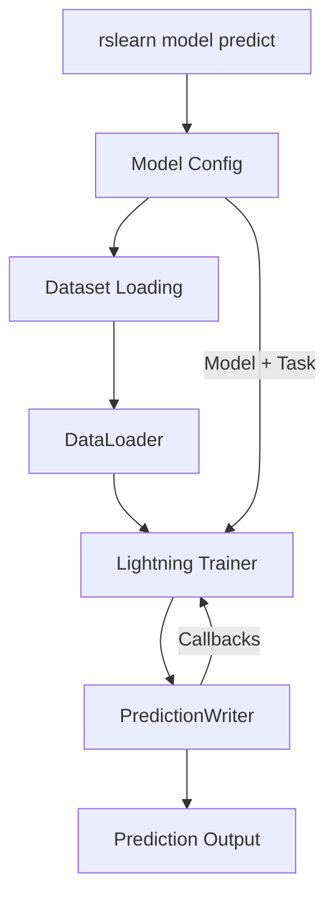

<!-- source: DeepWiki mcp.deepwiki.com · repo allenai/rslearn · page 7.5 Prediction and Inference · fetched 2026-10-26 -->

# Prediction and Inference

<details>
<summary>Relevant source files</summary>

The following files were used as context for generating this wiki page:

- [rslearn/train/lightning_module.py](rslearn/train/lightning_module.py)
- [rslearn/train/prediction_writer.py](rslearn/train/prediction_writer.py)
- [rslearn/train/tasks/classification.py](rslearn/train/tasks/classification.py)
- [tests/fixtures/datasets/image_to_class.py](tests/fixtures/datasets/image_to_class.py)
- [tests/integration/utils/test_s3_dataset.py](tests/integration/utils/test_s3_dataset.py)
- [tests/unit/train/tasks/test_classification.py](tests/unit/train/tasks/test_classification.py)
- [tests/unit/train/test_prediction_writer.py](tests/unit/train/test_prediction_writer.py)

</details>


This document covers the prediction and inference capabilities of the rslearn framework, including how to run inference on trained models, process model outputs, and write predictions back to datasets. This focuses on the post-training phase where models are used to generate predictions on new data.

For information about model training, see [Training Framework](#7.1). For details about model architectures, see [Model Architectures](#7.2). For information about tasks and metrics during training, see [Tasks and Metrics](#7.3).

## Overview

The rslearn prediction and inference system enables users to apply trained models to new data and save the results back to rslearn datasets. The system handles the complete pipeline from raw model outputs to formatted predictions stored in the appropriate raster or vector formats.

## Prediction Pipeline Architecture

The prediction pipeline consists of several key components that work together to transform model outputs into useful predictions:



Sources: [rslearn/train/lightning_module.py:284-299](), [rslearn/train/prediction_writer.py:40-194](), [rslearn/train/tasks/classification.py:156-196]()

## Lightning Module Prediction Step

The `RslearnLightningModule` implements the PyTorch Lightning prediction interface through the `predict_step` method. This method handles the forward pass during inference:

```python
def predict_step(self, batch, batch_idx, dataloader_idx=0):
    inputs, _, _ = batch
    outputs, _ = self(inputs)
    return outputs
```

The method extracts inputs from the batch, runs the forward pass through the model, and returns the raw model outputs. The targets and metadata are ignored during prediction since only the inputs are needed for inference.

Sources: [rslearn/train/lightning_module.py:284-299]()

## Task Output Processing

Tasks are responsible for converting raw model outputs into meaningful predictions through the `process_output` method. This method transforms model outputs (typically tensors) into either raster arrays or vector features depending on the task type.

### Classification Task Output Processing

For classification tasks, the `process_output` method converts probability tensors into class predictions:



The classification task supports both standard argmax selection and custom threshold-based classification for binary tasks. The `positive_class_threshold` parameter allows for non-0.5 decision boundaries.

Sources: [rslearn/train/tasks/classification.py:156-196](), [tests/unit/train/tasks/test_classification.py:8-62]()

## Prediction Writer System

The `RslearnWriter` class handles writing predictions back to rslearn datasets. It supports both raster and vector output formats and can handle predictions that are split across multiple patches.

### Writer Architecture



### Key Writer Features

- **Patch Merging**: The writer accumulates predictions from multiple patches of the same window using the `pending_outputs` dictionary
- **Format Handling**: Automatically selects the correct raster or vector format based on the output layer configuration
- **Spatial Coordination**: Uses `copy_spatial_array` to properly position patch outputs within the full window bounds

Sources: [rslearn/train/prediction_writer.py:40-194](), [tests/unit/train/test_prediction_writer.py:17-93]()

## Prediction Writer Configuration

The `RslearnWriter` requires several configuration parameters:

| Parameter | Description | Type |
|-----------|-------------|------|
| `path` | Dataset root directory | `str` |
| `output_layer` | Layer name for predictions | `str` |
| `path_options` | fsspec options for path access | `dict` |
| `selector` | Keys to access nested outputs | `list[str]` |
| `merger` | Patch merging strategy | `PatchPredictionMerger` |

The writer automatically detects the output layer type (raster or vector) from the dataset configuration and initializes the appropriate format handler.

Sources: [rslearn/train/prediction_writer.py:47-84]()

## Patch Prediction Merging

For windows that are processed in multiple patches, the `PatchPredictionMerger` base class provides an interface for combining overlapping predictions:



The base class defines the interface but specific merging strategies must be implemented by subclasses. Common strategies might include averaging, maximum voting, or weighted combinations.

Sources: [rslearn/train/prediction_writer.py:25-37]()

## CLI Prediction Workflow

The rslearn CLI provides a `predict` command that orchestrates the entire prediction pipeline:



The CLI command handles:
- Loading the trained model and configuration
- Setting up the dataset and data loader
- Configuring the Lightning trainer with prediction writer callbacks
- Running the prediction loop
- Saving outputs to the specified dataset layer

Sources: [rslearn/train/prediction_writer.py:40-194]()

## Advanced Prediction Features

### Metadata Handling

The prediction system preserves important metadata throughout the pipeline:

- **Window Information**: `window_name`, `window_bounds`, `group`
- **Spatial Coordinates**: `bounds`, `projection`
- **Patch Coordination**: `patch_idx`, `num_patches`

This metadata enables proper spatial positioning and patch coordination during output writing.

### Output Validation

The writer performs validation to ensure outputs match expected formats:
- Raster outputs must be numpy arrays with correct spatial dimensions
- Vector outputs must be lists of Feature objects
- Layer configurations must match the specified output layer type

Sources: [rslearn/train/prediction_writer.py:128-162]()

## Error Handling and Edge Cases

The prediction system handles several edge cases:

- **Missing Targets**: During prediction, target data is ignored and can be None
- **Invalid Outputs**: Tasks can mark examples as invalid if no valid prediction can be made
- **Patch Boundaries**: The writer handles cases where patch outputs extend beyond window boundaries
- **Format Mismatches**: Validation ensures outputs match the expected raster or vector format

Sources: [rslearn/train/lightning_module.py:284-299](), [rslearn/train/prediction_writer.py:128-162]()

---

