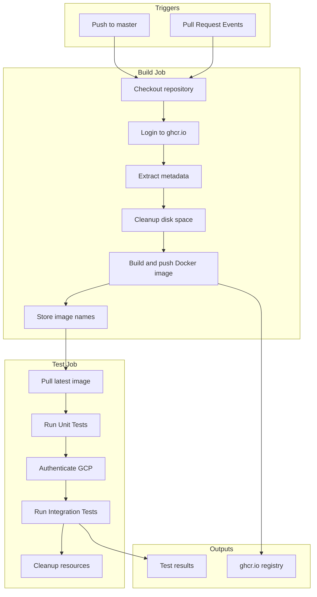
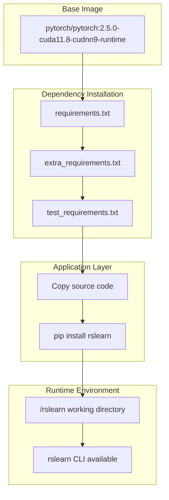
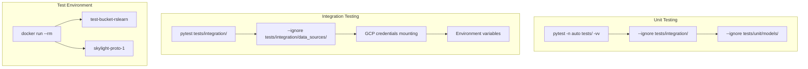
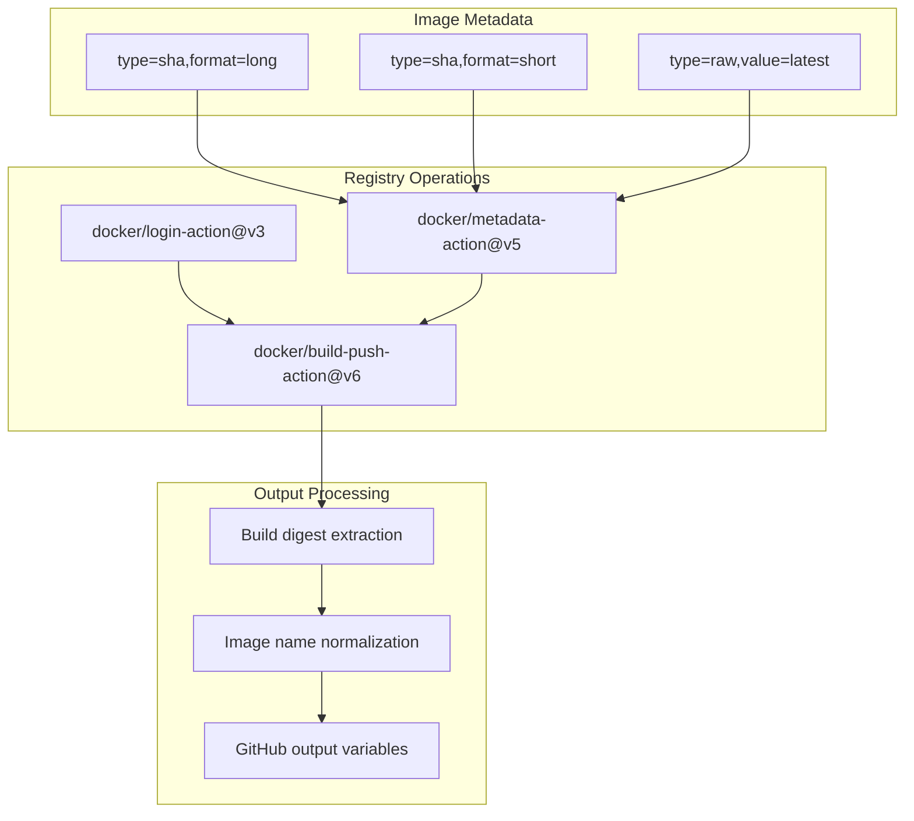
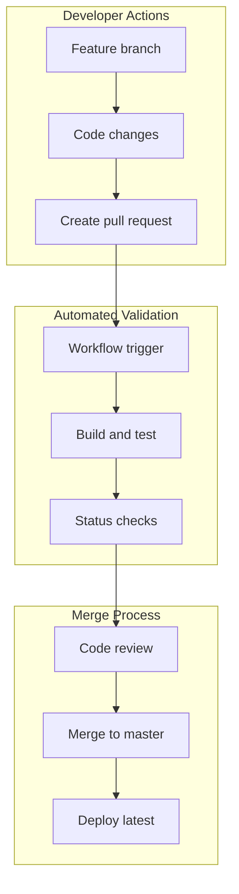

<!-- source: DeepWiki mcp.deepwiki.com · repo allenai/rslearn · page 8 Development and Deployment · fetched 2026-10-26 -->

# Development and Deployment

Relevant source files

The following files were used as context for generating this wiki page:

- [.github/workflows/build-test.yml](.github/workflows/build-test.yml)
- [Dockerfile](Dockerfile)

This document covers the development workflow, continuous integration/continuous deployment (CI/CD) pipelines, containerization, testing infrastructure, and deployment procedures for the rslearn framework. It provides technical details on how code changes are built, tested, and deployed through automated GitHub Actions workflows and Docker-based infrastructure.

For information about the core ML training and inference workflows, see [Machine Learning Framework](#7). For dataset preparation and management procedures, see [Dataset Management](#5).

## CI/CD Pipeline Architecture

The rslearn project uses GitHub Actions for automated building, testing, and deployment. The primary workflow handles Docker image creation, comprehensive testing, and container registry publishing.

### GitHub Actions Workflow Structure

**Sources:** [.github/workflows/build-test.yml:1-131]()

### Pipeline Configuration Details

The CI/CD pipeline operates with the following key configurations:

| Component | Configuration | Purpose |
|-----------|---------------|---------|
| Registry | `ghcr.io` | GitHub Container Registry for Docker images |
| Concurrency | `${{ github.workflow }}-${{ github.ref }}` | Prevents parallel runs on same branch |
| Image Tags | SHA-based + latest | Immutable versioning with convenient latest tag |
| Test Environment | `test-bucket-rslearn` | Isolated GCS bucket for integration tests |

The workflow implements automatic cleanup procedures including Docker image pruning and disk space management to optimize runner performance.

**Sources:** [.github/workflows/build-test.yml:10-16](), [.github/workflows/build-test.yml:48-55]()

## Docker Infrastructure

The rslearn framework uses a multi-stage Docker setup based on PyTorch CUDA runtime for GPU-accelerated machine learning workloads.

### Container Architecture

**Sources:** [Dockerfile:1-20]()

### Docker Build Process

The containerization follows a layered approach to optimize build caching:

1. **Base Layer**: PyTorch 2.5.0 with CUDA 11.8 and cuDNN 9 runtime
2. **Dependencies**: Sequential installation of `requirements.txt`, `extra_requirements.txt`, and `test_requirements.txt`
3. **Application**: Source code copy and package installation
4. **Configuration**: Working directory setup at `/rslearn`

The `--no-cache-dir` flag is used consistently to minimize image size by preventing pip cache accumulation.

**Sources:** [Dockerfile:10-19]()

## Testing Framework

The testing infrastructure implements a two-tier approach with unit tests and integration tests running in containerized environments.

### Test Execution Pipeline

**Sources:** [.github/workflows/build-test.yml:102-109](), [.github/workflows/build-test.yml:115-124]()

### Test Configuration

The testing framework uses the following key configurations:

| Test Type | Command | Exclusions | Environment |
|-----------|---------|------------|-------------|
| Unit | `pytest -n auto` | `tests/integration/`, `tests/unit/models/` | Container only |
| Integration | `pytest tests/integration/` | `tests/integration/data_sources/` | GCP credentials, test bucket |

Integration tests require Google Cloud Platform authentication through mounted service account credentials and access to the `test-bucket-rslearn` GCS bucket.

**Sources:** [.github/workflows/build-test.yml:97-101](), [.github/workflows/build-test.yml:110-113]()

## Deployment Process

The deployment process centers on automated Docker image publishing to GitHub Container Registry with tag-based versioning.

### Image Publishing Workflow

**Sources:** [.github/workflows/build-test.yml:37-47](), [.github/workflows/build-test.yml:56-63]()

### Registry Configuration

The deployment uses GitHub Container Registry (`ghcr.io`) with the following naming convention:

- **Registry**: `ghcr.io/${{ github.repository }}`
- **Authentication**: GitHub token-based
- **Permissions**: Contents read, packages write
- **Tags**: SHA-based (long/short) plus latest for default branch

Image names are normalized to lowercase to comply with Docker registry requirements, and the full image digest is captured for downstream job dependencies.

**Sources:** [.github/workflows/build-test.yml:70-77]()

## Development Workflow

The development workflow integrates code changes through automated validation and containerized testing before deployment.

### Branch Protection and Testing

**Sources:** [.github/workflows/build-test.yml:3-8]()

### Environment Management

The development workflow maintains separate environments for different stages:

| Environment | Trigger | Purpose | Resources |
|-------------|---------|---------|-----------|
| Development | Pull request | Validation testing | Ephemeral containers |
| Production | Master branch | Latest deployment | `ghcr.io` registry |
| Testing | Both | Integration validation | GCS test bucket |

The workflow includes automatic cleanup procedures to prevent resource accumulation and manages concurrent execution through GitHub's concurrency controls.

**Sources:** [.github/workflows/build-test.yml:14-16](), [.github/workflows/build-test.yml:126-131]()