# Page: Overview

# Overview

<details>
<summary>Relevant source files</summary>

The following files were used as context for generating this wiki page:

- [README.md](README.md)
- [extra_requirements.txt](extra_requirements.txt)
- [pyproject.toml](pyproject.toml)
- [requirements.txt](requirements.txt)
- [rslearn/py.typed](rslearn/py.typed)

</details>


## Purpose and Scope

This document provides a high-level technical overview of the rslearn framework, a comprehensive library and command-line tool for developing remote sensing datasets and machine learning models. rslearn facilitates the entire pipeline from raw satellite data ingestion to model training and inference for remote sensing applications.

The framework addresses five core capabilities: defining spatiotemporal windows for training data, importing raster and vector data from diverse sources, annotating vector data through integrated labeling applications, fine-tuning remote sensing foundation models, and applying trained models to new geographic locations and time periods.

For specific implementation details of individual subsystems, see [Data Sources](#4), [Dataset Management](#5), [Machine Learning Framework](#7), and [Development and Deployment](#8).

## System Architecture

The rslearn framework consists of four primary subsystems that work together to provide an end-to-end remote sensing machine learning platform:

#### High-Level System Architecture

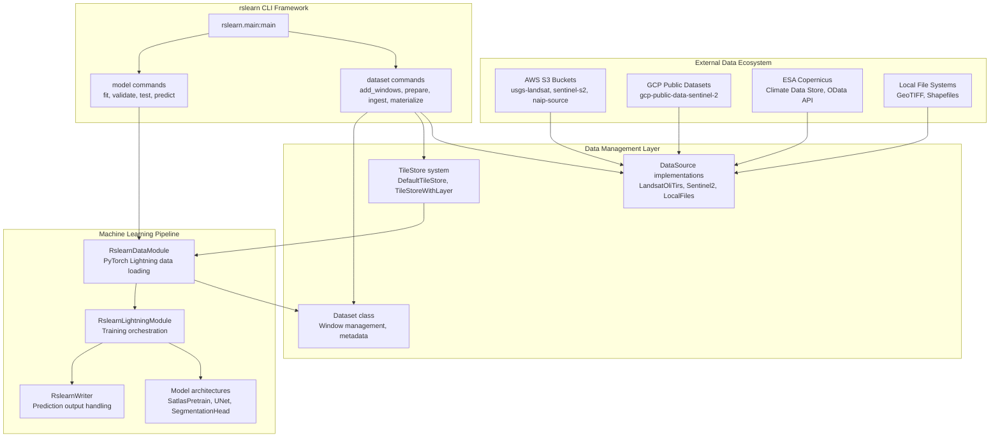

Sources: [pyproject.toml:22-23](), [README.md:1-16](), [extra_requirements.txt:1-22](), [requirements.txt:1-15]()

## Core Workflow and CLI Commands

The rslearn framework operates through a command-line interface that orchestrates data ingestion and model training workflows. The following diagram illustrates the primary CLI commands and their corresponding code execution paths:

#### CLI Command Flow and Code Mapping

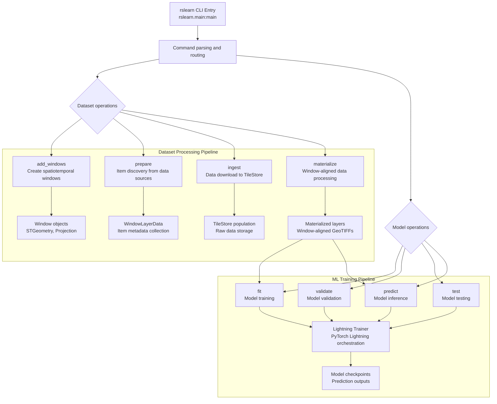

Sources: [pyproject.toml:22-23](), [README.md:102-120](), [README.md:320-324]()

## Primary Framework Components

### Data Source Abstraction Layer

rslearn implements a plugin-based data source system that provides uniform access to diverse remote sensing data repositories. The framework supports AWS S3 buckets for Landsat and Sentinel-2 data, Google Cloud Platform public datasets, European Space Agency services, and local file systems.

| Data Source Type | Implementation Class | Primary Use Case |
|------------------|---------------------|------------------|
| AWS Landsat | `LandsatOliTirs` | Landsat 8/9 OLI-TIRS imagery |
| AWS Sentinel-2 | `Sentinel2` | Sentinel-2 L1C/L2A from AWS |
| GCP Sentinel-2 | `Sentinel2` | Sentinel-2 from Google Cloud |
| Climate Data | `ERA5LandMonthlyMeans` | ERA5 climate variables |
| ESA Services | Copernicus implementations | European satellite missions |
| Local Files | `LocalFiles` | Local GeoTIFF and vector files |
| Web Tiles | `XyzTiles` | Mapbox and other tile services |

Sources: [README.md:38-57](), [extra_requirements.txt:3-4](), [extra_requirements.txt:6-8]()

### Dataset Management System

The dataset management subsystem handles spatiotemporal window definitions, metadata storage, and data materialization workflows. Windows represent training examples with specific geographic bounds, temporal ranges, and projection parameters.

#### Dataset Processing Workflow

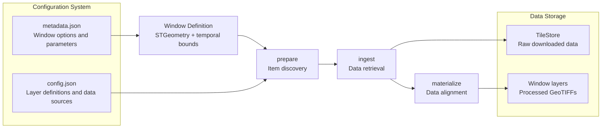

Sources: [README.md:98-120](), [README.md:67-89]()

### Machine Learning Framework Integration

rslearn integrates with PyTorch Lightning to provide a standardized training and inference pipeline for remote sensing models. The framework supports various model architectures including foundation models, time series processors, and task-specific heads.

#### ML Pipeline Architecture

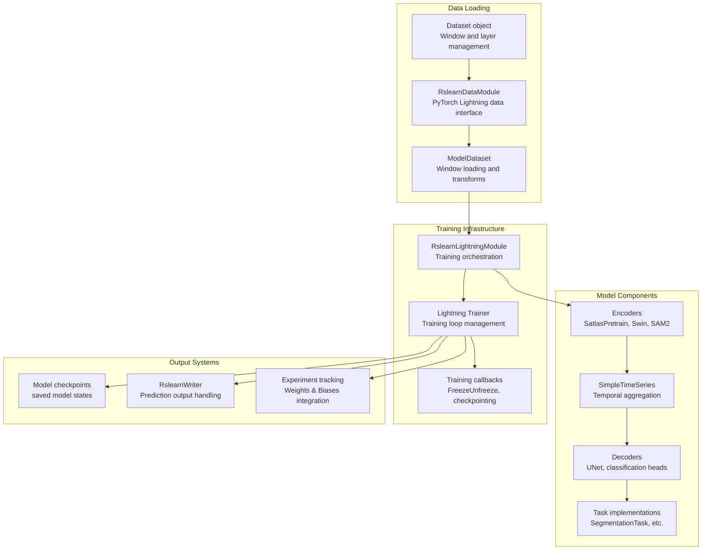

Sources: [README.md:214-324](), [extra_requirements.txt:18](), [extra_requirements.txt:21](), [requirements.txt:5]()

## Data Flow and Processing Pipeline

The rslearn framework implements a three-stage data processing pipeline that transforms raw remote sensing data into training-ready formats:

1. **Preparation Stage**: Discovers available data items from configured data sources that intersect with defined spatiotemporal windows
2. **Ingestion Stage**: Downloads raw data to the local TileStore, maintaining original formats and projections
3. **Materialization Stage**: Processes raw data into window-aligned GeoTIFF files with consistent projections and spatial bounds

This pipeline ensures that heterogeneous remote sensing data from multiple sources can be consistently accessed during model training and inference operations.

Sources: [README.md:112-120](), [README.md:200-205]()

## Framework Dependencies and Requirements

rslearn requires Python 3.10 or higher and integrates with several key dependencies for remote sensing and machine learning functionality:

- **Core ML**: PyTorch Lightning for training orchestration, torchvision for computer vision operations
- **Geospatial**: rasterio and fiona for raster/vector data handling, pyproj for coordinate system transformations
- **Cloud Storage**: boto3 for AWS S3 access, gcsfs for Google Cloud Storage
- **Remote Sensing**: earthengine-api for Google Earth Engine, satlaspretrain_models for foundation models
- **Optional**: wandb for experiment tracking, transformers for additional model architectures

Sources: [requirements.txt:1-15](), [extra_requirements.txt:1-22](), [pyproject.toml:14]()

---

# Page: Getting Started

# Getting Started

<details>
<summary>Relevant source files</summary>

The following files were used as context for generating this wiki page:

- [extra_requirements.txt](extra_requirements.txt)
- [requirements.txt](requirements.txt)
- [rslearn/dataset/manage.py](rslearn/dataset/manage.py)
- [rslearn/main.py](rslearn/main.py)

</details>


This document provides installation instructions and basic usage patterns for the rslearn framework. It covers the essential workflow from data ingestion through model training, focusing on CLI operations and core system components. For detailed information about specific data sources, see [Data Sources](#4). For comprehensive dataset management operations, see [Dataset Management](#5). For machine learning training details, see [Machine Learning Framework](#7).

## Installation

### Core Dependencies

rslearn requires Python dependencies specified in two files:

**Core Requirements** ([requirements.txt:1-15]()):
- `lightning[pytorch-extra]>=2.5.0.post0` - PyTorch Lightning framework
- `rasterio>=1.4` - Geospatial raster data I/O
- `fiona>=1.10` - Vector data I/O  
- `fsspec==2025.2.0` - Filesystem abstraction
- `boto3>=1.35` - AWS SDK for S3 access
- `universal_pathlib>=0.2.5` - Path handling across filesystems

**Extended Requirements** ([extra_requirements.txt:1-22]()):
- `earthengine-api>=0.1` - Google Earth Engine access
- `cdsapi>=0.7.4` - Copernicus Climate Data Store
- `satlaspretrain_models>=0.3` - Pre-trained satellite models
- `wandb>=0.17` - Experiment tracking
- `transformers>=4.45` - Transformer model architectures

Install using:
```bash
pip install -r requirements.txt
pip install -r extra_requirements.txt  # For additional data sources and models
```

Sources: [requirements.txt:1-15](), [extra_requirements.txt:1-22]()

## CLI Architecture

The rslearn command-line interface follows a hierarchical structure with two main categories:

### CLI Command Structure

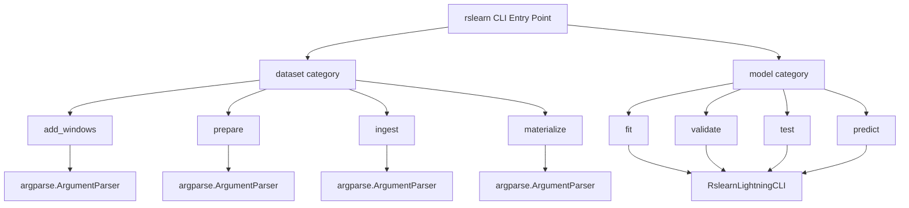

The CLI entry point ([rslearn/main.py:812-842]()) parses the category and command, then dispatches to registered handlers via `handler_registry` ([rslearn/main.py:34]()).

Sources: [rslearn/main.py:812-842](), [rslearn/main.py:34](), [rslearn/main.py:41-48]()

## Core Workflow

### Dataset Processing Pipeline

The rslearn framework follows a linear pipeline for processing remote sensing data:

```mermaid
graph LR
    WINDOWS["Dataset Windows<br/>(spatial extents)"] --> PREPARE["prepare command<br/>PrepareHandler"]
    PREPARE --> ITEMS["Item Discovery<br/>WindowLayerData"]
    ITEMS --> INGEST["ingest command<br/>IngestHandler"] 
    INGEST --> TILES["TileStore Population<br/>(raw data tiles)"]
    TILES --> MATERIALIZE["materialize command<br/>MaterializeHandler"]
    MATERIALIZE --> READY["Training-Ready Data<br/>(window directories)"]
    READY --> TRAINING["model fit<br/>RslearnLightningCLI"]
```

Each stage corresponds to specific CLI commands and handler classes:

| Stage | CLI Command | Handler Class | Purpose |
|-------|-------------|---------------|---------|
| Window Creation | `rslearn dataset add_windows` | `add_windows()` | Define spatial/temporal extents |
| Item Discovery | `rslearn dataset prepare` | `PrepareHandler` | Find data source items for windows |
| Data Download | `rslearn dataset ingest` | `IngestHandler` | Download raw data to tile store |
| Window Extraction | `rslearn dataset materialize` | `MaterializeHandler` | Extract window data for training |
| Model Training | `rslearn model fit` | `RslearnLightningCLI` | Train ML models |

Sources: [rslearn/main.py:76-233](), [rslearn/main.py:375-417](), [rslearn/main.py:469-610](), [rslearn/main.py:655-695](), [rslearn/main.py:776-785]()

### Basic Dataset Setup

**1. Create Dataset Windows**

Define spatial and temporal extents for your dataset:

```bash
rslearn dataset add_windows \
  --root /path/to/dataset \
  --group train \
  --box "-122.5,37.7,-122.3,37.9" \
  --crs "EPSG:4326" \
  --resolution 10 \
  --start "2023-01-01" \
  --end "2023-12-31"
```

Key parameters from `add_windows()` ([rslearn/main.py:76-233]()):
- `--root`: Dataset directory path
- `--group`: Window group name (e.g., train, val, test)  
- `--box`: Bounding box coordinates (x1,y1,x2,y2)
- `--crs`: Coordinate reference system
- `--resolution`: Pixel resolution in CRS units

**2. Prepare Windows**

Discover available data source items for each window:

```bash
rslearn dataset prepare \
  --root /path/to/dataset \
  --group train \
  --workers 4
```

The `PrepareHandler` ([rslearn/main.py:375-417]()) calls `prepare_dataset_windows()` ([rslearn/dataset/manage.py:53-133]()) to query data sources and save `WindowLayerData` objects.

**3. Ingest Data**

Download raw data to the tile store:

```bash
rslearn dataset ingest \
  --root /path/to/dataset \
  --group train \
  --workers 8 \
  --batch-size 10
```

The `IngestHandler` ([rslearn/main.py:469-610]()) groups ingest jobs by data source items to avoid duplicate downloads.

**4. Materialize Windows**

Extract window-specific data for training:

```bash
rslearn dataset materialize \
  --root /path/to/dataset \
  --group train \
  --workers 4
```

The `MaterializeHandler` ([rslearn/main.py:655-695]()) calls `materialize_dataset_windows()` ([rslearn/dataset/manage.py:335-372]()) to extract training-ready data from the tile store.

Sources: [rslearn/main.py:76-233](), [rslearn/main.py:375-417](), [rslearn/main.py:469-610](), [rslearn/main.py:655-695](), [rslearn/dataset/manage.py:53-133](), [rslearn/dataset/manage.py:335-372]()

## Model Training Workflow

### Training Commands

rslearn uses PyTorch Lightning through `RslearnLightningCLI` ([rslearn/main.py:742-785]()):

**Train a Model**

```bash
rslearn model fit \
  --data.path /path/to/dataset \
  --data.task classification \
  --model.task classification \
  --trainer.max_epochs 100
```

**Validate Model Performance**

```bash
rslearn model validate \
  --data.path /path/to/dataset \
  --model.ckpt_path /path/to/checkpoint.ckpt
```

**Generate Predictions**

```bash
rslearn model predict \
  --data.path /path/to/dataset \
  --model.ckpt_path /path/to/checkpoint.ckpt
```

### Lightning Integration

The `RslearnLightningCLI` class ([rslearn/main.py:742-754]()) extends PyTorch Lightning's CLI with:
- Automatic linking of `data.task` to `model.task` parameters
- Integration with `RslearnDataModule` and `RslearnLightningModule` 
- Support for `RslearnPredictionWriter` callbacks

All model commands (`fit`, `validate`, `test`, `predict`) route through `model_handler()` ([rslearn/main.py:776-785]()).

Sources: [rslearn/main.py:742-785](), [rslearn/main.py:776-785](), [rslearn/main.py:788-809]()

## Parallel Processing

### Worker Configuration

rslearn supports parallel processing through several worker parameters:

| Parameter | Purpose | Default |
|-----------|---------|---------|
| `--workers` | Main processing workers | 0 (single-threaded) |
| `--load-workers` | Window loading workers | Same as `--workers` |
| `--batch-size` | Windows per batch | 1 |
| `--jobs-per-process` | Jobs before process restart | None |

The `apply_on_windows()` function ([rslearn/main.py:283-357]()) handles multiprocessing coordination using the `forkserver` context ([rslearn/main.py:38]()).

### Multiprocessing Context

The framework sets the multiprocessing start method to `forkserver` ([rslearn/main.py:814-815]()) for better reliability with complex dependencies.

Sources: [rslearn/main.py:236-281](), [rslearn/main.py:283-357](), [rslearn/main.py:814-825]()

## Error Handling and Retry Logic

### Retry Configuration

Commands support retry logic through `retry()` ([rslearn/dataset/manage.py:26-50]()):

```bash
rslearn dataset prepare \
  --retry-max-attempts 3 \
  --retry-backoff-seconds 60
```

The retry mechanism implements exponential backoff with jitter to handle transient failures in data source access.

### Error Tolerance

Use `--ignore-errors` to continue processing despite individual job failures:

```bash
rslearn dataset ingest \
  --ignore-errors \
  --workers 8
```

Sources: [rslearn/dataset/manage.py:26-50](), [rslearn/main.py:434-449](), [rslearn/main.py:625-642]()

## Next Steps

After completing basic setup:

1. **Configure Data Sources**: See [Data Sources](#4) for specific provider setup (AWS, GCP, ESA, etc.)
2. **Customize Datasets**: See [Dataset Management](#5) for advanced window creation and layer configuration  
3. **Train Models**: See [Machine Learning Framework](#7) for model architectures and training strategies
4. **Deploy Models**: See [Development and Deployment](#8) for containerization and CI/CD

The framework provides extensive logging through `get_logger()` to monitor progress and debug issues throughout the pipeline.

Sources: [rslearn/log_utils.py](), [rslearn/main.py:26]()

---

# Page: Core Concepts

# Core Concepts

<details>
<summary>Relevant source files</summary>

The following files were used as context for generating this wiki page:

- [rslearn/config/__init__.py](rslearn/config/__init__.py)
- [rslearn/config/dataset.py](rslearn/config/dataset.py)
- [rslearn/dataset/dataset.py](rslearn/dataset/dataset.py)
- [rslearn/tile_stores/__init__.py](rslearn/tile_stores/__init__.py)
- [rslearn/tile_stores/tile_store.py](rslearn/tile_stores/tile_store.py)
- [rslearn/utils/geometry.py](rslearn/utils/geometry.py)
- [rslearn/utils/jsonargparse.py](rslearn/utils/jsonargparse.py)

</details>


This page covers the fundamental building blocks of the rslearn framework: datasets, spatiotemporal geometry, configuration system, and data storage abstractions. These concepts form the foundation for data ingestion, processing, and machine learning workflows. For information about specific data sources and their implementations, see [Data Sources](#4). For machine learning training concepts and model architectures, see [Machine Learning Framework](#7).

## Datasets

A `Dataset` is the primary organizational unit in rslearn, representing a collection of spatiotemporal windows with associated data layers. Datasets are stored as directory structures containing configuration files, windows, and processed data.

### Dataset Structure

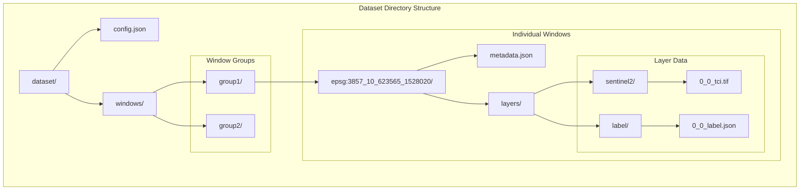

The `Dataset` class loads configuration from `config.json` and provides methods to load windows, manage layers, and access tile stores. Each dataset contains multiple window groups, where each group contains spatiotemporal windows identified by their projection and pixel bounds.

Sources: [rslearn/dataset/dataset.py:18-125]()

### Windows

Windows represent spatiotemporal regions of interest defined by their projection, pixel bounds, and time range. They serve as the fundamental unit for data retrieval and materialization in rslearn.

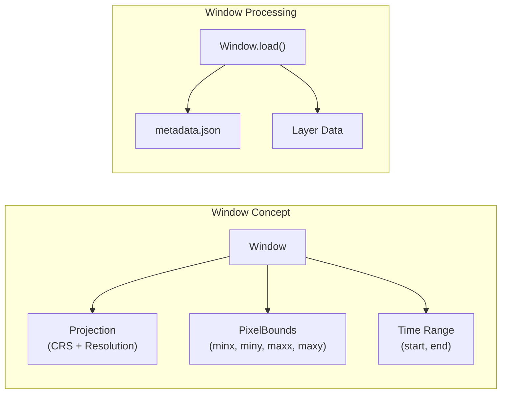

Sources: [rslearn/dataset/dataset.py:69-116]()

## Spatiotemporal Geometry

The framework provides robust handling of spatial coordinate systems and temporal ranges through the `Projection` and `STGeometry` classes.

### Projection System

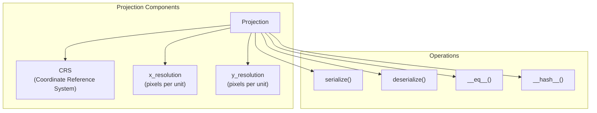

The `Projection` class combines a coordinate reference system (CRS) with x and y resolutions to define how pixel coordinates map to real-world coordinates. It supports serialization for configuration storage and provides comparison operations.

Sources: [rslearn/utils/geometry.py:45-113]()

### Spatiotemporal Geometry

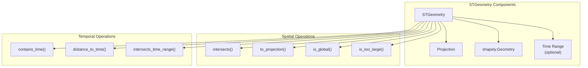

`STGeometry` combines spatial geometry (using Shapely) with temporal information and projection details. It supports spatial intersection testing, coordinate system transformations, and temporal range operations essential for matching windows with data items.

Sources: [rslearn/utils/geometry.py:116-314]()

## Configuration System

The configuration system provides structured, serializable definitions for all dataset components through a hierarchy of configuration classes.

### Configuration Class Hierarchy

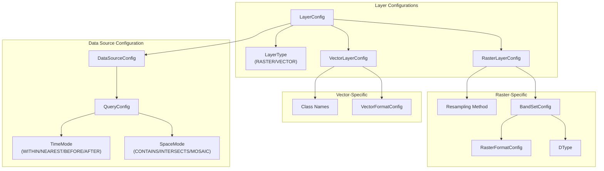

The configuration system uses composition to build complex dataset specifications from simple, reusable components. Each configuration class supports serialization to/from JSON for storage in `config.json` files.

Sources: [rslearn/config/dataset.py:1-532]()

### Query Configuration

Query configurations define how spatiotemporal windows are matched with data items from data sources:

| SpaceMode | Description |
|-----------|-------------|
| `CONTAINS` | Items must contain the entire window |
| `INTERSECTS` | Items must overlap any portion of the window |
| `MOSAIC` | Groups of items are computed to cover the entire window |

| TimeMode | Description |
|----------|-------------|
| `WITHIN` | Items must be within the window time range |
| `NEAREST` | Select items closest to the window time range |
| `BEFORE` | Select items before the end of the window time range |
| `AFTER` | Select items after the start of the window time range |

Sources: [rslearn/config/dataset.py:226-302]()

### Band Set Configuration

Raster layers use `BandSetConfig` to specify how bands are grouped, stored, and processed:

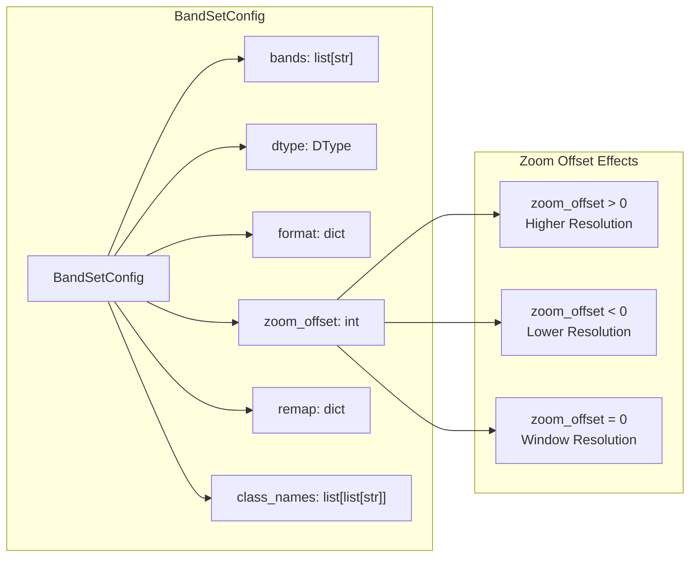

The `zoom_offset` parameter enables storing data at different resolutions than the window resolution, allowing optimization for storage space or detail preservation.

Sources: [rslearn/config/dataset.py:116-224]()

## Data Storage Abstraction

The `TileStore` system provides an abstraction layer for reading and writing raster and vector data during ingestion and materialization phases.

### TileStore Architecture

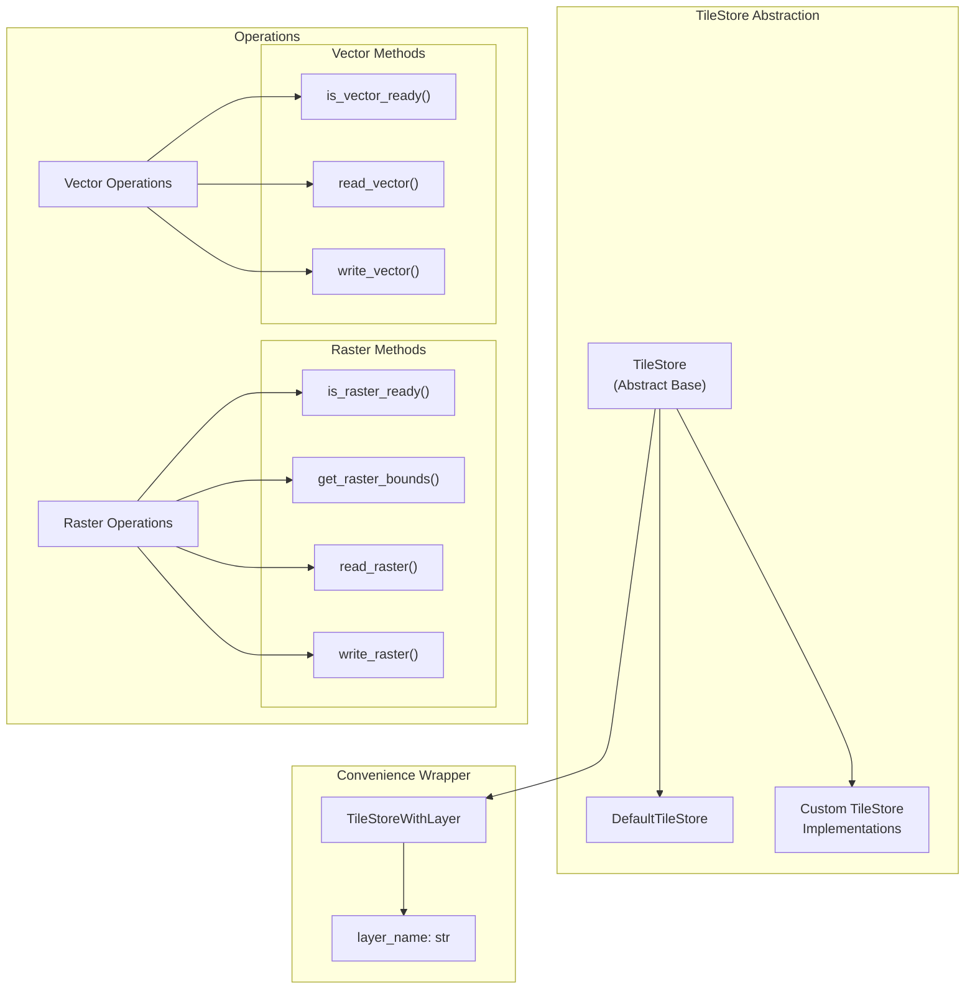

The `TileStoreWithLayer` wrapper provides layer-specific access to tile store operations, automatically passing the layer name to the underlying `TileStore` methods.

Sources: [rslearn/tile_stores/tile_store.py:12-329](), [rslearn/tile_stores/__init__.py:15-62]()

## Data Type System

The framework provides a unified data type system for handling different numeric formats across NumPy and PyTorch:

| DType | NumPy | PyTorch | Common Use |
|-------|-------|---------|------------|
| `UINT8` | `np.uint8` | - | RGB imagery, categorical data |
| `UINT16` | `np.uint16` | - | High-precision imagery |
| `FLOAT32` | `np.float32` | `torch.float32` | Continuous values, ML training |
| `INT32` | `np.int32` | `torch.int32` | Integer labels, indices |

The `DType` enum provides conversion methods `get_numpy_dtype()` and `get_torch_dtype()` to bridge between different numeric computing libraries.

Sources: [rslearn/config/dataset.py:17-60]()

## Configuration Loading

The framework uses a factory pattern to load configuration objects from JSON dictionaries:

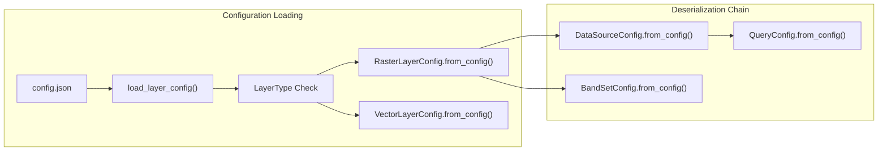

Each configuration class implements a `from_config()` static method that handles deserialization from dictionary representations, enabling flexible configuration file formats.

Sources: [rslearn/config/dataset.py:524-531](), [rslearn/config/__init__.py:1-33]()

---

# Page: Data Sources

# Data Sources

<details>
<summary>Relevant source files</summary>

The following files were used as context for generating this wiki page:

- [rslearn/data_sources/__init__.py](rslearn/data_sources/__init__.py)
- [rslearn/data_sources/data_source.py](rslearn/data_sources/data_source.py)
- [rslearn/data_sources/utils.py](rslearn/data_sources/utils.py)
- [tests/unit/data_sources/__init__.py](tests/unit/data_sources/__init__.py)
- [tests/unit/data_sources/test_match_candidate_items_to_window.py](tests/unit/data_sources/test_match_candidate_items_to_window.py)

</details>


The data sources system provides a unified interface for accessing remote sensing data from various providers and formats. This system abstracts the complexity of different data repositories, enabling consistent access to satellite imagery, climate data, and other geospatial datasets through a common API.

For specific data source implementations, see [AWS Data Sources](#4.1), [Google Cloud Data Sources](#4.2), [Climate Data Sources](#4.3), [European Space Agency Data Sources](#4.4), and [Local and Web Data Sources](#4.5). For dataset management operations that use these data sources, see [Dataset Management](#5).

## Core Architecture

The data source system is built around several key abstractions that enable flexible data access patterns and query modes.

### Data Source Class Hierarchy

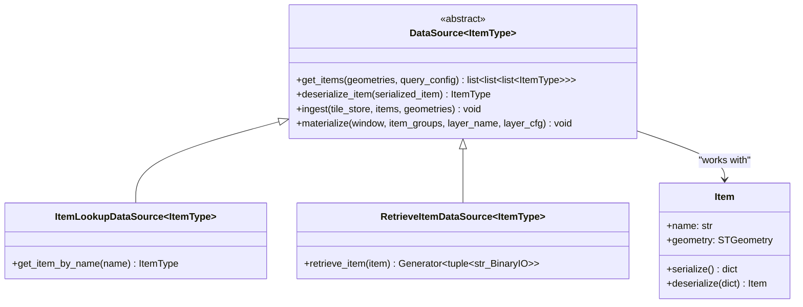

**Sources:** [rslearn/data_sources/data_source.py:12-130]()

### Item Structure

The `Item` class represents individual data objects within a data source, such as satellite scenes or vector files. Each item has a unique name and spatiotemporal geometry.

| Property | Type | Description |
|----------|------|-------------|
| `name` | `str` | Unique identifier for the item |
| `geometry` | `STGeometry` | Spatial and temporal extent |

**Sources:** [rslearn/data_sources/data_source.py:12-52]()

## Query System

The data source system supports sophisticated querying based on spatial and temporal criteria through the `QueryConfig` system.

### Space and Time Modes

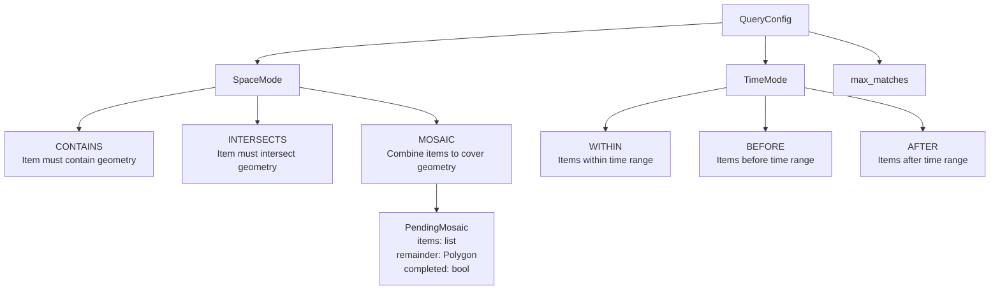

**Sources:** [rslearn/data_sources/utils.py:40-180]()

### Item Matching Algorithm

The `match_candidate_items_to_window` function implements the core logic for matching data source items to spatial windows based on query configuration.

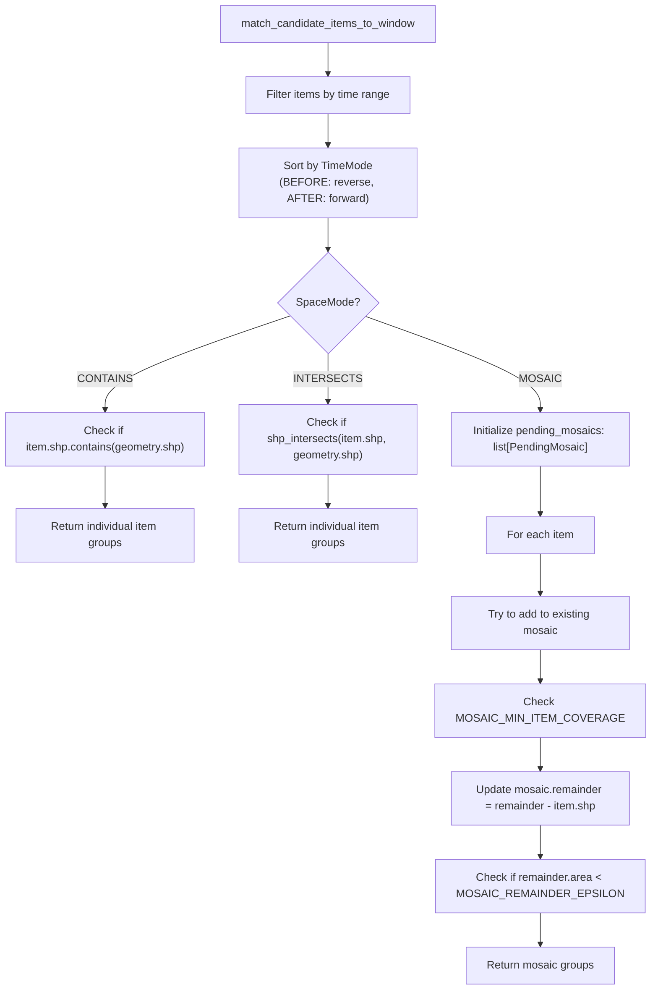

**Sources:** [rslearn/data_sources/utils.py:40-180]()

## Data Source Loading

Data sources are dynamically loaded from configuration using a factory pattern.

### Dynamic Loading Process

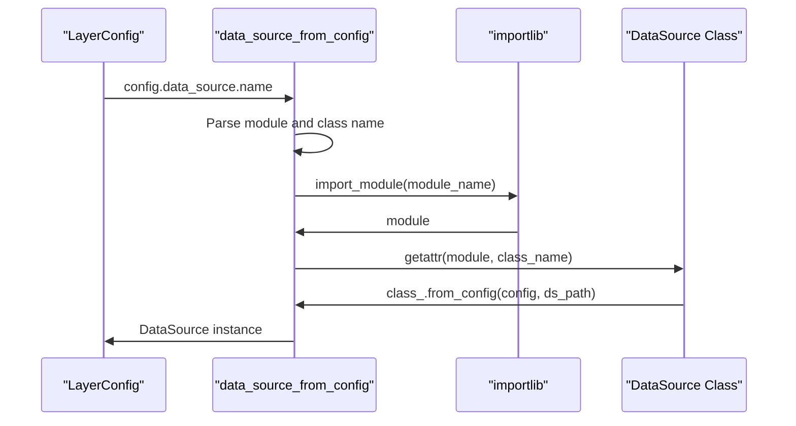

The loading process splits the fully qualified class name (e.g., `"rslearn.data_sources.landsat.LandsatOliTirs"`) into module and class components for dynamic import.

**Sources:** [rslearn/data_sources/__init__.py:26-42]()

## Data Source Operations

Data sources support two primary operations for data access:

### Ingest Operation

The `ingest` method downloads and stores raw data from the source into a tile store:

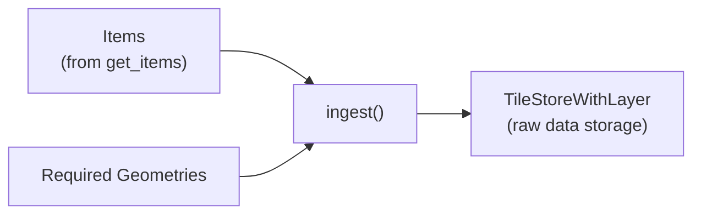

### Materialize Operation

The `materialize` method processes data directly for specific windows:

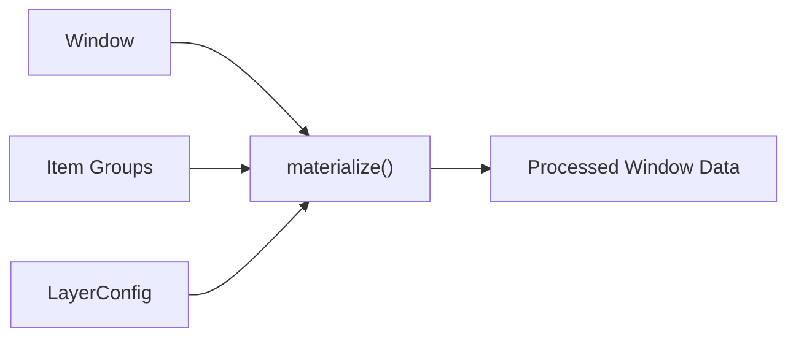

**Sources:** [rslearn/data_sources/data_source.py:81-111]()

## Mosaic Creation

The mosaic system enables combining multiple overlapping items to provide complete coverage of a spatial region.

### Mosaic Algorithm Constants

| Constant | Value | Purpose |
|----------|-------|---------|
| `MOSAIC_MIN_ITEM_COVERAGE` | 0.1 | Minimum fraction of area an item must cover |
| `MOSAIC_REMAINDER_EPSILON` | 0.01 | Threshold for considering mosaic complete |

### PendingMosaic State

The `PendingMosaic` dataclass tracks the state of mosaics being constructed:

```mermaid
stateDiagram-v2
    [*] --> Creating : New PendingMosaic
    Creating --> Adding : Add intersecting items
    Adding --> Adding : More items fit
    Adding --> Completed : remainder.area < MOSAIC_REMAINDER_EPSILON
    Completed --> [*]
    
    note right of Adding : Check MOSAIC_MIN_ITEM_COVERAGE<br/>Update remainder geometry
```

**Sources:** [rslearn/data_sources/utils.py:13-38](), [rslearn/data_sources/utils.py:113-179]()

## Integration with Dataset System

Data sources integrate with the broader rslearn dataset system through standardized interfaces:

```mermaid
graph TB
    subgraph "Dataset Layer"
        Window["Window"]
        LayerConfig["LayerConfig"]
    end
    
    subgraph "Data Source Layer"
        DataSource["DataSource"]
        Items["Items"]
        QueryConfig["QueryConfig"]
    end
    
    subgraph "Storage Layer"
        TileStore["TileStoreWithLayer"]
        MaterializedData["Materialized Data"]
    end
    
    Window --> DataSource : "get_items()"
    LayerConfig --> DataSource : "configuration"
    QueryConfig --> DataSource : "query parameters"
    
    DataSource --> Items : "produces"
    Items --> TileStore : "ingest()"
    Items --> MaterializedData : "materialize()"
```

**Sources:** [rslearn/data_sources/data_source.py:1-130](), [rslearn/data_sources/utils.py:1-181]()

---

# Page: AWS Data Sources

# AWS Data Sources

<details>
<summary>Relevant source files</summary>

The following files were used as context for generating this wiki page:

- [rslearn/data_sources/aws_landsat.py](rslearn/data_sources/aws_landsat.py)
- [rslearn/data_sources/aws_open_data.py](rslearn/data_sources/aws_open_data.py)
- [rslearn/data_sources/gcp_public_data.py](rslearn/data_sources/gcp_public_data.py)
- [tests/integration/conftest.py](tests/integration/conftest.py)
- [tests/integration/data_sources/test_aws_landsat.py](tests/integration/data_sources/test_aws_landsat.py)

</details>


This page documents the AWS-based data sources in the rslearn framework, which provide access to remote sensing datasets hosted on Amazon Web Services as part of the Registry of Open Data on AWS program. These data sources enable ingestion of Landsat, NAIP, and Sentinel-2 imagery stored on public S3 buckets.

For information about Google Cloud Platform data sources, see [Google Cloud Data Sources](#4.2). For climate data sources, see [Climate Data Sources](#4.3).

## Overview

The AWS data sources implement the `DataSource` interface and provide access to three major remote sensing datasets:

- **Landsat OLI-TIRS**: Landsat 8/9 imagery from the `usgs-landsat` bucket
- **NAIP**: National Agriculture Imagery Program data from the `naip-source` bucket  
- **Sentinel-2**: Sentinel-2 L1C and L2A data from Sinergise-maintained buckets

All AWS data sources use boto3 for S3 access and support both regular ingestion workflows and direct materialization from Cloud Optimized GeoTIFFs (COGs).

### AWS Data Source Class Hierarchy

```mermaid
classDiagram
    class DataSource {
        <<interface>>
        +get_items(geometries, query_config)
        +deserialize_item(serialized_item)
        +from_config(config, ds_path)
    }
    
    class ItemLookupDataSource {
        <<interface>>
        +get_item_by_name(name)
    }
    
    class RetrieveItemDataSource {
        <<interface>>
        +retrieve_item(item)
    }
    
    class TileStore {
        <<interface>>
        +is_raster_ready(layer_name, item_name, bands)
        +read_raster(layer_name, item_name, bands, projection, bounds)
    }
    
    class LandsatOliTirs {
        +bucket_name: "usgs-landsat"
        +bands: ["B1", "B2", ..., "B11"]
        +get_items(geometries, query_config)
        +ingest(tile_store, items, geometries)
        +materialize(window, item_groups, layer_name, layer_cfg)
    }
    
    class Naip {
        +bucket_name: "naip-source"
        +get_items(geometries, query_config)
        +ingest(tile_store, items, geometries)
    }
    
    class Sentinel2 {
        +bucket_names: {"L1C": "sentinel-s2-l1c", "L2A": "sentinel-s2-l2a"}
        +get_items(geometries, query_config)
        +ingest(tile_store, items, geometries)
    }
    
    DataSource <|-- LandsatOliTirs
    DataSource <|-- Naip
    DataSource <|-- Sentinel2
    ItemLookupDataSource <|-- Sentinel2
    RetrieveItemDataSource <|-- Sentinel2
    TileStore <|-- LandsatOliTirs
```

Sources: [rslearn/data_sources/aws_landsat.py:82-547](), [rslearn/data_sources/aws_open_data.py:71-357](), [rslearn/data_sources/aws_open_data.py:405-763]()

## Landsat OLI-TIRS Data Source

The `LandsatOliTirs` class provides access to Landsat 8/9 OLI-TIRS imagery from the USGS-maintained `usgs-landsat` S3 bucket. This data source supports both ingestion workflows and direct materialization from COGs.

### Key Features

- **Bucket**: `usgs-landsat` (requester pays)
- **Data Path**: `collection02/level-1/standard/oli-tirs`
- **Bands**: B1 through B11 spectral bands
- **Spatial Index**: Uses WRS2 (Worldwide Reference System 2) grid for spatial queries
- **Metadata**: Reads STAC JSON files for scene metadata
- **Cloud Cover Sorting**: Optional sorting by cloud cover percentage

### LandsatOliTirs Architecture

```mermaid
graph TD
    subgraph "AWS S3 Bucket"
        UsgsBucket["usgs-landsat bucket"]
        StacFiles["*_stac.json files"]
        TifFiles["Band TIF files (B1.TIF, B2.TIF, ...)"]
    end
    
    subgraph "Spatial Indexing"
        WrsShp["WRS2 shapefile"]
        WrsIndex["GridIndex with WRS2 polygons"]
    end
    
    subgraph "LandsatOliTirs Class"
        GetItems["get_items()"]
        ReadProducts["_read_products()"]
        Ingest["ingest()"]
        Materialize["materialize()"]
        ReadRaster["read_raster()"]
    end
    
    subgraph "Data Flow"
        Geometries["STGeometry list"]
        Items["LandsatOliTirsItem list"]
        TileStore["TileStoreWithLayer"]
        Window["Window"]
    end
    
    UsgsBucket --> StacFiles
    UsgsBucket --> TifFiles
    WrsShp --> WrsIndex
    
    Geometries --> GetItems
    GetItems --> WrsIndex
    GetItems --> ReadProducts
    ReadProducts --> StacFiles
    ReadProducts --> Items
    
    Items --> Ingest
    Ingest --> TifFiles
    Ingest --> TileStore
    
    Items --> Materialize
    Materialize --> ReadRaster
    ReadRaster --> TifFiles
    ReadRaster --> Window
```

Sources: [rslearn/data_sources/aws_landsat.py:82-136](), [rslearn/data_sources/aws_landsat.py:212-276](), [rslearn/data_sources/aws_landsat.py:278-335]()

### Configuration

The `LandsatOliTirs` data source is configured via `RasterLayerConfig`:

| Parameter | Description | Default |
|-----------|-------------|---------|
| `metadata_cache_dir` | Directory for caching STAC metadata and WRS2 shapefiles | Required |
| `sort_by` | Sort order for results (`"cloud_cover"` or `None`) | `None` |

### Spatial Indexing with WRS2

Landsat uses the WRS2 grid system for spatial organization. The data source downloads and indexes WRS2 polygons to efficiently query scenes by path/row:

- **WRS2 Shapefile**: Downloaded from USGS and cached locally
- **Grid Index**: Built using `GridIndex` with 1.0 degree resolution
- **Buffering**: WRS2 polygons are buffered by 0.2 degrees to account for scene overlap

Sources: [rslearn/data_sources/aws_landsat.py:212-276](), [rslearn/data_sources/aws_landsat.py:96-97]()

### Direct Materialization Support

`LandsatOliTirs` implements the `TileStore` interface, enabling direct materialization from COGs without intermediate storage:

```python
# Key methods for direct access
def is_raster_ready(self, layer_name: str, item_name: str, bands: list[str]) -> bool
def read_raster(self, layer_name: str, item_name: str, bands: list[str], 
                projection: Projection, bounds: PixelBounds) -> npt.NDArray[Any]
```

Sources: [rslearn/data_sources/aws_landsat.py:405-523]()

## NAIP Data Source

The `Naip` class provides access to National Agriculture Imagery Program (NAIP) imagery from the Esri-maintained `naip-source` S3 bucket.

### Key Features

- **Bucket**: `naip-source` (requester pays)
- **Bands**: R, G, B, IR (4-band imagery)
- **Spatial Index**: Uses shapefile-based indexing with optional rtree acceleration
- **Filtering**: Supports filtering by state and year
- **Data Coverage**: 2012 onwards (earlier data may be incomplete)

### NAIP Data Discovery Process

```mermaid
graph TD
    subgraph "S3 Bucket Structure"
        Bucket["naip-source bucket"]
        Manifest["manifest.txt"]
        IndexShp["state/year/100cm/index/*.shp"]
        TifFiles["state/year/100cm/index/rgbir/tileid/*.tif"]
    end
    
    subgraph "Discovery Process"
        DownloadManifest["Download manifest.txt"]
        FilterStates["Filter by states/years"]
        DownloadShp["Download index shapefiles"]
        BuildIndex["Build spatial index"]
        QueryItems["Query intersecting items"]
    end
    
    subgraph "Optional Acceleration"
        RtreeIndex["RtreeIndex cache"]
        GridIndex["GridIndex fallback"]
    end
    
    Bucket --> Manifest
    Bucket --> IndexShp
    Bucket --> TifFiles
    
    DownloadManifest --> Manifest
    DownloadManifest --> FilterStates
    FilterStates --> DownloadShp
    DownloadShp --> IndexShp
    DownloadShp --> BuildIndex
    BuildIndex --> RtreeIndex
    BuildIndex --> GridIndex
    BuildIndex --> QueryItems
```

Sources: [rslearn/data_sources/aws_open_data.py:136-151](), [rslearn/data_sources/aws_open_data.py:152-189](), [rslearn/data_sources/aws_open_data.py:190-282]()

### Configuration

| Parameter | Description | Default |
|-----------|-------------|---------|
| `index_cache_dir` | Directory for caching manifest and shapefiles | Required |
| `use_rtree_index` | Enable rtree spatial indexing for faster queries | `false` |
| `states` | List of state codes to include (e.g., `["ca", "tx"]`) | All states |
| `years` | List of years to include | All years ≥ 2012 |

### Spatial Indexing Strategy

NAIP supports two spatial indexing approaches:

1. **Rtree Index** (optional): Pre-built spatial index for fast queries
2. **GridIndex Fallback**: On-demand spatial filtering using 0.01-degree grid

Sources: [rslearn/data_sources/aws_open_data.py:110-118](), [rslearn/data_sources/aws_open_data.py:299-318]()

## Sentinel-2 Data Source

The `Sentinel2` class provides access to Sentinel-2 L1C and L2A data from Sinergise-maintained S3 buckets on AWS.

### Key Features

- **Buckets**: `sentinel-s2-l1c` and `sentinel-s2-l2a`
- **Modalities**: L1C (Top of Atmosphere) and L2A (Bottom of Atmosphere)
- **Bands**: Full spectral bands (B01-B12, B8A) plus TCI composite
- **Spatial Organization**: MGRS (Military Grid Reference System) tiles
- **Harmonization**: Optional pixel value harmonization across processing baselines

### Sentinel-2 Data Organization

```mermaid
graph TD
    subgraph "S3 Bucket Structure"
        L1CBucket["sentinel-s2-l1c bucket"]
        L2ABucket["sentinel-s2-l2a bucket"]
        TilePath["tiles/UTM_ZONE/LAT_BAND/SQUARE/YEAR/MONTH/DAY/SEQUENCE/"]
        TileInfo["tileInfo.json"]
        BandFiles["B01.jp2, B02.jp2, ..., TCI.jp2"]
    end
    
    subgraph "Modality Differences"
        L1CBands["L1C: All bands in root"]
        L2ABands["L2A: Bands in R10m/, R20m/, R60m/"]
    end
    
    subgraph "Sentinel2 Processing"
        GetTiles["get_sentinel2_tiles()"]
        ReadProducts["_read_products()"]
        ParseTileInfo["Parse tileInfo.json"]
        FilterGeometry["Filter by geometry intersection"]
    end
    
    L1CBucket --> TilePath
    L2ABucket --> TilePath
    TilePath --> TileInfo
    TilePath --> BandFiles
    TilePath --> L1CBands
    TilePath --> L2ABands
    
    GetTiles --> ReadProducts
    ReadProducts --> ParseTileInfo
    ParseTileInfo --> TileInfo
    ParseTileInfo --> FilterGeometry
```

Sources: [rslearn/data_sources/aws_open_data.py:420-458](), [rslearn/data_sources/aws_open_data.py:506-578]()

### Band Organization by Modality

The band file structure differs between L1C and L2A products:

```python
# L1C bands (all in root directory)
band_fnames = {
    Sentinel2Modality.L1C: [
        ("B01.jp2", ["B01"]),
        ("B02.jp2", ["B02"]),
        # ... other bands
        ("TCI.jp2", ["R", "G", "B"]),
    ],
    
    # L2A bands (organized by resolution)
    Sentinel2Modality.L2A: [
        ("R20m/B01.jp2", ["B01"]),
        ("R10m/B02.jp2", ["B02"]),
        # ... other bands
        ("R10m/TCI.jp2", ["R", "G", "B"]),
    ],
}
```

Sources: [rslearn/data_sources/aws_open_data.py:425-457]()

### Configuration

| Parameter | Description | Default |
|-----------|-------------|---------|
| `modality` | `"L1C"` or `"L2A"` | Required |
| `metadata_cache_dir` | Directory for caching tile metadata | Required |
| `sort_by` | Sort order (`"cloud_cover"` or `None`) | `None` |
| `harmonize` | Enable pixel value harmonization | `false` |

### Pixel Value Harmonization

Sentinel-2 supports optional harmonization to account for processing baseline changes:

```python
def _get_harmonize_callback(self, item: Sentinel2Item) -> Callable[[npt.NDArray], npt.NDArray] | None:
    """Gets the harmonization callback for the given item."""
    if not self.harmonize:
        return None
    # Reads metadata.xml to extract RADIO_ADD_OFFSET values
    # Returns callback to adjust pixel values
```

Sources: [rslearn/data_sources/aws_open_data.py:681-708]()

## Common Patterns

### Item Classes

All AWS data sources use corresponding `Item` classes that extend the base `Item` class:

| Data Source | Item Class | Key Attributes |
|-------------|------------|----------------|
| `LandsatOliTirs` | `LandsatOliTirsItem` | `blob_path`, `cloud_cover` |
| `Naip` | `NaipItem` | `blob_path` |
| `Sentinel2` | `Sentinel2Item` | `blob_path`, `cloud_cover` |

### Boto3 Integration

All AWS data sources use boto3 for S3 access:

```python
# Common pattern for bucket access
self.bucket = boto3.resource("s3").Bucket(bucket_name)

# Requester pays pattern
ExtraArgs={"RequestPayer": "requester"}
```

Sources: [rslearn/data_sources/aws_landsat.py:117-118](), [rslearn/data_sources/aws_open_data.py:485]()

### Metadata Caching

All data sources implement local caching of metadata to avoid repeated S3 requests:

- **Landsat**: Caches STAC JSON files and WRS2 shapefiles
- **NAIP**: Caches manifest.txt and index shapefiles  
- **Sentinel-2**: Caches tileInfo.json files

Sources: [rslearn/data_sources/aws_landsat.py:147-210](), [rslearn/data_sources/aws_open_data.py:142-189](), [rslearn/data_sources/aws_open_data.py:518-561]()

---

# Page: Google Cloud Data Sources

# Google Cloud Data Sources

<details>
<summary>Relevant source files</summary>

The following files were used as context for generating this wiki page:

- [rslearn/data_sources/aws_open_data.py](rslearn/data_sources/aws_open_data.py)
- [rslearn/data_sources/gcp_public_data.py](rslearn/data_sources/gcp_public_data.py)

</details>


This document covers Google Cloud Platform (GCP) data sources in the rslearn framework, specifically the implementation for accessing Sentinel-2 satellite imagery from Google's public datasets. For AWS-based data sources, see [AWS Data Sources](#4.1). For other satellite data sources, see [Climate Data Sources](#4.3) and [European Space Agency Data Sources](#4.4).

## Overview

The GCP data sources provide access to Sentinel-2 Level-1C (L1C) imagery hosted on Google Cloud Storage as part of the Google Public Cloud Data Program. The implementation leverages Google's public `gcp-public-data-sentinel-2` bucket and BigQuery indexing service to efficiently discover and retrieve satellite imagery.

## Architecture

The GCP data source system is built around the `Sentinel2` class which implements the `DataSource` interface. The system integrates with Google Cloud services for both data discovery and retrieval.

### Core Components

```mermaid
graph TB
    subgraph "Google Cloud Services"
        GCS["Google Cloud Storage<br/>gcp-public-data-sentinel-2"]
        BQ["BigQuery<br/>sentinel_2_index"]
    end
    
    subgraph "rslearn GCP Data Source"
        DS["Sentinel2 DataSource"]
        ITEM["Sentinel2Item"]
        XML["ParsedProductXML"]
    end
    
    subgraph "Local Caching"
        CACHE["index_cache_dir"]
        RTREE["RtreeIndex (optional)"]
    end
    
    subgraph "Data Processing"
        HARMONIZE["Harmonization Callbacks"]
        INGEST["Tile Store Ingestion"]
    end
    
    BQ --> DS
    GCS --> DS
    DS --> ITEM
    DS --> XML
    DS --> CACHE
    DS --> RTREE
    DS --> HARMONIZE
    DS --> INGEST
    
    CACHE --> XML
    RTREE --> ITEM
```

Sources: [rslearn/data_sources/gcp_public_data.py:114-832]()

### Data Discovery Flow

The system supports two modes for discovering relevant Sentinel-2 scenes:

```mermaid
graph TD
    START["get_items() Called"] --> MODE_CHECK{"use_rtree_index?"}
    
    MODE_CHECK -->|true| RTREE_FLOW["_get_candidate_items_index()"]
    MODE_CHECK -->|false| DIRECT_FLOW["_get_candidate_items_direct()"]
    
    RTREE_FLOW --> RTREE_QUERY["rtree_index.query(bounds)"]
    RTREE_QUERY --> ITEM_VALIDATION["Validate geometry intersection"]
    
    DIRECT_FLOW --> CELL_YEARS["Calculate needed_cell_years"]
    CELL_YEARS --> READ_PRODUCTS["_read_products()"]
    READ_PRODUCTS --> PRODUCT_FILTER["Filter by geometry"]
    
    ITEM_VALIDATION --> GET_XML["get_item_by_name()"]
    PRODUCT_FILTER --> MATCH_ITEMS["match_candidate_items_to_window()"]
    GET_XML --> MATCH_ITEMS
    
    MATCH_ITEMS --> GROUPS["Return item groups"]
```

Sources: [rslearn/data_sources/gcp_public_data.py:632-748]()

## Data Model

### Sentinel2Item

The `Sentinel2Item` class represents individual Sentinel-2 scenes with the following key attributes:

| Attribute | Type | Description |
|-----------|------|-------------|
| `name` | `str` | Unique scene identifier (product name) |
| `geometry` | `STGeometry` | Spatiotemporal extent |
| `blob_prefix` | `str` | GCS path prefix for image files |
| `cloud_cover` | `float` | Cloud cover percentage (0-100) |

Sources: [rslearn/data_sources/gcp_public_data.py:38-73]()

### Supported Bands

The data source supports the following Sentinel-2 bands:

| File Name | Band Names | Description |
|-----------|------------|-------------|
| `B01.jp2` | `["B01"]` | Coastal aerosol (443nm) |
| `B02.jp2` | `["B02"]` | Blue (490nm) |
| `B03.jp2` | `["B03"]` | Green (560nm) |
| `B04.jp2` | `["B04"]` | Red (665nm) |
| `B05.jp2` | `["B05"]` | Vegetation red edge (705nm) |
| `B06.jp2` | `["B06"]` | Vegetation red edge (740nm) |
| `B07.jp2` | `["B07"]` | Vegetation red edge (783nm) |
| `B08.jp2` | `["B08"]` | NIR (842nm) |
| `B09.jp2` | `["B09"]` | Water vapour (945nm) |
| `B10.jp2` | `["B10"]` | SWIR - Cirrus (1375nm) |
| `B11.jp2` | `["B11"]` | SWIR (1610nm) |
| `B12.jp2` | `["B12"]` | SWIR (2190nm) |
| `B8A.jp2` | `["B8A"]` | Vegetation red edge (865nm) |
| `TCI.jp2` | `["R", "G", "B"]` | True color image |

Sources: [rslearn/data_sources/gcp_public_data.py:131-146]()

## Configuration

### Basic Configuration

The `Sentinel2` data source is configured through the `from_config` method:

```python
# Example configuration
config = {
    "index_cache_dir": "cache/sentinel2_gcp",
    "use_rtree_index": True,
    "harmonize": False,
    "sort_by": "cloud_cover"
}
```

### Configuration Parameters

| Parameter | Type | Default | Description |
|-----------|------|---------|-------------|
| `index_cache_dir` | `str` | Required | Local directory for caching metadata |
| `use_rtree_index` | `bool` | `True` | Enable spatial indexing for faster queries |
| `harmonize` | `bool` | `False` | Apply harmonization across processing baselines |
| `sort_by` | `str` | `None` | Sort order for scenes ("cloud_cover" or None) |
| `rtree_time_range` | `tuple` | `None` | Time range for rtree population |
| `rtree_cache_dir` | `str` | `None` | Separate cache directory for rtree index |

Sources: [rslearn/data_sources/gcp_public_data.py:159-243]()

## Data Access Patterns

### BigQuery Integration

The system uses BigQuery to efficiently query the scene index:

```mermaid
graph LR
    QUERY["BigQuery Query"] --> TABLE["bigquery-public-data.cloud_storage_geo_index.sentinel_2_index"]
    TABLE --> FIELDS["source_url, base_url, product_id, sensing_time, granule_id, coordinates, cloud_cover"]
    FIELDS --> FILTER["Time Range Filtering"]
    FILTER --> ITEMS["Sentinel2Item Objects"]
```

The BigQuery query extracts essential metadata including spatial bounds, sensing time, and cloud cover for initial filtering.

Sources: [rslearn/data_sources/gcp_public_data.py:245-335]()

### Metadata Processing

For each discovered scene, the system processes the XML metadata file to extract precise geometry and blob paths:

```mermaid
graph TD
    SCENE["Sentinel2 Scene"] --> XML_PATH["MTD_MSIL1C.xml"]
    XML_PATH --> CACHE_CHECK{"XML Cached?"}
    
    CACHE_CHECK -->|No| DOWNLOAD["Download from GCS"]
    CACHE_CHECK -->|Yes| PARSE["Parse XML"]
    DOWNLOAD --> PARSE
    
    PARSE --> GEOMETRY["Extract EXT_POS_LIST"]
    PARSE --> BLOB_PREFIX["Extract IMAGE_FILE paths"]
    PARSE --> TIMESTAMPS["Extract PRODUCT_START_TIME"]
    PARSE --> CLOUD_COVER["Extract Cloud_Coverage_Assessment"]
    
    GEOMETRY --> ITEM["Sentinel2Item"]
    BLOB_PREFIX --> ITEM
    TIMESTAMPS --> ITEM
    CLOUD_COVER --> ITEM
```

Sources: [rslearn/data_sources/gcp_public_data.py:396-503]()

## Caching System

### Local Caching

The system implements comprehensive caching to minimize redundant network requests:

| Cache Type | Location | Content |
|------------|----------|---------|
| XML Metadata | `{index_cache_dir}/{scene_name}.xml` | Product metadata files |
| Item Cache | `{index_cache_dir}/{scene_name}.json` | Parsed scene information |
| Cell-Year Cache | `{index_cache_dir}/{cell_id}_{year}.json` | Scene lists per MGRS cell |
| Rtree Index | `{rtree_cache_dir}/` | Spatial index for fast lookups |

### Error Caching

The system caches both successful parsing and known errors:

```mermaid
graph TD
    PARSE_ATTEMPT["Parse Scene Metadata"] --> SUCCESS{"Parse Successful?"}
    
    SUCCESS -->|Yes| CACHE_ITEM["Cache Sentinel2Item JSON"]
    SUCCESS -->|No| ERROR_TYPE{"Error Type"}
    
    ERROR_TYPE --> CORRUPT["CorruptItemException"]
    ERROR_TYPE --> MISSING["MissingXMLException"]
    
    CORRUPT --> CACHE_ERROR["Cache error message"]
    MISSING --> SKIP["Skip caching"]
    
    CACHE_ITEM --> NEXT["Next scene"]
    CACHE_ERROR --> NEXT
    SKIP --> NEXT
```

Sources: [rslearn/data_sources/gcp_public_data.py:505-543]()

## Error Handling

### Exception Types

The system defines specific exceptions for different error conditions:

- `CorruptItemException`: Scene data is corrupted or malformed
- `MissingXMLException`: Required XML metadata file is missing from GCS

### Corruption Detection

The system performs several validation checks:

1. **File Completeness**: Verifies all expected band files exist
2. **Geometry Validation**: Ensures valid spatial geometry
3. **Zero-Area Check**: Detects scenes with degenerate geometry

Sources: [rslearn/data_sources/gcp_public_data.py:75-102](), [rslearn/data_sources/gcp_public_data.py:469-503]()

## Harmonization Support

The system supports optional harmonization of pixel values across different Sentinel-2 processing baselines for temporal consistency:

```mermaid
graph TD
    INGEST["Ingest Scene"] --> HARMONIZE_CHECK{"harmonize enabled?"}
    
    HARMONIZE_CHECK -->|No| DIRECT_WRITE["write_raster_file()"]
    HARMONIZE_CHECK -->|Yes| GET_CALLBACK["get_harmonize_callback()"]
    
    GET_CALLBACK --> XML_PARSE["Parse XML metadata"]
    XML_PARSE --> OFFSET_EXTRACT["Extract processing baseline"]
    OFFSET_EXTRACT --> CALLBACK["Create harmonization callback"]
    
    CALLBACK --> READ_ARRAY["Read raster array"]
    READ_ARRAY --> APPLY_CALLBACK["Apply harmonization"]
    APPLY_CALLBACK --> WRITE_ARRAY["write_raster() with modified array"]
    
    DIRECT_WRITE --> COMPLETE["Ingestion complete"]
    WRITE_ARRAY --> COMPLETE
```

Sources: [rslearn/data_sources/gcp_public_data.py:804-826]()

---

# Page: Climate Data Sources

# Climate Data Sources

<details>
<summary>Relevant source files</summary>

The following files were used as context for generating this wiki page:

- [rslearn/data_sources/climate_data_store.py](rslearn/data_sources/climate_data_store.py)
- [tests/integration/data_sources/test_climate_data_store.py](tests/integration/data_sources/test_climate_data_store.py)
- [tests/integration/test_main.py](tests/integration/test_main.py)

</details>


## Purpose and Scope

This document covers the climate data source implementations in rslearn, specifically focused on accessing and ingesting climate reanalysis data from the Copernicus Climate Data Store (CDS). The primary implementation is the `ERA5LandMonthlyMeans` data source which provides access to ERA5 land monthly averaged climate variables.

For satellite imagery data sources, see [AWS Data Sources](#4.1) and [Google Cloud Data Sources](#4.2). For European Space Agency data sources, see [European Space Agency Data Sources](#4.4).

## Climate Data Architecture

The climate data sources integrate with rslearn's data source framework to provide access to gridded climate datasets through standardized APIs.

```mermaid
graph TB
    subgraph "External Climate APIs"
        CDS["Copernicus Climate Data Store API<br/>cds.climate.copernicus.eu"]
        ERA5["ERA5-Land Monthly Means<br/>reanalysis-era5-land-monthly-means"]
    end
    
    subgraph "rslearn Climate Data Sources"
        ERA5LandMonthlyMeans["ERA5LandMonthlyMeans<br/>DataSource Implementation"]
        CDSClient["cdsapi.Client<br/>API Connection"]
    end
    
    subgraph "Data Processing Pipeline"
        NetCDF["NetCDF Files<br/>Downloaded from CDS"]
        Converter["_convert_nc_to_tif<br/>NetCDF to GeoTIFF"]
        GeoTIFF["GeoTIFF Files<br/>Multi-band Raster"]
    end
    
    subgraph "rslearn Storage"
        TileStore["TileStoreWithLayer<br/>Raster Storage"]
        Items["Item Grid System<br/>Spatial-Temporal Patches"]
    end
    
    CDS --> ERA5
    ERA5 --> CDSClient
    CDSClient --> ERA5LandMonthlyMeans
    ERA5LandMonthlyMeans --> NetCDF
    NetCDF --> Converter
    Converter --> GeoTIFF
    GeoTIFF --> TileStore
    ERA5LandMonthlyMeans --> Items
```

Sources: [rslearn/data_sources/climate_data_store.py:1-362]()

## ERA5LandMonthlyMeans Implementation

The `ERA5LandMonthlyMeans` class is the primary implementation for accessing ERA5 climate data. It follows a grid-based approach to minimize API requests and optimize data retrieval.

### Core Configuration

| Parameter | Type | Default | Description |
|-----------|------|---------|-------------|
| `band_names` | `list[str]` | Required | CDS variable names with "_" replaced by "-" |
| `api_key` | `str \| None` | `None` | CDS API key (can use `CDSAPI_KEY` env var) |
| `patch_size` | `float` | `10` | Grid cell size in degrees |

### Technical Specifications

| Property | Value | Description |
|----------|-------|-------------|
| `DATASET` | `"reanalysis-era5-land-monthly-means"` | CDS dataset identifier |
| `PIXEL_SIZE` | `0.1` | Native resolution in degrees (~9km) |
| `PRODUCT_TYPE` | `"monthly_averaged_reanalysis"` | CDS product type |
| `DATA_FORMAT` | `"netcdf"` | Download format from CDS |

Sources: [rslearn/data_sources/climate_data_store.py:28-82]()

## Grid-Based Item System

The climate data source uses a fixed grid system to optimize API requests and minimize redundant data downloads across different spatial windows.

```mermaid
graph TB
    subgraph "Spatial Grid System"
        Grid["Fixed WGS84 Grid<br/>patch_size x patch_size degrees"]
        GridCell["Grid Cell (col, row)<br/>10°x10° default"]
        Bounds["Cell Bounds Calculation<br/>col*patch_size to (col+1)*patch_size"]
    end
    
    subgraph "Temporal Organization"
        Monthly["Monthly Time Grid<br/>One item per month"]
        TimeRange["Item Time Range<br/>First day of month to first day of next"]
        MonthlyLoop["relativedelta(months=1)<br/>Month iteration"]
    end
    
    subgraph "Item Generation"
        TileToItem["_tile_to_item(col, row, year, month)<br/>Item Creation"]
        ItemName["Item Name<br/>f'{col}_{row}_{year}_{month}'"]
        STGeometry["STGeometry<br/>WGS84_PROJECTION + bounds + time_range"]
    end
    
    Grid --> GridCell
    GridCell --> Bounds
    Monthly --> TimeRange
    TimeRange --> MonthlyLoop
    TileToItem --> ItemName
    TileToItem --> STGeometry
    Bounds --> STGeometry
    TimeRange --> STGeometry
```

Sources: [rslearn/data_sources/climate_data_store.py:118-152](), [rslearn/data_sources/climate_data_store.py:154-216]()

## Data Processing Pipeline

The climate data processing involves converting netCDF files from the CDS API into GeoTIFF format compatible with rslearn's raster processing pipeline.

```mermaid
graph TB
    subgraph "CDS API Request"
        RequestBuilder["Build CDS Request<br/>product_type, variable, year, month, area"]
        CDSRetrieve["client.retrieve(DATASET, request, nc_file)<br/>Download NetCDF"]
        TempDir["tempfile.TemporaryDirectory<br/>Temporary Storage"]
    end
    
    subgraph "NetCDF Processing"
        NetCDFOpen["netCDF4.Dataset(nc_path)<br/>Open NetCDF File"]
        VariableFilter["Filter 3D Variables<br/>Skip latitude, longitude, etc."]
        BandExtraction["Extract Band Data<br/>band_data[0, :, :]"]
        MetadataRead["Read lat/lon Arrays<br/>Grid spacing validation"]
    end
    
    subgraph "GeoTIFF Conversion"
        ArrayStack["np.array(bands_data)<br/>(num_bands, height, width)"]
        TransformCalc["from_origin(west, north, pixel_size_x, pixel_size_y)<br/>Geospatial Transform"]
        RasterioWrite["rasterio.open(tif_path, 'w')<br/>Write GeoTIFF"]
        TileStoreWrite["tile_store.write_raster_file<br/>Store in TileStore"]
    end
    
    RequestBuilder --> CDSRetrieve
    CDSRetrieve --> TempDir
    TempDir --> NetCDFOpen
    NetCDFOpen --> VariableFilter
    VariableFilter --> BandExtraction
    NetCDFOpen --> MetadataRead
    BandExtraction --> ArrayStack
    MetadataRead --> TransformCalc
    ArrayStack --> RasterioWrite
    TransformCalc --> RasterioWrite
    RasterioWrite --> TileStoreWrite
```

Sources: [rslearn/data_sources/climate_data_store.py:292-361](), [rslearn/data_sources/climate_data_store.py:223-291]()

## Configuration and Usage

### Dataset Configuration

Climate data sources are configured through the dataset's layer configuration using the standard rslearn configuration system.

```json
{
  "layers": {
    "climate": {
      "type": "raster",
      "band_sets": [
        {
          "bands": ["2m-temperature", "total-precipitation"],
          "dtype": "float32"
        }
      ],
      "data_source": {
        "name": "rslearn.data_sources.climate_data_store.ERA5LandMonthlyMeans",
        "api_key": "your-cds-api-key",
        "patch_size": 10
      }
    }
  }
}
```

### Band Name Mapping

Climate variable names must be mapped from CDS convention to rslearn convention:

| CDS Variable Name | rslearn Band Name | Description |
|-------------------|-------------------|-------------|
| `2m_temperature` | `"2m-temperature"` | 2-meter air temperature |
| `total_precipitation` | `"total-precipitation"` | Total precipitation |
| `surface_pressure` | `"surface-pressure"` | Surface pressure |

Sources: [rslearn/data_sources/climate_data_store.py:36-39](), [rslearn/data_sources/climate_data_store.py:305-306]()

## Integration with rslearn Framework

### DataSource Interface Implementation

The `ERA5LandMonthlyMeans` class implements the standard `DataSource` interface:

| Method | Purpose | Implementation |
|--------|---------|----------------|
| `from_config()` | Factory method from configuration | Extracts band names and parameters |
| `get_items()` | Discover items for geometries | Grid-based item generation |
| `ingest()` | Download and store data | CDS API retrieval and conversion |
| `deserialize_item()` | Item deserialization | Standard `Item.deserialize()` |

### Query Configuration Requirements

Climate data sources require specific query configuration:

- `space_mode` must be `SpaceMode.MOSAIC`
- Geometries must include time ranges
- Monthly temporal resolution enforced

Sources: [rslearn/data_sources/climate_data_store.py:83-116](), [rslearn/data_sources/climate_data_store.py:167-168]()

## Error Handling and Validation

The climate data source implements validation at multiple levels:

### API Validation
- CDS API key validation through `cdsapi.Client`
- Request parameter validation by CDS service
- Network error handling for API requests

### Data Format Validation
- NetCDF variable structure validation
- Grid spacing uniformity checks (`PIXEL_SIZE` enforcement)
- Band count validation against expected `band_names`

### Geospatial Validation
- WGS84 bounds enforcement (`WGS84_BOUNDS` constraints)
- Grid alignment validation
- Coordinate reference system consistency

Sources: [rslearn/data_sources/climate_data_store.py:255-258](), [rslearn/data_sources/climate_data_store.py:264-273](), [rslearn/data_sources/climate_data_store.py:322-327]()

---

# Page: European Space Agency Data Sources

# European Space Agency Data Sources

<details>
<summary>Relevant source files</summary>

The following files were used as context for generating this wiki page:

- [.github/workflows/data-source-integration-test.yml](.github/workflows/data-source-integration-test.yml)
- [rslearn/data_sources/copernicus.py](rslearn/data_sources/copernicus.py)
- [tests/integration/data_sources/test_copernicus.py](tests/integration/data_sources/test_copernicus.py)

</details>


This document covers the rslearn framework's integration with European Space Agency (ESA) data sources, specifically the Copernicus programme data accessed through the ESA OData API. The primary focus is on Sentinel-2 satellite imagery, though the framework provides a generic base for accessing other Copernicus datasets.

For AWS-based Sentinel-2 access, see [AWS Data Sources](#4.1). For Google Cloud Sentinel-2 access, see [Google Cloud Data Sources](#4.2).

## Overview

The ESA data source system provides programmatic access to Copernicus satellite data through the ESA OData API. The implementation centers around downloading complete product zip files, extracting specific bands, and ingesting them into rslearn's tile store system. The framework handles authentication, spatial/temporal querying, and product harmonization.

## ESA Data Source Architecture

```mermaid
graph TB
    subgraph "ESA Copernicus API"
        ODATA["OData API<br/>catalogue.dataspace.copernicus.eu"]
        DOWNLOAD["Download API<br/>download.dataspace.copernicus.eu"]
        TOKEN["Token Service<br/>identity.dataspace.copernicus.eu"]
    end
    
    subgraph "rslearn Classes"
        COPERNICUS["Copernicus<br/>Generic API Client"]
        SENTINEL2["Sentinel2<br/>Specialized for S2"]
        ITEM["CopernicusItem<br/>Product Metadata"]
    end
    
    subgraph "Product Processing"
        ZIP["Product ZIP<br/>Download"]
        EXTRACT["Band Extraction<br/>JP2 Files"]
        HARMONIZE["Harmonization<br/>Processing Baseline"]
    end
    
    subgraph "Storage"
        TILESTORE["TileStoreWithLayer<br/>Raster Storage"]
    end
    
    TOKEN --> COPERNICUS
    ODATA --> COPERNICUS
    DOWNLOAD --> ZIP
    COPERNICUS --> ITEM
    COPERNICUS --> SENTINEL2
    SENTINEL2 --> ZIP
    ZIP --> EXTRACT
    EXTRACT --> HARMONIZE
    HARMONIZE --> TILESTORE
```

Sources: [rslearn/data_sources/copernicus.py:257-359]()

## Authentication and Configuration

The system supports multiple authentication methods for accessing the Copernicus Data Space Ecosystem:

### Authentication Methods

| Method | Configuration | Description |
|--------|---------------|-------------|
| Access Token | `COPERNICUS_ACCESS_TOKEN` env var | Direct API token (valid for 1 hour) |
| Username/Password | `COPERNICUS_USERNAME`, `COPERNICUS_PASSWORD` env vars | Automatic token refresh |
| Config Parameter | `access_token` in config | Explicitly provided token |

### Configuration Structure

```python
# Example configuration for Sentinel2 data source
{
    "data_source": {
        "type": "Sentinel2",
        "config": {
            "assets": ["B04", "B03", "B02", "TCI"],
            "product_type": "S2MSI2A",
            "harmonize": true,
            "query_filter": "Collection/Name eq 'SENTINEL-2'"
        }
    }
}
```

Sources: [rslearn/data_sources/copernicus.py:331-337](), [rslearn/data_sources/copernicus.py:757-790]()

## Core Classes and Data Flow

```mermaid
graph TB
    subgraph "Data Source Classes"
        COPERNICUS_CLASS["Copernicus<br/>_get(), _paginate()"]
        SENTINEL2_CLASS["Sentinel2<br/>from_config()"]
        ITEM_CLASS["CopernicusItem<br/>product_uuid, geometry"]
    end
    
    subgraph "API Operations"
        GET_ITEMS["get_items()<br/>Spatial/Temporal Query"]
        GET_TOKEN["_get_access_token()<br/>Auth Token Refresh"]
        PAGINATE["_paginate()<br/>Handle API Pagination"]
    end
    
    subgraph "Download Operations"
        DOWNLOAD_ZIP["Download Product ZIP<br/>requests.get()"]
        EXTRACT_BANDS["_zip_member_glob()<br/>Extract Specific Bands"]
        PROCESS_ZIP["_process_product_zip()<br/>Ingest to TileStore"]
    end
    
    COPERNICUS_CLASS --> GET_ITEMS
    COPERNICUS_CLASS --> GET_TOKEN
    COPERNICUS_CLASS --> PAGINATE
    SENTINEL2_CLASS -.->|inherits| COPERNICUS_CLASS
    GET_ITEMS --> ITEM_CLASS
    ITEM_CLASS --> DOWNLOAD_ZIP
    DOWNLOAD_ZIP --> EXTRACT_BANDS
    EXTRACT_BANDS --> PROCESS_ZIP
```

Sources: [rslearn/data_sources/copernicus.py:226-255](), [rslearn/data_sources/copernicus.py:657-790]()

## Sentinel-2 Specific Functionality

### Product Types and Band Mapping

The `Sentinel2` class handles two product types with different internal structures:

| Product Type | Description | Band Resolution Structure |
|--------------|-------------|---------------------------|
| `S2MSI1C` | Level-1C (Top of Atmosphere) | Single IMG_DATA directory |
| `S2MSI2A` | Level-2A (Bottom of Atmosphere) | Resolution-specific subdirectories (R10m, R20m, R60m) |

### Tile Index System

The framework maintains a spatial index of Sentinel-2 tiles for efficient querying:

```python
# Functions for tile indexing
get_sentinel2_tile_index()      # Download and parse KML file
load_sentinel2_tile_index()     # Create GridIndex from cached data
get_sentinel2_tiles()           # Query tiles intersecting geometry
```

### Band Asset Configuration

```python
BANDS = {
    "B01": ["B01"], "B02": ["B02"], "B03": ["B03"], "B04": ["B04"],
    "B05": ["B05"], "B06": ["B06"], "B07": ["B07"], "B08": ["B08"],
    "B09": ["B09"], "B11": ["B11"], "B12": ["B12"], "B8A": ["B8A"],
    "TCI": ["R", "G", "B"],  # True Color Image
    "AOT": ["AOT"],          # Aerosol Optical Thickness (L2A only)
    "WVP": ["WVP"],          # Water Vapour (L2A only)
    "SCL": ["SCL"],          # Scene Classification (L2A only)
}
```

Sources: [rslearn/data_sources/copernicus.py:650-679](), [rslearn/data_sources/copernicus.py:87-217]()

## Data Ingestion Workflow

```mermaid
graph TB
    subgraph "Query Phase"
        GEOMETRY["STGeometry<br/>Spatial/Temporal Query"]
        FILTER["Build Filter String<br/>WKT + Time Range"]
        API_QUERY["API Request<br/>/Products endpoint"]
        CANDIDATES["Candidate Items<br/>CopernicusItem[]"]
    end
    
    subgraph "Download Phase"
        CHECK_READY["Check if Bands Ready<br/>tile_store.is_raster_ready()"]
        GET_TOKEN_FLOW["Get Access Token<br/>_get_access_token()"]
        DOWNLOAD_PRODUCT["Download Product ZIP<br/>requests.get() with Bearer token"]
        TEMP_STORAGE["Temporary Storage<br/>tempfile.TemporaryDirectory()"]
    end
    
    subgraph "Processing Phase"
        OPEN_ZIP["Open ZIP File<br/>zipfile.ZipFile()"]
        MATCH_GLOB["Match Glob Patterns<br/>_zip_member_glob()"]
        EXTRACT_MEMBER["Extract JP2 Files<br/>zipf.extract()"]
        HARMONIZE_CHECK["Harmonization Check<br/>get_harmonize_callback()"]
        WRITE_TILESTORE["Write to TileStore<br/>write_raster_file()"]
    end
    
    GEOMETRY --> FILTER
    FILTER --> API_QUERY
    API_QUERY --> CANDIDATES
    CANDIDATES --> CHECK_READY
    CHECK_READY --> GET_TOKEN_FLOW
    GET_TOKEN_FLOW --> DOWNLOAD_PRODUCT
    DOWNLOAD_PRODUCT --> TEMP_STORAGE
    TEMP_STORAGE --> OPEN_ZIP
    OPEN_ZIP --> MATCH_GLOB
    MATCH_GLOB --> EXTRACT_MEMBER
    EXTRACT_MEMBER --> HARMONIZE_CHECK
    HARMONIZE_CHECK --> WRITE_TILESTORE
```

Sources: [rslearn/data_sources/copernicus.py:593-648](), [rslearn/data_sources/copernicus.py:792-847]()

## Harmonization Feature

Sentinel-2 processing baseline 04.00 introduced a +1000 offset to pixel values to preserve information in dark areas. The harmonization feature ensures compatibility between pre- and post-04.00 scenes.

### Harmonization Process

1. **Metadata Analysis**: Parse XML metadata from product ZIP to detect processing baseline
2. **Offset Detection**: Look for `RADIO_ADD_OFFSET` (L1C) or `BOA_ADD_OFFSET` (L2A) tags
3. **Callback Creation**: Generate transformation function to subtract offset
4. **Selective Application**: Apply only to spectral bands, not RGB composite (TCI)

### Implementation Details

```python
def get_harmonize_callback(tree):
    # Detect -1000 offset from XML metadata
    # Return callback function that subtracts offset
    def callback(array):
        return np.clip(array, -offset, None) - (-offset)
```

The harmonization is applied during raster ingestion when `harmonize=True` is configured.

Sources: [rslearn/data_sources/copernicus.py:42-84](), [rslearn/data_sources/copernicus.py:807-846]()

## Integration Testing

The framework includes comprehensive integration tests that verify:

- Authentication with real Copernicus credentials
- Product querying and downloading
- Band extraction and harmonization
- Tile store integration

### Test Configuration

```python
# Environment variables used in CI/CD
COPERNICUS_USERNAME  # Username for Copernicus Data Space
COPERNICUS_PASSWORD  # Password for authentication
```

### Test Coverage

| Test | Purpose | Location |
|------|---------|----------|
| `test_ingest_sentinel2` | Basic ingestion workflow | [tests/integration/data_sources/test_copernicus.py:25-52]() |
| `test_harmonize` | Harmonization functionality | [tests/integration/data_sources/test_copernicus.py:57-114]() |

Sources: [tests/integration/data_sources/test_copernicus.py:1-115](), [.github/workflows/data-source-integration-test.yml:111-112]()

## Error Handling and Limitations

### API Error Handling

The `ApiError` exception class handles various API failure scenarios:
- HTTP status code errors
- Authentication failures
- Rate limiting
- Product availability issues

### Known Limitations

- Product ZIP files can be very large (several GB)
- Access tokens expire after 1 hour
- API rate limits may apply
- Temporary storage requirements during processing

Sources: [rslearn/data_sources/copernicus.py:220-224](), [rslearn/data_sources/copernicus.py:365-371]()

---

# Page: Local and Web Data Sources

# Local and Web Data Sources

<details>
<summary>Relevant source files</summary>

The following files were used as context for generating this wiki page:

- [rslearn/data_sources/local_files.py](rslearn/data_sources/local_files.py)
- [rslearn/data_sources/usgs_landsat.py](rslearn/data_sources/usgs_landsat.py)
- [rslearn/data_sources/xyz_tiles.py](rslearn/data_sources/xyz_tiles.py)
- [rslearn/utils/feature.py](rslearn/utils/feature.py)
- [rslearn/utils/grid_index.py](rslearn/utils/grid_index.py)
- [rslearn/utils/vector_format.py](rslearn/utils/vector_format.py)
- [tests/integration/data_sources/test_layer_alias.py](tests/integration/data_sources/test_layer_alias.py)
- [tests/integration/data_sources/test_local_files.py](tests/integration/data_sources/test_local_files.py)
- [tests/integration/fixtures/datasets/local_files_dataset.py](tests/integration/fixtures/datasets/local_files_dataset.py)

</details>


This document covers data sources that access local file systems, USGS web services, and XYZ tile services. These data sources provide flexible ingestion capabilities for existing datasets stored locally or accessed through standard web protocols.

For cloud-based data sources like AWS and Google Cloud, see [AWS Data Sources](#4.1) and [Google Cloud Data Sources](#4.2). For climate and European space agency data, see [Climate Data Sources](#4.3) and [European Space Agency Data Sources](#4.4).

## Overview

The local and web data sources in rslearn provide three main access patterns:

- **Local Files**: Direct access to raster and vector files on the local filesystem or network-attached storage
- **USGS Services**: Programmatic access to Landsat data through the USGS M2M (Machine-to-Machine) API
- **XYZ Tile Services**: Access to web-based tile services using standard XYZ URL patterns

These data sources integrate with the same dataset management workflow as cloud-based sources, supporting the standard prepare → ingest → materialize pipeline.

## Local File Data Sources

The `LocalFiles` data source provides access to raster and vector data stored in local files. It automatically discovers files in a source directory and makes them available through the rslearn dataset interface.

### Architecture

```mermaid
graph TB
    subgraph "LocalFiles Data Source"
        LF["LocalFiles"]
        RasterImporter["RasterImporter"]
        VectorImporter["VectorImporter"]
        
        subgraph "Item Types"
            RasterItem["RasterItem"]
            VectorItem["VectorItem"]
        end
        
        subgraph "Item Specifications"
            RasterSpec["RasterItemSpec"]
        end
    end
    
    subgraph "File System"
        RasterFiles["*.tif, *.img, etc"]
        VectorFiles["*.geojson, *.shp, etc"]
        Cache["summary.json"]
    end
    
    LF --> RasterImporter
    LF --> VectorImporter
    RasterImporter --> RasterItem
    VectorImporter --> VectorItem
    RasterItem --> RasterSpec
    
    RasterImporter --> RasterFiles
    VectorImporter --> VectorFiles
    LF --> Cache
```

Sources: [rslearn/data_sources/local_files.py:395-421](), [rslearn/data_sources/local_files.py:179-241](), [rslearn/data_sources/local_files.py:269-341]()

The `LocalFiles` class uses a registry pattern with separate importers for different layer types. The `Importers` registry selects between `RasterImporter` and `VectorImporter` based on the layer configuration.

### Raster File Import

The `RasterImporter` handles raster data files that can be read by rasterio. It supports two configuration modes:

1. **Automatic Discovery**: Scans the source directory for raster files and treats each as a separate item
2. **Item Specifications**: Uses explicitly defined `RasterItemSpec` objects to group multiple files into single items

```mermaid
graph LR
    subgraph "Automatic Mode"
        AutoScan["Directory Scan"] --> AutoItems["One Item per File"]
    end
    
    subgraph "Item Spec Mode"
        ItemSpecs["item_specs config"] --> MultiFile["Multiple Files per Item"]
        MultiFile --> BandMapping["Custom Band Names"]
    end
    
    AutoItems --> RasterItem1["RasterItem"]
    MultiFile --> RasterItem2["RasterItem"]
```

Sources: [rslearn/data_sources/local_files.py:179-241](), [rslearn/data_sources/local_files.py:65-120]()

The `RasterItemSpec` class allows complex configurations where multiple files contribute different bands to a single item:

| Configuration | Description | Use Case |
|---------------|-------------|----------|
| `fnames` | List of file paths | Multi-band data split across files |
| `bands` | Band names for each file | Custom band naming schemes |
| `name` | Item identifier | Override default naming |

### Vector File Import

The `VectorImporter` handles vector data files readable by fiona, including GeoJSON, Shapefiles, and other OGR-supported formats. It automatically determines spatial bounds and handles large datasets that span global extents.

Key features include:

- **Automatic bounds detection** from vector geometries
- **Large dataset handling** with global geometry fallback for world-spanning data
- **Shapefile support** with automatic auxiliary file management (.shx, .dbf, .prj files)
- **CRS preservation** maintaining original coordinate reference systems

Sources: [rslearn/data_sources/local_files.py:269-341](), [rslearn/data_sources/local_files.py:342-393]()

### Configuration and Caching

The `LocalFiles` data source uses a caching mechanism to avoid repeatedly scanning directories:

```mermaid
graph TD
    ListItems["list_items()"] --> CheckCache{"Cache Exists?"}
    CheckCache -->|No| ScanDir["Scan Directory"]
    CheckCache -->|Yes| LoadCache["Load from summary.json"]
    ScanDir --> WriteCache["Write summary.json"]
    WriteCache --> ReturnItems["Return Items"]
    LoadCache --> ReturnItems
```

Sources: [rslearn/data_sources/local_files.py:422-441]()

The cache file `summary.json` contains serialized item metadata, preventing expensive filesystem operations on subsequent runs.

## USGS Services

The `LandsatOliTirs` data source provides access to Landsat OLI/TIRS data through the USGS Machine-to-Machine (M2M) API. This enables programmatic discovery and download of Landsat scenes.

### M2M API Integration

```mermaid
graph TB
    subgraph "USGS M2M API Client"
        Auth["Authentication"]
        Search["Scene Search"] 
        Metadata["Scene Metadata"]
        Products["Download Options"]
        Download["Download URLs"]
    end
    
    subgraph "LandsatOliTirs"
        Config["from_config()"]
        GetItems["get_items()"]
        Retrieve["retrieve_item()"]
        Ingest["ingest()"]
    end
    
    subgraph "Items"
        LandsatItem["LandsatOliTirsItem"]
    end
    
    Config --> Auth
    GetItems --> Search
    GetItems --> Metadata
    Retrieve --> Products
    Retrieve --> Download
    
    Search --> LandsatItem
    Metadata --> LandsatItem
```

Sources: [rslearn/data_sources/usgs_landsat.py:35-124](), [rslearn/data_sources/usgs_landsat.py:308-366]()

The `M2MAPIClient` class provides a Python interface to the USGS M2M API with the following capabilities:

| Method | Purpose | API Endpoint |
|--------|---------|--------------|
| `scene_search()` | Find scenes matching criteria | `scene-search` |
| `get_scene_metadata()` | Get detailed scene information | `scene-metadata` |
| `get_downloadable_products()` | List available download products | `download-options` |
| `get_download_url()` | Generate download URLs | `download-request` |

### Authentication Methods

The M2M API client supports two authentication methods:

1. **Username/Password**: Traditional EROS registration credentials
2. **Application Token**: Machine-to-machine authentication tokens

```python
# Configuration examples
{
    "username": "eros_username",
    "password": "eros_password"  # OR
    "token": "application_token"
}
```

Sources: [rslearn/data_sources/usgs_landsat.py:41-82](), [rslearn/data_sources/usgs_landsat.py:343-365]()

### Scene Discovery and Filtering

The `LandsatOliTirs` class provides several filtering options for scene discovery:

- **Spatial filtering** using bounding boxes
- **Temporal filtering** with acquisition date ranges  
- **Cloud cover filtering** with percentage thresholds
- **Metadata filtering** for custom scene attributes
- **Sorting options** including cloud cover-based ordering

The `get_items()` method converts API search results into `LandsatOliTirsItem` objects containing scene metadata and geometry information.

Sources: [rslearn/data_sources/usgs_landsat.py:388-425](), [rslearn/data_sources/usgs_landsat.py:367-386]()

### Data Retrieval

The data retrieval process involves multiple API calls to obtain download URLs for individual Landsat bands:

```mermaid
sequenceDiagram
    participant DS as LandsatOliTirs
    participant API as M2M API
    participant Store as TileStore
    
    DS->>API: get_downloadable_products()
    API->>DS: product list
    DS->>API: get_download_url() for each band
    API->>DS: download URLs
    DS->>Store: download and write_raster_file()
```

Sources: [rslearn/data_sources/usgs_landsat.py:462-494](), [rslearn/data_sources/usgs_landsat.py:508-544]()

The supported Landsat OLI/TIRS bands include B1-B11, corresponding to the standard Landsat Collection 2 Level-1 band designation.

## XYZ Tile Services

The `XyzTiles` data source provides access to web-based map tile services that follow the XYZ tiling scheme. This includes services like OpenStreetMap, satellite imagery providers, and custom tile servers.

### Tile Service Architecture

```mermaid
graph TB
    subgraph "XYZ Tile Configuration"
        URLTemplates["URL Templates"]
        TimeRanges["Time Ranges"] 
        Zoom["Zoom Level"]
        CRS["Coordinate System"]
    end
    
    subgraph "Tile Grid System"
        TotalPixels["Total Pixels = tile_size * 2^zoom"]
        PixelSize["Pixel Size = total_units / total_pixels"]
        Offset["Pixel Offset"]
    end
    
    subgraph "Data Access"
        ReadTile["read_tile(col, row)"]
        ReadBounds["read_bounds(bounds)"]
        Materialize["materialize()"]
    end
    
    URLTemplates --> ReadTile
    Zoom --> TotalPixels
    TotalPixels --> PixelSize
    ReadTile --> ReadBounds
    ReadBounds --> Materialize
```

Sources: [rslearn/data_sources/xyz_tiles.py:118-185](), [rslearn/data_sources/xyz_tiles.py:164-179]()

### URL Template System

XYZ tile services use URL templates with placeholder variables:

- `{x}`: Tile column coordinate
- `{y}`: Tile row coordinate  
- `{z}`: Zoom level

Example URL templates:
```
https://tile.openstreetmap.org/{z}/{x}/{y}.png
https://server.example.com/tiles/{z}/{x}/{y}.jpg
```

The `XyzTiles` class supports multiple URL templates with corresponding time ranges, enabling access to temporal imagery series.

Sources: [rslearn/data_sources/xyz_tiles.py:239-256](), [rslearn/data_sources/xyz_tiles.py:186-208]()

### Projection and Coordinate Systems

While XYZ tiles commonly use Web Mercator projection (EPSG:3857), the `XyzTiles` implementation supports arbitrary coordinate reference systems:

| Parameter | Default | Purpose |
|-----------|---------|---------|
| `crs` | EPSG:3857 | Coordinate reference system |
| `total_units` | 2π × 6378137 | Projection extent |
| `offset` | π × 6378137 | Center offset |
| `tile_size` | 256 | Pixels per tile |

The coordinate transformation maps between projection coordinates and tile grid positions using the configured pixel size and offset parameters.

Sources: [rslearn/data_sources/xyz_tiles.py:127-179]()

### Tile Reading and Assembly

The tile reading system assembles requested bounds from individual tiles:

```mermaid
graph LR
    Bounds["Target Bounds"] --> TileCalc["Calculate Required Tiles"]
    TileCalc --> ReadTiles["read_tile() for each"]
    ReadTiles --> Assemble["Assemble into Array"]
    Assemble --> Result["Final Raster"]
    
    subgraph "Tile Assembly"
        GridLogic["Grid Position Logic"]
        CopyArray["copy_spatial_array()"]
    end
    
    ReadTiles --> GridLogic
    GridLogic --> CopyArray
    CopyArray --> Assemble
```

Sources: [rslearn/data_sources/xyz_tiles.py:31-82](), [rslearn/data_sources/xyz_tiles.py:257-278]()

The `read_from_tile_callback()` function handles the tile assembly logic, managing partial tiles at boundaries and missing tiles in sparse datasets.

## Configuration Examples

### Local Files Configuration

```json
{
  "layers": {
    "local_raster": {
      "type": "raster",
      "data_source": {
        "name": "rslearn.data_sources.local_files.LocalFiles",
        "src_dir": "path/to/raster/files"
      }
    },
    "local_vector": {
      "type": "vector", 
      "data_source": {
        "name": "rslearn.data_sources.local_files.LocalFiles",
        "src_dir": "path/to/vector/files"
      }
    }
  }
}
```

### USGS Landsat Configuration

```json
{
  "layers": {
    "landsat": {
      "type": "raster",
      "data_source": {
        "name": "rslearn.data_sources.usgs_landsat.LandsatOliTirs",
        "username": "eros_username",
        "password": "eros_password",
        "sort_by": "cloud_cover",
        "timeout_seconds": 120
      }
    }
  }
}
```

### XYZ Tiles Configuration

```json
{
  "layers": {
    "osm_tiles": {
      "type": "raster",
      "data_source": {
        "name": "rslearn.data_sources.xyz_tiles.XyzTiles",
        "url_templates": ["https://tile.openstreetmap.org/{z}/{x}/{y}.png"],
        "zoom": 14,
        "time_ranges": [["2020-01-01T00:00:00", "2024-01-01T00:00:00"]],
        "crs": "EPSG:3857",
        "tile_size": 256
      }
    }
  }
}
```

Sources: [rslearn/data_sources/local_files.py:414-421](), [rslearn/data_sources/usgs_landsat.py:343-365](), [rslearn/data_sources/xyz_tiles.py:186-208]()

---

# Page: Dataset Management

# Dataset Management

<details>
<summary>Relevant source files</summary>

The following files were used as context for generating this wiki page:

- [rslearn/data_sources/raster_source.py](rslearn/data_sources/raster_source.py)
- [rslearn/dataset/manage.py](rslearn/dataset/manage.py)
- [rslearn/dataset/materialize.py](rslearn/dataset/materialize.py)
- [rslearn/main.py](rslearn/main.py)

</details>


This document covers the comprehensive dataset management system in rslearn, which handles the creation, preparation, ingestion, and materialization of remote sensing datasets. The system enables users to define spatial-temporal windows of interest and systematically process data from various remote sensing sources into training-ready formats.

For information about configuring data sources and their connection parameters, see [Data Sources](#4). For details about the underlying data storage formats and tile stores, see [Data Processing and Storage](#6).

## Overview

The dataset management system operates through a four-stage pipeline that transforms raw remote sensing data into structured, window-based datasets suitable for machine learning applications. Each stage is implemented as a separate CLI command and can be executed independently or as part of a complete workflow.

### Dataset Management Workflow

```mermaid
graph TD
    User["User"] --> CLI["rslearn CLI"]
    
    CLI --> AddWindows["add_windows"]
    CLI --> Prepare["prepare"] 
    CLI --> Ingest["ingest"]
    CLI --> Materialize["materialize"]
    
    AddWindows --> WindowsCreated["Windows Created<br/>in Dataset"]
    WindowsCreated --> Prepare
    
    Prepare --> PrepareHandler["PrepareHandler.__call__()"]
    PrepareHandler --> DataSources["Data Sources<br/>get_items()"]
    DataSources --> WindowLayerData["WindowLayerData<br/>saved to windows"]
    
    WindowLayerData --> Ingest
    Ingest --> IngestHandler["IngestHandler.__call__()"]
    IngestHandler --> TileStore["TileStore<br/>Raw tiles stored"]
    
    TileStore --> Materialize
    Materialize --> MaterializeHandler["MaterializeHandler.__call__()"]
    MaterializeHandler --> Materializers["RasterMaterializer/<br/>VectorMaterializer"]
    Materializers --> FinalDataset["Final Dataset<br/>Ready for ML Training"]
```

Sources: [rslearn/main.py:76-234](), [rslearn/main.py:419-460](), [rslearn/main.py:612-653](), [rslearn/main.py:697-740]()

## Window Management

### Creating Windows

Windows define the spatial and temporal extents for data processing. The `add_windows` command creates these windows based on bounding boxes or vector files.

| Parameter | Purpose | Example |
|-----------|---------|---------|
| `--box` | Define extent by coordinates | `--box -122.5,37.7,-122.4,37.8` |
| `--fname` | Define extents from vector file | `--fname regions.geojson` |
| `--crs` | Output coordinate system | `--crs EPSG:4326` |
| `--resolution` | Spatial resolution | `--resolution 10` |
| `--grid_size` | Create grid of windows | `--grid_size 1000` |
| `--window_size` | Fixed window size | `--window_size 512` |
| `--utm` | Use appropriate UTM projection | `--utm` |

### Window Creation Implementation

```mermaid
graph TD
    AddWindowsCmd["add_windows command"] --> ParseArgs["Parse CLI arguments"]
    ParseArgs --> CheckInput{"Box or File?"}
    
    CheckInput -->|Box| AddWindowsFromBox["add_windows_from_box()"]
    CheckInput -->|File| AddWindowsFromFile["add_windows_from_file()"]
    
    AddWindowsFromBox --> CreateWindows["Create Window objects"]
    AddWindowsFromFile --> CreateWindows
    
    CreateWindows --> SaveToDataset["Save to Dataset"]
    SaveToDataset --> WindowObjects["Window objects<br/>with projection<br/>and bounds"]
```

Sources: [rslearn/main.py:76-234](), [rslearn/dataset/add_windows.py]()

## Data Preparation

The preparation stage identifies which data items from configured data sources are needed for each window. This creates a mapping between windows and the specific remote sensing products required.

### Preparation Process

```mermaid
graph TD
    PrepareCommand["rslearn dataset prepare"] --> PrepareHandler["PrepareHandler"]
    PrepareHandler --> ApplyOnWindows["apply_on_windows()"]
    
    ApplyOnWindows --> LoadWindows["dataset.load_windows()"]
    LoadWindows --> WindowBatches["Window batches"]
    
    WindowBatches --> PrepareDatasetWindows["prepare_dataset_windows()"]
    PrepareDatasetWindows --> IterateLayers["Iterate dataset layers"]
    
    IterateLayers --> DataSourceFromConfig["data_source_from_config()"]
    DataSourceFromConfig --> GetGeometries["Get window geometries"]
    GetGeometries --> DataSourceGetItems["data_source.get_items()"]
    
    DataSourceGetItems --> SerializedItems["Serialized items"]
    SerializedItems --> WindowLayerData["WindowLayerData"]
    WindowLayerData --> SaveLayerData["window.save_layer_datas()"]
```

Sources: [rslearn/main.py:375-417](), [rslearn/main.py:419-460](), [rslearn/dataset/manage.py:53-133]()

### PrepareHandler Class

The `PrepareHandler` implements the core preparation logic with support for retries and error handling:

```mermaid
classDiagram
    class PrepareHandler {
        +force: bool
        +dataset: Dataset
        +retry_max_attempts: int
        +retry_backoff: timedelta
        +set_dataset(dataset)
        +__call__(windows)
    }
    
    class WindowLayerData {
        +layer_name: str
        +serialized_item_groups: list
    }
    
    class DataSource {
        +get_items(geometries, query_config)
        +deserialize_item(serialized_item)
    }
    
    PrepareHandler --> DataSource : uses
    PrepareHandler --> WindowLayerData : creates
    WindowLayerData --> Window : saved to
```

Sources: [rslearn/main.py:375-417](), [rslearn/dataset/manage.py:53-133]()

## Data Ingestion

Ingestion downloads the identified data items and stores them as tiles in the dataset's tile store. This stage handles the actual data transfer and tile-based storage.

### Ingestion Architecture

```mermaid
graph TD
    IngestCommand["rslearn dataset ingest"] --> IngestHandler["IngestHandler"]
    IngestHandler --> GetJobs["get_jobs()"]
    
    GetJobs --> LoadLayerDatas["Load WindowLayerData<br/>for all windows"]
    LoadLayerDatas --> GroupByItem["Group geometries<br/>by Item"]
    GroupByItem --> IngestJobs["Ingest job tuples<br/>(layer_name, layer_cfg, item, geometries)"]
    
    IngestJobs --> ApplyOnWindows["apply_on_windows()"]
    ApplyOnWindows --> IngestCall["IngestHandler.__call__()"]
    
    IngestCall --> GroupByLayer["Group jobs by layer"]
    GroupByLayer --> GetTileStore["get_tile_store_with_layer()"]
    GetTileStore --> DataSourceIngest["data_source.ingest()"]
    DataSourceIngest --> TileStorePopulated["TileStore populated<br/>with raw tiles"]
```

Sources: [rslearn/main.py:469-610](), [rslearn/main.py:612-653](), [rslearn/dataset/manage.py:135-194]()

### IngestHandler Implementation

The `IngestHandler` optimizes ingestion by grouping windows by the items they require, avoiding duplicate downloads:

| Method | Purpose | Input | Output |
|--------|---------|--------|--------|
| `get_jobs()` | Compute ingest jobs from windows | `list[Window]` | `list[tuple[str, LayerConfig, Item, list[STGeometry]]]` |
| `__call__()` | Execute ingest jobs | Ingest jobs | Populated TileStore |
| `_load_layer_data_for_windows()` | Load layer data with multiprocessing | `list[Window]` | `list[tuple[Window, dict[str, WindowLayerData]]]` |

Sources: [rslearn/main.py:469-610]()

## Data Materialization

Materialization extracts the window-specific portions of ingested data from the tile store and writes them in the final format for machine learning consumption.

### Materialization System

```mermaid
graph TD
    MaterializeCommand["rslearn dataset materialize"] --> MaterializeHandler["MaterializeHandler"]
    MaterializeHandler --> ApplyOnWindows["apply_on_windows()"]
    
    ApplyOnWindows --> MaterializeDatasetWindows["materialize_dataset_windows()"]
    MaterializeDatasetWindows --> IterateLayers["Iterate dataset layers"]
    
    IterateLayers --> MaterializeWindow["materialize_window()"]
    MaterializeWindow --> CheckCompleted{"Layer already<br/>completed?"}
    
    CheckCompleted -->|No| LoadLayerData["Load WindowLayerData"]
    LoadLayerData --> CheckIngested{"Items ingested?"}
    
    CheckIngested -->|Yes| SelectMaterializer["Select Materializer<br/>based on layer type"]
    CheckIngested -->|No| DirectMaterialize["Direct data source<br/>materialization"]
    
    SelectMaterializer --> RasterMaterializer["RasterMaterializer.materialize()"]
    SelectMaterializer --> VectorMaterializer["VectorMaterializer.materialize()"]
    
    RasterMaterializer --> WindowData["Window-specific<br/>raster files"]
    VectorMaterializer --> WindowData
    DirectMaterialize --> WindowData
```

Sources: [rslearn/main.py:655-695](), [rslearn/main.py:697-740](), [rslearn/dataset/manage.py:245-333](), [rslearn/dataset/manage.py:335-373]()

### Materializer Classes

The materialization system uses specialized classes for different data types:

```mermaid
classDiagram
    class Materializer~LayerConfigType~ {
        <<abstract>>
        +materialize(tile_store, window, layer_name, layer_cfg, item_groups)
    }
    
    class RasterMaterializer {
        +materialize(tile_store, window, layer_name, layer_cfg, item_groups)
        -read_raster_window_from_tiles()
    }
    
    class VectorMaterializer {
        +materialize(tile_store, window, layer_name, layer_cfg, item_groups)
    }
    
    class Materializers {
        <<registry>>
        +raster: RasterMaterializer
        +vector: VectorMaterializer
    }
    
    Materializer <|-- RasterMaterializer
    Materializer <|-- VectorMaterializer
    Materializers --> RasterMaterializer
    Materializers --> VectorMaterializer
```

Sources: [rslearn/dataset/materialize.py:31-51](), [rslearn/dataset/materialize.py:115-213](), [rslearn/dataset/materialize.py:215-254]()

### Raster Materialization Process

For raster data, materialization involves reading from multiple tiles and combining them into window-specific arrays:

```mermaid
graph TD
    RasterMaterialize["RasterMaterializer.materialize()"] --> IterateBandSets["Iterate band_sets"]
    IterateBandSets --> GetProjectionBounds["Get final projection<br/>and bounds"]
    
    GetProjectionBounds --> CreateDestArray["Create destination array<br/>np.zeros()"]
    CreateDestArray --> IterateItems["Iterate items in group"]
    
    IterateItems --> MapBands["Map wanted bands<br/>to available bands"]
    MapBands --> ReadRasterWindow["read_raster_window_from_tiles()"]
    
    ReadRasterWindow --> TileStoreRead["tile_store.read_raster()"]
    TileStoreRead --> ApplyRemapper["Apply remapper<br/>(if configured)"]
    ApplyRemapper --> CombineData["Combine into<br/>destination array"]
    
    CombineData --> EncodeRaster["raster_format.encode_raster()"]
    EncodeRaster --> MarkCompleted["window.mark_layer_completed()"]
```

Sources: [rslearn/dataset/materialize.py:115-213](), [rslearn/dataset/materialize.py:54-113]()

## Parallel Processing and Error Handling

### apply_on_windows Function

The dataset management system uses a common parallel processing pattern implemented in `apply_on_windows()`:

| Parameter | Purpose | Default |
|-----------|---------|---------|
| `workers` | Number of parallel processes | 0 (sequential) |
| `load_workers` | Workers for loading windows | Same as `workers` |
| `batch_size` | Windows per batch | 1 |
| `jobs_per_process` | Jobs before process restart | None |
| `use_initial_job` | Run first job in main thread | True |

```mermaid
graph TD
    ApplyOnWindows["apply_on_windows()"] --> SetDataset["f.set_dataset(dataset)"]
    SetDataset --> LoadWindows["dataset.load_windows()"]
    LoadWindows --> GetJobs{"f.get_jobs() exists?"}
    
    GetJobs -->|Yes| ComputeJobs["f.get_jobs(windows)"]
    GetJobs -->|No| UseWindows["jobs = windows"]
    
    ComputeJobs --> ShuffleJobs["random.shuffle(jobs)"]
    UseWindows --> ShuffleJobs
    
    ShuffleJobs --> InitialJob{"use_initial_job<br/>and jobs > 0?"}
    InitialJob -->|Yes| RunFirst["f([jobs[0]])"]
    InitialJob -->|No| CreateBatches["Create batches"]
    RunFirst --> CreateBatches
    
    CreateBatches --> CheckWorkers{"workers == 0?"}
    CheckWorkers -->|Yes| Sequential["Sequential processing<br/>with tqdm"]
    CheckWorkers -->|No| Parallel["multiprocessing.Pool<br/>with tqdm"]
    
    Sequential --> Complete["Processing complete"]
    Parallel --> Complete
```

Sources: [rslearn/main.py:283-357](), [rslearn/main.py:359-373]()

### Retry Mechanism

All dataset operations support configurable retry logic for handling transient failures:

```mermaid
graph TD
    RetryFunction["retry()"] --> AttemptLoop["for attempt_idx in range(retry_max_attempts)"]
    AttemptLoop --> TryFunction["try: fn()"]
    
    TryFunction --> Success["Return result"]
    TryFunction --> Exception["except Exception"]
    
    Exception --> CalculateBackoff["sleep_base_seconds = <br/>retry_backoff * (attempt_idx + 1)"]
    CalculateBackoff --> RandomizedSleep["time.sleep(sleep_base_seconds * <br/>(1 + random.random()))"]
    RandomizedSleep --> AttemptLoop
    
    AttemptLoop --> FinalAttempt["Final attempt:<br/>fn() without try/catch"]
    FinalAttempt --> Success
    FinalAttempt --> FinalException["Exception propagated"]
```

Sources: [rslearn/dataset/manage.py:26-51]()

## CLI Integration

The dataset management commands are integrated into the main rslearn CLI through a handler registry system:

```mermaid
graph TD
    MainCLI["rslearn CLI main()"] --> ParseCategory["Parse category and command"]
    ParseCategory --> HandlerRegistry["handler_registry.get()"]
    
    HandlerRegistry --> AddWindowsHandler["add_windows handler"]
    HandlerRegistry --> PrepareHandler["prepare handler"]  
    HandlerRegistry --> IngestHandler["ingest handler"]
    HandlerRegistry --> MaterializeHandler["materialize handler"]
    
    AddWindowsHandler --> AddWindowsFunction["add_windows()"]
    PrepareHandler --> DatasetPrepareFunction["dataset_prepare()"]
    IngestHandler --> DatasetIngestFunction["dataset_ingest()"]
    MaterializeHandler --> DatasetMaterializeFunction["dataset_materialize()"]
```

Sources: [rslearn/main.py:34-48](), [rslearn/main.py:812-842]()

The handlers are registered using the `@register_handler` decorator:

- `@register_handler("dataset", "add_windows")` - [rslearn/main.py:76]()
- `@register_handler("dataset", "prepare")` - [rslearn/main.py:419]()
- `@register_handler("dataset", "ingest")` - [rslearn/main.py:612]()
- `@register_handler("dataset", "materialize")` - [rslearn/main.py:697]()

Each handler follows a consistent pattern of argument parsing, creating handler objects, and calling `apply_on_windows_args()` for distributed processing.

Sources: [rslearn/main.py:41-48](), [rslearn/main.py:76-234](), [rslearn/main.py:419-460](), [rslearn/main.py:612-653](), [rslearn/main.py:697-740]()

---

# Page: Data Processing and Storage

# Data Processing and Storage

<details>
<summary>Relevant source files</summary>

The following files were used as context for generating this wiki page:

- [rslearn/data_sources/raster_source.py](rslearn/data_sources/raster_source.py)
- [rslearn/dataset/materialize.py](rslearn/dataset/materialize.py)
- [rslearn/tile_stores/default.py](rslearn/tile_stores/default.py)
- [rslearn/utils/raster_format.py](rslearn/utils/raster_format.py)
- [tests/unit/tile_stores/test_default.py](tests/unit/tile_stores/test_default.py)
- [tests/unit/utils/test_raster_format.py](tests/unit/utils/test_raster_format.py)

</details>


This page covers the data storage formats, tile store systems, and materialization pipeline that convert raw remote sensing data into training-ready formats. This includes raster and vector format implementations, tile storage abstractions, and the materialization process that transforms ingested data into final dataset windows.

For information about data ingestion from external sources, see [Data Sources](#4). For details about dataset management and window creation, see [Dataset Management](#5). For machine learning data loading, see [Data Loading for Training](#7.4).

## Overview

The rslearn framework implements a multi-stage data processing pipeline that transforms raw remote sensing data into formats optimized for machine learning training:

```mermaid
graph TD
    SOURCES["Data Sources"] --> INGEST["Data Ingest"]
    INGEST --> TILESTORE["TileStore Storage"]
    TILESTORE --> MATERIALIZE["Materialization Process"] 
    MATERIALIZE --> WINDOWS["Dataset Windows"]
    
    subgraph "Storage Formats"
        RASTERFORMAT["RasterFormat Implementations"]
        VECTORFORMAT["VectorFormat Implementations"]
    end
    
    subgraph "Processing Components"
        MATERIALIZERS["Materializer Classes"]
        REMAPPERS["Data Remappers"]
    end
    
    TILESTORE --> MATERIALIZERS
    MATERIALIZERS --> RASTERFORMAT
    MATERIALIZERS --> VECTORFORMAT
    MATERIALIZERS --> WINDOWS
    REMAPPERS --> MATERIALIZERS
```

**Sources:** [rslearn/dataset/materialize.py:1-254](), [rslearn/utils/raster_format.py:1-702](), [rslearn/tile_stores/default.py:1-354]()

## Storage Format System

The framework provides pluggable storage formats for both raster and vector data through abstract base classes and concrete implementations.

### Raster Formats

The `RasterFormat` abstract class defines the interface for encoding and decoding raster data:

| Format | Class | Use Case | File Output |
|--------|-------|----------|-------------|
| `geotiff` | `GeotiffRasterFormat` | Single large GeoTIFF files | `geotiff.tif` |
| `image_tile` | `ImageTileRasterFormat` | Tiled storage with multiple files | `{col}_{row}.{ext}` |
| `single_image` | `SingleImageRasterFormat` | Simple image output | `image.{ext}` |

#### GeotiffRasterFormat

Stores raster data as a single tiled GeoTIFF file with configurable compression and tiling options:

```mermaid
graph LR
    INPUT["Input Array"] --> PROFILE["GeoTIFF Profile"]
    PROFILE --> TILING{"Enable Tiling?"}
    TILING -->|Yes| COG["Cloud Optimized GeoTIFF"]
    TILING -->|No| SIMPLE["Simple GeoTIFF"]
    COG --> OUTPUT["geotiff.tif"]
    SIMPLE --> OUTPUT
```

**Sources:** [rslearn/utils/raster_format.py:381-534]()

#### ImageTileRasterFormat

Splits large rasters into a grid of smaller tiles, with each tile stored as a separate image file:

```mermaid
graph TD
    ARRAY["Input Raster Array"] --> GRID["Tile Grid Calculation"]
    GRID --> PADDING["Array Padding to Grid"]
    PADDING --> TILES["Individual Tile Creation"]
    TILES --> METADATA["metadata.json"]
    TILES --> TILEFILES["{col}_{row}.{ext} Files"]
```

**Sources:** [rslearn/utils/raster_format.py:132-379]()

### Vector Formats

Vector data storage is handled through the `VectorFormat` interface, with implementations for common geospatial vector formats.

**Sources:** [rslearn/utils/vector_format.py](), [rslearn/dataset/materialize.py:215-254]()

## Tile Store System

Tile stores provide an abstraction layer for managing raw ingested data before materialization. The `DefaultTileStore` class implements the primary storage backend.

### DefaultTileStore Architecture

```mermaid
graph TB
    subgraph "Storage Layout"
        ROOT["Dataset Root Path"]
        LAYER["Layer Directories"]
        ITEM["Item Directories"] 
        BANDS["Band Set Directories"]
        FILES["Data Files + completed"]
    end
    
    ROOT --> LAYER
    LAYER --> ITEM
    ITEM --> BANDS
    BANDS --> FILES
    
    subgraph "Operations"
        WRITE["write_raster()"]
        READ["read_raster()"] 
        CHECK["is_raster_ready()"]
        BOUNDS["get_raster_bounds()"]
    end
    
    FILES --> READ
    WRITE --> FILES
    CHECK --> FILES
    BOUNDS --> FILES
```

The tile store organizes data in a hierarchical directory structure: `{layer}/{item}/{bands}/files`. Each raster is stored with a completion marker file to indicate successful writes.

**Sources:** [rslearn/tile_stores/default.py:33-354]()

### TileStore Operations

| Method | Purpose | Return Type |
|--------|---------|-------------|
| `write_raster()` | Store raster array with metadata | `None` |
| `read_raster()` | Read raster in specified projection/bounds | `numpy.ndarray` |
| `get_raster_bounds()` | Get bounds of stored raster | `PixelBounds` |
| `is_raster_ready()` | Check if raster ingestion completed | `bool` |
| `get_raster_bands()` | List available band sets for item | `list[list[str]]` |

**Sources:** [rslearn/tile_stores/default.py:125-354]()

## Materialization Process

Materialization transforms ingested tile store data into final dataset formats through the `Materializer` system. This process handles projection transformations, band selection, data remapping, and format conversion.

### Materializer Classes

```mermaid
graph TD
    MATERIALIZER["Materializer<LayerConfigType>"]
    RASTERMATERIALIZER["RasterMaterializer"]
    VECTORMATERIALIZER["VectorMaterializer"]
    
    MATERIALIZER -.->|inherits| RASTERMATERIALIZER
    MATERIALIZER -.->|inherits| VECTORMATERIALIZER
    
    subgraph "Raster Processing"
        TILESTORE1["TileStore"] --> READ1["read_raster_window_from_tiles()"]
        READ1 --> REMAP["Remapper.apply()"]
        REMAP --> FORMAT1["RasterFormat.encode_raster()"]
    end
    
    subgraph "Vector Processing"  
        TILESTORE2["TileStore"] --> READ2["read_vector()"]
        READ2 --> FORMAT2["VectorFormat.encode_vector()"]
    end
    
    RASTERMATERIALIZER --> TILESTORE1
    VECTORMATERIALIZER --> TILESTORE2
```

**Sources:** [rslearn/dataset/materialize.py:31-254]()

### Raster Materialization Pipeline

The `RasterMaterializer` implements a sophisticated pipeline for processing raster data:

1. **Band Resolution**: Determines which tile store band sets contain the required output bands
2. **Projection Handling**: Applies zoom offsets and projection transformations via `BandSetConfig`
3. **Data Reading**: Uses `read_raster_window_from_tiles()` to extract data from multiple items
4. **Remapping**: Applies optional data transformations via `Remapper` classes
5. **Format Encoding**: Writes final data using the configured `RasterFormat`

```mermaid
graph TD
    CONFIG["BandSetConfig"] --> PROJECTION["get_final_projection_and_bounds()"]
    PROJECTION --> ARRAY["Create destination array"]
    
    subgraph "Multi-Item Processing"
        ITEMS["Item Groups"] --> BANDMAP["Band Mapping Resolution"]
        BANDMAP --> TILEREAD["read_raster_window_from_tiles()"]
        TILEREAD --> REMAP["Optional Remapping"]
        REMAP --> MERGE["Merge into destination"]
    end
    
    ARRAY --> ITEMS
    MERGE --> ENCODE["RasterFormat.encode_raster()"]
    ENCODE --> COMPLETE["mark_layer_completed()"]
```

**Sources:** [rslearn/dataset/materialize.py:115-213](), [rslearn/dataset/materialize.py:54-113]()

### Data Remapping

The materialization process supports optional data transformations through the `Remapper` system, which can modify pixel values during the materialization process. This enables operations like value scaling, categorical remapping, and data type conversions.

**Sources:** [rslearn/dataset/materialize.py:102-103](), [rslearn/dataset/remap.py]()

## Window Data Organization

Materialized data is organized into window-specific directories with a consistent structure for both raster and vector data:

```mermaid
graph TD
    WINDOW["Window Directory"] --> LAYERS["Layer Subdirectories"]
    LAYERS --> GROUPS["Group ID Subdirectories"]  
    GROUPS --> RASTERDATA["Raster Band Directories"]
    GROUPS --> VECTORDATA["Vector Data Files"]
    
    RASTERDATA --> RASTERFILES["Format-specific files"]
    VECTORDATA --> VECTORFILES["Format-specific files"]
    
    subgraph "Completion Tracking"
        COMPLETED["completed marker files"]
        RASTERFILES --> COMPLETED
        VECTORFILES --> COMPLETED
    end
```

The `Window` class provides methods for accessing materialized data paths and tracking completion status across layers and group IDs.

**Sources:** [rslearn/dataset/window.py](), [rslearn/dataset/materialize.py:204-212]()

## Integration with Data Pipeline

The data processing and storage system integrates with the broader rslearn pipeline through well-defined interfaces:

- **Input**: Raw data from `DataSource` implementations via tile store ingestion
- **Configuration**: Layer specifications from `RasterLayerConfig` and `VectorLayerConfig`  
- **Output**: Training-ready data accessible via `Window` objects for ML data loading
- **Monitoring**: Completion tracking and progress reporting through marker files

This design enables efficient parallel processing, resumable operations, and flexible storage backend configurations while maintaining data integrity throughout the pipeline.

**Sources:** [rslearn/dataset/materialize.py:34-51](), [rslearn/config/__init__.py]()

---

# Page: Machine Learning Framework

# Machine Learning Framework

<details>
<summary>Relevant source files</summary>

The following files were used as context for generating this wiki page:

- [rslearn/train/data_module.py](rslearn/train/data_module.py)
- [rslearn/train/dataset.py](rslearn/train/dataset.py)
- [rslearn/train/lightning_module.py](rslearn/train/lightning_module.py)
- [rslearn/train/tasks/classification.py](rslearn/train/tasks/classification.py)
- [tests/unit/train/tasks/test_classification.py](tests/unit/train/tasks/test_classification.py)

</details>


This document provides an overview of the machine learning training framework in rslearn, which is built on PyTorch Lightning and provides a standardized pipeline for training remote sensing models. The framework handles data loading, model training, evaluation, and inference with support for various tasks like classification and object detection.

For detailed information about specific aspects, see [Training Framework](#7.1) for PyTorch Lightning modules and training workflows, [Model Architectures](#7.2) for available model implementations, [Tasks and Metrics](#7.3) for task-specific implementations, [Data Loading for Training](#7.4) for dataset classes and data pipelines, and [Prediction and Inference](#7.5) for model inference workflows.

## Framework Architecture

The rslearn ML framework consists of several key components that work together to provide a complete training pipeline:

```mermaid
graph TB
    subgraph "Data Layer"
        Dataset["Dataset<br/>(rslearn.dataset)"]
        Windows["Windows<br/>(spatial/temporal)"]
        Layers["Data Layers<br/>(raster/vector)"]
    end
    
    subgraph "Training Data Pipeline"
        DataInput["DataInput<br/>(specification)"]
        SplitConfig["SplitConfig<br/>(train/val/test)"]
        ModelDataset["ModelDataset<br/>(torch.utils.data.Dataset)"]
        RslearnDataModule["RslearnDataModule<br/>(L.LightningDataModule)"]
    end
    
    subgraph "Task System"
        Task["Task<br/>(abstract base)"]
        ClassificationTask["ClassificationTask"]
        BasicTask["BasicTask"]
        TaskHead["Task-specific Heads<br/>(ClassificationHead)"]
    end
    
    subgraph "Training Framework"
        Model["torch.nn.Module<br/>(user model)"]
        RslearnLightningModule["RslearnLightningModule<br/>(L.LightningModule)"]
        Trainer["Lightning Trainer"]
    end
    
    subgraph "Configuration"
        RestoreConfig["RestoreConfig<br/>(checkpoint restore)"]
        SamplerFactory["SamplerFactory<br/>(data sampling)"]
        Transforms["Transform Pipeline"]
    end
    
    %% Data flow
    Dataset --> Windows
    Windows --> Layers
    
    DataInput --> ModelDataset
    SplitConfig --> ModelDataset
    Layers --> ModelDataset
    ModelDataset --> RslearnDataModule
    
    Task --> ModelDataset
    Task --> RslearnLightningModule
    ClassificationTask --> Task
    BasicTask --> Task
    TaskHead --> Task
    
    Model --> RslearnLightningModule
    RslearnDataModule --> Trainer
    RslearnLightningModule --> Trainer
    
    RestoreConfig --> RslearnLightningModule
    SamplerFactory --> SplitConfig
    Transforms --> SplitConfig
    
    style Dataset fill:#e1f5fe
    style RslearnLightningModule fill:#fff3e0
    style Task fill:#f3e5f5
    style Trainer fill:#e8f5e8
```

Sources: [rslearn/train/dataset.py:1-683](), [rslearn/train/lightning_module.py:1-312](), [rslearn/train/data_module.py:1-171](), [rslearn/train/tasks/classification.py:1-356]()

## Core Components

### Lightning Integration

The framework is built around PyTorch Lightning, providing a standardized training infrastructure:

| Component | Class | Purpose |
|-----------|-------|---------|
| Lightning Module | `RslearnLightningModule` | Wraps user models and handles training/validation/testing steps |
| Data Module | `RslearnDataModule` | Manages data loading for different splits (train/val/test/predict) |
| Task System | `Task` implementations | Defines loss functions, metrics, and data processing logic |

The `RslearnLightningModule` serves as the main training orchestrator, accepting a user-provided model and a task definition:

```python
# Core Lightning module initialization
def __init__(
    self,
    model: torch.nn.Module,
    task: Task,
    lr: float = 1e-3,
    plateau: bool = False,
    # ... additional parameters
):
```

Sources: [rslearn/train/lightning_module.py:74-116]()

### Data Loading Pipeline

The data loading system transforms rslearn datasets into PyTorch training data:

```mermaid
graph LR
    subgraph "Data Input Specification"
        DataInput["DataInput<br/>(layer specification)"]
        InputSpecs["data_type: raster/vector<br/>layers: list[str]<br/>bands: list[str]<br/>required: bool<br/>is_target: bool"]
    end
    
    subgraph "Split Configuration"
        SplitConfig["SplitConfig"]
        SplitSpecs["groups: list[str]<br/>transforms: list[Module]<br/>patch_size: int|tuple<br/>sampler: SamplerFactory<br/>num_samples: int"]
    end
    
    subgraph "Dataset Implementation"
        ModelDataset["ModelDataset<br/>(torch Dataset)"]
        WindowFilter["Window Filtering<br/>(check_window)"]
        DataReader["Data Reading<br/>(read_input)"]
    end
    
    subgraph "PyTorch Integration"
        DataLoader["DataLoader"]
        CollateFunction["collate_fn"]
        Sampler["Sampler<br/>(Random/Weighted)"]
    end
    
    DataInput --> ModelDataset
    SplitConfig --> ModelDataset
    ModelDataset --> WindowFilter
    WindowFilter --> DataReader
    
    ModelDataset --> DataLoader
    SplitConfig --> Sampler
    Sampler --> DataLoader
    CollateFunction --> DataLoader
    
    style DataInput fill:#e1f5fe
    style ModelDataset fill:#fff3e0
    style DataLoader fill:#e8f5e8
```

Sources: [rslearn/train/dataset.py:112-148](), [rslearn/train/dataset.py:150-248](), [rslearn/train/dataset.py:282-434]()

### Task System

Tasks define the machine learning objective and provide task-specific processing:

| Task Component | Responsibility | Key Methods |
|----------------|----------------|-------------|
| Input Processing | Convert raw data to model inputs/targets | `process_inputs()` |
| Output Processing | Convert model outputs to predictions | `process_output()` |
| Metrics | Define evaluation metrics | `get_metrics()` |
| Visualization | Create visual outputs | `visualize()` |

The task system supports different ML objectives through specialized implementations:

```python
# Example task interface
class Task:
    def process_inputs(
        self,
        raw_inputs: dict[str, torch.Tensor | list[Feature]],
        metadata: dict[str, Any],
        load_targets: bool = True,
    ) -> tuple[dict[str, Any], dict[str, Any]]:
        # Convert raw data to model-compatible format
        pass
    
    def get_metrics(self) -> MetricCollection:
        # Define task-specific metrics
        pass
```

Sources: [rslearn/train/tasks/classification.py:23-265]()

## Training Data Flow

The following diagram shows how data flows through the training system:

```mermaid
sequenceDiagram
    participant Dataset as "Dataset<br/>(rslearn)"
    participant ModelDataset as "ModelDataset"
    participant Task as "Task"
    participant DataLoader as "DataLoader"
    participant LightningModule as "RslearnLightningModule"
    participant Model as "User Model"
    
    Dataset->>ModelDataset: "load_windows()"
    ModelDataset->>ModelDataset: "check_window()<br/>(filter valid windows)"
    
    DataLoader->>ModelDataset: "__getitem__(idx)"
    ModelDataset->>ModelDataset: "read_input()<br/>(load raster/vector data)"
    ModelDataset->>Task: "process_inputs()<br/>(raw_inputs, metadata)"
    Task-->>ModelDataset: "(input_dict, target_dict)"
    ModelDataset-->>DataLoader: "(inputs, targets, metadata)"
    
    DataLoader->>LightningModule: "training_step(batch)"
    LightningModule->>Model: "forward(inputs)"
    Model-->>LightningModule: "outputs"
    LightningModule->>Task: "compute loss & metrics"
    Task-->>LightningModule: "loss_dict"
    LightningModule-->>DataLoader: "loss"
```

Sources: [rslearn/train/dataset.py:439-631](), [rslearn/train/lightning_module.py:184-215](), [rslearn/train/data_module.py:82-105]()

## Key Configuration Classes

### DataInput Configuration

The `DataInput` class specifies what data to read from the dataset:

| Parameter | Type | Purpose |
|-----------|------|---------|
| `data_type` | `str` | Either "raster" or "vector" |
| `layers` | `list[str]` | Layer names to read from |
| `bands` | `list[str]` | Raster bands to extract |
| `required` | `bool` | Whether to skip windows missing this data |
| `is_target` | `bool` | Whether this is a training target |
| `dtype` | `DType` | Data type for loading |

Sources: [rslearn/train/dataset.py:112-148]()

### SplitConfig Configuration

The `SplitConfig` class controls data loading behavior for each split:

| Parameter | Type | Purpose |
|-----------|------|---------|
| `groups` | `list[str]` | Window groups to include |
| `transforms` | `list[torch.nn.Module]` | Data augmentation pipeline |
| `patch_size` | `int \| tuple[int, int]` | Extract patches instead of full windows |
| `sampler` | `SamplerFactory` | Custom sampling strategy |
| `num_samples` | `int` | Limit number of examples per epoch |
| `skip_targets` | `bool` | Skip target loading (for inference) |

Sources: [rslearn/train/dataset.py:150-248]()

### Sampler Factories

The framework provides flexible sampling strategies through factory classes:

- `RandomSamplerFactory`: Standard random sampling with optional replacement
- `WeightedRandomSamplerFactory`: Weighted sampling based on window properties

Sources: [rslearn/train/dataset.py:30-110]()

## Error Handling and Robustness

The framework includes robust error handling for distributed training environments:

- `RetryDataset`: Wraps datasets to retry failed data loading operations
- `check_window()`: Validates that windows have required data layers before training
- Consistent window sorting using hash-based ordering for multi-GPU reproducibility

Sources: [rslearn/train/dataset.py:637-683](), [rslearn/train/dataset.py:250-280](), [rslearn/train/dataset.py:389-391]()

---

# Page: Training Framework

# Training Framework

<details>
<summary>Relevant source files</summary>

The following files were used as context for generating this wiki page:

- [rslearn/train/callbacks/freeze_unfreeze.py](rslearn/train/callbacks/freeze_unfreeze.py)
- [rslearn/train/lightning_module.py](rslearn/train/lightning_module.py)
- [rslearn/train/tasks/classification.py](rslearn/train/tasks/classification.py)
- [rslearn/train/transforms/transform.py](rslearn/train/transforms/transform.py)
- [rslearn/utils/array.py](rslearn/utils/array.py)
- [rslearn/utils/mp.py](rslearn/utils/mp.py)
- [tests/integration/train/test_freeze_unfreeze.py](tests/integration/train/test_freeze_unfreeze.py)
- [tests/integration/train/test_transforms.py](tests/integration/train/test_transforms.py)
- [tests/unit/train/tasks/test_classification.py](tests/unit/train/tasks/test_classification.py)

</details>


This document covers the PyTorch Lightning-based training framework in rslearn, including the core Lightning module, task system, training configuration, callbacks, and model restoration capabilities. For information about model architectures and prediction heads, see [Model Architectures](#7.2). For details about data loading and transforms, see [Data Loading for Training](#7.4).

## Core Training Architecture

The training framework is built around PyTorch Lightning and provides a structured approach to training remote sensing models. The main components include the `RslearnLightningModule`, task definitions, training callbacks, and configuration management.

```mermaid
graph TB
    subgraph "Training Components"
        LM["RslearnLightningModule"]
        TASK["Task (e.g. ClassificationTask)"]
        MODEL["torch.nn.Module"]
        RESTORE["RestoreConfig"]
        CALLBACKS["Callbacks (e.g. FreezeUnfreeze)"]
    end
    
    subgraph "PyTorch Lightning Integration"
        TRAINER["pl.Trainer"]
        OPTIM["Optimizer (AdamW)"]
        SCHED["LR Scheduler (ReduceLROnPlateau)"]
        METRICS["MetricCollection"]
    end
    
    subgraph "Training Steps"
        TRAIN["training_step()"]
        VAL["validation_step()"]
        TEST["test_step()"]
        PREDICT["predict_step()"]
    end
    
    LM --> MODEL
    LM --> TASK
    LM --> RESTORE
    TRAINER --> LM
    TRAINER --> CALLBACKS
    
    LM --> OPTIM
    LM --> SCHED
    LM --> METRICS
    
    LM --> TRAIN
    LM --> VAL
    LM --> TEST
    LM --> PREDICT
    
    TASK --> METRICS
```

Sources: [rslearn/train/lightning_module.py:1-312](), [rslearn/train/tasks/classification.py:1-356](), [rslearn/train/callbacks/freeze_unfreeze.py:1-80]()

## RslearnLightningModule

The `RslearnLightningModule` is the central component that orchestrates training. It wraps a PyTorch model and task configuration, handling the training loop, optimization, and metrics computation.

### Key Features

| Feature | Description | Configuration |
|---------|-------------|---------------|
| **Model Wrapping** | Wraps any `torch.nn.Module` | `model` parameter |
| **Task Integration** | Integrates with task-specific loss and metrics | `task` parameter |
| **Optimizer Configuration** | AdamW optimizer with configurable learning rate | `lr` parameter |
| **Learning Rate Scheduling** | Optional plateau scheduler | `plateau`, `plateau_*` parameters |
| **Model Restoration** | Load pre-trained weights from non-Lightning checkpoints | `restore_config` parameter |
| **Visualization** | Output visualizations during validation/testing | `visualize_dir` parameter |

### Training Step Implementation

The training loop is implemented through standard PyTorch Lightning hooks:

```mermaid
graph LR
    BATCH["batch: (inputs, targets, metadata)"] --> FORWARD["model.forward()"]
    FORWARD --> OUTPUTS["outputs, loss_dict"]
    OUTPUTS --> LOSS["train_loss = sum(loss_dict.values())"]
    LOSS --> LOG["self.log_dict()"]
    LOG --> RETURN["return train_loss"]
```

Sources: [rslearn/train/lightning_module.py:184-216]()

The `training_step()` method [rslearn/train/lightning_module.py:184-216]() processes batches by:
1. Unpacking inputs, targets, and metadata
2. Forwarding through the model to get outputs and loss dictionary
3. Summing all losses from the loss dictionary
4. Logging individual losses and total loss
5. Returning the total loss for backpropagation

## Task System

Tasks define the specific machine learning problem being solved and handle loss computation, metrics, and output processing. The task system provides a standardized interface for different types of problems.

### ClassificationTask

The `ClassificationTask` [rslearn/train/tasks/classification.py:23-265]() handles multi-class classification problems with the following capabilities:

| Capability | Description | Configuration |
|------------|-------------|---------------|
| **Class Mapping** | Maps string labels to integer indices | `classes` parameter |
| **Property Filtering** | Filters features by property values | `filters` parameter |
| **Threshold Adjustment** | Custom threshold for binary classification | `positive_class_threshold` |
| **Metrics Configuration** | Configurable accuracy, precision, recall, F1 | `enable_f1_metric`, `metric_kwargs` |
| **Invalid Handling** | Handle missing labels gracefully | `allow_invalid` |

### Classification Metrics

The task system provides flexible metrics computation through `ClassificationMetric` [rslearn/train/tasks/classification.py:303-356]():

```mermaid
graph TB
    TARGET["targets: list[dict]"] --> VALID["Filter by 'valid' key"]
    PREDS["predictions: torch.Tensor"] --> VALID
    VALID --> METRIC["Update underlying metric"]
    METRIC --> COMPUTE["Compute final result"]
    
    subgraph "Supported Metrics"
        ACC["MulticlassAccuracy"]
        PREC["MulticlassPrecision"] 
        REC["MulticlassRecall"]
        F1["MulticlassF1Score"]
    end
```

Sources: [rslearn/train/tasks/classification.py:229-264](), [rslearn/train/tasks/classification.py:303-356]()

## Training Configuration

### Optimizer and Scheduler Configuration

The `configure_optimizers()` method [rslearn/train/lightning_module.py:157-182]() sets up training optimization:

- **Optimizer**: AdamW with configurable learning rate
- **Parameters**: Only includes parameters with `requires_grad=True`
- **Scheduler**: Optional `ReduceLROnPlateau` scheduler

### Learning Rate Scheduling

When plateau scheduling is enabled, the scheduler monitors training loss and reduces learning rate when improvement stagnates:

| Parameter | Purpose | Default |
|-----------|---------|---------|
| `plateau_factor` | Reduction factor for learning rate | 0.1 |
| `plateau_patience` | Epochs to wait before reducing | 10 |
| `plateau_min_lr` | Minimum learning rate | 0 |
| `plateau_cooldown` | Epochs to wait after reduction | 0 |

Sources: [rslearn/train/lightning_module.py:157-182]()

## Callbacks

### FreezeUnfreeze Callback

The `FreezeUnfreeze` callback [rslearn/train/callbacks/freeze_unfreeze.py:9-80]() provides fine-tuning capabilities by freezing model components initially and unfreezing them after specified epochs.

```mermaid
graph TB
    INIT["FreezeUnfreeze.__init__()"] --> FREEZE["freeze_before_training()"]
    FREEZE --> TRAINING["Training begins"]
    TRAINING --> CHECK["finetune_function() called each epoch"]
    CHECK --> UNFREEZE{"current_epoch == unfreeze_at_epoch?"}
    UNFREEZE -->|Yes| UNFR["unfreeze_and_add_param_group()"]
    UNFREEZE -->|No| CONTINUE["Continue training"]
    UNFR --> ADJUST["Adjust scheduler min_lrs"]
    ADJUST --> CONTINUE
```

Sources: [rslearn/train/callbacks/freeze_unfreeze.py:9-80]()

### Key Features

- **Module Selection**: Uses `module_selector` list to navigate to target module
- **Learning Rate Adjustment**: Applies `unfreeze_lr_factor` to newly unfrozen parameters
- **Scheduler Integration**: Automatically adjusts plateau scheduler for new parameter groups

## Model Restoration

The `RestoreConfig` class [rslearn/train/lightning_module.py:17-72]() enables loading pre-trained weights from non-Lightning checkpoints:

### Configuration Options

| Option | Purpose | Example |
|--------|---------|---------|
| `restore_path` | Path to checkpoint file | `"s3://bucket/model.pth"` |
| `selector` | Navigate to model parameters in checkpoint | `["model", "state_dict"]` |
| `ignore_prefixes` | Skip parameters with these prefixes | `["classifier."]` |
| `remap_prefixes` | Rename parameter prefixes | `[("backbone.", "encoder.")]` |

### Restoration Process

```mermaid
graph LR
    LOAD["torch.load(restore_path)"] --> SELECT["Apply selector navigation"]
    SELECT --> IGNORE["Remove ignore_prefixes"]
    IGNORE --> REMAP["Apply remap_prefixes"]
    REMAP --> RESTORE["model.load_state_dict()"]
```

Sources: [rslearn/train/lightning_module.py:17-72](), [rslearn/train/lightning_module.py:144-156]()

The restoration happens in `on_fit_start()` [rslearn/train/lightning_module.py:144-156]() but only when starting a fresh fit (not resuming from Lightning checkpoint).

## Transforms

The transform system provides data augmentation and preprocessing capabilities. The base `Transform` class [rslearn/train/transforms/transform.py:9-130]() provides utilities for working with input and target dictionaries.

### Selector System

Transforms use a selector system to specify which data to modify:

- `"input/key"` - Targets input dictionary
- `"target/key"` - Targets target dictionary  
- `"key"` - Defaults to input dictionary

### Transform Utilities

The base class provides helper methods:
- `read_selector()` - Read data from selector path
- `write_selector()` - Write data to selector path
- `apply_fn()` - Apply function to multiple selectors

Sources: [rslearn/train/transforms/transform.py:9-130]()

## Training Workflow

The complete training workflow integrates all components:

```mermaid
graph TB
    subgraph "Setup Phase"
        CONFIG["Training Configuration"]
        MODEL["Model Architecture"]
        TASK["Task Definition"]
        RESTORE["RestoreConfig (optional)"]
    end
    
    subgraph "Lightning Module"
        LM["RslearnLightningModule"]
        OPTIM["configure_optimizers()"]
        METRICS["Initialize metrics"]
    end
    
    subgraph "Training Loop"
        TRAIN_STEP["training_step()"]
        VAL_STEP["validation_step()"]
        TEST_STEP["test_step()"]
        CALLBACKS["Callback execution"]
    end
    
    subgraph "Outputs"
        LOGS["Training logs"]
        CKPTS["Model checkpoints"]
        VIZ["Visualizations (optional)"]
    end
    
    CONFIG --> LM
    MODEL --> LM
    TASK --> LM
    RESTORE --> LM
    
    LM --> OPTIM
    LM --> METRICS
    
    LM --> TRAIN_STEP
    LM --> VAL_STEP
    LM --> TEST_STEP
    LM --> CALLBACKS
    
    TRAIN_STEP --> LOGS
    VAL_STEP --> LOGS
    TEST_STEP --> VIZ
    CALLBACKS --> CKPTS
```

Sources: [rslearn/train/lightning_module.py:74-312](), [tests/integration/train/test_freeze_unfreeze.py:89-108]()

The workflow demonstrates how the Lightning module coordinates model training, task-specific loss computation, metrics evaluation, and callback execution to provide a complete training pipeline for remote sensing applications.

---

# Page: Model Architectures

# Model Architectures

<details>
<summary>Relevant source files</summary>

The following files were used as context for generating this wiki page:

- [rslearn/models/faster_rcnn.py](rslearn/models/faster_rcnn.py)
- [rslearn/models/sam2_enc.py](rslearn/models/sam2_enc.py)
- [rslearn/models/satlaspretrain.py](rslearn/models/satlaspretrain.py)
- [rslearn/models/simple_time_series.py](rslearn/models/simple_time_series.py)
- [rslearn/models/ssl4eo_s12.py](rslearn/models/ssl4eo_s12.py)
- [rslearn/models/swin.py](rslearn/models/swin.py)
- [rslearn/train/tasks/detection.py](rslearn/train/tasks/detection.py)
- [tests/unit/train/tasks/test_detection.py](tests/unit/train/tasks/test_detection.py)

</details>


This document covers the model architectures available in the rslearn framework, including encoders, time series models, and task-specific decoders. These architectures form the backbone of the machine learning pipeline and can be combined in various ways to handle different remote sensing tasks.

For information about training these models, see [Training Framework](#7.1). For details on specific tasks that use these architectures, see [Tasks and Metrics](#7.3).

## Architecture Overview

The rslearn framework implements a modular architecture system where encoders extract features from imagery and specialized decoders/heads produce task-specific outputs. The system supports both single-image and time series processing.

```mermaid
graph TB
    subgraph "Input Processing"
        IMG["Image/Time Series Input"]
        TS["SimpleTimeSeries Wrapper"]
    end
    
    subgraph "Encoder Architectures"
        SATLAS["SatlasPretrain"]
        SWIN["Swin Transformer"]
        SSL4EO["SSL4EO-S12"]
        SAM2["SAM2Encoder"]
    end
    
    subgraph "Feature Processing"
        FEATURES["Multi-scale Features"]
        BACKBONE["get_backbone_channels()"]
    end
    
    subgraph "Task-Specific Heads"
        FRCNN["FasterRCNN"]
        DETECT["DetectionTask"]
        OTHER["Other Task Heads"]
    end
    
    IMG --> TS
    IMG --> SATLAS
    IMG --> SWIN
    IMG --> SSL4EO
    IMG --> SAM2
    
    TS --> SATLAS
    TS --> SWIN
    TS --> SSL4EO
    TS --> SAM2
    
    SATLAS --> FEATURES
    SWIN --> FEATURES
    SSL4EO --> FEATURES
    SAM2 --> FEATURES
    
    FEATURES --> BACKBONE
    BACKBONE --> FRCNN
    BACKBONE --> DETECT
    BACKBONE --> OTHER
```

Sources: [rslearn/models/simple_time_series.py](), [rslearn/models/satlaspretrain.py](), [rslearn/models/swin.py](), [rslearn/models/ssl4eo_s12.py](), [rslearn/models/sam2_enc.py](), [rslearn/models/faster_rcnn.py](), [rslearn/train/tasks/detection.py]()

## Encoder Architectures

### SatlasPretrain Models

The `SatlasPretrain` class provides access to pretrained models from the Satlas project, offering high-quality remote sensing representations.

```mermaid
graph LR
    subgraph "SatlasPretrain Architecture"
        INPUT["inputs: list[dict[str, Any]]"]
        WEIGHTS["satlaspretrain_models.Weights()"]
        MODEL["pretrained_model"]
        FEATURES["Multi-scale Features"]
    end
    
    INPUT --> MODEL
    WEIGHTS --> MODEL
    MODEL --> FEATURES
    
    subgraph "Supported Architectures"
        SWINB["SwinB: 128,256,512,1024 channels"]
        SWINT["SwinT: 96,192,384,768 channels"]
        RESNET["Resnet: 256,512,1024,2048 channels"]
    end
    
    MODEL --> SWINB
    MODEL --> SWINT
    MODEL --> RESNET
```

**Key Features:**
- Supports SwinB, SwinT, and ResNet architectures
- Optional Feature Pyramid Network (FPN) integration
- Pretrained on large-scale remote sensing datasets
- Multi-scale feature extraction at 4x, 8x, 16x, 32x downsampling

**Usage Pattern:**
```python
# Example configuration
encoder = SatlasPretrain(
    model_identifier="satlas-model-v1-swinb",
    fpn=True
)
```

Sources: [rslearn/models/satlaspretrain.py:9-76]()

### Swin Transformer Models

The `Swin` class implements Swin Transformer architectures using torchvision, supporting both ImageNet pretraining and custom input channels.

```mermaid
graph TB
    subgraph "Swin Architecture Options"
        ARCH["Architecture Selection"]
        V1["Swin v1: swin_t, swin_s, swin_b"]
        V2["Swin v2: swin_v2_t, swin_v2_s, swin_v2_b"]
    end
    
    subgraph "Configuration"
        PRETRAINED["pretrained: bool"]
        CHANNELS["input_channels: int"]
        LAYERS["output_layers: list[int]"]
        OUTPUTS["num_outputs: int"]
    end
    
    subgraph "Feature Extraction"
        FEATURES["Multi-scale Features"]
        SCALES["4x, 8x, 16x, 32x downsampling"]
    end
    
    ARCH --> V1
    ARCH --> V2
    PRETRAINED --> FEATURES
    CHANNELS --> FEATURES
    LAYERS --> FEATURES
    FEATURES --> SCALES
```

**Channel Configurations:**
| Architecture | Scale | Channels |
|--------------|-------|----------|
| swin_b, swin_v2_b | 4x, 8x, 16x, 32x | 128, 256, 512, 1024 |
| swin_t, swin_s, swin_v2_t, swin_v2_s | 4x, 8x, 16x, 32x | 96, 192, 384, 768 |

Sources: [rslearn/models/swin.py:17-157]()

### SSL4EO-S12 Models

The `Ssl4eoS12` class provides access to self-supervised pretrained models from the SSL4EO-S12 project.

**Architecture Details:**
- Currently supports ResNet50 backbone
- Adapted for 13-channel input (Sentinel-2 bands)
- Multi-scale feature output at 4x, 8x, 16x, 32x downsampling
- Channel configuration: 256, 512, 1024, 2048

Sources: [rslearn/models/ssl4eo_s12.py:9-101]()

### SAM2 Encoder

The `SAM2Encoder` extracts the image encoder from SegmentAnything2 models for feature extraction.

```mermaid
graph LR
    subgraph "SAM2 Model Variants"
        TINY["sam2_hiera_tiny: 96,192,384,768"]
        SMALL["sam2_hiera_small: 96,192,384,768"]  
        BASE["sam2_hiera_base_plus: 112,224,448,896"]
        LARGE["sam2_hiera_large: 144,288,576,1152"]
    end
    
    subgraph "Processing"
        FULL["Full SAM2 Model"]
        ENCODER["image_encoder.trunk"]
        CLEANUP["_remove_unused_modules()"]
    end
    
    FULL --> ENCODER
    FULL --> CLEANUP
    ENCODER --> TINY
    ENCODER --> SMALL
    ENCODER --> BASE
    ENCODER --> LARGE
```

Sources: [rslearn/models/sam2_enc.py:11-107]()

## Time Series Processing

### SimpleTimeSeries Wrapper

The `SimpleTimeSeries` class wraps any encoder to handle temporal sequences of imagery, providing multiple aggregation strategies.

```mermaid
graph TB
    subgraph "Time Series Input"
        IMAGES["Time Series Images<br/>Concatenated Channels"]
        SPLIT["Split by image_channels"]
        INDIVIDUAL["Individual Images"]
    end
    
    subgraph "Encoder Processing"
        ENCODER["Wrapped Encoder"]
        FEATURES["Per-Image Features"]
    end
    
    subgraph "Temporal Aggregation"
        MAX["Max Pooling"]
        MEAN["Mean Pooling"]
        CONVRNN["ConvRNN"]
        CONV3D["3D Convolutions"]
        CONV1D["1D Convolutions"]
    end
    
    subgraph "Grouping"
        GROUPS["groups: list[list[int]]"]
        CONCAT["Concatenate Groups"]
        OUTPUT["Final Features"]
    end
    
    IMAGES --> SPLIT
    SPLIT --> INDIVIDUAL
    INDIVIDUAL --> ENCODER
    ENCODER --> FEATURES
    
    FEATURES --> MAX
    FEATURES --> MEAN
    FEATURES --> CONVRNN
    FEATURES --> CONV3D
    FEATURES --> CONV1D
    
    MAX --> GROUPS
    MEAN --> GROUPS
    CONVRNN --> GROUPS
    CONV3D --> GROUPS
    CONV1D --> GROUPS
    
    GROUPS --> CONCAT
    CONCAT --> OUTPUT
```

**Aggregation Operations:**

| Operation | Description | Use Case |
|-----------|-------------|----------|
| `max` | Temporal max pooling | Highlight peak values |
| `mean` | Temporal mean pooling | Average temporal behavior |
| `convrnn` | Convolutional RNN | Sequential temporal modeling |
| `conv3d` | 3D convolutions | Spatiotemporal features |
| `conv1d` | 1D convolutions per pixel | Per-pixel temporal modeling |

**Grouping System:**
The `groups` parameter allows combining different temporal subsets. For example, comparing before/after images:
```python
# Group images 0-2 as "before", images 3-5 as "after"
groups = [[0, 1, 2], [3, 4, 5]]
```

Sources: [rslearn/models/simple_time_series.py:8-235]()

## Task-Specific Decoders

### Faster R-CNN Detection Head

The `FasterRCNN` class implements object detection using the Faster R-CNN architecture with multi-scale feature input.

```mermaid
graph TB
    subgraph "Input Processing"
        FEATURES["Multi-scale Features"]
        TRANSFORM["NoopTransform"]
        IMAGELIST["ImageList"]
    end
    
    subgraph "Region Proposal Network"
        ANCHORS["AnchorGenerator"]
        RPNHEAD["RPNHead"]
        RPN["RegionProposalNetwork"]
        PROPOSALS["Region Proposals"]
    end
    
    subgraph "ROI Processing"
        ROIPOOL["MultiScaleRoIAlign"]
        BOXHEAD["TwoMLPHead"]
        PREDICTOR["FastRCNNPredictor"]
        DETECTIONS["Final Detections"]
    end
    
    subgraph "Optional Segmentation"
        MASKPOOL["Mask ROI Pool"]
        MASKHEAD["MaskRCNNHeads"]
        MASKPRED["MaskRCNNPredictor"]
        MASKS["Instance Masks"]
    end
    
    FEATURES --> TRANSFORM
    TRANSFORM --> IMAGELIST
    IMAGELIST --> ANCHORS
    ANCHORS --> RPNHEAD
    RPNHEAD --> RPN
    RPN --> PROPOSALS
    
    PROPOSALS --> ROIPOOL
    ROIPOOL --> BOXHEAD
    BOXHEAD --> PREDICTOR
    PREDICTOR --> DETECTIONS
    
    DETECTIONS --> MASKPOOL
    MASKPOOL --> MASKHEAD
    MASKHEAD --> MASKPRED
    MASKPRED --> MASKS
```

**Key Parameters:**
- `downsample_factors`: Resolution of input feature maps
- `num_channels`: Channels in feature maps (must be consistent)
- `anchor_sizes`: Anchor configurations for different scales
- `instance_segmentation`: Enable Mask R-CNN capabilities
- `box_score_thresh`: Confidence threshold for inference

Sources: [rslearn/models/faster_rcnn.py:50-215]()

## Integration with Detection Tasks

The detection models integrate with the `DetectionTask` class to provide complete object detection pipelines.

```mermaid
graph TB
    subgraph "Detection Pipeline"
        VECTORS["Vector Features"]
        PROCESS["process_inputs()"]
        TARGETS["Detection Targets"]
    end
    
    subgraph "Model Architecture"
        ENCODER["Feature Encoder"]
        DECODER["FasterRCNN Decoder"]
        OUTPUTS["Raw Predictions"]
    end
    
    subgraph "Post-processing"
        THRESHOLD["Score Thresholding"]
        NMS["Non-Maximum Suppression"]
        FEATURES["Output Features"]
    end
    
    subgraph "Evaluation"
        MAP["mAP Metric"]
        F1["F1 Metric"]
        MATCHING["Hungarian Matching"]
    end
    
    VECTORS --> PROCESS
    PROCESS --> TARGETS
    TARGETS --> ENCODER
    ENCODER --> DECODER
    DECODER --> OUTPUTS
    OUTPUTS --> THRESHOLD
    THRESHOLD --> NMS
    NMS --> FEATURES
    
    OUTPUTS --> MAP
    OUTPUTS --> F1
    F1 --> MATCHING
```

**Detection Task Features:**
- Supports both point and bounding box detection
- Configurable class filtering and unknown category handling
- Multiple evaluation metrics (mAP, F1, precision, recall)
- Flexible box size and clipping options
- Hungarian matching for evaluation

Sources: [rslearn/train/tasks/detection.py:38-597](), [tests/unit/train/tasks/test_detection.py:8-78]()

## Common Interface Pattern

All encoder architectures follow a consistent interface pattern:

```python
class EncoderInterface:
    def forward(self, inputs: list[dict[str, Any]]) -> list[torch.Tensor]:
        """Return multi-scale feature maps"""
        
    def get_backbone_channels(self) -> list[tuple[int, int]]:
        """Return (downsample_factor, channels) for each scale"""
```

This standardized interface allows encoders to be used interchangeably and wrapped with `SimpleTimeSeries` for temporal processing.

Sources: [rslearn/models/satlaspretrain.py:63-75](), [rslearn/models/swin.py:92-129](), [rslearn/models/ssl4eo_s12.py:54-73](), [rslearn/models/sam2_enc.py:100-106](), [rslearn/models/simple_time_series.py:123-138]()

---

# Page: Tasks and Metrics

# Tasks and Metrics

<details>
<summary>Relevant source files</summary>

The following files were used as context for generating this wiki page:

- [rslearn/models/faster_rcnn.py](rslearn/models/faster_rcnn.py)
- [rslearn/train/lightning_module.py](rslearn/train/lightning_module.py)
- [rslearn/train/tasks/classification.py](rslearn/train/tasks/classification.py)
- [rslearn/train/tasks/detection.py](rslearn/train/tasks/detection.py)
- [tests/unit/train/tasks/test_classification.py](tests/unit/train/tasks/test_classification.py)
- [tests/unit/train/tasks/test_detection.py](tests/unit/train/tasks/test_detection.py)

</details>


This document covers the task and metrics system in rslearn, which defines machine learning objectives and their evaluation criteria. Tasks encapsulate the logic for processing inputs/outputs and computing losses, while metrics provide standardized evaluation during training and inference.

For information about the overall training framework and PyTorch Lightning integration, see [Training Framework](#7.1). For details about model architectures that work with these tasks, see [Model Architectures](#7.2).

## Task System Overview

The rslearn task system provides a standardized interface for different machine learning objectives. Each task handles input processing, target preparation, loss computation, output processing, visualization, and metrics definition.

```mermaid
graph TB
    subgraph "Training Pipeline"
        LIGHTNING["RslearnLightningModule"]
        MODEL["torch.nn.Module"]
        TASK["Task Implementation"]
    end
    
    subgraph "Task Responsibilities"
        PROCESS_IN["process_inputs()"]
        PROCESS_OUT["process_output()"]
        VISUALIZE["visualize()"]
        METRICS["get_metrics()"]
    end
    
    subgraph "Concrete Tasks"
        CLASSIFICATION["ClassificationTask"]
        DETECTION["DetectionTask"]
        CUSTOM["Custom Tasks"]
    end
    
    subgraph "Data Flow"
        RAW_INPUTS["Raw Inputs<br/>(raster/vector)"]
        PROCESSED["Processed Targets"]
        OUTPUTS["Model Outputs"]
        FEATURES["Feature Outputs"]
    end
    
    LIGHTNING --> TASK
    LIGHTNING --> MODEL
    TASK --> PROCESS_IN
    TASK --> PROCESS_OUT
    TASK --> VISUALIZE
    TASK --> METRICS
    
    CLASSIFICATION --> TASK
    DETECTION --> TASK
    CUSTOM --> TASK
    
    RAW_INPUTS --> PROCESS_IN
    PROCESS_IN --> PROCESSED
    OUTPUTS --> PROCESS_OUT
    PROCESS_OUT --> FEATURES
    
    style LIGHTNING fill:#e1f5fe
    style TASK fill:#fff3e0
    style CLASSIFICATION fill:#f3e5f5
    style DETECTION fill:#f3e5f5
```

Sources: [rslearn/train/lightning_module.py:74-141](), [rslearn/train/tasks/classification.py:23-79](), [rslearn/train/tasks/detection.py:38-123]()

## Task Integration with Lightning Module

The `RslearnLightningModule` coordinates tasks with the PyTorch Lightning training framework. Tasks are responsible for defining metrics and processing data, while the Lightning module handles the training loop.

```mermaid
graph LR
    subgraph "Lightning Training Step"
        INPUTS["inputs, targets, metadata"]
        MODEL_FORWARD["model(inputs, targets)"]
        OUTPUTS["outputs, loss_dict"]
        LOG_LOSS["log train_loss"]
    end
    
    subgraph "Lightning Validation Step"  
        VAL_INPUTS["inputs, targets, metadata"]
        VAL_FORWARD["model(inputs, targets)"]
        VAL_OUTPUTS["outputs, loss_dict"]
        VAL_METRICS["val_metrics.update()"]
        LOG_METRICS["log val_metrics"]
    end
    
    subgraph "Task Metrics"
        GET_METRICS["task.get_metrics()"]
        METRIC_COLLECTION["MetricCollection"]
        VAL_CLONE["metrics.clone(prefix='val_')"]
        TEST_CLONE["metrics.clone(prefix='test_')"]
    end
    
    INPUTS --> MODEL_FORWARD
    MODEL_FORWARD --> OUTPUTS
    OUTPUTS --> LOG_LOSS
    
    VAL_INPUTS --> VAL_FORWARD
    VAL_FORWARD --> VAL_OUTPUTS
    VAL_OUTPUTS --> VAL_METRICS
    VAL_METRICS --> LOG_METRICS
    
    GET_METRICS --> METRIC_COLLECTION
    METRIC_COLLECTION --> VAL_CLONE
    METRIC_COLLECTION --> TEST_CLONE
    VAL_CLONE --> VAL_METRICS
```

Sources: [rslearn/train/lightning_module.py:136-141](), [rslearn/train/lightning_module.py:184-246](), [rslearn/train/lightning_module.py:217-246]()

## Classification Tasks

The `ClassificationTask` handles window-level classification problems where each spatial window receives a single class label.

### Classification Task Configuration

| Parameter | Type | Description |
|-----------|------|-------------|
| `property_name` | `str` | Property name containing class labels |
| `classes` | `list` | List of class names or IDs |
| `filters` | `list[tuple[str, str]]` | Feature property filters |
| `read_class_id` | `bool` | Read integer class IDs instead of names |
| `allow_invalid` | `bool` | Allow windows without labels |
| `skip_unknown_categories` | `bool` | Skip unknown class labels |
| `positive_class` | `str` | Positive class for binary classification |
| `positive_class_threshold` | `float` | Threshold for positive class prediction |

Sources: [rslearn/train/tasks/classification.py:26-79]()

### Classification Data Processing

```mermaid
graph TD
    subgraph "Input Processing"
        RAW_FEATURES["Feature List"]
        FILTER_PROPS["Apply Property Filters"]
        EXTRACT_CLASS["Extract Class Label"]
        CLASS_TENSOR["torch.Tensor class, valid"]
    end
    
    subgraph "Output Processing"
        MODEL_LOGITS["Model Logits"]
        SOFTMAX["torch.nn.functional.softmax()"]
        THRESHOLD["Apply positive_class_threshold"]
        OUTPUT_FEATURE["Feature with class property"]
    end
    
    subgraph "Loss Computation"
        CLASS_HEAD["ClassificationHead"]
        CROSS_ENTROPY["cross_entropy loss"]
        MASK_INVALID["Mask invalid examples"]
    end
    
    RAW_FEATURES --> FILTER_PROPS
    FILTER_PROPS --> EXTRACT_CLASS
    EXTRACT_CLASS --> CLASS_TENSOR
    
    MODEL_LOGITS --> SOFTMAX
    SOFTMAX --> THRESHOLD
    THRESHOLD --> OUTPUT_FEATURE
    
    CLASS_HEAD --> CROSS_ENTROPY
    CROSS_ENTROPY --> MASK_INVALID
```

Sources: [rslearn/train/tasks/classification.py:98-154](), [rslearn/train/tasks/classification.py:156-196](), [rslearn/train/tasks/classification.py:267-301]()

### Classification Metrics

The classification task provides accuracy and optional F1 metrics:

- **Accuracy**: Uses `MulticlassAccuracy` from torchmetrics
- **F1 Score**: Configurable per-class or averaged F1, precision, recall
- **Custom Thresholds**: Support for binary classification with custom decision thresholds

Sources: [rslearn/train/tasks/classification.py:229-264](), [rslearn/train/tasks/classification.py:303-355]()

## Detection Tasks

The `DetectionTask` handles object detection with bounding boxes or point locations. It supports both point geometries (with fixed box sizes) and polygon/rectangle geometries.

### Detection Task Configuration

| Parameter | Type | Description |
|-----------|------|-------------|
| `property_name` | `str` | Property containing class labels |
| `classes` | `list[str]` | Object class names |
| `box_size` | `int` | Fixed box size for point geometries |
| `clip_boxes` | `bool` | Clip boxes to image bounds |
| `exclude_by_center` | `bool` | Exclude boxes by center location |
| `score_threshold` | `float` | Confidence threshold for predictions |
| `enable_map_metric` | `bool` | Enable mAP computation |
| `enable_f1_metric` | `bool` | Enable F1 score computation |
| `f1_metric_thresholds` | `list[list[float]]` | Score thresholds for F1 |

Sources: [rslearn/train/tasks/detection.py:41-123]()

### Detection Data Processing Pipeline

```mermaid
graph TD
    subgraph "Input Processing"
        VECTOR_FEATURES["Vector Features"]
        EXTRACT_GEOMETRY["Extract Geometry"]
        COMPUTE_BOXES["Compute Bounding Boxes"]
        CLIP_FILTER["Clip and Filter Boxes"]
        BOX_TENSORS["boxes, labels tensors"]
    end
    
    subgraph "Box Processing Logic"
        POINT_GEOM["Point Geometry"]
        POLY_GEOM["Polygon Geometry"]  
        FIXED_SIZE["box_size parameter"]
        BOUNDS_EXTRACT["shp.bounds"]
        CENTER_CALC["centroid ± box_size"]
    end
    
    subgraph "Output Processing"
        MODEL_DETECTIONS["Model Detections<br/>boxes, scores, labels"]
        SCORE_FILTER["score > score_threshold"]
        CREATE_FEATURES["Create Feature Objects"]
        OUTPUT_FEATURES["List[Feature]"]
    end
    
    VECTOR_FEATURES --> EXTRACT_GEOMETRY
    EXTRACT_GEOMETRY --> COMPUTE_BOXES
    COMPUTE_BOXES --> CLIP_FILTER
    CLIP_FILTER --> BOX_TENSORS
    
    POINT_GEOM --> CENTER_CALC
    POLY_GEOM --> BOUNDS_EXTRACT
    FIXED_SIZE --> CENTER_CALC
    
    MODEL_DETECTIONS --> SCORE_FILTER
    SCORE_FILTER --> CREATE_FEATURES
    CREATE_FEATURES --> OUTPUT_FEATURES
```

Sources: [rslearn/train/tasks/detection.py:124-244](), [rslearn/train/tasks/detection.py:246-285]()

### Detection Metrics System

The detection task implements specialized metrics for object detection evaluation:

```mermaid
graph TB
    subgraph "Detection Metrics"
        MAP_METRIC["mAP (Mean Average Precision)"]
        F1_METRIC["F1Metric (Custom Implementation)"]
        PRECISION_METRIC["Precision"]
        RECALL_METRIC["Recall"]
    end
    
    subgraph "F1Metric Components"
        SCORE_THRESHOLDS["score_thresholds"]
        CMP_MODE["Comparison Mode<br/>IoU or Distance"]
        CMP_THRESHOLD["Similarity Threshold"]
        HUNGARIAN["Hungarian Matching"]
        TP_FP_FN["TP, FP, FN Counts"]
    end
    
    subgraph "Comparison Modes"
        IOU_MODE["IoU Mode<br/>torchvision.ops.box_iou"]
        DISTANCE_MODE["Distance Mode<br/>scipy.spatial.distance_matrix"]
    end
    
    MAP_METRIC --> SCORE_THRESHOLDS
    F1_METRIC --> SCORE_THRESHOLDS
    F1_METRIC --> CMP_MODE
    F1_METRIC --> CMP_THRESHOLD
    CMP_MODE --> IOU_MODE
    CMP_MODE --> DISTANCE_MODE
    CMP_MODE --> HUNGARIAN
    HUNGARIAN --> TP_FP_FN
```

Sources: [rslearn/train/tasks/detection.py:335-376](), [rslearn/train/tasks/detection.py:429-596]()

## Custom F1 Metric for Detection

The detection task includes a sophisticated F1 metric implementation that handles object detection matching:

### Matching Algorithm

1. **Score Filtering**: Filter predictions by confidence threshold
2. **Similarity Computation**: Compute IoU or distance between predicted and ground truth boxes
3. **Hungarian Assignment**: Use `scipy.optimize.linear_sum_assignment` for optimal matching
4. **TP/FP/FN Counting**: Count true positives, false positives, false negatives

### F1Metric Parameters

| Parameter | Type | Description |
|-----------|------|-------------|
| `num_classes` | `int` | Number of object classes |
| `score_thresholds` | `list[float]` | Confidence score thresholds to evaluate |
| `cmp_mode` | `str` | `"iou"` or `"distance"` for box matching |
| `cmp_threshold` | `float` | Minimum IoU or maximum distance for match |
| `flatten_classes` | `bool` | Compute metrics across all classes combined |
| `metric_mode` | `str` | Return `"f1"`, `"precision"`, or `"recall"` |

Sources: [rslearn/train/tasks/detection.py:429-465](), [rslearn/train/tasks/detection.py:485-596]()

## Metrics Integration

All task metrics integrate seamlessly with PyTorch Lightning's logging system:

```mermaid
graph LR
    subgraph "Metric Lifecycle"
        INIT["Task Initialization"]
        GET_METRICS["task.get_metrics()"]
        CLONE["metrics.clone(prefix)"]
        UPDATE["metrics.update(outputs, targets)"]
        COMPUTE["metrics.compute()"]
        LOG["lightning.log_dict()"]
        RESET["metrics.reset()"]
    end
    
    subgraph "Metric Types"
        TORCHMETRICS["TorchMetrics<br/>MulticlassAccuracy<br/>MeanAveragePrecision"]
        CUSTOM["Custom Metrics<br/>F1Metric<br/>DetectionMetric"]
        WRAPPERS["Metric Wrappers<br/>ClassificationMetric<br/>DetectionMetric"]
    end
    
    INIT --> GET_METRICS
    GET_METRICS --> CLONE
    CLONE --> UPDATE
    UPDATE --> COMPUTE
    COMPUTE --> LOG
    LOG --> RESET
    
    GET_METRICS --> TORCHMETRICS
    GET_METRICS --> CUSTOM
    TORCHMETRICS --> WRAPPERS
    CUSTOM --> WRAPPERS
```

Sources: [rslearn/train/lightning_module.py:136-141](), [rslearn/train/tasks/classification.py:303-355](), [rslearn/train/tasks/detection.py:379-427]()

## Visualization Support

Tasks provide visualization capabilities for debugging and analysis:

### Classification Visualization
- Overlays predicted and ground truth class labels on input images
- Uses PIL ImageDraw for text rendering

### Detection Visualization  
- Draws bounding boxes with class-specific colors
- Separate visualizations for ground truth (`"gt"`) and predictions (`"pred"`)
- Applies score thresholding for prediction visualization

Sources: [rslearn/train/tasks/classification.py:198-227](), [rslearn/train/tasks/detection.py:287-333]()

## Task Extension

To implement custom tasks, extend the base task interface and implement:

1. `process_inputs()`: Convert raw data to model-compatible format
2. `process_output()`: Convert model outputs to feature representations  
3. `get_metrics()`: Define task-specific metrics
4. `visualize()`: Create debugging visualizations

The task system is designed for extensibility while maintaining consistent integration with the training pipeline.

Sources: [rslearn/train/tasks/task.py]() (referenced but not provided), [rslearn/train/lightning_module.py:118-119]()

---

# Page: Data Loading for Training

# Data Loading for Training

<details>
<summary>Relevant source files</summary>

The following files were used as context for generating this wiki page:

- [rslearn/train/callbacks/freeze_unfreeze.py](rslearn/train/callbacks/freeze_unfreeze.py)
- [rslearn/train/data_module.py](rslearn/train/data_module.py)
- [rslearn/train/dataset.py](rslearn/train/dataset.py)
- [rslearn/train/transforms/transform.py](rslearn/train/transforms/transform.py)
- [rslearn/utils/array.py](rslearn/utils/array.py)
- [rslearn/utils/mp.py](rslearn/utils/mp.py)
- [tests/integration/train/test_freeze_unfreeze.py](tests/integration/train/test_freeze_unfreeze.py)
- [tests/integration/train/test_transforms.py](tests/integration/train/test_transforms.py)

</details>


This document covers the data loading system for machine learning training in rslearn. The system provides PyTorch-compatible datasets and data modules that load remote sensing data from rslearn datasets into formats suitable for model training. 

For information about the broader machine learning framework and training orchestration, see [Training Framework](#7.1). For details about data processing and storage systems that prepare data for training, see [Data Processing and Storage](#6).

## Overview

The data loading system consists of several key components that work together to provide efficient, configurable data loading for training:

- `ModelDataset` - PyTorch dataset implementation that reads from rslearn datasets
- `RslearnDataModule` - Lightning DataModule that coordinates data loading across splits
- `DataInput` - Specifications for what data to read from each window
- `SplitConfig` - Configuration for train/validation/test splits
- Sampling factories for different data sampling strategies
- Transform integration for data augmentation

## Core Data Loading Architecture

```mermaid
graph TB
    subgraph "Configuration Layer"
        DI["DataInput"]
        SC["SplitConfig"] 
        SF["SamplerFactory"]
    end
    
    subgraph "Data Module Layer"
        RDM["RslearnDataModule"]
        CL["collate_fn"]
    end
    
    subgraph "Dataset Layer" 
        MD["ModelDataset"]
        RD["RetryDataset"]
        CW["check_window"]
    end
    
    subgraph "Data Sources"
        DS["rslearn.Dataset"]
        W["Window"]
        L["Layers (raster/vector)"]
    end
    
    subgraph "PyTorch Integration"
        DL["DataLoader"]
        TR["PyTorch Training Loop"]
    end
    
    DI --> RDM
    SC --> RDM
    SF --> RDM
    
    RDM --> MD
    MD --> RD
    CW --> MD
    
    DS --> MD
    W --> MD
    L --> MD
    
    RDM --> DL
    CL --> DL
    DL --> TR
    
    style DI fill:#e1f5fe
    style MD fill:#fff3e0
    style RDM fill:#f3e5f5
```

**Data Loading Architecture**
Sources: [rslearn/train/data_module.py:1-171](), [rslearn/train/dataset.py:1-683]()

## Data Input Specifications

The `DataInput` class defines what data should be loaded from each window for training. It specifies the data type, source layers, and loading configuration.

| Property | Type | Description |
|----------|------|-------------|
| `data_type` | `str` | Either "raster" or "vector" |
| `layers` | `list[str]` | Layer names to read from |
| `bands` | `list[str]` | Bands to read (raster only) |
| `required` | `bool` | Skip windows missing these layers |
| `passthrough` | `bool` | Include in model input even if not used by task |
| `is_target` | `bool` | Whether this represents a training target |
| `dtype` | `DType` | Data type for loading |

```mermaid
graph LR
    subgraph "DataInput Examples"
        DI1["image_input<br/>DataInput"]
        DI2["target_input<br/>DataInput"] 
        DI3["metadata_input<br/>DataInput"]
    end
    
    subgraph "Configuration"
        DI1 --> C1["data_type: 'raster'<br/>layers: ['sentinel2']<br/>bands: ['B02', 'B03', 'B04']<br/>required: True"]
        DI2 --> C2["data_type: 'vector'<br/>layers: ['labels']<br/>is_target: True<br/>required: True"]
        DI3 --> C3["data_type: 'raster'<br/>layers: ['elevation']<br/>passthrough: True<br/>required: False"]
    end
    
    subgraph "Window Layers"
        L1["sentinel2 layer"]
        L2["labels layer"]
        L3["elevation layer"]
    end
    
    C1 --> L1
    C2 --> L2  
    C3 --> L3
```

**DataInput Configuration Flow**
Sources: [rslearn/train/dataset.py:112-148]()

## Split Configuration System

The `SplitConfig` class allows different configuration for train, validation, and test splits. This enables flexible data loading strategies across different phases of training.

### Core SplitConfig Properties

```mermaid
graph TB
    subgraph "SplitConfig Components"
        G["groups: list[str]<br/>Filter by window groups"]
        N["names: list[str]<br/>Specific window names"]
        T["tags: dict[str, str]<br/>Filter by window options"]
        NS["num_samples: int<br/>Limit number of examples"]
        TR["transforms: list[Module]<br/>Data augmentation"]
        S["sampler: SamplerFactory<br/>Sampling strategy"]
        PS["patch_size: int|tuple<br/>Crop size"]
        OR["overlap_ratio: float<br/>Patch overlap"]
        LAP["load_all_patches: bool<br/>Sequential vs random patches"]
        ST["skip_targets: bool<br/>Skip targets for inference"]
    end
    
    subgraph "Usage Examples"
        SC1["train_config<br/>SplitConfig"]
        SC2["val_config<br/>SplitConfig"] 
        SC3["predict_config<br/>SplitConfig"]
    end
    
    G --> SC1
    N --> SC1
    T --> SC1
    NS --> SC1
    TR --> SC1
    S --> SC1
    PS --> SC1
    OR --> SC1
    LAP --> SC1
    ST --> SC3
```

**SplitConfig Architecture**
Sources: [rslearn/train/dataset.py:150-248]()

### Patch Loading Strategies

The system supports flexible patch loading for handling large images:

- **Random patches**: Sample random crops during training for data augmentation
- **Sequential patches**: Load all possible patches from each window systematically
- **Overlapping patches**: Configure overlap between adjacent patches

Sources: [rslearn/train/dataset.py:402-433]()

## ModelDataset Implementation

The `ModelDataset` class is the core PyTorch dataset that loads data from rslearn datasets. It handles window filtering, data reading, and transform application.

### Dataset Initialization Flow

```mermaid
graph TD
    subgraph "Initialization Phase"
        A["ModelDataset.__init__"]
        B["Load windows from Dataset"]
        C["Apply group/name filters"]
        D["Apply tag filters"]
        E["Remove target inputs if skip_targets"]
        F["check_window validation"]
        G["Sort windows by hash"]
        H["Apply num_samples limit"]
        I["Generate patches if load_all_patches"]
    end
    
    A --> B
    B --> C
    C --> D
    D --> E
    E --> F
    F --> G
    G --> H
    H --> I
    
    subgraph "Window Processing"
        CW["check_window function"]
        IL["is_layer_completed check"]
        REQ["Required layer validation"]
    end
    
    F --> CW
    CW --> IL
    IL --> REQ
    
    subgraph "Multiprocessing Support"
        MP["multiprocessing.Pool"]
        SIMU["star_imap_unordered"]
    end
    
    F --> MP
    MP --> SIMU
```

**ModelDataset Initialization**
Sources: [rslearn/train/dataset.py:285-433](), [rslearn/train/dataset.py:250-279](), [rslearn/utils/mp.py:33-48]()

### Data Loading Process

When `__getitem__` is called, the dataset performs the following operations:

```mermaid
graph TD
    subgraph "Data Loading Pipeline"
        A["__getitem__(idx)"]
        B["Select window/patch bounds"]
        C["Read inputs via read_input"]
        D["Process raster data"]
        E["Process vector data"]
        F["Task.process_inputs"]
        G["Apply transforms"]
        H["Return input_dict, target_dict, metadata"]
    end
    
    A --> B
    B --> C
    C --> D
    C --> E
    D --> F
    E --> F
    F --> G
    G --> H
    
    subgraph "Raster Processing"
        R1["Enumerate available layers"]
        R2["Select layer randomly"]
        R3["Load band sets"]
        R4["Merge bands into tensor"]
        R5["Apply dtype conversion"]
    end
    
    D --> R1
    R1 --> R2  
    R2 --> R3
    R3 --> R4
    R4 --> R5
    
    subgraph "Vector Processing"
        V1["Load vector format"]
        V2["Decode vector features"]
    end
    
    E --> V1
    V1 --> V2
```

**Data Loading Process**
Sources: [rslearn/train/dataset.py:439-631]()

## Sampling Strategies

The system provides several sampling strategies through the `SamplerFactory` pattern:

### Available Samplers

```mermaid
graph TB
    subgraph "SamplerFactory Classes"
        SF["SamplerFactory<br/>(Abstract)"]
        RSF["RandomSamplerFactory"]
        WRSF["WeightedRandomSamplerFactory"]
    end
    
    subgraph "PyTorch Samplers"
        RS["RandomSampler"]
        WRS["WeightedRandomSampler"]
    end
    
    subgraph "Configuration"
        RSC["replacement: bool<br/>num_samples: int"]
        WRSC["option_key: str<br/>num_samples: int<br/>replacement: bool"]
    end
    
    SF --> RSF
    SF --> WRSF
    
    RSF --> RS
    WRSF --> WRS
    
    RSF --> RSC
    WRSF --> WRSC
```

**Sampling Architecture**
Sources: [rslearn/train/dataset.py:30-109]()

The `WeightedRandomSamplerFactory` reads weights from window options, enabling custom sampling strategies based on data characteristics or training requirements.

## RslearnDataModule Integration

The `RslearnDataModule` coordinates data loading across training phases and integrates with PyTorch Lightning:

### DataModule Architecture

```mermaid
graph TB
    subgraph "RslearnDataModule"
        INIT["__init__<br/>Configure splits and inputs"]
        SETUP["setup(stage)<br/>Create ModelDataset instances"]
        TDL["train_dataloader()"]
        VDL["val_dataloader()"]  
        TEDL["test_dataloader()"]
        PDL["predict_dataloader()"]
    end
    
    subgraph "Stage Mapping"
        FIT["fit → [train, val]"]
        VAL["validate → [val]"]
        TEST["test → [test]"]
        PRED["predict → [predict]"]
    end
    
    subgraph "Dataset Creation"
        MD1["ModelDataset (train)"]
        MD2["ModelDataset (val)"]
        MD3["ModelDataset (test)"]
        MD4["ModelDataset (predict)"]
        RD["RetryDataset wrapper"]
    end
    
    subgraph "DataLoader Creation"
        DL["DataLoader"]
        CF["collate_fn"]
        SAM["Sampler configuration"]
    end
    
    SETUP --> FIT
    SETUP --> VAL
    SETUP --> TEST  
    SETUP --> PRED
    
    FIT --> MD1
    FIT --> MD2
    VAL --> MD2
    TEST --> MD3
    PRED --> MD4
    
    MD1 --> RD
    MD2 --> RD
    MD3 --> RD
    MD4 --> RD
    
    TDL --> DL
    VDL --> DL
    TEDL --> DL
    PDL --> DL
    
    DL --> CF
    DL --> SAM
```

**RslearnDataModule Flow**
Sources: [rslearn/train/data_module.py:32-171]()

### DataLoader Configuration

The data module automatically configures PyTorch DataLoaders with appropriate settings:

- **Batch size and workers**: Configurable parallelization
- **Collation**: Custom `collate_fn` that preserves dict structure
- **Sampling**: Applies split-specific samplers or default shuffling
- **Persistence**: Enables persistent workers when using multiprocessing

Sources: [rslearn/train/data_module.py:107-122](), [rslearn/train/data_module.py:16-29]()

## Error Handling and Reliability

The `RetryDataset` wrapper provides robustness against transient data loading errors:

```mermaid
graph LR
    subgraph "RetryDataset Wrapper"
        RD["RetryDataset.__getitem__"]
        TRY["Try loading item"]
        ERR["Catch exception"]
        DELAY["Sleep delay seconds"]
        RETRY["Retry up to max_retries"]
        FINAL["Final attempt (no catch)"]
    end
    
    RD --> TRY
    TRY --> ERR
    ERR --> DELAY
    DELAY --> RETRY
    RETRY --> TRY
    RETRY --> FINAL
```

**Error Handling Flow**
Sources: [rslearn/train/dataset.py:637-683]()

## Transform Integration

The data loading system integrates with the transform system for data augmentation:

- Transforms are configured per split in `SplitConfig`
- Applied after task processing but before returning data
- Supports sequential composition of multiple transforms
- Works with both input and target dictionaries

The `Sequential` transform chains multiple transforms together, while the base `Transform` class provides utilities for working with nested dictionaries.

Sources: [rslearn/train/dataset.py:307-310](), [rslearn/train/dataset.py:626](), [rslearn/train/transforms/transform.py:9-129]()

## Usage Patterns

### Basic Configuration

```python
# Define what data to load
image_input = DataInput("raster", ["sentinel2"], bands=["B02", "B03", "B04"])
target_input = DataInput("vector", ["labels"], is_target=True)

# Configure splits
train_config = SplitConfig(
    groups=["train"],
    transforms=[SomeAugmentation()],
    patch_size=256,
    sampler=RandomSamplerFactory(num_samples=10000)
)

# Create data module
data_module = RslearnDataModule(
    inputs={"image": image_input, "targets": target_input},
    task=MyTask(),
    path="path/to/dataset",
    train_config=train_config
)
```

This configuration pattern is commonly used throughout the codebase for setting up training data loading.

Sources: [tests/integration/train/test_freeze_unfreeze.py:59-69](), [tests/integration/train/test_transforms.py:10-27]()

---

# Page: Prediction and Inference

# Prediction and Inference

<details>
<summary>Relevant source files</summary>

The following files were used as context for generating this wiki page:

- [rslearn/train/lightning_module.py](rslearn/train/lightning_module.py)
- [rslearn/train/prediction_writer.py](rslearn/train/prediction_writer.py)
- [rslearn/train/tasks/classification.py](rslearn/train/tasks/classification.py)
- [tests/fixtures/datasets/image_to_class.py](tests/fixtures/datasets/image_to_class.py)
- [tests/integration/utils/test_s3_dataset.py](tests/integration/utils/test_s3_dataset.py)
- [tests/unit/train/tasks/test_classification.py](tests/unit/train/tasks/test_classification.py)
- [tests/unit/train/test_prediction_writer.py](tests/unit/train/test_prediction_writer.py)

</details>


This document covers the prediction and inference capabilities of the rslearn framework, including how to run inference on trained models, process model outputs, and write predictions back to datasets. This focuses on the post-training phase where models are used to generate predictions on new data.

For information about model training, see [Training Framework](#7.1). For details about model architectures, see [Model Architectures](#7.2). For information about tasks and metrics during training, see [Tasks and Metrics](#7.3).

## Overview

The rslearn prediction and inference system enables users to apply trained models to new data and save the results back to rslearn datasets. The system handles the complete pipeline from raw model outputs to formatted predictions stored in the appropriate raster or vector formats.

## Prediction Pipeline Architecture

The prediction pipeline consists of several key components that work together to transform model outputs into useful predictions:

```mermaid
graph TD
    INPUT["Input Data"]
    LIGHTNING["RslearnLightningModule"]
    PREDICT["predict_step()"]
    MODEL["Model Forward Pass"]
    TASK["Task.process_output()"]
    WRITER["RslearnWriter"]
    DATASET["Dataset Storage"]
    
    INPUT --> LIGHTNING
    LIGHTNING --> PREDICT
    PREDICT --> MODEL
    MODEL --> TASK
    TASK --> WRITER
    WRITER --> DATASET
    
    PREDICT --> |"Raw Model Outputs"| TASK
    TASK --> |"Processed Features/Arrays"| WRITER
    WRITER --> |"Raster/Vector Files"| DATASET
```

Sources: [rslearn/train/lightning_module.py:284-299](), [rslearn/train/prediction_writer.py:40-194](), [rslearn/train/tasks/classification.py:156-196]()

## Lightning Module Prediction Step

The `RslearnLightningModule` implements the PyTorch Lightning prediction interface through the `predict_step` method. This method handles the forward pass during inference:

```python
def predict_step(self, batch, batch_idx, dataloader_idx=0):
    inputs, _, _ = batch
    outputs, _ = self(inputs)
    return outputs
```

The method extracts inputs from the batch, runs the forward pass through the model, and returns the raw model outputs. The targets and metadata are ignored during prediction since only the inputs are needed for inference.

Sources: [rslearn/train/lightning_module.py:284-299]()

## Task Output Processing

Tasks are responsible for converting raw model outputs into meaningful predictions through the `process_output` method. This method transforms model outputs (typically tensors) into either raster arrays or vector features depending on the task type.

### Classification Task Output Processing

For classification tasks, the `process_output` method converts probability tensors into class predictions:

```mermaid
graph LR
    PROBS["Probability Tensor"]
    ARGMAX["Argmax Selection"]
    THRESHOLD["Threshold Logic"]
    CLASS["Class Name/ID"]
    FEATURE["Feature Object"]
    
    PROBS --> ARGMAX
    PROBS --> THRESHOLD
    ARGMAX --> CLASS
    THRESHOLD --> CLASS
    CLASS --> FEATURE
    
    FEATURE --> |"properties[property_name]"| OUTPUT["Output Features"]
```

The classification task supports both standard argmax selection and custom threshold-based classification for binary tasks. The `positive_class_threshold` parameter allows for non-0.5 decision boundaries.

Sources: [rslearn/train/tasks/classification.py:156-196](), [tests/unit/train/tasks/test_classification.py:8-62]()

## Prediction Writer System

The `RslearnWriter` class handles writing predictions back to rslearn datasets. It supports both raster and vector output formats and can handle predictions that are split across multiple patches.

### Writer Architecture

```mermaid
graph TB
    subgraph "RslearnWriter Components"
        WRITER["RslearnWriter"]
        MERGER["PatchPredictionMerger"]
        PENDING["pending_outputs"]
        FORMAT["RasterFormat/VectorFormat"]
    end
    
    subgraph "Input Processing"
        BATCH["Prediction Batch"]
        METADATA["Metadata"]
        TASK_PROC["task.process_output()"]
    end
    
    subgraph "Output Storage"
        RASTER["Raster Files"]
        VECTOR["Vector Files"]
        WINDOW["Window Completion"]
    end
    
    BATCH --> TASK_PROC
    METADATA --> TASK_PROC
    TASK_PROC --> WRITER
    WRITER --> PENDING
    PENDING --> MERGER
    MERGER --> FORMAT
    FORMAT --> RASTER
    FORMAT --> VECTOR
    FORMAT --> WINDOW
```

### Key Writer Features

- **Patch Merging**: The writer accumulates predictions from multiple patches of the same window using the `pending_outputs` dictionary
- **Format Handling**: Automatically selects the correct raster or vector format based on the output layer configuration
- **Spatial Coordination**: Uses `copy_spatial_array` to properly position patch outputs within the full window bounds

Sources: [rslearn/train/prediction_writer.py:40-194](), [tests/unit/train/test_prediction_writer.py:17-93]()

## Prediction Writer Configuration

The `RslearnWriter` requires several configuration parameters:

| Parameter | Description | Type |
|-----------|-------------|------|
| `path` | Dataset root directory | `str` |
| `output_layer` | Layer name for predictions | `str` |
| `path_options` | fsspec options for path access | `dict` |
| `selector` | Keys to access nested outputs | `list[str]` |
| `merger` | Patch merging strategy | `PatchPredictionMerger` |

The writer automatically detects the output layer type (raster or vector) from the dataset configuration and initializes the appropriate format handler.

Sources: [rslearn/train/prediction_writer.py:47-84]()

## Patch Prediction Merging

For windows that are processed in multiple patches, the `PatchPredictionMerger` base class provides an interface for combining overlapping predictions:

```mermaid
graph TD
    PATCHES["Multiple Patches"]
    MERGER["PatchPredictionMerger"]
    MERGE_METHOD["merge()"]
    COMBINED["Combined Output"]
    
    PATCHES --> MERGER
    MERGER --> MERGE_METHOD
    MERGE_METHOD --> COMBINED
    
    PATCHES --> |"Sequence[Any]"| MERGE_METHOD
    MERGE_METHOD --> |"Sequence[Any]"| COMBINED
```

The base class defines the interface but specific merging strategies must be implemented by subclasses. Common strategies might include averaging, maximum voting, or weighted combinations.

Sources: [rslearn/train/prediction_writer.py:25-37]()

## CLI Prediction Workflow

The rslearn CLI provides a `predict` command that orchestrates the entire prediction pipeline:

```mermaid
graph TD
    CLI["rslearn model predict"]
    CONFIG["Model Config"]
    DATASET["Dataset Loading"]
    DATALOADER["DataLoader"]
    TRAINER["Lightning Trainer"]
    WRITER["PredictionWriter"]
    OUTPUT["Prediction Output"]
    
    CLI --> CONFIG
    CONFIG --> DATASET
    DATASET --> DATALOADER
    DATALOADER --> TRAINER
    TRAINER --> WRITER
    WRITER --> OUTPUT
    
    CONFIG --> |"Model + Task"| TRAINER
    WRITER --> |"Callbacks"| TRAINER
```

The CLI command handles:
- Loading the trained model and configuration
- Setting up the dataset and data loader
- Configuring the Lightning trainer with prediction writer callbacks
- Running the prediction loop
- Saving outputs to the specified dataset layer

Sources: [rslearn/train/prediction_writer.py:40-194]()

## Advanced Prediction Features

### Metadata Handling

The prediction system preserves important metadata throughout the pipeline:

- **Window Information**: `window_name`, `window_bounds`, `group`
- **Spatial Coordinates**: `bounds`, `projection`
- **Patch Coordination**: `patch_idx`, `num_patches`

This metadata enables proper spatial positioning and patch coordination during output writing.

### Output Validation

The writer performs validation to ensure outputs match expected formats:
- Raster outputs must be numpy arrays with correct spatial dimensions
- Vector outputs must be lists of Feature objects
- Layer configurations must match the specified output layer type

Sources: [rslearn/train/prediction_writer.py:128-162]()

## Error Handling and Edge Cases

The prediction system handles several edge cases:

- **Missing Targets**: During prediction, target data is ignored and can be None
- **Invalid Outputs**: Tasks can mark examples as invalid if no valid prediction can be made
- **Patch Boundaries**: The writer handles cases where patch outputs extend beyond window boundaries
- **Format Mismatches**: Validation ensures outputs match the expected raster or vector format

Sources: [rslearn/train/lightning_module.py:284-299](), [rslearn/train/prediction_writer.py:128-162]()

---

# Page: Development and Deployment

# Development and Deployment

<details>
<summary>Relevant source files</summary>

The following files were used as context for generating this wiki page:

- [.github/workflows/build-test.yml](.github/workflows/build-test.yml)
- [Dockerfile](Dockerfile)

</details>


This document covers the development workflow, continuous integration/continuous deployment (CI/CD) pipelines, containerization, testing infrastructure, and deployment procedures for the rslearn framework. It provides technical details on how code changes are built, tested, and deployed through automated GitHub Actions workflows and Docker-based infrastructure.

For information about the core ML training and inference workflows, see [Machine Learning Framework](#7). For dataset preparation and management procedures, see [Dataset Management](#5).

## CI/CD Pipeline Architecture

The rslearn project uses GitHub Actions for automated building, testing, and deployment. The primary workflow handles Docker image creation, comprehensive testing, and container registry publishing.

### GitHub Actions Workflow Structure

```mermaid
graph TD
    subgraph "Triggers"
        PUSH["Push to master"]
        PR["Pull Request Events"]
    end
    
    subgraph "Build Job"
        CHECKOUT["Checkout repository"]
        LOGIN["Login to ghcr.io"]
        META["Extract metadata"]
        CLEANUP["Cleanup disk space"]
        BUILD["Build and push Docker image"]
        STORE["Store image names"]
    end
    
    subgraph "Test Job"
        PULL["Pull latest image"]
        UNIT["Run Unit Tests"]
        GCP_AUTH["Authenticate GCP"]
        INTEGRATION["Run Integration Tests"]
        CLEAN["Cleanup resources"]
    end
    
    subgraph "Outputs"
        GHCR["ghcr.io registry"]
        RESULTS["Test results"]
    end
    
    PUSH --> CHECKOUT
    PR --> CHECKOUT
    
    CHECKOUT --> LOGIN
    LOGIN --> META
    META --> CLEANUP
    CLEANUP --> BUILD
    BUILD --> STORE
    
    STORE --> PULL
    PULL --> UNIT
    UNIT --> GCP_AUTH
    GCP_AUTH --> INTEGRATION
    INTEGRATION --> CLEAN
    
    BUILD --> GHCR
    INTEGRATION --> RESULTS
```

**Sources:** [.github/workflows/build-test.yml:1-131]()

### Pipeline Configuration Details

The CI/CD pipeline operates with the following key configurations:

| Component | Configuration | Purpose |
|-----------|---------------|---------|
| Registry | `ghcr.io` | GitHub Container Registry for Docker images |
| Concurrency | `${{ github.workflow }}-${{ github.ref }}` | Prevents parallel runs on same branch |
| Image Tags | SHA-based + latest | Immutable versioning with convenient latest tag |
| Test Environment | `test-bucket-rslearn` | Isolated GCS bucket for integration tests |

The workflow implements automatic cleanup procedures including Docker image pruning and disk space management to optimize runner performance.

**Sources:** [.github/workflows/build-test.yml:10-16](), [.github/workflows/build-test.yml:48-55]()

## Docker Infrastructure

The rslearn framework uses a multi-stage Docker setup based on PyTorch CUDA runtime for GPU-accelerated machine learning workloads.

### Container Architecture

```mermaid
graph TD
    subgraph "Base Image"
        PYTORCH["pytorch/pytorch:2.5.0-cuda11.8-cudnn9-runtime"]
    end
    
    subgraph "Dependency Installation"
        REQ1["requirements.txt"]
        REQ2["extra_requirements.txt"] 
        REQ3["test_requirements.txt"]
    end
    
    subgraph "Application Layer"
        COPY["Copy source code"]
        INSTALL["pip install rslearn"]
    end
    
    subgraph "Runtime Environment"
        WORKDIR["/rslearn working directory"]
        ENTRYPOINT["rslearn CLI available"]
    end
    
    PYTORCH --> REQ1
    REQ1 --> REQ2
    REQ2 --> REQ3
    REQ3 --> COPY
    COPY --> INSTALL
    INSTALL --> WORKDIR
    WORKDIR --> ENTRYPOINT
```

**Sources:** [Dockerfile:1-20]()

### Docker Build Process

The containerization follows a layered approach to optimize build caching:

1. **Base Layer**: PyTorch 2.5.0 with CUDA 11.8 and cuDNN 9 runtime
2. **Dependencies**: Sequential installation of `requirements.txt`, `extra_requirements.txt`, and `test_requirements.txt`
3. **Application**: Source code copy and package installation
4. **Configuration**: Working directory setup at `/rslearn`

The `--no-cache-dir` flag is used consistently to minimize image size by preventing pip cache accumulation.

**Sources:** [Dockerfile:10-19]()

## Testing Framework

The testing infrastructure implements a two-tier approach with unit tests and integration tests running in containerized environments.

### Test Execution Pipeline

```mermaid
graph TD
    subgraph "Unit Testing"
        UNIT_CMD["pytest -n auto tests/ -vv"]
        EXCLUDE1["--ignore tests/integration/"]
        EXCLUDE2["--ignore tests/unit/models/"]
    end
    
    subgraph "Integration Testing"
        INT_CMD["pytest tests/integration/"]
        EXCLUDE3["--ignore tests/integration/data_sources/"]
        GCP_CREDS["GCP credentials mounting"]
        ENV_VARS["Environment variables"]
    end
    
    subgraph "Test Environment"
        DOCKER_RUN["docker run --rm"]
        TEST_BUCKET["test-bucket-rslearn"]
        GCS_PROJECT["skylight-proto-1"]
    end
    
    UNIT_CMD --> EXCLUDE1
    EXCLUDE1 --> EXCLUDE2
    
    INT_CMD --> EXCLUDE3
    EXCLUDE3 --> GCP_CREDS
    GCP_CREDS --> ENV_VARS
    
    DOCKER_RUN --> TEST_BUCKET
    DOCKER_RUN --> GCS_PROJECT
```

**Sources:** [.github/workflows/build-test.yml:102-109](), [.github/workflows/build-test.yml:115-124]()

### Test Configuration

The testing framework uses the following key configurations:

| Test Type | Command | Exclusions | Environment |
|-----------|---------|------------|-------------|
| Unit | `pytest -n auto` | `tests/integration/`, `tests/unit/models/` | Container only |
| Integration | `pytest tests/integration/` | `tests/integration/data_sources/` | GCP credentials, test bucket |

Integration tests require Google Cloud Platform authentication through mounted service account credentials and access to the `test-bucket-rslearn` GCS bucket.

**Sources:** [.github/workflows/build-test.yml:97-101](), [.github/workflows/build-test.yml:110-113]()

## Deployment Process

The deployment process centers on automated Docker image publishing to GitHub Container Registry with tag-based versioning.

### Image Publishing Workflow

```mermaid
graph TD
    subgraph "Image Metadata"
        SHA_LONG["type=sha,format=long"]
        SHA_SHORT["type=sha,format=short"] 
        LATEST["type=raw,value=latest"]
    end
    
    subgraph "Registry Operations"
        LOGIN_GHCR["docker/login-action@v3"]
        METADATA["docker/metadata-action@v5"]
        BUILD_PUSH["docker/build-push-action@v6"]
    end
    
    subgraph "Output Processing"
        DIGEST["Build digest extraction"]
        LOWERCASE["Image name normalization"]
        OUTPUT_VARS["GitHub output variables"]
    end
    
    SHA_LONG --> METADATA
    SHA_SHORT --> METADATA
    LATEST --> METADATA
    
    LOGIN_GHCR --> BUILD_PUSH
    METADATA --> BUILD_PUSH
    
    BUILD_PUSH --> DIGEST
    DIGEST --> LOWERCASE
    LOWERCASE --> OUTPUT_VARS
```

**Sources:** [.github/workflows/build-test.yml:37-47](), [.github/workflows/build-test.yml:56-63]()

### Registry Configuration

The deployment uses GitHub Container Registry (`ghcr.io`) with the following naming convention:

- **Registry**: `ghcr.io/${{ github.repository }}`
- **Authentication**: GitHub token-based
- **Permissions**: Contents read, packages write
- **Tags**: SHA-based (long/short) plus latest for default branch

Image names are normalized to lowercase to comply with Docker registry requirements, and the full image digest is captured for downstream job dependencies.

**Sources:** [.github/workflows/build-test.yml:70-77]()

## Development Workflow

The development workflow integrates code changes through automated validation and containerized testing before deployment.

### Branch Protection and Testing

```mermaid
graph TD
    subgraph "Developer Actions"
        FEATURE["Feature branch"]
        COMMIT["Code changes"]
        PR_CREATE["Create pull request"]
    end
    
    subgraph "Automated Validation"
        TRIGGER["Workflow trigger"]
        BUILD_TEST["Build and test"]
        STATUS_CHECK["Status checks"]
    end
    
    subgraph "Merge Process"
        APPROVAL["Code review"]
        MERGE["Merge to master"]
        DEPLOY["Deploy latest"]
    end
    
    FEATURE --> COMMIT
    COMMIT --> PR_CREATE
    
    PR_CREATE --> TRIGGER
    TRIGGER --> BUILD_TEST
    BUILD_TEST --> STATUS_CHECK
    
    STATUS_CHECK --> APPROVAL
    APPROVAL --> MERGE
    MERGE --> DEPLOY
```

**Sources:** [.github/workflows/build-test.yml:3-8]()

### Environment Management

The development workflow maintains separate environments for different stages:

| Environment | Trigger | Purpose | Resources |
|-------------|---------|---------|-----------|
| Development | Pull request | Validation testing | Ephemeral containers |
| Production | Master branch | Latest deployment | `ghcr.io` registry |
| Testing | Both | Integration validation | GCS test bucket |

The workflow includes automatic cleanup procedures to prevent resource accumulation and manages concurrent execution through GitHub's concurrency controls.

**Sources:** [.github/workflows/build-test.yml:14-16](), [.github/workflows/build-test.yml:126-131]()