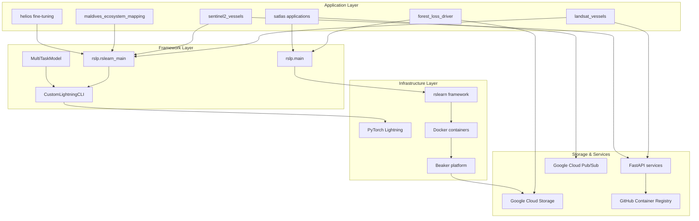
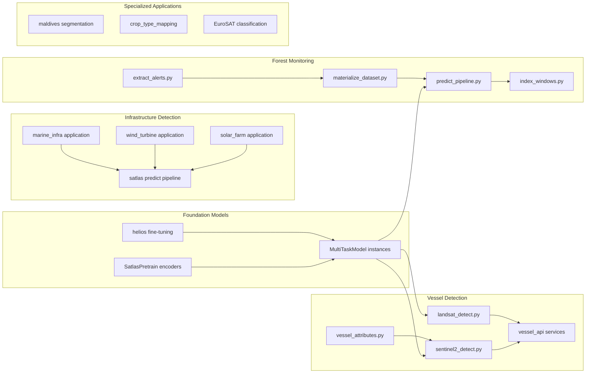
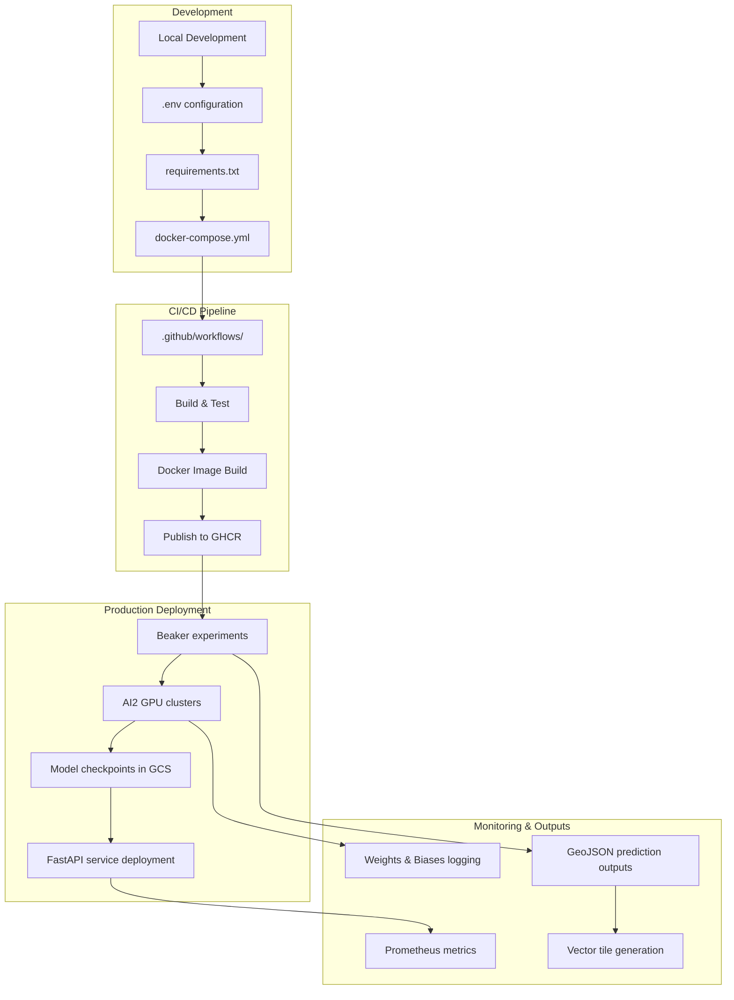

<!-- source: DeepWiki mcp.deepwiki.com · repo allenai/rslearn_projects · page 1 Overview · fetched 2026-10-26 -->

# Overview

Relevant source files

The following files were used as context for generating this wiki page:

- [LICENSE](LICENSE)
- [README.md](README.md)
- [docs/images/sentinel2_vessels/prediction.png](docs/images/sentinel2_vessels/prediction.png)
- [docs/satlas_marine_infra.md](docs/satlas_marine_infra.md)
- [rslp/forest_loss_driver/README.md](rslp/forest_loss_driver/README.md)

## Purpose and Scope

The `rslearn_projects` repository contains production machine learning applications for remote sensing built on the [rslearn framework](https://github.com/allenai/rslearn). This repository serves as the operational deployment layer for AI2's remote sensing capabilities, providing complete end-to-end systems from data processing to model inference and API services.

The repository encompasses three primary categories of systems:
- **Geospatial analysis applications** for forest monitoring, infrastructure detection, and ecosystem mapping
- **Vessel detection systems** for maritime surveillance using multiple satellite data sources
- **Foundation model integrations** enabling transfer learning across remote sensing tasks

For specific application documentation, see [Forest Loss Driver System](#3), [Vessel Detection Systems](#4), and [Satlas System](#5). For infrastructure details, see [Core Infrastructure](#2).

## System Architecture

The repository implements a layered architecture where specialized applications build upon shared infrastructure components:

Sources: [README.md:1-47](), [rslp/forest_loss_driver/README.md:1-60]()

## Application Ecosystem

The repository contains seven major application systems, each serving distinct remote sensing use cases:

Sources: [README.md:36-47](), [docs/satlas_marine_infra.md:1-116]()

## Core Technology Stack

The repository standardizes on a specific technology stack that enables consistent development and deployment patterns across all applications:

| Component | Technology | Purpose |
|-----------|------------|---------|
| ML Framework | `rslearn` + PyTorch Lightning | Dataset management, model training, and inference |
| CLI Interface | `CustomLightningCLI` | Enhanced Lightning CLI with cloud checkpointing |
| Containerization | Docker + Docker Compose | Development environment and deployment packaging |
| Orchestration | Beaker platform | GPU cluster job scheduling and execution |
| Storage | Google Cloud Storage | Model checkpoints, datasets, and results |
| APIs | FastAPI | Production inference services |
| Job Queuing | Google Cloud Pub/Sub | Distributed processing coordination |
| Registry | GitHub Container Registry | Container image publishing |

The `RSLP_PREFIX` environment variable serves as the root path for all model checkpoints and auxiliary files, typically pointing to a Google Cloud Storage bucket for production deployments.

Sources: [README.md:28-34]()

## Development and Deployment Pipeline

The repository implements a comprehensive CI/CD pipeline that transforms code changes into production-ready containerized services:

The deployment process leverages AI2's internal infrastructure, with Beaker providing GPU cluster access and Google Cloud Storage serving as the primary data persistence layer. All applications follow the same containerization patterns, enabling consistent deployment and scaling across different use cases.

Sources: [README.md:12-34]()

---

