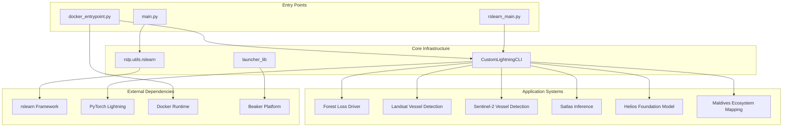
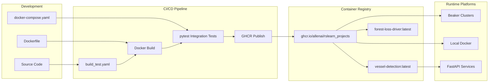
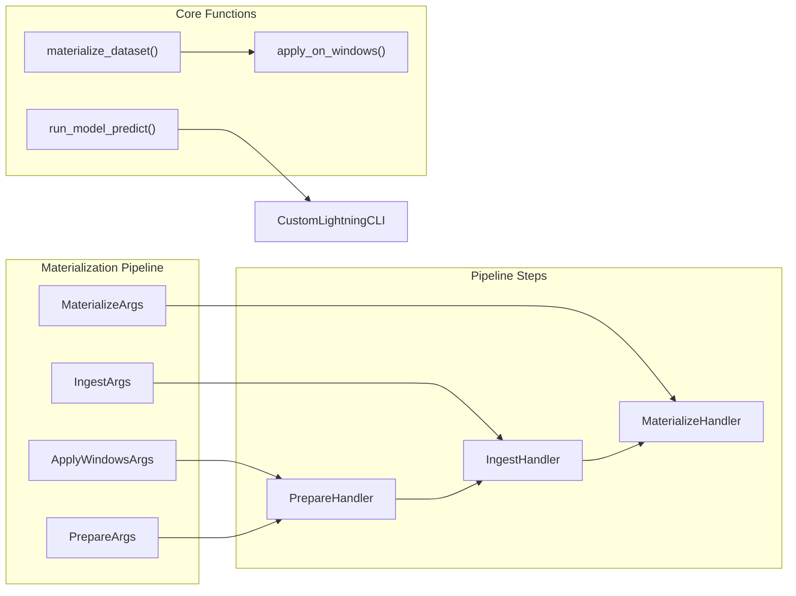
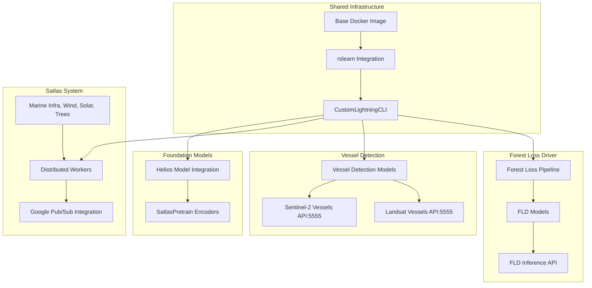
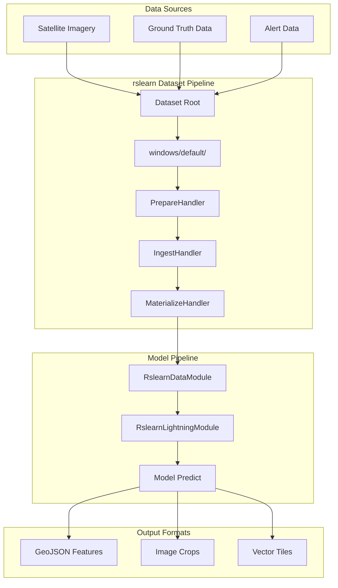
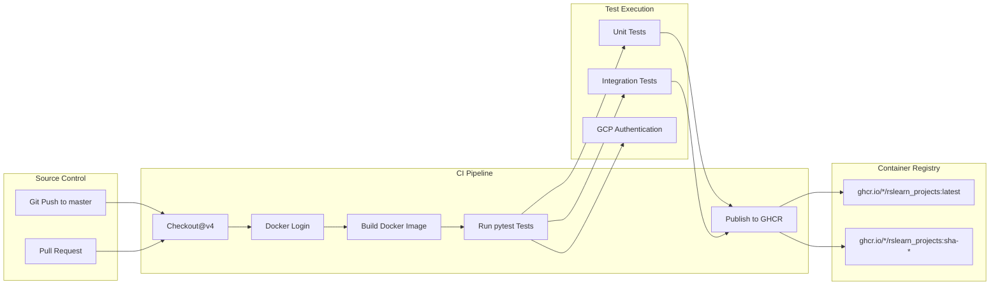

<!-- source: DeepWiki mcp.deepwiki.com · repo allenai/rslearn_projects · page 1.1 System Architecture · fetched 2026-10-26 -->

# System Architecture

Relevant source files

The following files were used as context for generating this wiki page:

- [.dockerignore](.dockerignore)
- [.github/workflows/build_test.yaml](.github/workflows/build_test.yaml)
- [.github/workflows/get_test_targets.sh](.github/workflows/get_test_targets.sh)
- [Dockerfile](Dockerfile)
- [docker-compose.yaml](docker-compose.yaml)
- [requirements.txt](requirements.txt)
- [rslp/config.py](rslp/config.py)
- [rslp/docker_entrypoint.py](rslp/docker_entrypoint.py)
- [rslp/landsat_vessels/Dockerfile](rslp/landsat_vessels/Dockerfile)
- [rslp/launcher_lib.py](rslp/launcher_lib.py)
- [rslp/lightning_cli.py](rslp/lightning_cli.py)
- [rslp/main.py](rslp/main.py)
- [rslp/rslearn_main.py](rslp/rslearn_main.py)
- [rslp/utils/rslearn.py](rslp/utils/rslearn.py)
- [tests/integration/forest_loss_driver/conftest.py](tests/integration/forest_loss_driver/conftest.py)
- [tests/integration/forest_loss_driver/inference/test_materialize_dataset.py](tests/integration/forest_loss_driver/inference/test_materialize_dataset.py)
- [tests/integration/forest_loss_driver/inference/test_model_predict.py](tests/integration/forest_loss_driver/inference/test_model_predict.py)
- [tests/unit/test_launcher_lib.py](tests/unit/test_launcher_lib.py)

This document provides a comprehensive overview of the system architecture for the rslearn_projects repository, which implements a collection of machine learning applications for remote sensing built on the rslearn framework. The architecture encompasses core infrastructure components, application-specific systems, and deployment mechanisms that enable scalable remote sensing ML workloads.

For information about specific applications like Forest Loss Driver, see [Forest Loss Driver System](#3). For deployment workflows, see [CI/CD and Deployment](#8). For development setup and utilities, see [Development Guide](#9).

## Core System Architecture

The rslearn_projects repository implements a layered architecture where the rslearn framework provides the foundation for multiple specialized remote sensing applications.

### High-Level System Components

**Sources:** [`rslp/docker_entrypoint.py:1-28`](), [`rslp/rslearn_main.py:1-30`](), [`rslp/main.py:1-76`](), [`rslp/lightning_cli.py:1-365`](), [`rslp/utils/rslearn.py:1-162`](), [`rslp/launcher_lib.py:1-266`]()

### Container Architecture and Deployment Pipeline

**Sources:** [`Dockerfile:1-48`](), [`docker-compose.yaml:1-14`](), [`.github/workflows/build_test.yaml:1-207`](), [`rslp/landsat_vessels/Dockerfile:1-13`]()

## Core Infrastructure Components

### CustomLightningCLI Integration

The `CustomLightningCLI` class extends the rslearn framework's Lightning CLI with AI2-specific features for cloud checkpointing and experiment management.

| Component | Purpose | Key Features |
|-----------|---------|--------------|
| `CustomLightningCLI` | Enhanced Lightning CLI | Cloud checkpointing, W&B integration, auto-resume |
| `SaveWandbRunIdCallback` | W&B run tracking | Saves W&B run IDs to GCS for resumption |
| `get_cached_checkpoint` | Checkpoint caching | Local caching of remote checkpoints |

Key configuration parameters:
- `--rslp_project`: Project identifier for organization
- `--rslp_experiment`: Experiment identifier 
- `--autoresume`: Auto-resume from existing checkpoints
- `--load_best`: Load best performing checkpoint for inference

**Sources:** [`rslp/lightning_cli.py:114-365`]()

### Dataset Materialization Pipeline

The rslearn integration provides a standardized pipeline for preparing datasets across all applications.

**Sources:** [`rslp/utils/rslearn.py:25-162`]()

### Experiment Management and Code Distribution

The launcher library manages experiment orchestration, hyperparameter sweeps, and code distribution across compute platforms.

| Function | Purpose | Key Operations |
|----------|---------|----------------|
| `upload_code()` | Code distribution | Creates zip archive, uploads to GCS |
| `download_code()` | Code retrieval | Downloads and extracts code in containers |
| `generate_combinations()` | Hyperparameter sweeps | Generates config combinations |
| `upload_wandb_id()` / `download_wandb_id()` | W&B tracking | Manages W&B run IDs for resumption |

**Sources:** [`rslp/launcher_lib.py:14-266`]()

## Application System Architecture

### Multi-Application Deployment Model

**Sources:** [`Dockerfile:18-48`](), [`rslp/lightning_cli.py:114-365`](), [`rslp/landsat_vessels/Dockerfile:1-13`]()

### Entry Point Architecture

The system provides multiple entry points for different deployment scenarios:

| Entry Point | Use Case | Key Features |
|-------------|----------|--------------|
| `docker_entrypoint.py` | Containerized jobs | Downloads code from GCS, runs rslearn |
| `rslearn_main.py` | Direct execution | Local development, custom Lightning CLI |
| `main.py` | Workflow execution | Project-specific workflow routing |

**Sources:** [`rslp/docker_entrypoint.py:1-28`](), [`rslp/rslearn_main.py:1-30`](), [`rslp/main.py:42-65`]()

## Data Flow and Processing Architecture

### Dataset Processing Pipeline

**Sources:** [`rslp/utils/rslearn.py:82-127`](), [`tests/integration/forest_loss_driver/inference/test_materialize_dataset.py:25-94`](), [`tests/integration/forest_loss_driver/inference/test_model_predict.py:25-90`]()

## Infrastructure and Deployment Architecture

### CI/CD Pipeline Architecture

The deployment pipeline implements a comprehensive build, test, and publish workflow:

| Stage | Components | Key Operations |
|-------|------------|----------------|
| Build | `docker/build-push-action` | Multi-architecture Docker builds |
| Test | `docker-compose` | Unit and integration test execution |
| Publish | `ghcr.io` | Container registry publishing |

**Sources:** [`.github/workflows/build_test.yaml:19-207`](), [`docker-compose.yaml:1-14`](), [`.github/workflows/get_test_targets.sh:1-28`]()

### Compute Platform Integration

The system integrates with multiple compute platforms for different workload types:

| Platform | Use Case | Integration Method |
|----------|----------|--------------------|
| Beaker | Large-scale training and inference | `beaker-py` library |
| Local Docker | Development and testing | `docker-compose` |
| GitHub Actions | CI/CD | Ubuntu runners with Docker |

**Sources:** [`requirements.txt:1-15`](), [`.github/workflows/build_test.yaml:80-147`]()

This architecture enables scalable, reproducible remote sensing ML workloads across multiple applications while maintaining consistent infrastructure patterns and deployment mechanisms.

---

