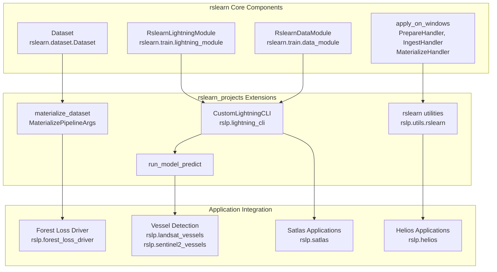
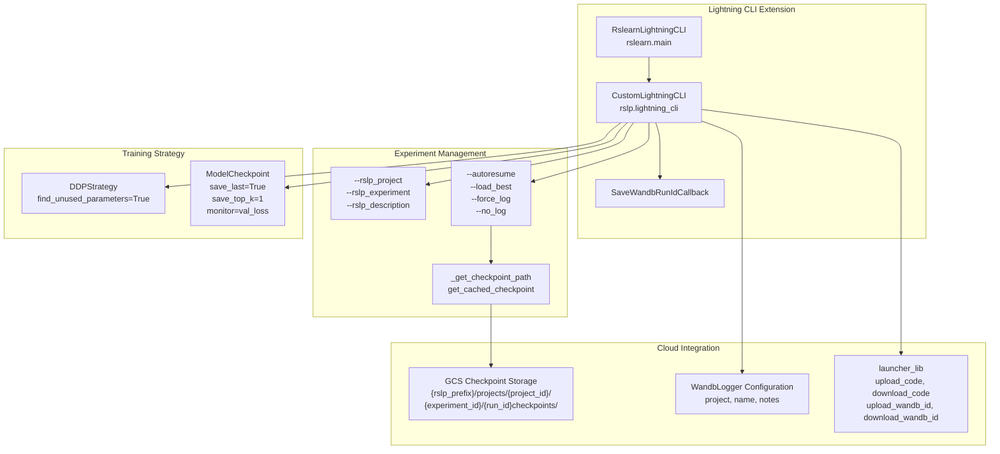
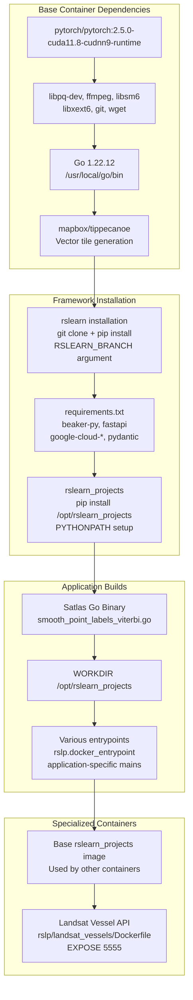
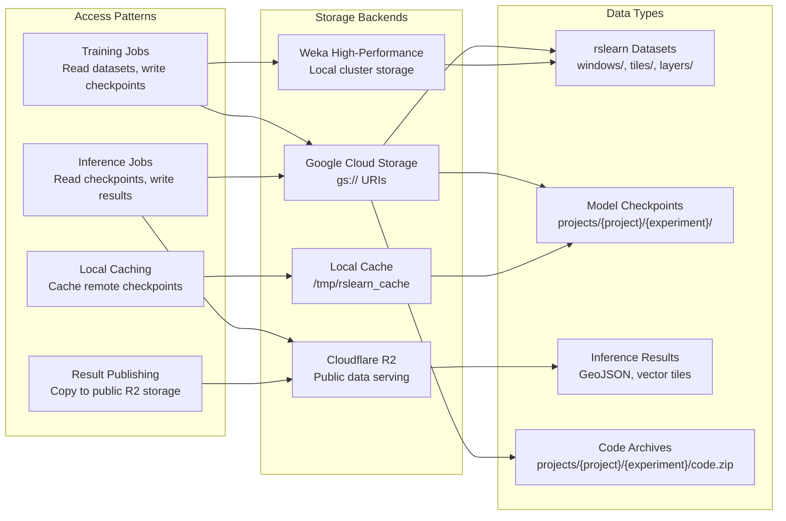
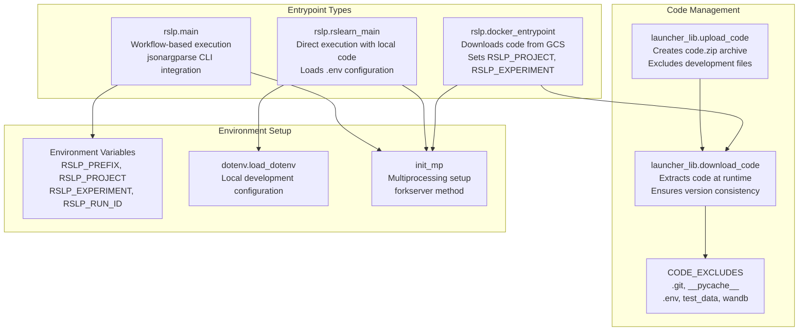

<!-- source: DeepWiki mcp.deepwiki.com · repo allenai/rslearn_projects · page 1.2 Core Technologies · fetched 2026-10-26 -->

# Core Technologies

Relevant source files

The following files were used as context for generating this wiki page:

- [.dockerignore](.dockerignore)
- [.github/workflows/build_test.yaml](.github/workflows/build_test.yaml)
- [.github/workflows/get_test_targets.sh](.github/workflows/get_test_targets.sh)
- [Dockerfile](Dockerfile)
- [docker-compose.yaml](docker-compose.yaml)
- [requirements.txt](requirements.txt)
- [rslp/config.py](rslp/config.py)
- [rslp/docker_entrypoint.py](rslp/docker_entrypoint.py)
- [rslp/landsat_vessels/Dockerfile](rslp/landsat_vessels/Dockerfile)
- [rslp/launcher_lib.py](rslp/launcher_lib.py)
- [rslp/lightning_cli.py](rslp/lightning_cli.py)
- [rslp/main.py](rslp/main.py)
- [rslp/rslearn_main.py](rslp/rslearn_main.py)
- [rslp/utils/rslearn.py](rslp/utils/rslearn.py)
- [tests/integration/forest_loss_driver/conftest.py](tests/integration/forest_loss_driver/conftest.py)
- [tests/integration/forest_loss_driver/inference/test_materialize_dataset.py](tests/integration/forest_loss_driver/inference/test_materialize_dataset.py)
- [tests/integration/forest_loss_driver/inference/test_model_predict.py](tests/integration/forest_loss_driver/inference/test_model_predict.py)
- [tests/unit/test_launcher_lib.py](tests/unit/test_launcher_lib.py)

This document provides an overview of the foundational technologies that underpin all applications in the rslearn_projects repository. These core technologies provide shared infrastructure, common patterns, and deployment mechanisms used across vessel detection, forest loss driver, Satlas, and other machine learning applications.

For information about how these technologies are orchestrated in specific applications, see [System Architecture](#1.1). For details about the distributed worker system built on these foundations, see [Distributed Worker System](#2.4).

## rslearn Framework Integration

The repository is built as an extension of the [rslearn framework](https://github.com/allenai/rslearn), which provides the core dataset management, model training, and inference capabilities for remote sensing machine learning. All applications in this repository leverage rslearn's foundational components while adding AI2-specific enhancements and workflow orchestration.

### Core Framework Architecture

**Sources:** [rslp/utils/rslearn.py:1-162](), [rslp/lightning_cli.py:1-365]()

### Dataset Materialization Pipeline

The `materialize_dataset` function provides a standardized workflow for preparing rslearn datasets across all applications. It orchestrates the three-stage rslearn pipeline: prepare, ingest, and materialize.

| Component | Purpose | Configuration |
|-----------|---------|---------------|
| `PrepareHandler` | Extracts metadata and prepares windows | `PrepareArgs` with retry logic |
| `IngestHandler` | Downloads and processes raw satellite imagery | `IngestArgs` with error handling |
| `MaterializeHandler` | Converts data to final format for training/inference | `MaterializeArgs` with layer management |

The pipeline uses `ApplyWindowsArgs` to control parallelization with configurable workers, batch sizes, and job distribution. Each stage supports retry mechanisms with exponential backoff for robust cloud-based processing.

**Sources:** [rslp/utils/rslearn.py:82-127](), [rslp/utils/rslearn.py:25-80]()

## PyTorch Lightning and CustomLightningCLI

The repository enhances PyTorch Lightning with AI2-specific features through the `CustomLightningCLI` class, which extends rslearn's `RslearnLightningCLI` to provide cloud checkpointing, experiment management, and Weights & Biases integration.

### CustomLightningCLI Architecture

**Sources:** [rslp/lightning_cli.py:114-365](), [rslp/lightning_cli.py:25-72]()

### Checkpoint Management

The CLI provides sophisticated checkpoint management for distributed training environments:

- **`--autoresume=true`**: Automatically resumes from `last.ckpt` if available, otherwise starts fresh
- **`--load_best=true`**: Loads the best-performing checkpoint based on epoch numbers, required for inference
- **Checkpoint caching**: Remote checkpoints are cached locally using SHA256 hashing to avoid repeated downloads

The checkpoint path resolution logic prioritizes checkpoints with higher epoch numbers and falls back to `last.ckpt` only when no epoch-based checkpoints exist.

**Sources:** [rslp/lightning_cli.py:171-258]()

## Docker and Containerization

All applications are containerized using a multi-stage Docker architecture that provides consistent environments from development through production deployment.

### Container Architecture

**Sources:** [Dockerfile:1-48](), [rslp/landsat_vessels/Dockerfile:1-13]()

### Development and Testing Environment

The repository provides a Docker Compose setup for local development and testing that mirrors production environments while providing development conveniences.

| Service | Purpose | Configuration |
|---------|---------|---------------|
| `test` | Integration and unit testing | Built from main Dockerfile |
| Local development | Code mounting and debugging | Volume mounts, environment variables |
| CI/CD integration | Automated testing in GitHub Actions | Same container across environments |

The `.dockerignore` file excludes development artifacts, test data, and cache directories to optimize build contexts and container sizes.

**Sources:** [docker-compose.yaml:1-14](), [.dockerignore:1-8]()

## Cloud Platforms and Infrastructure

The repository integrates with multiple cloud platforms to provide scalable compute, storage, and orchestration capabilities.

### Beaker Platform Integration

Beaker serves as the primary compute platform for training and large-scale inference jobs. The integration provides:

- **Cluster targeting**: `jupiter-cirrascale-2`, `saturn-cirrascale`, `neptune-cirrascale`
- **GPU resource allocation**: Automatic GPU detection and allocation
- **Job scheduling**: Integration with `beaker-py` for programmatic job submission
- **Experiment tracking**: Hierarchical organization by project and experiment IDs

### Google Cloud Services

| Service | Purpose | Integration Points |
|---------|---------|-------------------|
| **Cloud Storage** | Dataset storage, checkpoints, results | `gs://` URIs throughout codebase |
| **Cloud Pub/Sub** | Job queuing for distributed inference | Worker orchestration in Satlas |
| **BigTable** | Metadata and indexing for large datasets | Vessel detection and forest loss systems |

**Sources:** [requirements.txt:3-4](), [.github/workflows/build_test.yaml:137-145]()

### Storage Architecture

The repository uses a hierarchical storage layout across multiple backends:

**Sources:** [rslp/lightning_cli.py:25-27](), [rslp/launcher_lib.py:14-15]()

## Development and CI/CD Tooling

The repository provides comprehensive tooling for development, testing, and automated deployment through GitHub Actions workflows.

### GitHub Actions Pipeline

The main CI/CD pipeline orchestrates building, testing, and publishing of Docker images:

| Stage | Purpose | Key Features |
|-------|---------|--------------|
| **Build** | Docker image creation | Multi-platform builds, metadata extraction |
| **Test** | Automated testing | Unit and integration tests, selective test execution |
| **Publish** | Container registry publishing | GitHub Container Registry, tag management |

The pipeline uses intelligent test selection based on changed files, running only relevant test suites for pull requests while executing full test suites on the master branch.

**Sources:** [.github/workflows/build_test.yaml:1-153](), [.github/workflows/get_test_targets.sh:1-28]()

### Container Registry Strategy

Images are published to GitHub Container Registry (GHCR) with multiple tagging strategies:

- **SHA-based tags**: `sha-{long}`, `sha-{short}` for precise version tracking
- **Branch tags**: `latest` for master branch builds
- **Digest-based references**: Immutable references for production deployments

The registry integration supports automated authentication using GitHub tokens and provides secure access to private repositories.

**Sources:** [.github/workflows/build_test.yaml:31-76]()

### Code Distribution and Entrypoints

The repository provides multiple entrypoints for different execution contexts:

The code distribution system ensures version consistency between job submission and execution environments while excluding development artifacts and sensitive configuration files.

**Sources:** [rslp/docker_entrypoint.py:1-28](), [rslp/rslearn_main.py:1-30](), [rslp/main.py:1-76](), [rslp/launcher_lib.py:77-127]()

---

