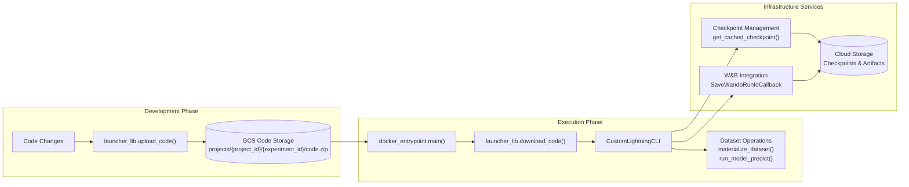
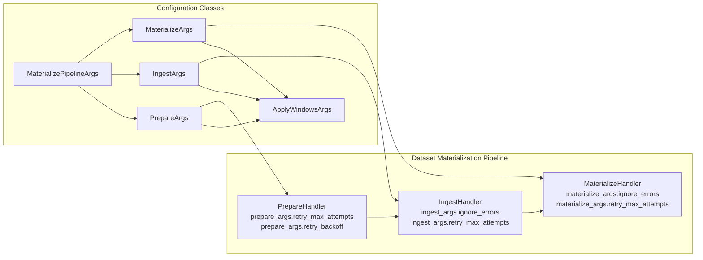
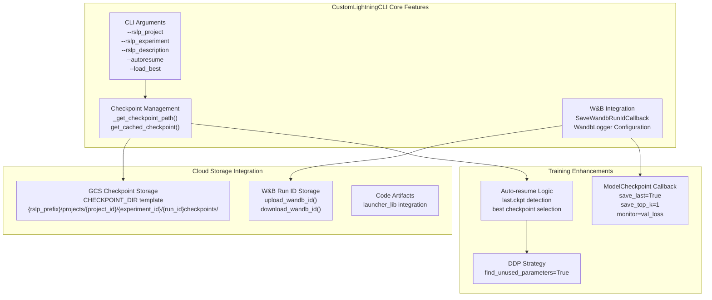
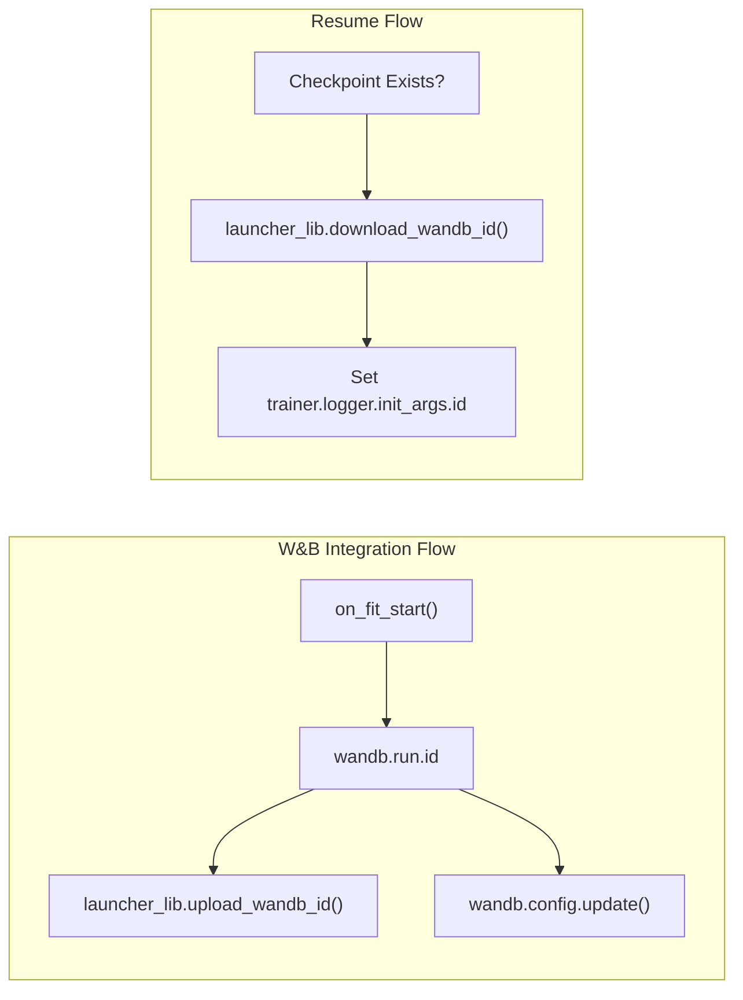
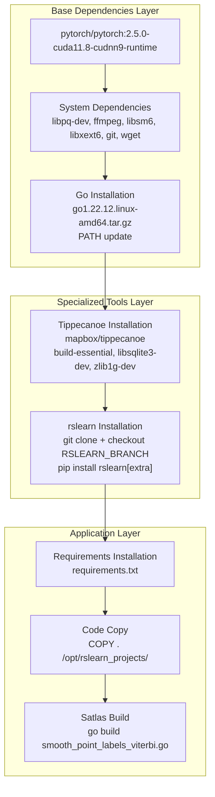
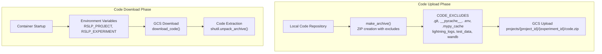
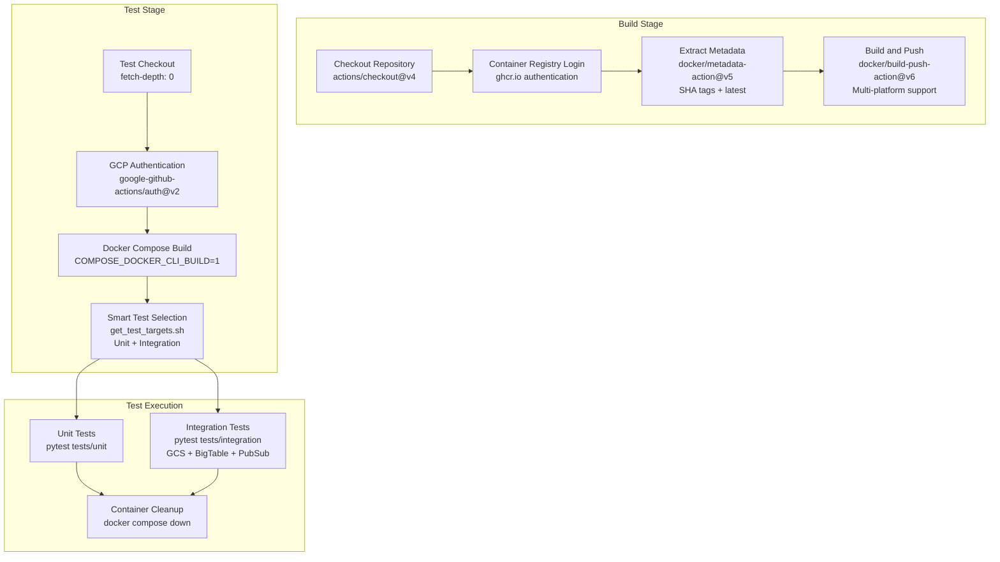

<!-- source: DeepWiki mcp.deepwiki.com · repo allenai/rslearn_projects · page 2 Core Infrastructure · fetched 2026-10-26 -->

# Core Infrastructure

<details>
<summary>Relevant source files</summary>

The following files were used as context for generating this wiki page:

- [.dockerignore](.dockerignore)
- [.github/workflows/build_test.yaml](.github/workflows/build_test.yaml)
- [.github/workflows/get_test_targets.sh](.github/workflows/get_test_targets.sh)
- [Dockerfile](Dockerfile)
- [docker-compose.yaml](docker-compose.yaml)
- [requirements.txt](requirements.txt)
- [rslp/config.py](rslp/config.py)
- [rslp/docker_entrypoint.py](rslp/docker_entrypoint.py)
- [rslp/landsat_vessels/Dockerfile](rslp/landsat_vessels/Dockerfile)
- [rslp/launcher_lib.py](rslp/launcher_lib.py)
- [rslp/lightning_cli.py](rslp/lightning_cli.py)
- [rslp/main.py](rslp/main.py)
- [rslp/rslearn_main.py](rslp/rslearn_main.py)
- [rslp/utils/rslearn.py](rslp/utils/rslearn.py)
- [tests/integration/forest_loss_driver/conftest.py](tests/integration/forest_loss_driver/conftest.py)
- [tests/integration/forest_loss_driver/inference/test_materialize_dataset.py](tests/integration/forest_loss_driver/inference/test_materialize_dataset.py)
- [tests/integration/forest_loss_driver/inference/test_model_predict.py](tests/integration/forest_loss_driver/inference/test_model_predict.py)
- [tests/unit/test_launcher_lib.py](tests/unit/test_launcher_lib.py)

</details>


This document covers the shared infrastructure components that support all applications within the rslearn_projects repository. The core infrastructure provides the foundational layer for dataset management, model training, containerization, and distributed job execution that all domain-specific applications build upon.

For application-specific systems that utilize this infrastructure, see [Forest Loss Driver System](#3), [Vessel Detection Systems](#4), and [Satlas System](#5). For deployment and CI/CD workflows that build upon this infrastructure, see [CI/CD and Deployment](#8).

## Infrastructure Architecture Overview

The core infrastructure consists of four primary subsystems that work together to provide a complete machine learning platform for remote sensing applications.

```mermaid
graph TB
    subgraph "Core ML Framework"
        rslearn_utils["`rslp/utils/rslearn.py`<br/>Dataset & Model Utilities"]
        lightning_cli["`CustomLightningCLI`<br/>Enhanced Training Interface"]
        base_config["`rslp/config.py`<br/>Base Configuration Classes"]
    end
    
    subgraph "Containerization Layer"
        dockerfile["`Dockerfile`<br/>Multi-stage Container Build"]
        docker_compose["`docker-compose.yaml`<br/>Local Development Setup"]
        entrypoint["`rslp/docker_entrypoint.py`<br/>Container Entry Point"]
    end
    
    subgraph "Job Management System"
        launcher_lib["`rslp/launcher_lib.py`<br/>Code & Job Management"]
        main_cli["`rslp/main.py`<br/>Workflow Dispatcher"]
        rslearn_main["`rslp/rslearn_main.py`<br/>Direct rslearn Integration"]
    end
    
    subgraph "CI/CD Pipeline"
        build_test["`build_test.yaml`<br/>GitHub Actions Workflow"]
        test_targets["`get_test_targets.sh`<br/>Smart Test Selection"]
    end
    
    rslearn_utils --> lightning_cli
    lightning_cli --> dockerfile
    launcher_lib --> entrypoint
    main_cli --> rslearn_main
    build_test --> dockerfile
    build_test --> docker_compose
    
    style rslearn_utils fill:#f9f9f9
    style lightning_cli fill:#f9f9f9
    style dockerfile fill:#f0f8ff
    style launcher_lib fill:#fff8f0
```

**Core Infrastructure Data Flow**



Sources: [rslp/lightning_cli.py:1-365](), [rslp/utils/rslearn.py:1-162](), [rslp/launcher_lib.py:1-266](), [Dockerfile:1-48]()

## rslearn Framework Integration

The repository extends the core rslearn framework through a set of utility modules that provide standardized interfaces for dataset operations and model execution. The integration layer abstracts rslearn's complexity while adding project-specific functionality.

### Dataset Operations

The `rslp.utils.rslearn` module provides the primary interface for dataset lifecycle management through structured configuration classes and pipeline functions:

| Component | Purpose | Key Methods |
|-----------|---------|-------------|
| `MaterializePipelineArgs` | Configuration for dataset materialization | Contains `PrepareArgs`, `IngestArgs`, `MaterializeArgs` |
| `ApplyWindowsArgs` | Parallel processing configuration | Controls workers, batch size, job distribution |
| `materialize_dataset()` | Execute complete dataset pipeline | Runs prepare → ingest → materialize sequence |
| `run_model_predict()` | Model inference execution | Wraps `CustomLightningCLI` for prediction tasks |

The materialization pipeline follows rslearn's three-stage approach:



### Model Execution Interface

The `run_model_predict()` function provides a standardized way to execute model inference across all applications:

```python
# From rslp/utils/rslearn.py:129-162
def run_model_predict(
    model_cfg_fname: str,
    ds_path: UPath,
    groups: list[str] = [],
    extra_args: list[str] = [],
) -> None
```

This function instantiates `CustomLightningCLI` with project-specific defaults and handles argument composition for different prediction scenarios.

Sources: [rslp/utils/rslearn.py:1-162](), [tests/integration/forest_loss_driver/inference/test_model_predict.py:1-90](), [tests/integration/forest_loss_driver/inference/test_materialize_dataset.py:1-94]()

## CustomLightningCLI and Training Infrastructure

The `CustomLightningCLI` class extends PyTorch Lightning's CLI with AI2-specific features for cloud-native machine learning workflows. It provides enhanced checkpoint management, experiment tracking, and distributed training capabilities.

### Enhanced Lightning CLI Features



### Checkpoint Management System

The checkpoint management system provides three distinct modes for handling model state:

| Mode | Flag | Behavior | Use Case |
|------|------|----------|----------|
| Default | None | Error if checkpoint exists | New training runs |
| Auto-resume | `--autoresume=true` | Resume if `last.ckpt` exists, else start fresh | Preemptible environments |
| Load Best | `--load_best=true` | Load best checkpoint, error if none exists | Inference tasks |

The checkpoint resolution logic [rslp/lightning_cli.py:171-259]() implements sophisticated best-checkpoint selection based on epoch numbering and fallback to `last.ckpt` only when no epoch-tagged checkpoints exist.

### Experiment Tracking Integration

The `SaveWandbRunIdCallback` class manages W&B run continuity across job restarts:



Sources: [rslp/lightning_cli.py:1-365](), [rslp/launcher_lib.py:129-172]()

## Docker and Containerization

The containerization system provides a multi-stage Docker build that creates self-contained environments for training and inference. The system supports both local development and production deployment scenarios.

### Container Build Architecture



### Container Entry Points

The system provides multiple entry points for different execution contexts:

| Entry Point | File | Purpose | Environment |
|-------------|------|---------|-------------|
| Docker Entry | `rslp/docker_entrypoint.py` | Production containers with code download | Beaker, distributed jobs |
| Direct Entry | `rslp/rslearn_main.py` | Local development, manual execution | Development environments |
| Workflow Dispatcher | `rslp/main.py` | Project-specific workflow execution | All environments |

The Docker entry point implements the code synchronization pattern:

```python
# From rslp/docker_entrypoint.py:6-23
def main() -> None:
    import os
    project_id = os.environ["RSLP_PROJECT"]
    experiment_id = os.environ["RSLP_EXPERIMENT"]
    from rslp.launcher_lib import download_code
    download_code(project_id, experiment_id)
    import rslp.rslearn_main
    rslp.rslearn_main.main()
```

### Development and Testing Setup

The `docker-compose.yaml` configuration provides a simplified setup for local testing and development:

- Builds the main Dockerfile without GPU requirements
- Mounts test data and provides environment variable injection
- Supports both unit and integration testing workflows

Sources: [Dockerfile:1-48](), [docker-compose.yaml:1-14](), [rslp/docker_entrypoint.py:1-28](), [rslp/rslearn_main.py:1-30]()

## Distributed Job Management and Orchestration

The job management system provides code distribution, experiment configuration, and hyperparameter sweep capabilities for distributed execution across cloud infrastructure.

### Code Distribution System



### Hyperparameter Management

The launcher library provides sophisticated hyperparameter sweep capabilities through configuration combination generation:

| Function | Purpose | Input | Output |
|----------|---------|-------|--------|
| `extract_parameters()` | Find list-valued parameters | Nested config dict | List of (path, values) tuples |
| `generate_combinations()` | Create parameter combinations | Base config + hyperparams | List of complete configs |
| `create_custom_configs()` | Generate config files | Config paths + output dir | Dict of run_id → config_path |

The system supports nested parameter specification and automatic cartesian product generation for comprehensive hyperparameter exploration.

### Experiment Metadata Management

W&B run ID persistence enables experiment continuity across job preemption and restart:

```python
# From rslp/launcher_lib.py:129-147
def upload_wandb_id(
    project_id: str, experiment_id: str, run_id: str | None, wandb_id: str
) -> None:
    rslp_prefix = UPath(os.environ["RSLP_PREFIX"])
    run_id_path = f"{run_id}/" if run_id else ""
    blob_path = WANDB_ID_BLOB_PATH.format(
        project_id=project_id, experiment_id=experiment_id, run_id=run_id_path
    )
    with (rslp_prefix / blob_path).open("w") as f:
        f.write(wandb_id)
```

Sources: [rslp/launcher_lib.py:1-266](), [rslp/main.py:1-76](), [tests/unit/test_launcher_lib.py:1-60]()

## CI/CD and Build Pipeline

The CI/CD system provides automated testing, container building, and artifact publishing through GitHub Actions workflows with intelligent test selection and multi-stage validation.

### Build and Test Workflow



### Intelligent Test Selection

The `get_test_targets.sh` script implements change-based test selection to optimize CI execution time:

```bash
# From .github/workflows/get_test_targets.sh:15-27
CHANGED_FILES=$(git diff --name-only origin/master...HEAD)

for dir in tests/$TEST_TYPE/*/; do
    dir_name=$(basename "$dir")
    if echo "$CHANGED_FILES" | grep -q "^rslp/$dir_name/"; then
        TEST_DIRS+=("tests/$TEST_TYPE/$dir_name/**")
    fi
done
```

This approach ensures that only relevant tests execute for specific application changes while maintaining comprehensive coverage for core infrastructure modifications.

### Container Registry Integration

The workflow publishes multi-tagged container images to GitHub Container Registry (GHCR):

- SHA-based tags for immutable references (`sha-<commit>`)
- Short SHA tags for convenience (`sha-<short>`)
- Latest tag for default branch commits
- Digest-based references for deployment systems

Sources: [.github/workflows/build_test.yaml:1-207](), [.github/workflows/get_test_targets.sh:1-28](), [requirements.txt:1-15]()

---

