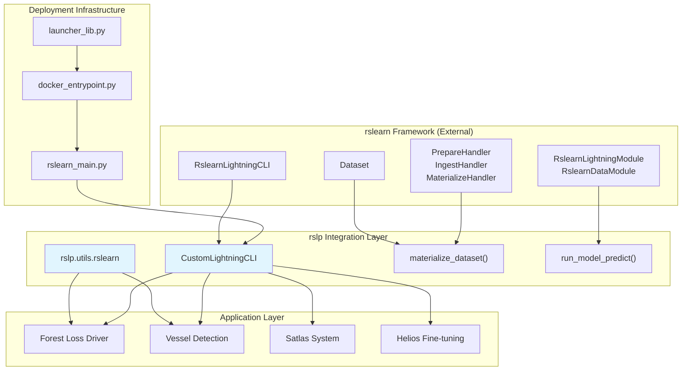
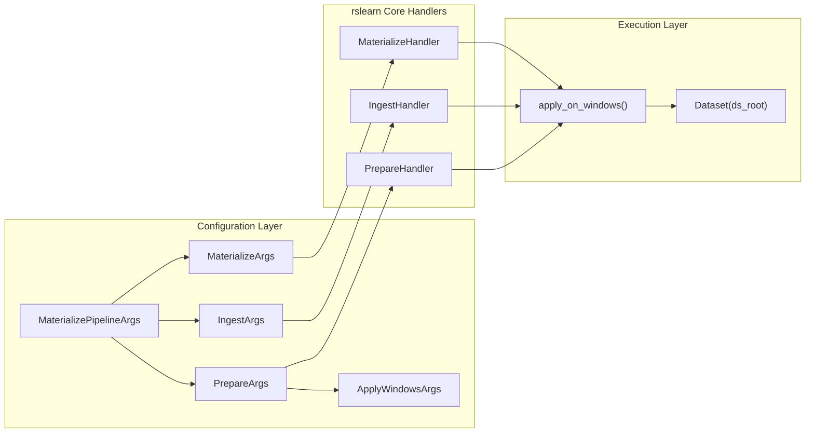
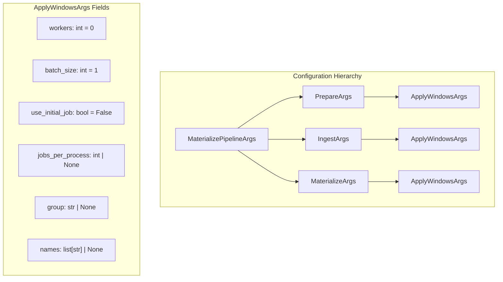
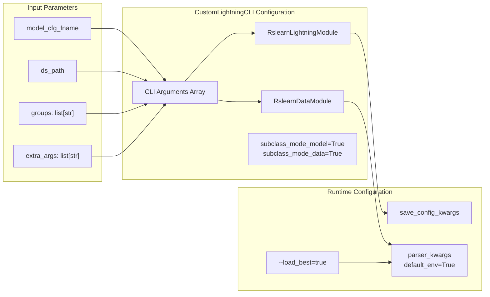
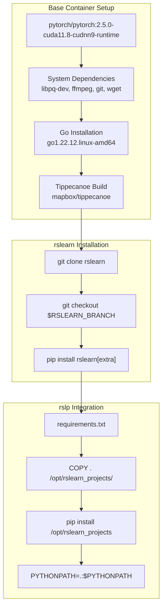
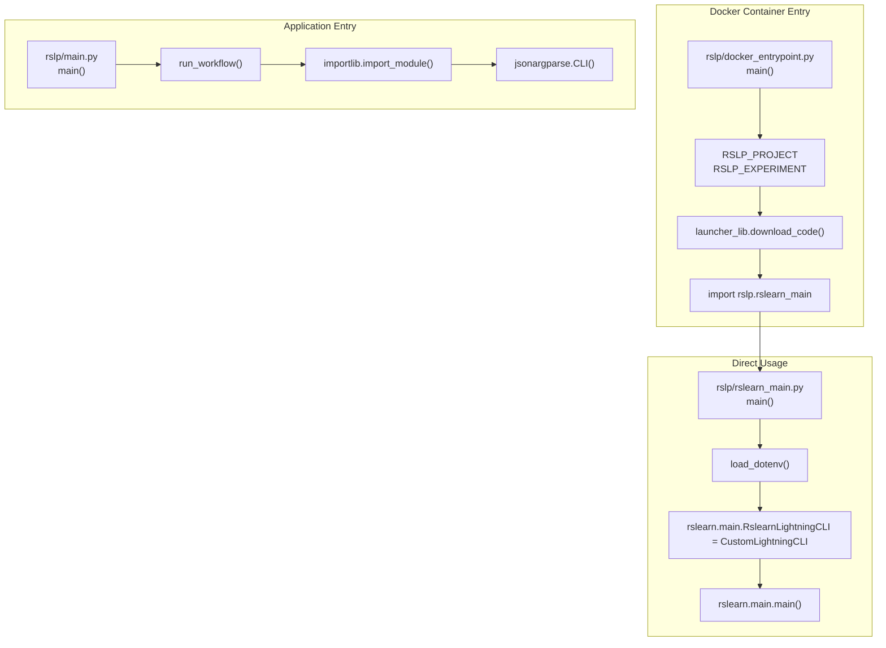

<!-- source: DeepWiki mcp.deepwiki.com · repo allenai/rslearn_projects · page 2.1 rslearn Framework Integration · fetched 2026-10-26 -->

# rslearn Framework Integration

Relevant source files

The following files were used as context for generating this wiki page:

- [.dockerignore](.dockerignore)
- [.github/workflows/build_test.yaml](.github/workflows/build_test.yaml)
- [.github/workflows/get_test_targets.sh](.github/workflows/get_test_targets.sh)
- [Dockerfile](Dockerfile)
- [docker-compose.yaml](docker-compose.yaml)
- [requirements.txt](requirements.txt)
- [rslp/config.py](rslp/config.py)
- [rslp/docker_entrypoint.py](rslp/docker_entrypoint.py)
- [rslp/landsat_vessels/Dockerfile](rslp/landsat_vessels/Dockerfile)
- [rslp/launcher_lib.py](rslp/launcher_lib.py)
- [rslp/lightning_cli.py](rslp/lightning_cli.py)
- [rslp/main.py](rslp/main.py)
- [rslp/rslearn_main.py](rslp/rslearn_main.py)
- [rslp/utils/rslearn.py](rslp/utils/rslearn.py)
- [tests/integration/forest_loss_driver/conftest.py](tests/integration/forest_loss_driver/conftest.py)
- [tests/integration/forest_loss_driver/inference/test_materialize_dataset.py](tests/integration/forest_loss_driver/inference/test_materialize_dataset.py)
- [tests/integration/forest_loss_driver/inference/test_model_predict.py](tests/integration/forest_loss_driver/inference/test_model_predict.py)
- [tests/unit/test_launcher_lib.py](tests/unit/test_launcher_lib.py)

This document covers how the `rslearn_projects` repository extends and integrates with the core `rslearn` framework for dataset management, model training, and inference. The integration provides AI2-specific enhancements while maintaining compatibility with the base rslearn functionality.

For information about the CustomLightningCLI training framework, see [CustomLightningCLI and Training](#2.2). For Docker containerization details, see [Docker and Containerization](#2.3).

## Integration Architecture

The rslearn framework integration operates through several key extension points that enhance the base rslearn functionality with AI2-specific features:

Sources: [rslp/utils/rslearn.py:1-162](), [rslp/lightning_cli.py:1-365](), [rslp/rslearn_main.py:1-30](), [rslp/docker_entrypoint.py:1-28]()

## Dataset Management Integration

The rslearn dataset management integration provides standardized interfaces for dataset materialization across all applications:

### Dataset Materialization Pipeline

The `materialize_dataset()` function provides a unified interface for dataset preparation:

| Component | Purpose | Configuration |
|-----------|---------|---------------|
| `PrepareHandler` | Window-level preparation | `retry_max_attempts`, `retry_backoff` |
| `IngestHandler` | Data ingestion from sources | `ignore_errors`, retry parameters |
| `MaterializeHandler` | Final materialization | Error handling and retry logic |
| `ApplyWindowsArgs` | Execution parameters | `workers`, `batch_size`, `jobs_per_process` |

Sources: [rslp/utils/rslearn.py:25-127](), [tests/integration/forest_loss_driver/inference/test_materialize_dataset.py:1-94]()

### Dataset Configuration Structures

The integration defines standardized configuration dataclasses for consistent dataset processing:

Sources: [rslp/utils/rslearn.py:25-80]()

## Model Training and Inference Integration

The model training integration centers around the `run_model_predict()` function and `CustomLightningCLI` class:

### Model Prediction Pipeline

The `run_model_predict()` function constructs standardized CLI arguments for rslearn model inference:

| Parameter | Purpose | CLI Mapping |
|-----------|---------|-------------|
| `model_cfg_fname` | Model configuration file | `--config` |
| `ds_path` | Dataset root path | `--data.init_args.path` |
| `groups` | Prediction groups | `--data.init_args.predict_config.groups` |
| `extra_args` | Additional arguments | Appended to args list |

Sources: [rslp/utils/rslearn.py:129-162](), [tests/integration/forest_loss_driver/inference/test_model_predict.py:19-33]()

## Docker Integration

The rslearn framework is integrated into the Docker environment through the base container setup:

### Docker Build Integration

The Docker integration allows for flexible rslearn branch selection through the `RSLEARN_BRANCH` build argument, defaulting to `master`.

Sources: [Dockerfile:18-25](), [Dockerfile:29-41]()

## Entry Points and Usage Patterns

The rslearn integration provides multiple entry points for different deployment scenarios:

### Entry Point Architecture

### Usage Patterns

| Entry Point | Use Case | Key Features |
|-------------|----------|--------------|
| `rslearn_main.py` | Direct development usage | Environment variable loading, CLI replacement |
| `docker_entrypoint.py` | Container deployment | Code download from GCS, environment setup |
| `main.py` | Workflow execution | Project-specific workflow routing, jsonargparse integration |

Sources: [rslp/rslearn_main.py:10-24](), [rslp/docker_entrypoint.py:6-22](), [rslp/main.py:42-64]()

## Integration Testing

The rslearn integration is validated through comprehensive integration tests that verify dataset materialization and model prediction workflows:

```mermaid
graph LR
    subgraph "Test Data Setup"
        gcs_download["download_test_data fixture"]
        test_paths["test_materialized_dataset_path<br/>test_unmaterialized_dataset_path"]
        model_config["model_cfg_fname fixture"]
    end
    
    subgraph "Dataset Tests"
        materialize_test["test_materialize_forest_loss_driver_dataset"]
        dataset_copy["shutil.copytree()"]
        materialize_call["materialize_dataset()"]
        validation["Assert materialized layers exist"]
    end
    
    subgraph "Model Tests"
        predict_test["test_forest_loss_driver_model_predict"]
        setup_dataset["select_least_cloudy_images_pipeline()"]
        model_predict["run_model_predict()"]
        output_validation["Validate GeoJSON output format"]
    end
    
    gcs_download --> test_paths
    test_paths --> model_config
    
    model_config --> materialize_test
    materialize_test --> dataset_copy
    dataset_copy --> materialize_call
    materialize_call --> validation
    
    validation --> predict_test
    predict_test --> setup_dataset
    setup_dataset --> model_predict
    model_predict --> output_validation
```

The integration tests verify that rslearn dataset operations produce expected file structures and that model prediction generates valid GeoJSON outputs with correct probability distributions.

Sources: [tests/integration/forest_loss_driver/inference/test_materialize_dataset.py:25-41](), [tests/integration/forest_loss_driver/inference/test_model_predict.py:25-33](), [tests/integration/forest_loss_driver/conftest.py:59-104]()

---

