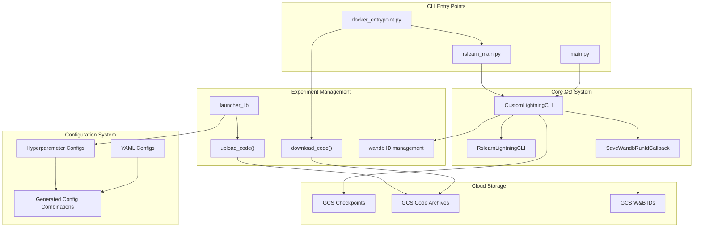
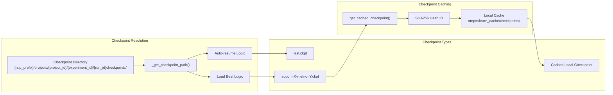
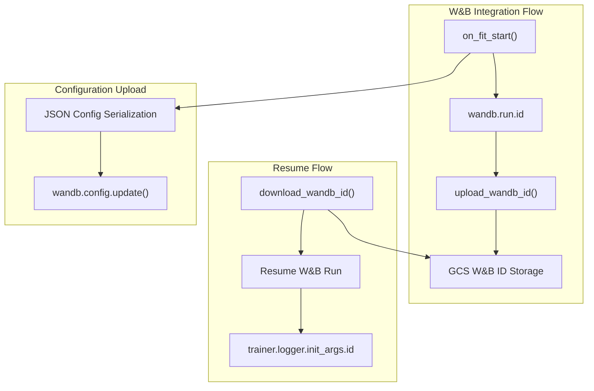
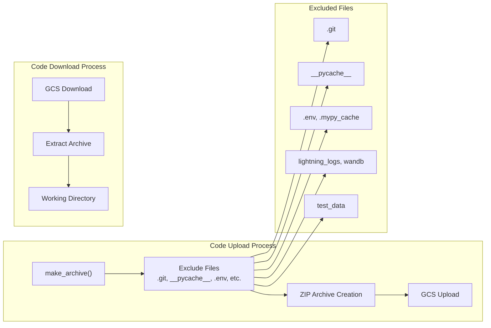
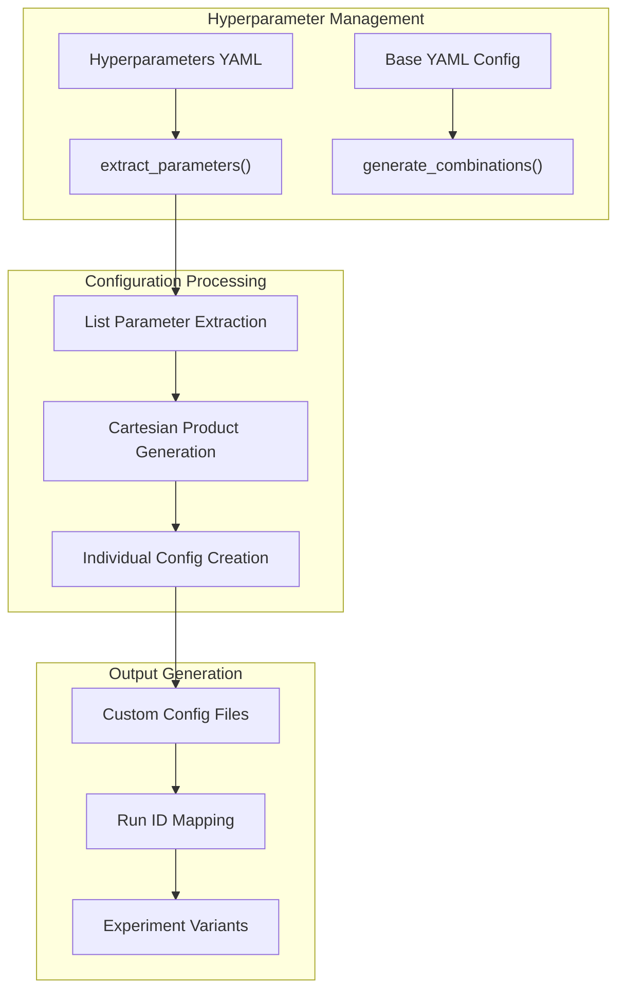

<!-- source: DeepWiki mcp.deepwiki.com · repo allenai/rslearn_projects · page 2.2 CustomLightningCLI and Training · fetched 2026-10-26 -->

# CustomLightningCLI and Training

<details>
<summary>Relevant source files</summary>

The following files were used as context for generating this wiki page:

- [.dockerignore](.dockerignore)
- [Dockerfile](Dockerfile)
- [requirements.txt](requirements.txt)
- [rslp/config.py](rslp/config.py)
- [rslp/docker_entrypoint.py](rslp/docker_entrypoint.py)
- [rslp/launcher_lib.py](rslp/launcher_lib.py)
- [rslp/lightning_cli.py](rslp/lightning_cli.py)
- [rslp/main.py](rslp/main.py)
- [rslp/rslearn_main.py](rslp/rslearn_main.py)
- [tests/unit/test_launcher_lib.py](tests/unit/test_launcher_lib.py)

</details>


This document covers the enhanced PyTorch Lightning CLI system that provides AI2-specific features for machine learning training workflows. The CustomLightningCLI extends the rslearn framework with cloud checkpointing, Weights & Biases integration, hyperparameter experiment management, and distributed training capabilities.

For information about the broader rslearn framework integration, see [rslearn Framework Integration](#2.1). For Docker containerization details, see [Docker and Containerization](#2.3).

## System Overview

The CustomLightningCLI system provides a comprehensive training infrastructure built on top of PyTorch Lightning. It handles experiment lifecycle management, from code packaging and distribution to checkpoint management and logging integration.

## Training Infrastructure Architecture



Sources: [rslp/lightning_cli.py:1-365](), [rslp/launcher_lib.py:1-266](), [rslp/rslearn_main.py:1-30](), [rslp/docker_entrypoint.py:1-28](), [rslp/main.py:1-76]()

## CustomLightningCLI Class

The `CustomLightningCLI` class extends the rslearn framework's `RslearnLightningCLI` with AI2-specific functionality:

### Core Features

- **Cloud Checkpointing**: Automatic checkpoint management to Google Cloud Storage
- **W&B Integration**: Seamless Weights & Biases logging and run management
- **Auto-resume**: Intelligent checkpoint resumption with `--autoresume` flag
- **Best Checkpoint Loading**: Load best-performing checkpoints with `--load_best` flag
- **Distributed Training**: DDP strategy configuration with unused parameter handling

### Key Arguments

The CLI adds several custom arguments beyond the standard Lightning CLI:

- `--rslp_project`: Unique project identifier for organizing experiments
- `--rslp_experiment`: Unique experiment name within a project
- `--rslp_description`: Human-readable experiment description
- `--autoresume`: Enable automatic resumption from existing checkpoints
- `--load_best`: Load the best checkpoint for inference tasks
- `--force_log`: Force W&B logging even for test/predict operations
- `--no_log`: Disable W&B logging for training

Sources: [rslp/lightning_cli.py:114-169]()

## Checkpoint Management System



Sources: [rslp/lightning_cli.py:171-258](), [rslp/lightning_cli.py:32-72]()

### Checkpoint Resolution Logic

The system implements sophisticated checkpoint resolution:

1. **Load Best Mode** (`--load_best=true`): Finds the checkpoint with the highest epoch number, prioritizing epoch-labeled checkpoints over `last.ckpt`
2. **Auto-resume Mode** (`--autoresume=true`): Loads `last.ckpt` if it exists, otherwise starts fresh
3. **Default Mode**: Requires no existing checkpoints, throws error if checkpoints exist

### Checkpoint Caching

For non-local checkpoints (e.g., GCS), the system implements a local caching mechanism:
- Checkpoints are cached in `/tmp/rslearn_cache/checkpoints/`
- Cache keys are SHA256 hashes of the checkpoint path
- Cached checkpoints persist across runs to avoid re-downloading

Sources: [rslp/lightning_cli.py:32-72](), [rslp/lightning_cli.py:200-244]()

## Weights & Biases Integration

### SaveWandbRunIdCallback

The `SaveWandbRunIdCallback` manages W&B run persistence across training sessions:



Sources: [rslp/lightning_cli.py:74-112](), [rslp/launcher_lib.py:129-172]()

### W&B Configuration

The CLI automatically configures W&B logging with:
- Project name from `--rslp_project`
- Experiment name from `--rslp_experiment`
- Description from `--rslp_description`
- Automatic run ID persistence for resumption

Sources: [rslp/lightning_cli.py:277-289]()

## Code Management and Distribution

### Code Archive System



Sources: [rslp/launcher_lib.py:77-127](), [rslp/launcher_lib.py:16-24]()

The system packages and distributes code for distributed training:

- **Upload**: `upload_code()` creates a ZIP archive excluding development files
- **Download**: `download_code()` extracts the archive in the training environment
- **Exclusions**: Filters out `.git`, `__pycache__`, `.env`, logs, and test data

### Storage Paths

Code archives are stored at: `projects/{project_id}/{experiment_id}/code.zip`
W&B run IDs are stored at: `projects/{project_id}/{experiment_id}/{run_id}wandb_id`

Sources: [rslp/launcher_lib.py:14-15]()

## Hyperparameter Experiment Management

### Configuration Generation

The system supports automated hyperparameter experiments through configuration generation:



Sources: [rslp/launcher_lib.py:174-266]()

### Hyperparameter Processing

The system processes hyperparameter configurations by:

1. **Parameter Extraction**: Recursively finds list-valued parameters in nested YAML
2. **Combination Generation**: Creates Cartesian product of all parameter combinations
3. **Config Creation**: Generates individual configuration files for each combination
4. **Run Mapping**: Associates each configuration with a unique run ID

Example hyperparameter configuration structure:
```yaml
param1: [value1, value2]
nested_param:
  param2: [value3, value4]
```

Sources: [rslp/launcher_lib.py:174-196](), [rslp/launcher_lib.py:211-236]()

## Entry Points and Execution

### Training Entry Points

| Entry Point | Purpose | Code Download |
|-------------|---------|---------------|
| `rslp/rslearn_main.py` | Direct local execution | No |
| `rslp/docker_entrypoint.py` | Docker container execution | Yes |
| `rslp/main.py` | Workflow-based execution | No |

### Docker Integration

The Docker entrypoint provides the complete training pipeline:

1. **Environment Setup**: Loads `RSLP_PROJECT` and `RSLP_EXPERIMENT` variables
2. **Code Download**: Retrieves code archive from GCS
3. **Training Execution**: Runs CustomLightningCLI with downloaded code

Sources: [rslp/docker_entrypoint.py:1-28]()

### Multiprocessing Configuration

The system configures multiprocessing for distributed training:
- Uses `forkserver` start method in Docker environments
- Initializes multiprocessing in main entry points

Sources: [rslp/docker_entrypoint.py:25-26](), [rslp/utils/mp.py]()

## Configuration Management

### Project Structure

Training configurations follow a hierarchical structure:
- **Project ID**: Top-level organization (e.g., "forest_loss_driver")
- **Experiment ID**: Specific experiment within project
- **Run ID**: Individual runs within hyperparameter experiments

### YAML Configuration

The system uses YAML files for configuration with jsonargparse integration:
- Base configurations define model architecture and training parameters
- Hyperparameter configurations specify parameter variations
- Generated configurations create individual experiment variants

Sources: [rslp/launcher_lib.py:27-40](), [rslp/launcher_lib.py:239-266]()

## Training Pipeline Integration

### Lightning Callbacks

The system automatically configures essential Lightning callbacks:

- **ModelCheckpoint**: Saves checkpoints to GCS with `save_last=True` and `save_top_k=1`
- **SaveWandbRunIdCallback**: Manages W&B run persistence
- **DDPStrategy**: Configures distributed training with `find_unused_parameters=True`

### Trainer Configuration

The CLI automatically applies training-specific configurations:
- Checkpoint directory pointing to GCS
- W&B logger configuration
- DDP strategy for multi-GPU training
- Callback registration and management

Sources: [rslp/lightning_cli.py:301-351]()

---

