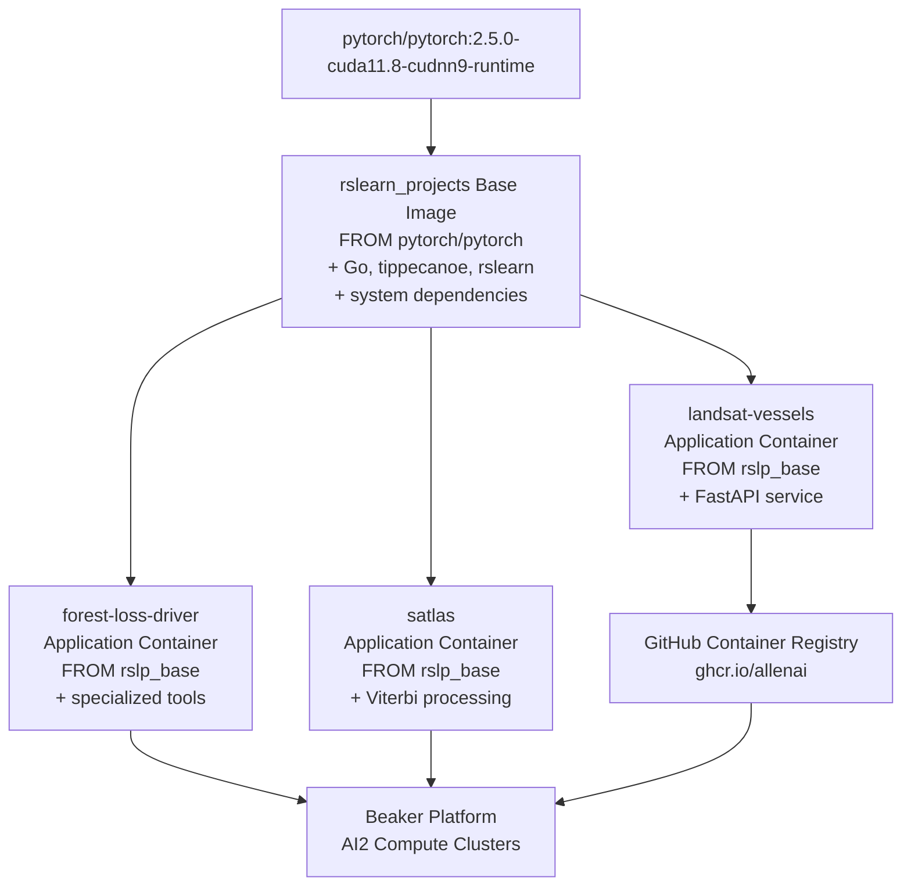
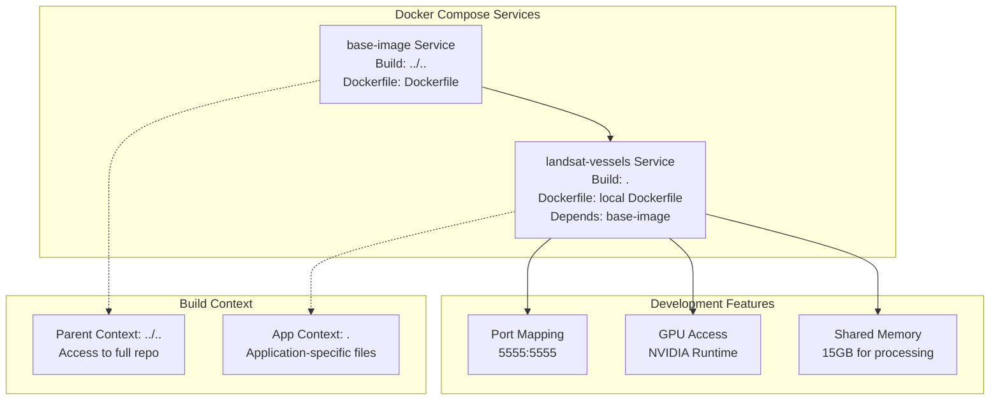
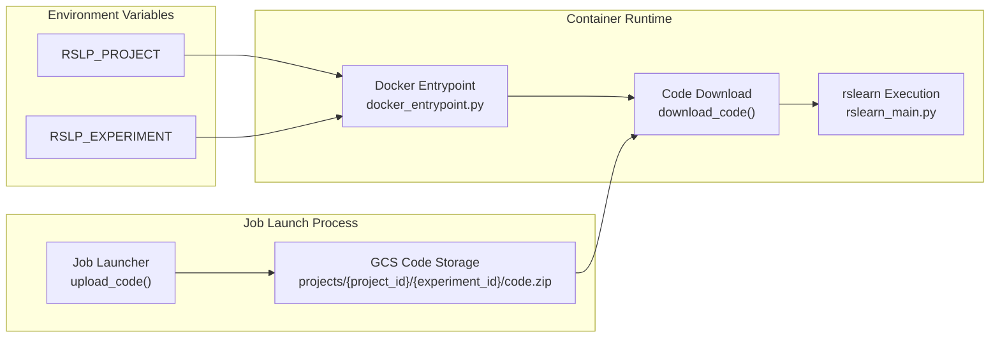
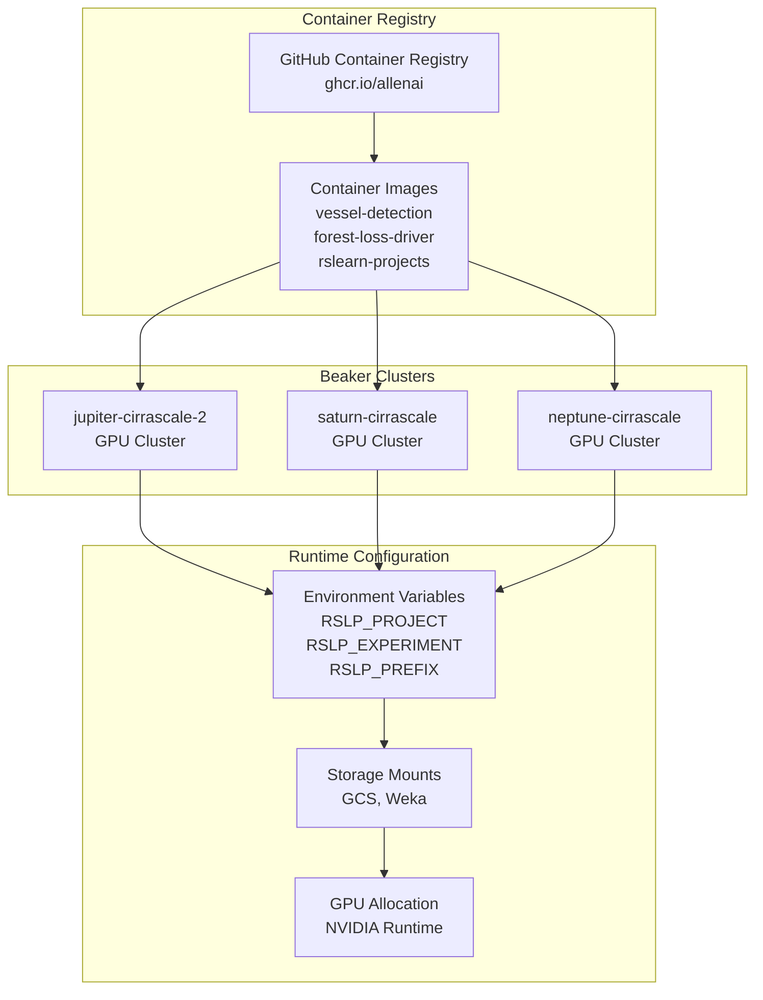

<!-- source: DeepWiki mcp.deepwiki.com · repo allenai/rslearn_projects · page 2.3 Docker and Containerization · fetched 2026-10-26 -->

# Docker and Containerization

<details>
<summary>Relevant source files</summary>

The following files were used as context for generating this wiki page:

- [.dockerignore](.dockerignore)
- [Dockerfile](Dockerfile)
- [data/landsat_vessels/config_classifier.yaml](data/landsat_vessels/config_classifier.yaml)
- [data/landsat_vessels/config_detector.yaml](data/landsat_vessels/config_detector.yaml)
- [requirements.txt](requirements.txt)
- [rslp/config.py](rslp/config.py)
- [rslp/docker_entrypoint.py](rslp/docker_entrypoint.py)
- [rslp/landsat_vessels/config.py](rslp/landsat_vessels/config.py)
- [rslp/landsat_vessels/docker-compose.yaml](rslp/landsat_vessels/docker-compose.yaml)
- [rslp/landsat_vessels/evaluation/get_metrics.py](rslp/landsat_vessels/evaluation/get_metrics.py)
- [rslp/landsat_vessels/evaluation/scenario_checks.py](rslp/landsat_vessels/evaluation/scenario_checks.py)
- [rslp/launcher_lib.py](rslp/launcher_lib.py)
- [rslp/lightning_cli.py](rslp/lightning_cli.py)
- [rslp/main.py](rslp/main.py)
- [rslp/rslearn_main.py](rslp/rslearn_main.py)
- [tests/unit/test_launcher_lib.py](tests/unit/test_launcher_lib.py)

</details>


## Purpose and Scope

This document covers the Docker-based containerization system used throughout rslearn_projects. The system provides a hierarchical container architecture with a shared base image and application-specific extensions, integrated development environments using Docker Compose, and automated deployment pipelines to container registries and compute platforms.

For information about the distributed worker system that runs these containers, see [Distributed Worker System](#2.4). For details about CI/CD workflows that build and publish containers, see [GitHub Actions Workflows](#8.1).

## Container Architecture Overview

The containerization system follows a two-tier architecture with a shared base image containing common dependencies and application-specific containers that extend this base with specialized requirements.

### Container Hierarchy



Sources: [Dockerfile:1-48](), [rslp/landsat_vessels/docker-compose.yaml:1-30]()

### Base Image Components

The base image is built from PyTorch's CUDA runtime and includes several key components:

| Component | Purpose | Installation Method |
|-----------|---------|-------------------|
| Go 1.22.12 | Satlas Viterbi processing | Binary download and extraction |
| tippecanoe | Vector tile generation for forest loss driver | Source compilation from GitHub |
| rslearn framework | Core ML framework | Git clone with configurable branch |
| System packages | PostgreSQL, FFmpeg, OpenCV dependencies | apt package manager |

The base image uses an `ARG RSLEARN_BRANCH=master` parameter to allow specifying different rslearn versions during build, enabling flexibility for different deployment scenarios.

Sources: [Dockerfile:1-48]()

## Application-Specific Containers

### Container Specialization Pattern

```mermaid
graph LR
    subgraph "Base Image Build Process"
        pytorch["pytorch/pytorch:2.5.0"]
        deps["System Dependencies<br/>libpq-dev, ffmpeg, git"]
        go_install["Go Installation<br/>/usr/local/go"]
        tippecanoe_build["Tippecanoe Build<br/>/opt/tippecanoe"]
        rslearn_install["rslearn Installation<br/>/opt/rslearn"]
        rslp_install["rslearn_projects<br/>/opt/rslearn_projects"]
        
        pytorch --> deps
        deps --> go_install
        go_install --> tippecanoe_build
        tippecanoe_build --> rslearn_install
        rslearn_install --> rslp_install
    end
    
    subgraph "Application Extensions"
        landsat_docker["Landsat Dockerfile<br/>+ FastAPI dependencies"]
        vessel_api["Vessel Detection API<br/>Port 5555"]
        
        rslp_install --> landsat_docker
        landsat_docker --> vessel_api
    end
```



Sources: [Dockerfile:1-48](), [rslp/landsat_vessels/docker-compose.yaml:12-30]()

### Landsat Vessels Container Example

The landsat vessels application demonstrates the typical pattern for application-specific containers:

- **Base inheritance**: Extends the main rslearn_projects image
- **Service configuration**: Exposes port 5555 for FastAPI service
- **Resource allocation**: Configures 15GB shared memory for GPU processing
- **GPU access**: Uses NVIDIA runtime with all GPUs visible

The container configuration includes specific settings for distributed processing:

```yaml
# From docker-compose.yaml
shm_size: '15G'
environment:
  - NVIDIA_VISIBLE_DEVICES=all
deploy:
  resources:
    reservations:
      devices:
        - capabilities: [gpu]
runtime: nvidia
```

Sources: [rslp/landsat_vessels/docker-compose.yaml:19-29]()

## Development Environment with Docker Compose

### Multi-Service Development Setup



Sources: [rslp/landsat_vessels/docker-compose.yaml:1-30]()

### Build Optimization with .dockerignore

The build process excludes unnecessary files to optimize container size and build speed:

- Git repositories (`.git`)
- Python cache (`__pycache__`, `.mypy_cache`) 
- Development artifacts (`lightning_logs`, `wandb`)
- Test data (`**/test_data/**/**/*.tif`)
- Environment files (`.env`)

Sources: [.dockerignore:1-8]()

## Container Entrypoint and Code Management

### Dynamic Code Loading System

The container entrypoint system enables dynamic code distribution for training jobs:



Sources: [rslp/docker_entrypoint.py:1-28](), [rslp/launcher_lib.py:77-127]()

### Code Archive Management

The system creates filtered archives of the codebase, excluding development artifacts:

```python
CODE_EXCLUDES = [
    ".git",
    "rslp/__pycache__",
    ".env", 
    ".mypy_cache",
    "lightning_logs",
    "test_data",
    "wandb",
]
```

The `make_archive` function in `launcher_lib.py` creates ZIP archives with these exclusions, ensuring containers receive only the necessary code for execution.

Sources: [rslp/launcher_lib.py:16-24](), [rslp/launcher_lib.py:43-75]()

## Integration with Deployment Platforms

### Beaker Platform Integration

The containers are designed to run on AI2's Beaker platform with specific cluster targeting:



Sources: [rslp/docker_entrypoint.py:13-17](), [rslp/lightning_cli.py:25-27]()

### Environment Variable Configuration

Containers require specific environment variables for proper integration:

| Variable | Purpose | Used By |
|----------|---------|---------|
| `RSLP_PROJECT` | Project identifier for code/checkpoint organization | docker_entrypoint.py, lightning_cli.py |
| `RSLP_EXPERIMENT` | Experiment identifier for versioning | docker_entrypoint.py, lightning_cli.py |
| `RSLP_PREFIX` | Base path for GCS storage operations | lightning_cli.py, launcher_lib.py |
| `RSLP_RUN_ID` | Optional run identifier for hyperparameter experiments | lightning_cli.py |

Sources: [rslp/docker_entrypoint.py:15-16](), [rslp/lightning_cli.py:266-274]()

## Container Registry and Publishing

### Automated Image Publishing

The system uses GitHub Actions to automatically build and publish container images to GitHub Container Registry (GHCR). This enables consistent deployment across different environments and platforms.

Container images follow naming conventions that correspond to their application domains:
- `vessel-detection` for maritime vessel detection services
- `forest-loss-driver` for forest monitoring applications  
- `rslearn-projects` for general-purpose training and inference

The publishing process integrates with the CI/CD pipeline to ensure images are updated with each code change, maintaining consistency between development and production environments.

Sources: [rslp/landsat_vessels/docker-compose.yaml:16]()

---

