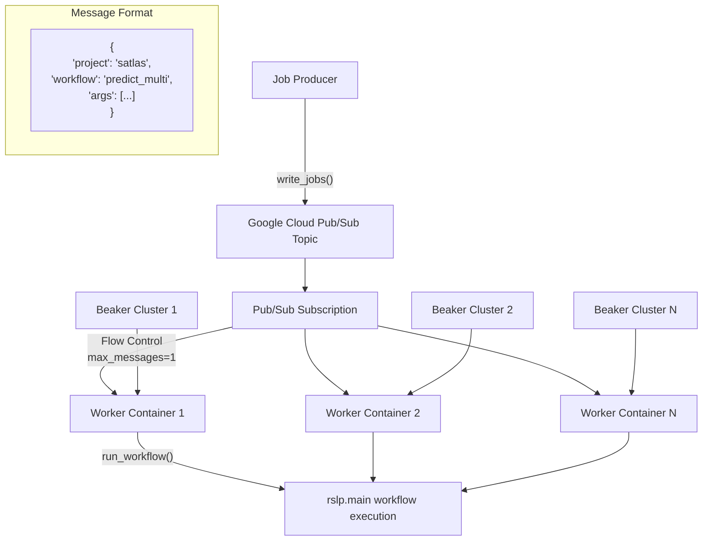
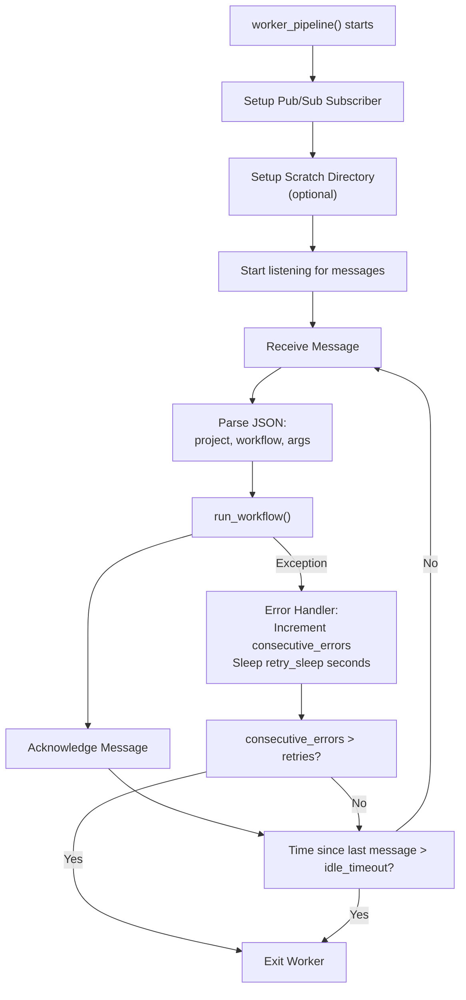
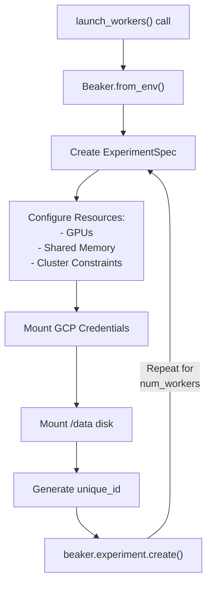
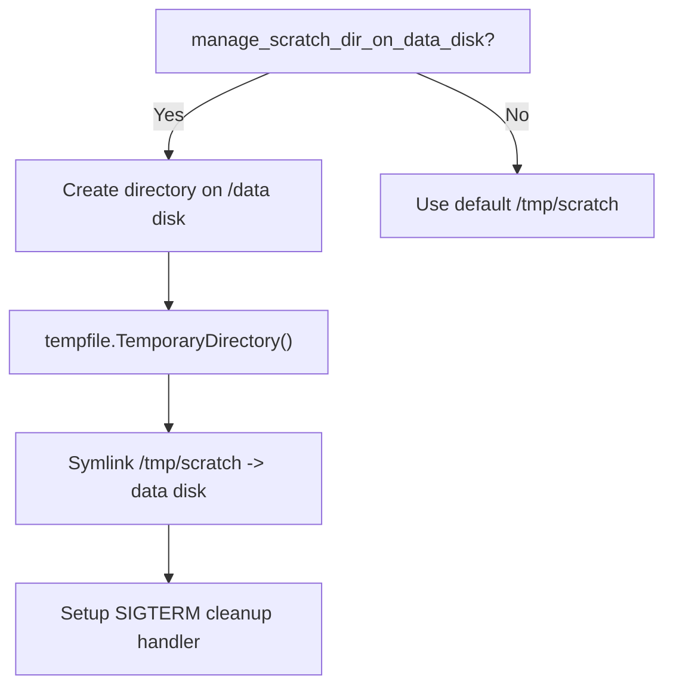
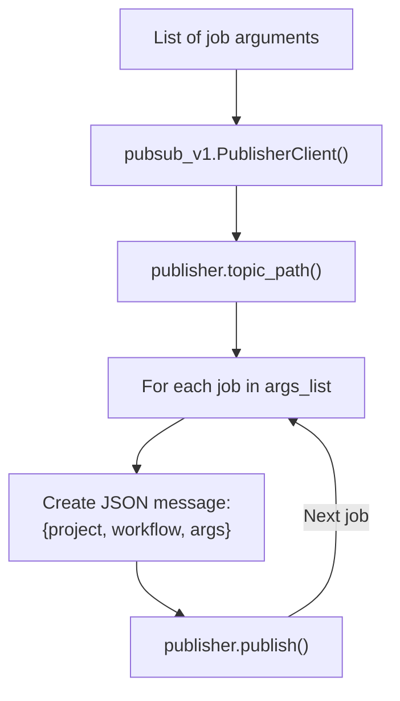
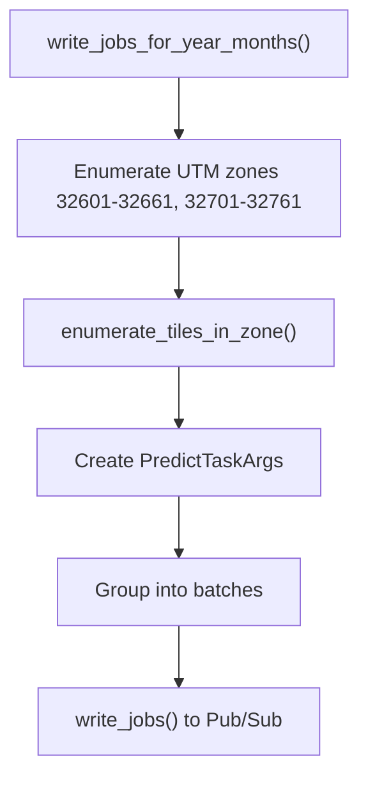

<!-- source: DeepWiki mcp.deepwiki.com · repo allenai/rslearn_projects · page 2.4 Distributed Worker System · fetched 2026-10-26 -->

# Distributed Worker System

<details>
<summary>Relevant source files</summary>

The following files were used as context for generating this wiki page:

- [data/satlas/marine_infra/config.json](data/satlas/marine_infra/config.json)
- [data/satlas/marine_infra/config.yaml](data/satlas/marine_infra/config.yaml)
- [data/satlas/wind_turbine/config_azure.json](data/satlas/wind_turbine/config_azure.json)
- [rslp/common/README.md](rslp/common/README.md)
- [rslp/common/__init__.py](rslp/common/__init__.py)
- [rslp/common/worker.py](rslp/common/worker.py)
- [rslp/common/write_file.py](rslp/common/write_file.py)
- [rslp/satlas/README.md](rslp/satlas/README.md)
- [rslp/satlas/__init__.py](rslp/satlas/__init__.py)
- [rslp/satlas/data_sources.py](rslp/satlas/data_sources.py)
- [rslp/satlas/postprocess.py](rslp/satlas/postprocess.py)
- [rslp/satlas/predict_pipeline.py](rslp/satlas/predict_pipeline.py)
- [rslp/satlas/publish.py](rslp/satlas/publish.py)
- [rslp/satlas/scripts/smooth_point_labels_viterbi.go](rslp/satlas/scripts/smooth_point_labels_viterbi.go)
- [rslp/satlas/write_jobs.py](rslp/satlas/write_jobs.py)
- [tests/integration/common/__init__.py](tests/integration/common/__init__.py)
- [tests/integration/common/test_worker.py](tests/integration/common/test_worker.py)
- [tests/integration/satlas/test_data_sources.py](tests/integration/satlas/test_data_sources.py)
- [tests/integration_slow/satlas/test_predict_pipeline.py](tests/integration_slow/satlas/test_predict_pipeline.py)
- [tests/unit/satlas/__init__.py](tests/unit/satlas/__init__.py)
- [tests/unit/satlas/test_postprocess.py](tests/unit/satlas/test_postprocess.py)

</details>


The Distributed Worker System provides a scalable job queuing and execution infrastructure for running large-scale distributed workloads across Beaker clusters. It uses Google Cloud Pub/Sub as the message queue and enables dynamic scaling of worker processes that can handle long-running computational tasks like model inference and data processing.

For information about the rslearn framework integration, see [rslearn Framework Integration](#2.1). For Docker containerization details, see [Docker and Containerization](#2.3).

## System Architecture

The distributed worker system follows a producer-consumer pattern where job producers write tasks to a Google Cloud Pub/Sub topic, and worker consumers process these tasks on distributed compute infrastructure.



Sources: [rslp/common/worker.py:1-313](), [rslp/common/README.md:1-36]()

## Core Worker Implementation

The worker system centers around the `worker_pipeline()` function which implements a robust message processing loop with error handling and resource management.

### Worker Process Flow



Sources: [rslp/common/worker.py:67-220]()

### Key Configuration Parameters

| Parameter | Default | Purpose |
|-----------|---------|---------|
| `retries` | 3 | Maximum consecutive errors before worker termination |
| `retry_sleep` | 60 | Sleep duration between retries (seconds) |
| `idle_timeout` | 10 | Timeout before terminating idle worker (seconds) |
| `max_lease_duration` | 24 * 3600 | Maximum job execution time (seconds) |
| `max_messages` | 1 | Flow control: process one message at a time |

Sources: [rslp/common/worker.py:70-75](), [rslp/common/worker.py:170-174]()

## Job Launching and Worker Management

### Worker Deployment

The `launch_workers()` function creates Beaker experiments that run worker containers across specified clusters.



Sources: [rslp/common/worker.py:222-285]()

### Worker Configuration

Each worker is launched with the following Beaker configuration:

```python
# Command executed in worker container
command=["python", "-m", "rslp.main"]
arguments=["common", "worker", project_id, subscription_id, ...]

# Resource allocation
resources=TaskResources(gpu_count=gpus, shared_memory=shared_memory)

# Volume mounts
datasets=[
    DataMount(source=DataSource(secret="RSLEARN_GCP_CREDENTIALS"), 
              mount_path="/etc/credentials/gcp_credentials.json"),
    DataMount(source=DataSource(host_path="/data"), mount_path="/data")
]
```

Sources: [rslp/common/worker.py:257-282]()

## Scratch Directory Management

The worker system provides automatic scratch directory management for disk-intensive tasks that may exceed container ephemeral storage limits.

### Scratch Directory Setup



The cleanup signal handler ensures scratch directories are properly removed if workers are terminated:

```python
def get_cleanup_signal_handler(tmp_dir: str) -> Callable[[int, Any], None]:
    def cleanup_signal_handler(signo: int, stack_frame: Any) -> None:
        logger.error(f"cleanup_signal_handler: caught signal {signo}")
        shutil.rmtree(tmp_dir)
        sys.exit(1)
    return cleanup_signal_handler
```

Sources: [rslp/common/worker.py:96-107](), [rslp/common/worker.py:50-64](), [rslp/common/worker.py:39-47]()

## Job Definition and Publishing

### Job Message Format

Jobs are published to Pub/Sub topics as JSON messages with a standardized format:

```json
{
    "project": "satlas",
    "workflow": "predict_multi", 
    "args": ["--application", "MARINE_INFRA", "--out_path", "gs://...", ...]
}
```

### Job Publishing Function

The `write_jobs()` function handles batch publishing of jobs to Pub/Sub topics:



Sources: [rslp/common/worker.py:287-313]()

## Integration with Satlas System

The distributed worker system is extensively used by the Satlas prediction pipeline for large-scale geospatial model inference across UTM zones.

### Satlas Job Generation



Example usage for marine infrastructure prediction:
```bash
python -m rslp.main satlas write_jobs_for_year_months \
    --year_months '[[2024, 7]]' \
    --application MARINE_INFRA \
    --out_path 'gs://rslearn-eai/projects/satlas/marine_infra/version-20241212/{year:04d}-{month:02d}/' \
    --project_id earthsystem-dev-c3po \
    --topic_id rslp-job-queue-favyen
```

Sources: [rslp/satlas/write_jobs.py:268-316](), [rslp/satlas/README.md:45-66]()

### Worker Launch Example

```bash
python -m rslp.main common launch \
    --image_name favyen/rslp_image \
    --project_id earthsystem-dev-c3po \
    --subscription_id rslp-job-queue-favyen-sub \
    --num_workers 100 \
    --cluster "['ai2/jupiter-cirrascale-2']" \
    --gpus 1 \
    --shared_memory 256GiB \
    --manage_scratch_dir_on_data_disk=true
```

Sources: [rslp/satlas/README.md:67-73](), [rslp/common/README.md:22-28]()

## Error Handling and Reliability

### Retry Mechanism

The worker implements a consecutive error tracking system:

- Workers track `consecutive_errors` counter
- After each successful job, counter resets to 0  
- After each failed job, counter increments and worker sleeps
- If `consecutive_errors > retries`, worker terminates
- This allows workers to handle occasional failures while terminating persistent issues

### Flow Control and Resource Management

```python
flow_control = pubsub_v1.types.FlowControl(
    max_messages=1,  # Process one job at a time
    max_lease_duration=24 * 3600,  # Allow up to 24 hours per job
)
```

- Single message processing ensures full resource utilization per job
- Extended lease duration supports long-running inference tasks
- Idle timeout prevents resource waste from unused workers

Sources: [rslp/common/worker.py:125-167](), [rslp/common/worker.py:170-174]()

## Testing Infrastructure

The worker system includes comprehensive integration tests that validate:

- Worker idle timeout behavior
- Job execution from Pub/Sub messages  
- Message acknowledgment and error handling

Test setup uses environment variables for Pub/Sub configuration:
- `TEST_PUBSUB_PROJECT` - Google Cloud project for test resources
- `TEST_PUBSUB_TOPIC` - Topic for writing test jobs
- `TEST_PUBSUB_SUBSCRIPTION` - Subscription for worker consumption

Sources: [tests/integration/common/test_worker.py:1-67]()

---

