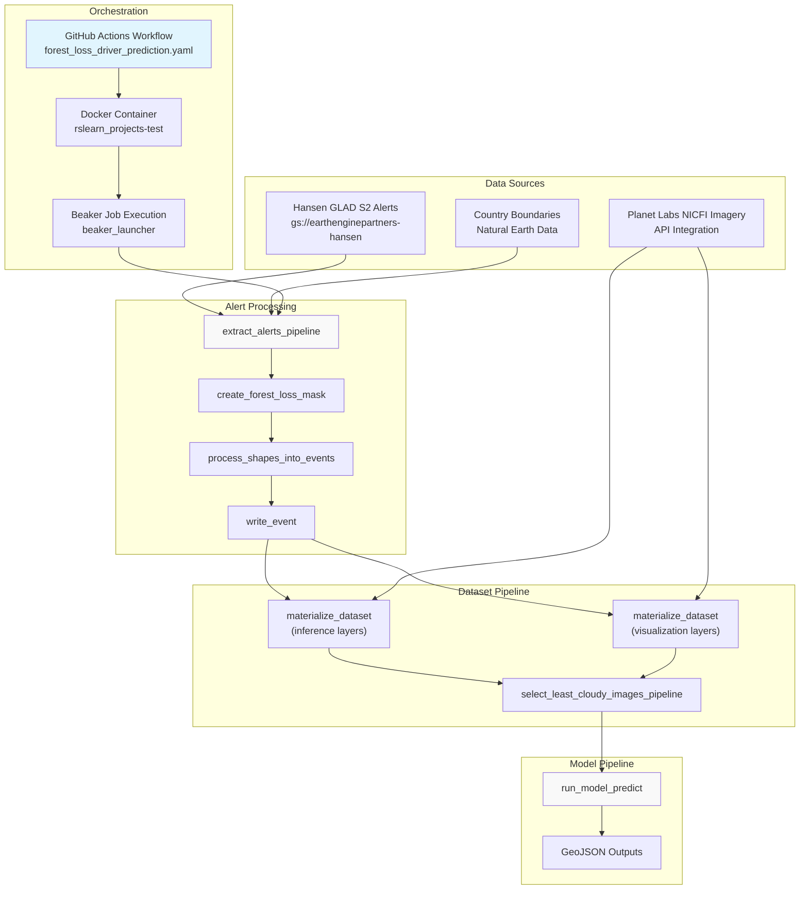
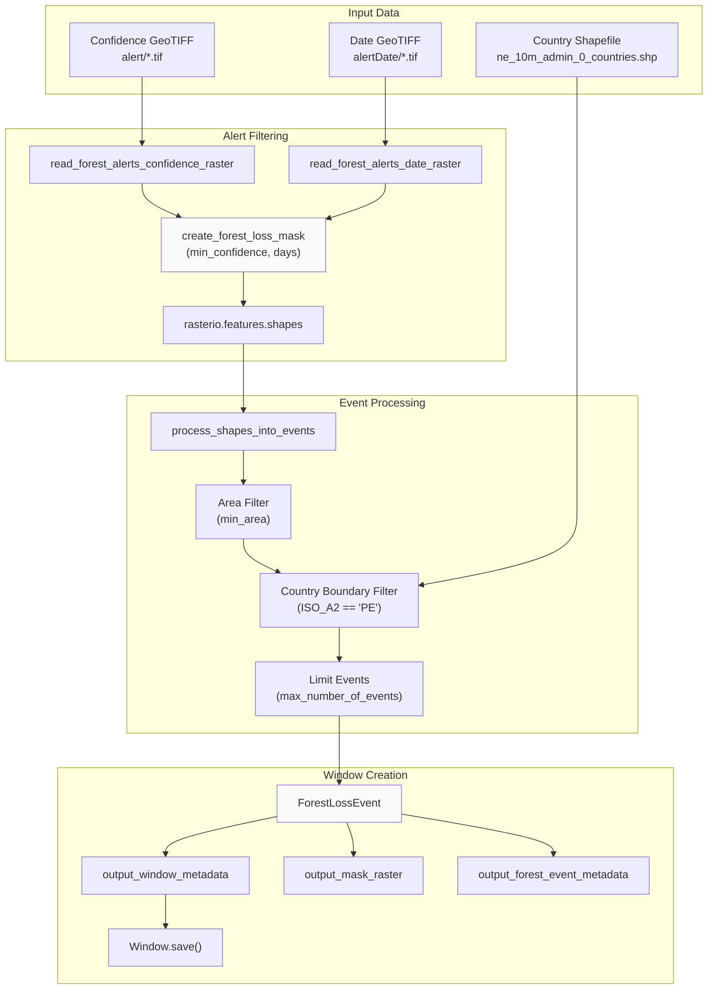
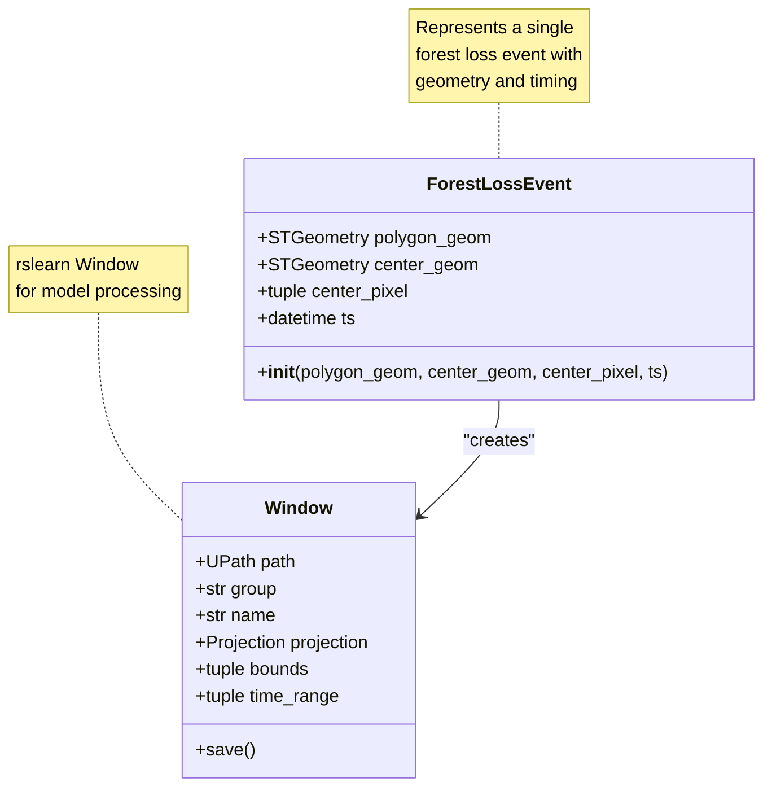
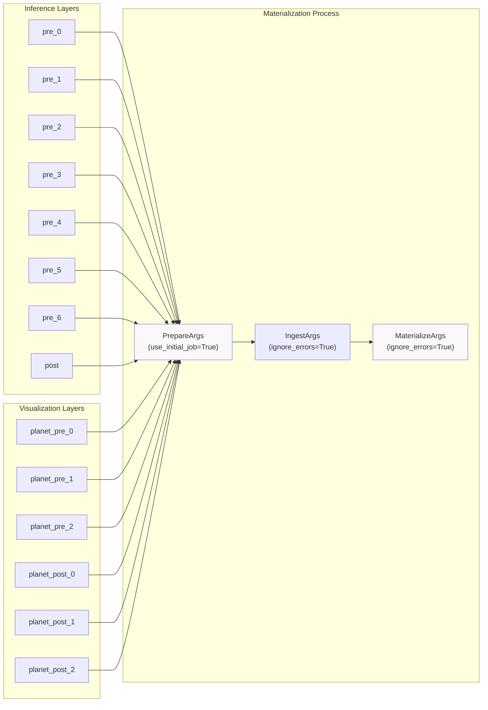
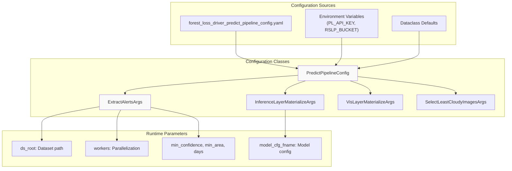
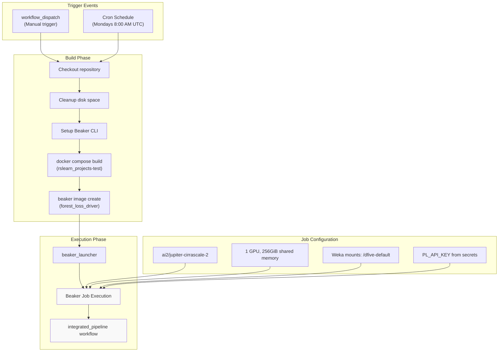
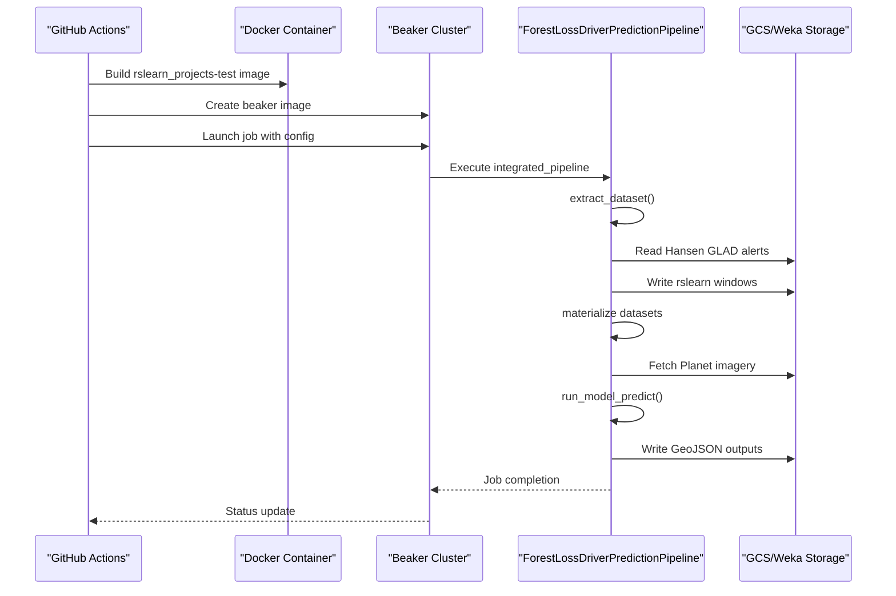

<!-- source: DeepWiki mcp.deepwiki.com · repo allenai/rslearn_projects · page 3 Forest Loss Driver System · fetched 2026-10-26 -->

# Forest Loss Driver System

Relevant source files

The following files were used as context for generating this wiki page:

- [.github/workflows/forest_loss_driver_prediction.yaml](.github/workflows/forest_loss_driver_prediction.yaml)
- [rslp/forest_loss_driver/inference/config.py](rslp/forest_loss_driver/inference/config.py)
- [rslp/forest_loss_driver/inference/config/forest_loss_driver_predict_pipeline_config.yaml](rslp/forest_loss_driver/inference/config/forest_loss_driver_predict_pipeline_config.yaml)
- [rslp/forest_loss_driver/inference/extract_alerts.py](rslp/forest_loss_driver/inference/extract_alerts.py)
- [rslp/forest_loss_driver/predict_pipeline.py](rslp/forest_loss_driver/predict_pipeline.py)
- [tests/integration/forest_loss_driver/inference/test_extract_alerts.py](tests/integration/forest_loss_driver/inference/test_extract_alerts.py)
- [tests/integration/forest_loss_driver/test_predict_pipeline.py](tests/integration/forest_loss_driver/test_predict_pipeline.py)

The Forest Loss Driver System is an automated machine learning pipeline for processing forest loss alerts and predicting the underlying drivers of deforestation. This system processes Hansen/GLAD S2 alert data, extracts satellite imagery from Planet Labs, and applies trained models to classify the cause of forest loss events.

This document covers the prediction pipeline, data processing, and orchestration components. For information about the core ML infrastructure shared across applications, see [Core Infrastructure](#2). For details about model training and the rslearn framework integration, see [rslearn Framework Integration](#2.1).

## System Overview

The Forest Loss Driver System operates as an integrated pipeline that transforms raw forest loss alerts into classified predictions about deforestation drivers. The system runs on a weekly schedule via GitHub Actions and processes data across distributed Beaker clusters.

### High-Level Architecture

**System Architecture Flow**

Sources: [.github/workflows/forest_loss_driver_prediction.yaml:1-108](), [rslp/forest_loss_driver/predict_pipeline.py:35-94](), [rslp/forest_loss_driver/inference/extract_alerts.py:375-481]()

### Core Pipeline Components

| Component | Purpose | Input | Output |
|-----------|---------|--------|--------|
| `extract_alerts_pipeline` | Extract forest loss events from GLAD alerts | Hansen GeoTIFF files | rslearn Windows with masks |
| `materialize_dataset` | Fetch satellite imagery for windows | Windows + Planet API | Materialized image layers |
| `select_least_cloudy_images_pipeline` | Choose best images per window | Multiple image options | Selected image metadata |
| `run_model_predict` | Apply ML model to windows | Materialized dataset | GeoJSON predictions |

Sources: [rslp/forest_loss_driver/predict_pipeline.py:48-77](), [rslp/forest_loss_driver/inference/config.py:201-234]()

## Alert Extraction Pipeline

The alert extraction pipeline processes Hansen GLAD S2 alert data to identify recent forest loss events and create rslearn-compatible windows for downstream processing.

### Alert Processing Workflow

**Alert Extraction Data Flow**

Sources: [rslp/forest_loss_driver/inference/extract_alerts.py:223-324](), [rslp/forest_loss_driver/inference/extract_alerts.py:375-481]()

### Key Processing Parameters

The alert extraction is controlled by several key parameters defined in `ExtractAlertsArgs`:

| Parameter | Default | Description |
|-----------|---------|-------------|
| `min_confidence` | 2 | Minimum GLAD alert confidence threshold |
| `days` | 365 | Days to look back from prediction time |
| `min_area` | 16.0 | Minimum area (pixels) for event inclusion |
| `max_number_of_events` | None | Maximum events to process per tile |
| `workers` | 128 | Parallel workers for processing |

Sources: [rslp/forest_loss_driver/inference/config.py:56-112]()

### Forest Loss Event Structure

The `ForestLossEvent` class encapsulates each detected deforestation event:

**Forest Loss Event Data Model**

Sources: [rslp/forest_loss_driver/inference/extract_alerts.py:54-78](), [rslp/forest_loss_driver/inference/extract_alerts.py:161-173]()

## Dataset Materialization

The dataset materialization process fetches satellite imagery for each extracted forest loss window using the rslearn framework and Planet Labs API integration.

### Layer Configuration

The system processes two distinct sets of imagery layers:

| Layer Type | Purpose | Workers | Layers |
|------------|---------|---------|---------|
| Inference | Model prediction | 128 | `pre_0` through `pre_6`, `post` |
| Visualization | Display/analysis | 32 | `planet_pre_0` through `planet_pre_2`, `planet_post_0` through `planet_post_2` |

**Layer Materialization Architecture**

Sources: [rslp/forest_loss_driver/inference/config.py:18-37](), [rslp/forest_loss_driver/inference/config.py:115-183]()

### Materialization Configuration

The system uses separate configuration classes for different layer types:

- `InferenceLayerMaterializeArgs`: High worker count (128), disables visualization layers
- `VisLayerMaterializeArgs`: Limited workers (32) due to API rate limits, disables inference layers

Sources: [rslp/forest_loss_driver/inference/config.py:114-183]()

## Configuration System

The Forest Loss Driver system uses a hierarchical configuration approach combining dataclasses, YAML files, and environment variables.

### Configuration Architecture

**Configuration Hierarchy**

Sources: [rslp/forest_loss_driver/inference/config.py:201-234](), [rslp/forest_loss_driver/inference/config/forest_loss_driver_predict_pipeline_config.yaml:1-9]()

### Key Configuration Parameters

| Parameter | Location | Purpose |
|-----------|----------|---------|
| `ds_root` | Runtime | Dataset storage path (overwritten by pipeline) |
| `model_cfg_fname` | YAML | Path to model configuration file |
| `index_cache_dir` | YAML | Temporary index cache location |
| `tile_store_dir` | YAML | Weka storage path for tiles |
| `workers` | YAML | Parallel processing worker count |

Sources: [rslp/forest_loss_driver/inference/config/forest_loss_driver_predict_pipeline_config.yaml:1-9]()

## Pipeline Orchestration

The Forest Loss Driver system orchestrates complex workflows through GitHub Actions, Beaker job scheduling, and Docker containerization.

### GitHub Actions Workflow

**Orchestration Workflow**

Sources: [.github/workflows/forest_loss_driver_prediction.yaml:1-108]()

### Execution Environment

The system executes within a containerized environment with specific resource requirements:

| Resource | Configuration |
|----------|---------------|
| Container | `rslearn_projects-test` (built via docker-compose) |
| Cluster | `ai2/jupiter-cirrascale-2` |
| GPU | 1 GPU, preemptible instances |
| Memory | 256GiB shared memory |
| Storage | Weka mount at `/dfive-default` |
| API Keys | Planet Labs API key from GitHub secrets |

Sources: [.github/workflows/forest_loss_driver_prediction.yaml:84-107]()

### Pipeline Execution Flow

**Pipeline Execution Sequence**

Sources: [.github/workflows/forest_loss_driver_prediction.yaml:70-88](), [rslp/forest_loss_driver/predict_pipeline.py:35-94]()

The Forest Loss Driver System represents a sophisticated integration of remote sensing data processing, machine learning inference, and cloud-based orchestration, providing automated weekly assessment of forest loss drivers across targeted geographic regions.

---

