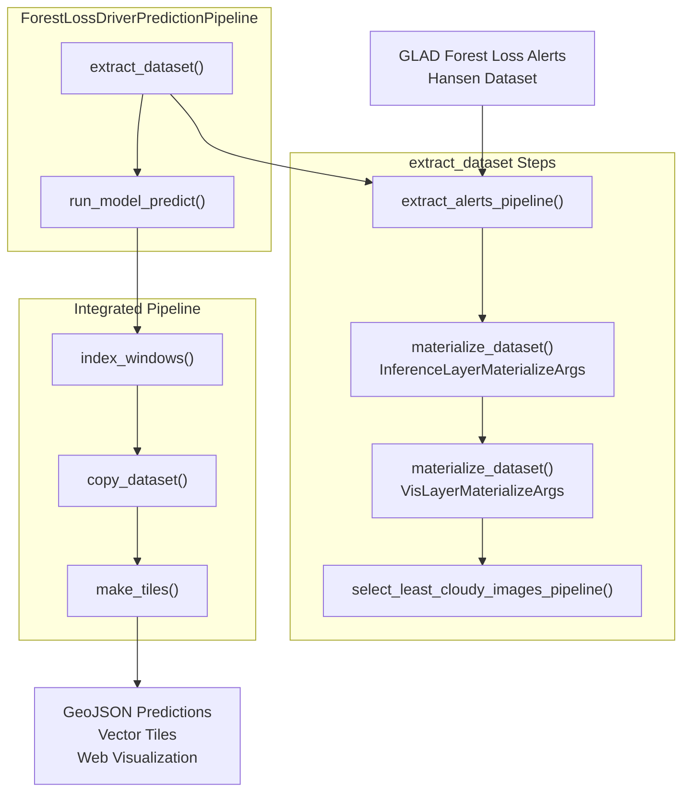
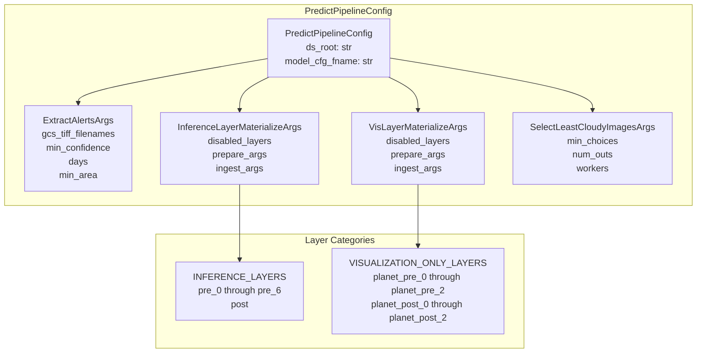
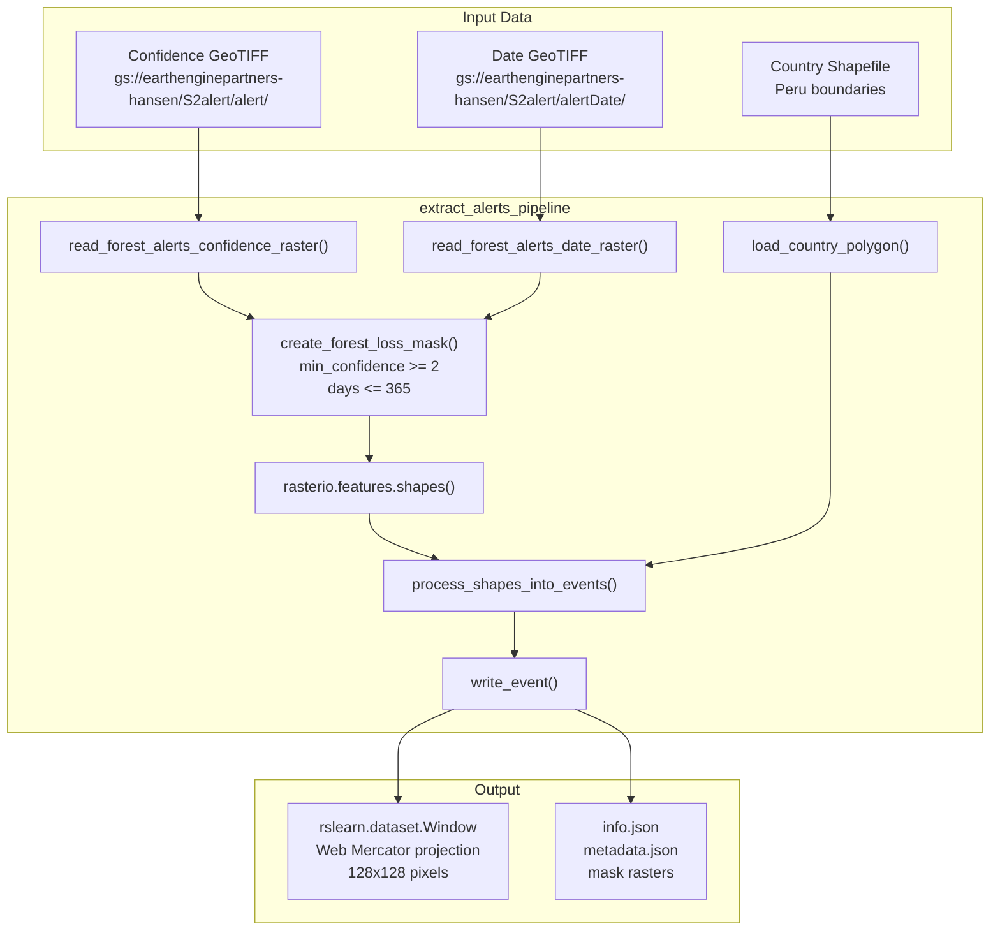
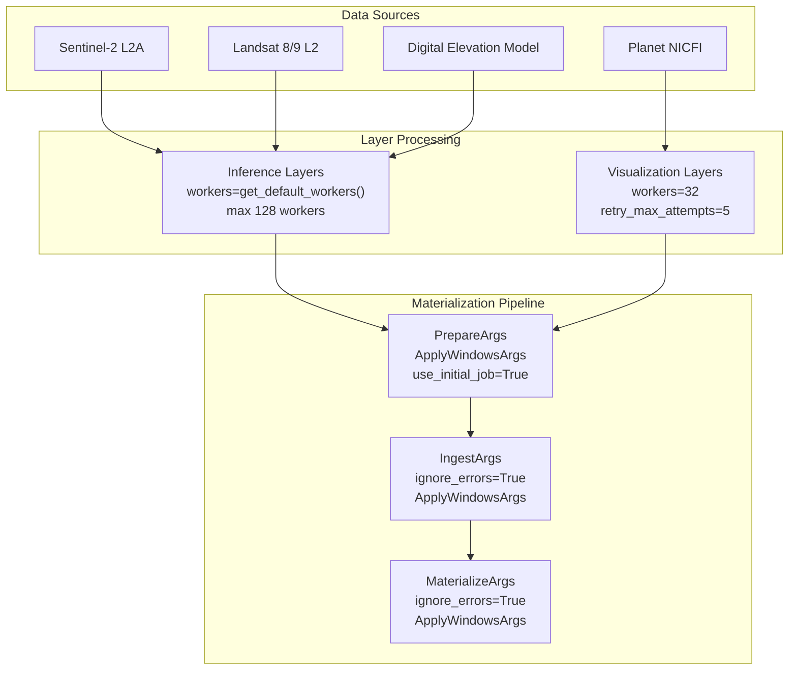
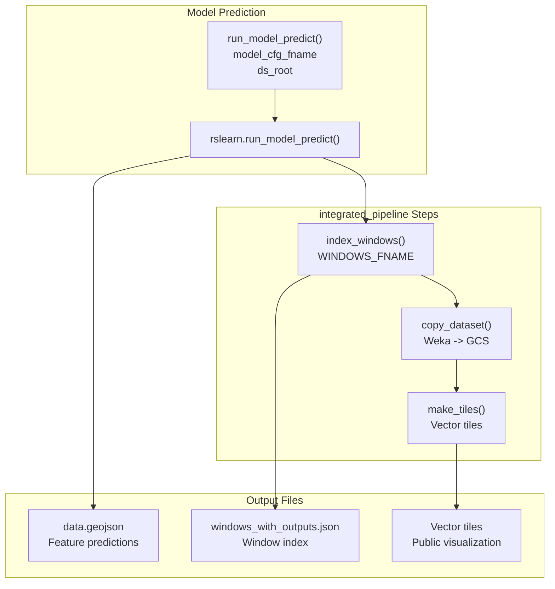
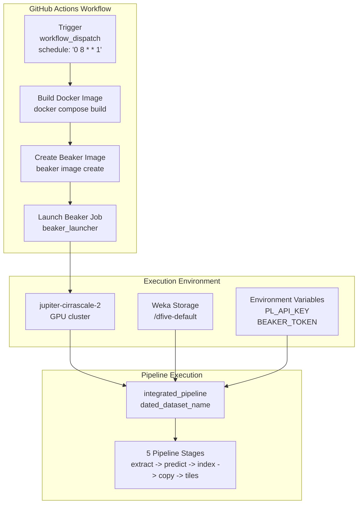

<!-- source: DeepWiki mcp.deepwiki.com · repo allenai/rslearn_projects · page 3.1 Prediction Pipeline · fetched 2026-10-26 -->

# Prediction Pipeline

<details>
<summary>Relevant source files</summary>

The following files were used as context for generating this wiki page:

- [.github/workflows/forest_loss_driver_prediction.yaml](.github/workflows/forest_loss_driver_prediction.yaml)
- [rslp/forest_loss_driver/__init__.py](rslp/forest_loss_driver/__init__.py)
- [rslp/forest_loss_driver/copy.py](rslp/forest_loss_driver/copy.py)
- [rslp/forest_loss_driver/inference/config.py](rslp/forest_loss_driver/inference/config.py)
- [rslp/forest_loss_driver/inference/config/forest_loss_driver_predict_pipeline_config.yaml](rslp/forest_loss_driver/inference/config/forest_loss_driver_predict_pipeline_config.yaml)
- [rslp/forest_loss_driver/inference/extract_alerts.py](rslp/forest_loss_driver/inference/extract_alerts.py)
- [rslp/forest_loss_driver/predict_pipeline.py](rslp/forest_loss_driver/predict_pipeline.py)
- [tests/integration/forest_loss_driver/inference/test_extract_alerts.py](tests/integration/forest_loss_driver/inference/test_extract_alerts.py)
- [tests/integration/forest_loss_driver/test_predict_pipeline.py](tests/integration/forest_loss_driver/test_predict_pipeline.py)

</details>


This page documents the Forest Loss Driver prediction pipeline, which implements an automated end-to-end system for processing forest loss alerts and generating model predictions. The pipeline extracts recent forest loss events from GLAD alert data, materializes satellite imagery datasets, runs deep learning models for classification, and publishes results for visualization.

For information about the overall Forest Loss Driver system architecture, see [Forest Loss Driver System](#3). For deployment and orchestration details, see [Deployment and Orchestration](#3.3).

## Pipeline Overview

The Forest Loss Driver prediction pipeline implements a complete workflow from raw forest loss alerts to published model predictions. The pipeline is designed to run automatically on a weekly schedule and processes forest loss events detected in Peru using Planet Labs and other satellite imagery sources.



The pipeline consists of two main phases implemented in the `ForestLossDriverPredictionPipeline` class:

1. **Dataset Extraction** (`extract_dataset()`): Processes forest loss alerts and materializes satellite imagery
2. **Model Prediction** (`run_model_predict()`): Applies trained models to generate classifications

Sources: [rslp/forest_loss_driver/predict_pipeline.py:35-78](), [rslp/forest_loss_driver/__init__.py:24-67]()

## Configuration System

The pipeline uses a hierarchical configuration system built around the `PredictPipelineConfig` dataclass, which orchestrates multiple specialized configuration components.



### Key Configuration Classes

| Configuration Class | Purpose | Key Parameters |
|---------------------|---------|----------------|
| `PredictPipelineConfig` | Main pipeline configuration | `ds_root`, `model_cfg_fname` |
| `ExtractAlertsArgs` | Forest loss alert extraction | `min_confidence=2`, `days=365`, `min_area=16.0` |
| `InferenceLayerMaterializeArgs` | Model inference data layers | Excludes `VISUALIZATION_ONLY_LAYERS` |
| `VisLayerMaterializeArgs` | Visualization data layers | Excludes `INFERENCE_LAYERS`, uses fewer workers |
| `SelectLeastCloudyImagesArgs` | Cloud filtering parameters | `min_choices=5`, `num_outs=3` |

The system separates inference layers (used for model prediction) from visualization layers (used for web display) to optimize processing and API rate limits.

Sources: [rslp/forest_loss_driver/inference/config.py:200-234](), [rslp/forest_loss_driver/inference/config.py:18-44](), [rslp/forest_loss_driver/inference/config.py:114-183]()

## Forest Loss Alert Extraction

The alert extraction stage processes GLAD forest loss alerts from Hansen dataset GeoTIFF files to identify recent deforestation events and create analysis windows.



### Alert Processing Workflow

The extraction process implements several filtering stages:

1. **Temporal Filtering**: Events within the last 365 days from prediction time
2. **Confidence Filtering**: Minimum confidence threshold of 2 
3. **Area Filtering**: Minimum area of 16.0 square units
4. **Geographic Filtering**: Events within Peru boundaries
5. **Connected Component Analysis**: Groups adjacent pixels into coherent events

The process creates `ForestLossEvent` objects containing:
- `polygon_geom`: Event boundary in projection coordinates
- `center_geom`: Event center point
- `center_pixel`: Pixel coordinates in source raster
- `ts`: Timestamp from alert date raster

Each event generates an rslearn `Window` with 128x128 pixel dimensions at Web Mercator zoom level 13.

Sources: [rslp/forest_loss_driver/inference/extract_alerts.py:375-481](), [rslp/forest_loss_driver/inference/extract_alerts.py:54-78](), [rslp/forest_loss_driver/inference/extract_alerts.py:325-353]()

## Dataset Materialization

The pipeline materializes satellite imagery datasets using the rslearn framework, processing both inference and visualization layers with different optimization strategies.



### Layer Configuration

The system defines two distinct layer sets optimized for different purposes:

**Inference Layers** (`INFERENCE_LAYERS`):
- `pre_0` through `pre_6`: Multi-temporal pre-event imagery
- `post`: Post-event imagery
- Used for model prediction with high worker counts

**Visualization Layers** (`VISUALIZATION_ONLY_LAYERS`):
- `planet_pre_0` through `planet_pre_2`: Planet NICFI pre-event
- `planet_post_0` through `planet_post_2`: Planet NICFI post-event  
- Limited to 32 workers due to API rate limits

The materialization process uses `ignore_errors=True` to handle missing or corrupted satellite imagery gracefully, ensuring the pipeline continues processing available data.

Sources: [rslp/forest_loss_driver/inference/config.py:114-147](), [rslp/forest_loss_driver/inference/config.py:149-183](), [rslp/forest_loss_driver/predict_pipeline.py:55-68]()

## Model Prediction and Post-Processing

After dataset materialization, the pipeline applies trained models and processes results for publication.



### Post-Processing Pipeline

The `integrated_pipeline()` function orchestrates the complete workflow:

1. **Model Prediction**: Applies trained classification models to materialized windows
2. **Window Indexing**: Creates searchable index of windows with model outputs
3. **Dataset Copy**: Transfers results from high-performance Weka storage to GCS for serving
4. **Tile Generation**: Creates vector tiles for web visualization

The copy stage selects specific layers needed for web serving:

```python
NEEDED_LAYERS = [
    "best_pre_0", "best_pre_1", "best_pre_2",
    "best_post_0", "best_post_1", "best_post_2", 
    "planet_pre_0", "planet_pre_1", "planet_pre_2",
    "planet_post_0", "planet_post_1", "planet_post_2",
    "mask", "output"
]
```

Sources: [rslp/forest_loss_driver/predict_pipeline.py:70-77](), [rslp/forest_loss_driver/__init__.py:24-67](), [rslp/forest_loss_driver/copy.py:22-37]()

## Orchestration and Deployment

The pipeline is orchestrated through GitHub Actions with automated weekly execution and Beaker platform integration.



### Deployment Configuration

The GitHub Actions workflow implements:

- **Scheduled Execution**: Weekly runs every Monday at 8:00 AM UTC
- **Manual Triggers**: `workflow_dispatch` for on-demand execution  
- **Resource Allocation**: 1 GPU, 256GiB shared memory, preemptible instances
- **Storage Integration**: Weka high-performance storage mounted at `/dfive-default`
- **Environment Management**: Secure handling of Planet Labs API keys

The pipeline uses date-based dataset naming (`dataset_YYYYMMDD`) based on the most recent Friday to organize weekly prediction runs.

### Configuration Parameters

| Parameter | Value | Purpose |
|-----------|-------|---------|
| `RSLP_PROJECT` | `forest_loss_driver` | Project identifier |
| `RSLP_WORKFLOW` | `integrated_pipeline` | Workflow to execute |
| `BEAKER_IMAGE_NAME` | `forest_loss_driver` | Container image name |
| `CLUSTERS` | `ai2/jupiter-cirrascale-2` | Compute cluster |
| `gpu_count` | `1` | GPU allocation |
| `shared_memory` | `256GiB` | Memory allocation |

Sources: [.github/workflows/forest_loss_driver_prediction.yaml:1-108](), [rslp/forest_loss_driver/__init__.py:17-67]()

---

