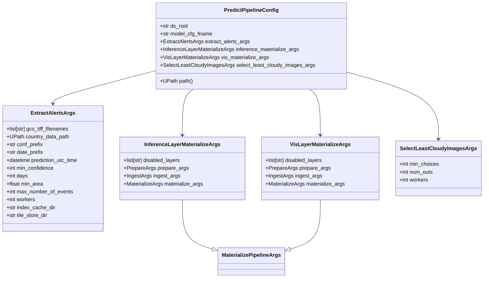
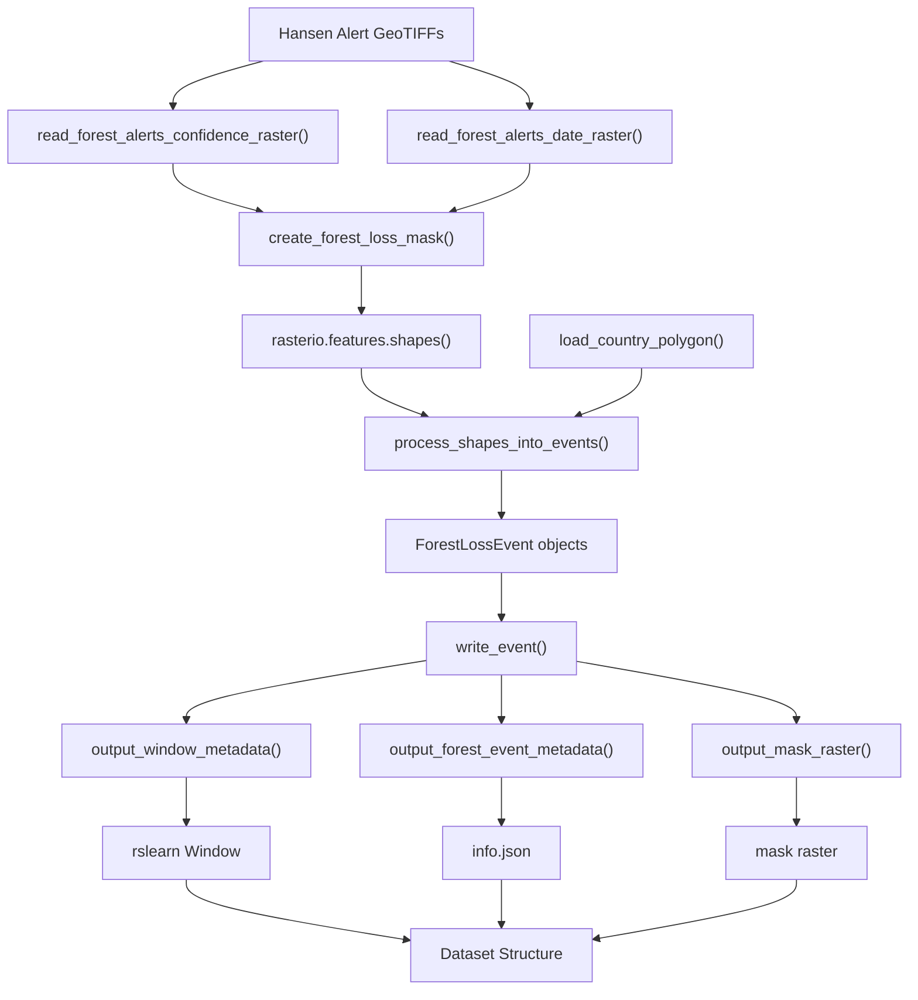
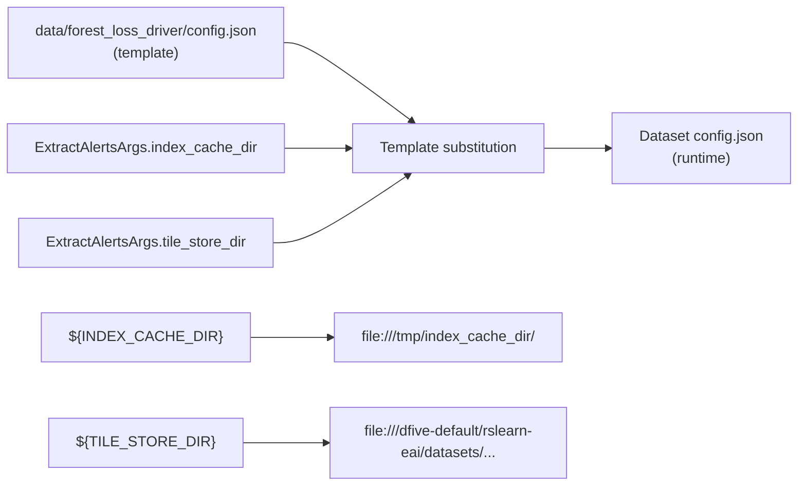
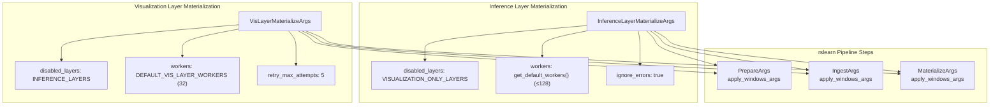
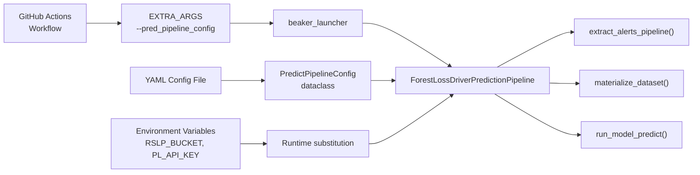
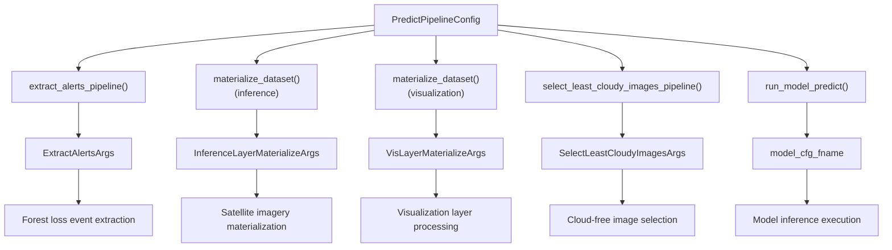

<!-- source: DeepWiki mcp.deepwiki.com · repo allenai/rslearn_projects · page 3.2 Data Processing and Configuration · fetched 2026-10-26 -->

# Data Processing and Configuration

<details>
<summary>Relevant source files</summary>

The following files were used as context for generating this wiki page:

- [.github/workflows/forest_loss_driver_prediction.yaml](.github/workflows/forest_loss_driver_prediction.yaml)
- [data/forest_loss_driver/config.yaml](data/forest_loss_driver/config.yaml)
- [rslp/forest_loss_driver/inference/config.py](rslp/forest_loss_driver/inference/config.py)
- [rslp/forest_loss_driver/inference/config/forest_loss_driver_predict_pipeline_config.yaml](rslp/forest_loss_driver/inference/config/forest_loss_driver_predict_pipeline_config.yaml)
- [rslp/forest_loss_driver/inference/extract_alerts.py](rslp/forest_loss_driver/inference/extract_alerts.py)
- [rslp/forest_loss_driver/predict_pipeline.py](rslp/forest_loss_driver/predict_pipeline.py)
- [tests/integration/forest_loss_driver/inference/test_extract_alerts.py](tests/integration/forest_loss_driver/inference/test_extract_alerts.py)
- [tests/integration/forest_loss_driver/test_predict_pipeline.py](tests/integration/forest_loss_driver/test_predict_pipeline.py)

</details>


## Purpose and Scope

This document covers the data processing and configuration system for the Forest Loss Driver prediction pipeline. This includes the configuration architecture, dataset extraction from Hansen forest loss alerts, and the materialization of rslearn datasets for both model inference and visualization purposes. For information about the overall prediction pipeline orchestration, see [Forest Loss Driver System](#3). For deployment and orchestration details, see [Deployment and Orchestration](#3.3).

## Configuration System Architecture

The Forest Loss Driver system uses a hierarchical configuration architecture built on Python dataclasses that can be serialized to/from YAML files. The main configuration entry point is `PredictPipelineConfig`, which orchestrates all aspects of data processing and model inference.

### Configuration Class Hierarchy



The configuration system supports different parameter sets for inference layers versus visualization layers. `InferenceLayerMaterializeArgs` disables visualization-only layers (`VISUALIZATION_ONLY_LAYERS`) and uses high worker counts, while `VisLayerMaterializeArgs` disables inference layers (`INFERENCE_LAYERS`) and uses fewer workers to respect Planet Labs API rate limits.

Sources: [rslp/forest_loss_driver/inference/config.py:55-234]()

### Layer Configuration Constants

The system defines two distinct sets of layers based on their purpose:

| Layer Type | Layers | Purpose |
|------------|--------|---------|
| Visualization Only | `planet_pre_0`, `planet_pre_1`, `planet_pre_2`, `planet_post_0`, `planet_post_1`, `planet_post_2` | High-resolution Planet imagery for human visualization |
| Inference | `pre_0` through `pre_6`, `post` | Processed imagery optimized for model inference |

Sources: [rslp/forest_loss_driver/inference/config.py:18-36]()

## Data Extraction and Alert Processing

The data extraction process transforms Hansen Global Forest Loss alerts into structured rslearn datasets. This involves processing GeoTIFF rasters containing confidence scores and alert dates, filtering based on temporal and spatial criteria, and creating individual windows for each forest loss event.

### Alert Processing Flow



The extraction process uses multiprocessing to handle large numbers of forest loss events efficiently. The `ExtractAlertsArgs.workers` parameter controls parallelization, with a default calculated by `get_default_workers()` that caps at 128 workers to avoid I/O bottlenecks.

Sources: [rslp/forest_loss_driver/inference/extract_alerts.py:375-481](), [rslp/forest_loss_driver/inference/config.py:49-52]()

### Forest Loss Event Processing

Each detected forest loss event is represented by a `ForestLossEvent` object containing:

- `polygon_geom`: Connected component geometry in projection coordinates
- `center_geom`: Centroid point clipped to the polygon
- `center_pixel`: Center coordinates in raster pixel space
- `ts`: Timestamp derived from Hansen alert date raster

The system filters events based on multiple criteria defined in `ExtractAlertsArgs`:
- Minimum confidence threshold (`min_confidence`)
- Temporal window in days before prediction time (`days`)
- Minimum area threshold (`min_area`)
- Geographic containment within country boundaries
- Optional maximum event count (`max_number_of_events`)

Sources: [rslp/forest_loss_driver/inference/extract_alerts.py:54-78](), [rslp/forest_loss_driver/inference/extract_alerts.py:255-324]()

### Dataset Configuration Generation

The extraction process generates an rslearn dataset configuration by templating the base configuration file with runtime parameters:



This templating system allows the same base configuration to be used across different deployment environments by injecting environment-specific paths at runtime.

Sources: [rslp/forest_loss_driver/inference/extract_alerts.py:355-373]()

## Dataset Materialization

Dataset materialization is the process of converting extracted forest loss events into complete rslearn datasets with satellite imagery. The system uses two distinct materialization configurations to handle different data sources and requirements.

### Materialization Architecture



The dual materialization approach allows the system to optimize resource usage: inference layers use maximum parallelization for throughput, while visualization layers use conservative worker counts to respect Planet Labs API rate limits.

Sources: [rslp/forest_loss_driver/inference/config.py:114-182]()

### Layer Processing Strategy

| Step | Inference Layers | Visualization Layers |
|------|------------------|---------------------|
| **Prepare** | `use_initial_job: true`, max workers | `use_initial_job: true`, 32 workers |
| **Ingest** | `ignore_errors: true`, max workers | `retry_max_attempts: 5`, 32 workers |
| **Materialize** | `ignore_errors: true`, max workers | `ignore_errors: true`, 32 workers |

The `ignore_errors` flag ensures that individual window failures don't halt the entire materialization process, which is critical when processing thousands of forest loss events across different geographic regions and time periods.

Sources: [rslp/forest_loss_driver/inference/config.py:128-146](), [rslp/forest_loss_driver/inference/config.py:163-182]()

## Configuration Files and Parameters

The system uses a layered configuration approach with YAML files that can override dataclass defaults. The main configuration file provides production-ready defaults while allowing customization for different deployment scenarios.

### Primary Configuration File

The main configuration file `forest_loss_driver_predict_pipeline_config.yaml` defines key operational parameters:

```yaml
extract_alerts_args:
  index_cache_dir: "file:///tmp/index_cache_dir/"
  tile_store_dir: "file:///dfive-default/rslearn-eai/datasets/forest_loss_driver/tile_store_root_dir/"
  workers: 112
select_least_cloudy_images_args:
  workers: 112
model_cfg_fname: "data/forest_loss_driver/config.yaml"
ds_root: "placeholder" # overwritten by integrated pipeline
```

The `ds_root` parameter is intentionally set as a placeholder since it's dynamically generated by the integrated pipeline based on timestamp and other runtime factors.

Sources: [rslp/forest_loss_driver/inference/config/forest_loss_driver_predict_pipeline_config.yaml:1-9]()

### Model Configuration Integration

The model configuration is specified separately in `data/forest_loss_driver/config.yaml`, which defines the complete machine learning pipeline including:

- Multi-task model architecture with Swin transformer encoder
- Data module configuration with input/output mappings
- Training parameters and callbacks
- Layer definitions and data transformations

The separation allows the data processing configuration to remain stable while model parameters can be updated independently.

Sources: [data/forest_loss_driver/config.yaml:1-141]()

### Runtime Parameter Flow



The configuration flows from the GitHub Actions workflow through the Beaker job launcher, where YAML configuration is deserialized into Python dataclasses and combined with environment-specific parameters.

Sources: [.github/workflows/forest_loss_driver_prediction.yaml:90-94](), [rslp/forest_loss_driver/predict_pipeline.py:38-46]()

## Integration with Pipeline Components

The configuration system integrates with multiple pipeline components to coordinate data processing, model inference, and output generation. Each component receives its configuration through the `PredictPipelineConfig` object.

### Component Configuration Mapping



Each pipeline component is designed to be independently configurable while maintaining consistency through the central configuration object. This enables selective re-execution of pipeline stages during development and debugging.

Sources: [rslp/forest_loss_driver/predict_pipeline.py:48-78]()

The configuration system ensures that resource allocation, error handling, and processing parameters are consistently applied across all stages of the data processing pipeline, from initial alert extraction through final model prediction output.

---

