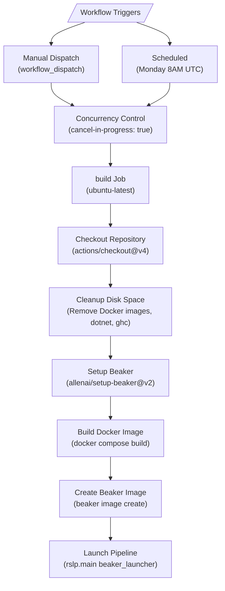
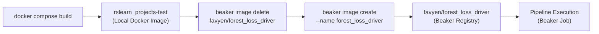
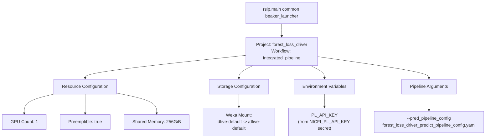
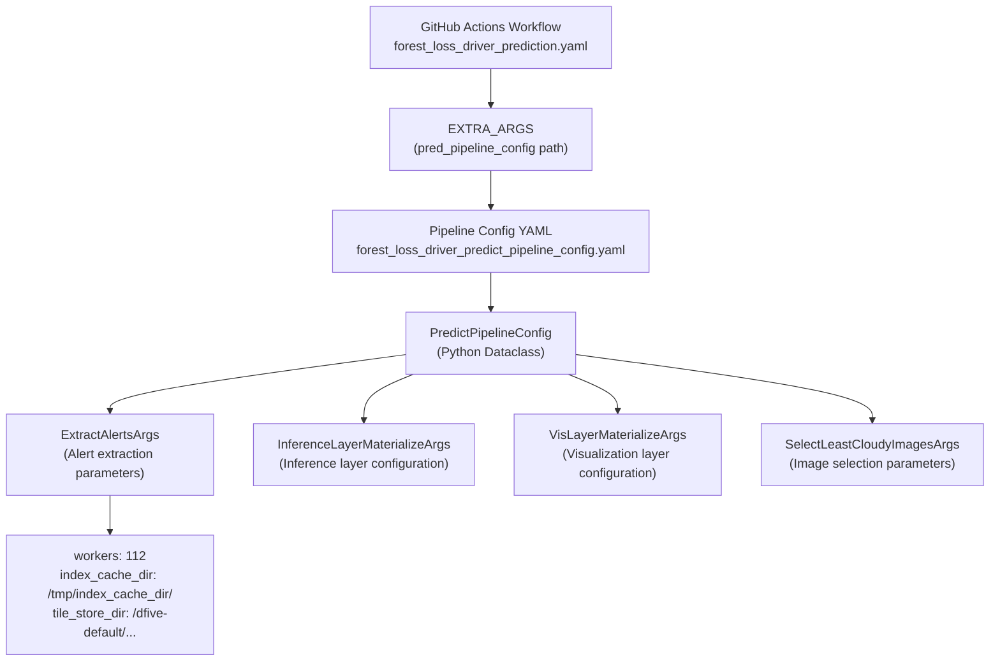
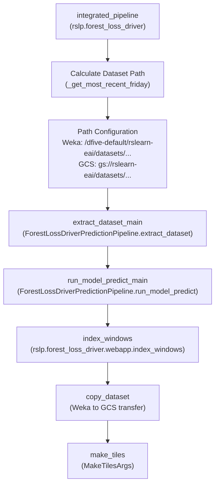
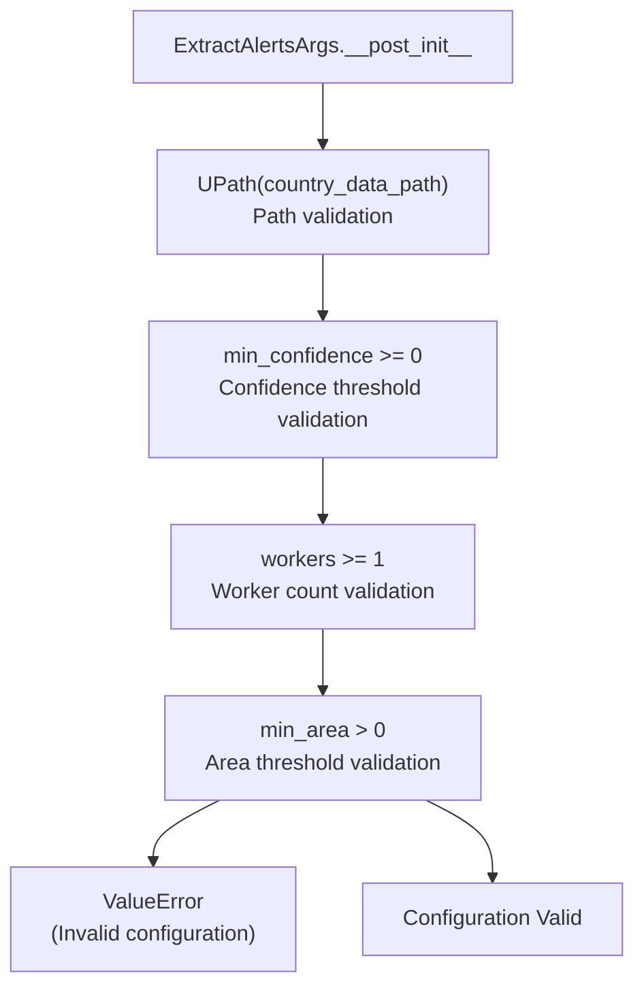

<!-- source: DeepWiki mcp.deepwiki.com · repo allenai/rslearn_projects · page 3.3 Deployment and Orchestration · fetched 2026-10-26 -->

# Deployment and Orchestration

Relevant source files

The following files were used as context for generating this wiki page:

- [.github/workflows/forest_loss_driver_prediction.yaml](.github/workflows/forest_loss_driver_prediction.yaml)
- [rslp/forest_loss_driver/__init__.py](rslp/forest_loss_driver/__init__.py)
- [rslp/forest_loss_driver/copy.py](rslp/forest_loss_driver/copy.py)
- [rslp/forest_loss_driver/inference/config.py](rslp/forest_loss_driver/inference/config.py)
- [rslp/forest_loss_driver/inference/config/forest_loss_driver_predict_pipeline_config.yaml](rslp/forest_loss_driver/inference/config/forest_loss_driver_predict_pipeline_config.yaml)
- [rslp/forest_loss_driver/inference/extract_alerts.py](rslp/forest_loss_driver/inference/extract_alerts.py)
- [rslp/forest_loss_driver/predict_pipeline.py](rslp/forest_loss_driver/predict_pipeline.py)
- [tests/integration/forest_loss_driver/inference/test_extract_alerts.py](tests/integration/forest_loss_driver/inference/test_extract_alerts.py)
- [tests/integration/forest_loss_driver/test_predict_pipeline.py](tests/integration/forest_loss_driver/test_predict_pipeline.py)

This page documents the deployment and orchestration infrastructure for the Forest Loss Driver system, covering the automated GitHub Actions workflows, Beaker platform integration, and pipeline execution mechanisms. The system provides end-to-end automation from code changes to production inference results.

For information about the prediction pipeline components and data processing, see [Prediction Pipeline](#3.1). For configuration details and data extraction, see [Data Processing and Configuration](#3.2).

## GitHub Actions Workflow Orchestration

The Forest Loss Driver system uses a comprehensive GitHub Actions workflow for automated deployment and execution. The workflow runs on a weekly schedule and handles the complete deployment lifecycle.

### Workflow Trigger and Scheduling

The main workflow is defined in [`.github/workflows/forest_loss_driver_prediction.yaml:1-29`]() and operates on two trigger mechanisms:

| Trigger Type | Schedule | Purpose |
|--------------|----------|---------|
| `workflow_dispatch` | Manual | On-demand execution for testing and emergency runs |
| `schedule` | `0 8 * * 1` (8:00 AM UTC every Monday) | Regular weekly production runs |

The workflow uses concurrency control to prevent overlapping executions and includes automatic cancellation of in-progress runs when new ones are triggered.

Sources: [`.github/workflows/forest_loss_driver_prediction.yaml:1-29`](), [`.github/workflows/forest_loss_driver_prediction.yaml:26-28`]()

### Environment Configuration and Secrets Management

The workflow manages multiple environment variables and secrets for Beaker integration and API access:

| Environment Variable | Source | Purpose |
|---------------------|--------|---------|
| `RSLP_PROJECT` | Hardcoded | Project identifier: `forest_loss_driver` |
| `RSLP_WORKFLOW` | Hardcoded | Workflow identifier: `integrated_pipeline` |
| `BEAKER_IMAGE_NAME` | Hardcoded | Image name for creation: `forest_loss_driver` |
| `BEAKER_TOKEN` | GitHub Secret | Authentication token for Beaker API |
| `BEAKER_ADDR` | GitHub Secret | Beaker API endpoint address |
| `RSLP_PREFIX` | GitHub Secret | Prefix for dataset paths |
| `PL_API_KEY` | GitHub Secret | Planet Labs API key for satellite imagery |

Sources: [`.github/workflows/forest_loss_driver_prediction.yaml:8-25`](), [`.github/workflows/forest_loss_driver_prediction.yaml:102-107`]()

## Docker Containerization and Image Management

The deployment process creates and manages Docker images through a multi-stage process involving local building, Beaker image creation, and cleanup operations.

### Image Build Process

The system performs disk space cleanup before building to prevent storage issues on GitHub Actions runners. This includes removing existing Docker images, .NET runtime, GHC compiler, and Boost libraries.

Sources: [`.github/workflows/forest_loss_driver_prediction.yaml:40-47`](), [`.github/workflows/forest_loss_driver_prediction.yaml:56-65`]()

### Container Runtime Configuration

The Docker container execution uses specific resource allocation and mount configurations:

| Configuration | Value | Purpose |
|---------------|-------|---------|
| GPU Count | 1 | Model inference acceleration |
| Preemptible | true | Cost optimization on Beaker |
| Shared Memory | 256GiB | Large dataset processing |
| Weka Mount | `/dfive-default` | High-performance storage access |
| Cluster | `ai2/jupiter-cirrascale-2` | Specific GPU cluster selection |

Sources: [`.github/workflows/forest_loss_driver_prediction.yaml:82-88`](), [`.github/workflows/forest_loss_driver_prediction.yaml:95-101`]()

## Beaker Platform Integration

The system integrates with the Beaker platform for distributed computing and job orchestration. The integration uses the `rslp.main` module's `beaker_launcher` functionality.

### Beaker Job Configuration

The Beaker launcher executes within a Docker container context, inheriting environment variables and configuration from the GitHub Actions workflow.

Sources: [`.github/workflows/forest_loss_driver_prediction.yaml:70-88`](), [`.github/workflows/forest_loss_driver_prediction.yaml:90-107`]()

## Pipeline Configuration and Execution

The orchestration system uses a hierarchical configuration approach with YAML files and dataclass structures to manage pipeline parameters.

### Configuration Hierarchy

The configuration system operates through multiple layers:

Sources: [`.github/workflows/forest_loss_driver_prediction.yaml:90-94`](), [`rslp/forest_loss_driver/inference/config/forest_loss_driver_predict_pipeline_config.yaml:1-9`](), [`rslp/forest_loss_driver/inference/config.py:201-234`]()

### Pipeline Execution Flow

The `integrated_pipeline` workflow orchestrates multiple stages of processing:

The pipeline automatically determines the dataset path based on the most recent Friday, ensuring consistent weekly dataset naming.

Sources: [`rslp/forest_loss_driver/__init__.py:24-66`](), [`rslp/forest_loss_driver/__init__.py:17-22`](), [`rslp/forest_loss_driver/__init__.py:69-75`]()

## Storage and Data Management

The orchestration system manages data across multiple storage systems with specific allocation strategies for different processing stages.

### Storage Architecture

| Storage System | Mount Point | Purpose | Performance Characteristics |
|----------------|-------------|---------|---------------------------|
| Weka | `/dfive-default` | Dataset processing, model inference | High-performance, SSD-based |
| Google Cloud Storage | `gs://rslearn-eai` | Final dataset hosting, web access | Scalable, cost-effective |
| Local Container | `/tmp/index_cache_dir` | Index caching | Fast local access |

### Data Transfer Pipeline

```mermaid
graph LR
    hansen_data["Hansen Forest Loss Data<br/>(gs://earthenginepartners-hansen)"] --> extract["extract_alerts_pipeline<br/>(Alert Extraction)"]
    
    extract --> weka_dataset["Weka Dataset<br/>(/dfive-default/rslearn-eai/datasets/)"]
    
    weka_dataset --> inference["Model Inference<br/>(run_model_predict)"]
    inference --> weka_results["Results on Weka<br/>(layers/output/)"]
    
    weka_results --> copy_job["copy_dataset<br/>(rslp.forest_loss_driver.copy)"]
    copy_job --> gcs_dataset["GCS Dataset<br/>(gs://rslearn-eai/datasets/)"]
    
    gcs_dataset --> tiles["make_tiles<br/>(Public Access)"]
```

The copy operation selectively transfers only necessary layers: `best_pre_*`, `best_post_*`, `planet_*`, `mask`, and `output` layers, along with metadata files.

Sources: [`rslp/forest_loss_driver/__init__.py:48-53`](), [`rslp/forest_loss_driver/copy.py:22-37`](), [`rslp/forest_loss_driver/inference/config.py:1-10`]()

## Error Handling and Validation

The orchestration system includes multiple validation and error handling mechanisms to ensure reliable execution.

### Configuration Validation

The `ExtractAlertsArgs` dataclass includes post-initialization validation:

### Pipeline Error Handling

The pipeline includes error handling for common failure scenarios:

| Error Condition | Handling Strategy | Location |
|-----------------|------------------|----------|
| No forest loss events found | Raise `ValueError` with configuration guidance | [`extract_alerts.py:469-474`]() |
| Missing layers during materialization | `ignore_errors=True` in materialize args | [`config.py:141-146`]() |
| API rate limiting | Reduced worker count for visualization layers | [`config.py:166-167`]() |
| Completed pipeline reruns | Skip extraction if completion marker exists | [`extract_alerts.py:387-391`]() |

Sources: [`rslp/forest_loss_driver/inference/config.py:103-112`](), [`rslp/forest_loss_driver/inference/extract_alerts.py:469-474`](), [`rslp/forest_loss_driver/inference/extract_alerts.py:387-391`]()

---

