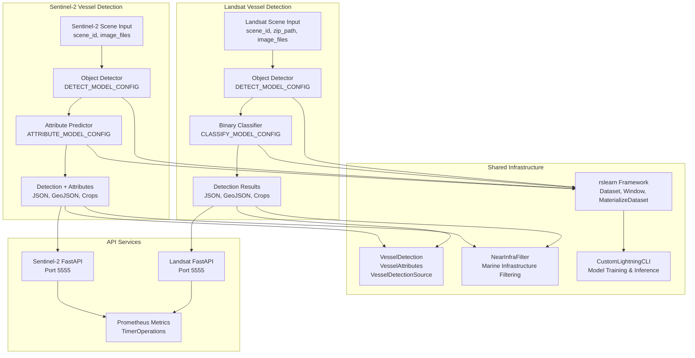
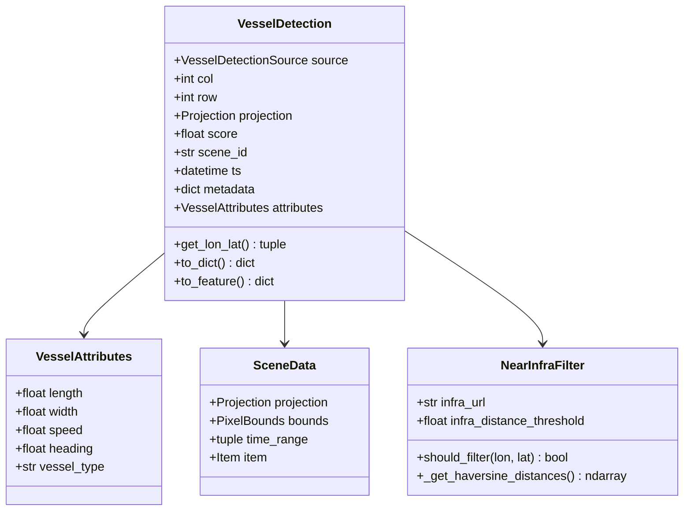
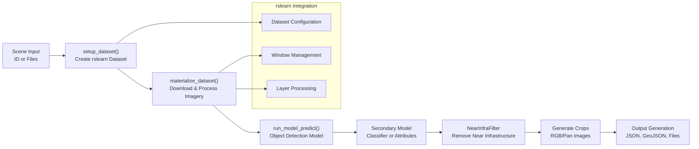
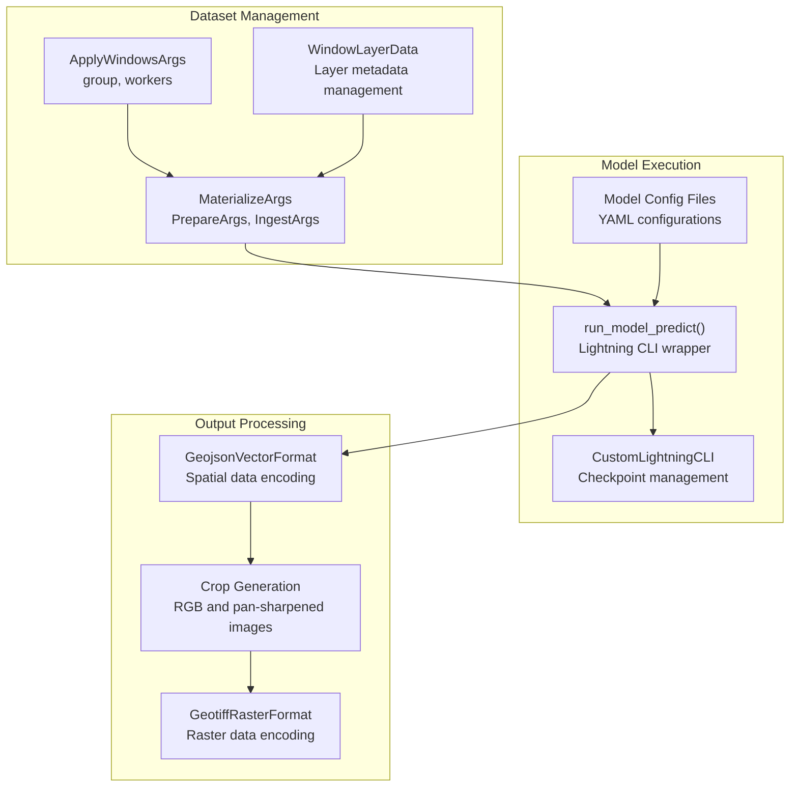

<!-- source: DeepWiki mcp.deepwiki.com · repo allenai/rslearn_projects · page 4 Vessel Detection Systems · fetched 2026-10-26 -->

# Vessel Detection Systems

Relevant source files

The following files were used as context for generating this wiki page:

- [ai2_docs/README.md](ai2_docs/README.md)
- [ai2_docs/batch_inference.md](ai2_docs/batch_inference.md)
- [ai2_docs/coding_best_practices_brainstorm.md](ai2_docs/coding_best_practices_brainstorm.md)
- [ai2_docs/landsat_vessels/api_use.md](ai2_docs/landsat_vessels/api_use.md)
- [ai2_docs/landsat_vessels/images/missed_vessels_B8.png](ai2_docs/landsat_vessels/images/missed_vessels_B8.png)
- [ai2_docs/landsat_vessels/images/missed_vessels_RGB.png](ai2_docs/landsat_vessels/images/missed_vessels_RGB.png)
- [ai2_docs/landsat_vessels/model_summary.md](ai2_docs/landsat_vessels/model_summary.md)
- [ai2_docs/landsat_vessels/train_eval.md](ai2_docs/landsat_vessels/train_eval.md)
- [docs/images/landsat_vessels/prediction.png](docs/images/landsat_vessels/prediction.png)
- [docs/landsat_vessels.md](docs/landsat_vessels.md)
- [docs/sentinel2_vessels.md](docs/sentinel2_vessels.md)
- [rslp/landsat_vessels/predict_pipeline.py](rslp/landsat_vessels/predict_pipeline.py)
- [rslp/sentinel2_vessels/predict_pipeline.py](rslp/sentinel2_vessels/predict_pipeline.py)
- [rslp/utils/filter.py](rslp/utils/filter.py)
- [tests/integration/test_lightning_cli.py](tests/integration/test_lightning_cli.py)
- [tests/unit/forest_loss_driver/inference/test_unit_extract_alerts.py](tests/unit/forest_loss_driver/inference/test_unit_extract_alerts.py)
- [tests/unit/test_filter.py](tests/unit/test_filter.py)

This document covers the dual vessel detection systems for analyzing satellite imagery to identify ships and maritime vessels. The repository contains two complete detection pipelines: one for Landsat 8/9 imagery and another for Sentinel-2 imagery. Both systems integrate with the rslearn framework for data processing and provide REST APIs for operational deployment.

For information about the broader ML infrastructure supporting these systems, see [Core Infrastructure](#2). For details about distributed job processing, see [Distributed Worker System](#2.4).

## System Architecture Overview

The vessel detection systems consist of two independent but architecturally similar pipelines that share common utilities and deployment infrastructure.

Sources: [rslp/landsat_vessels/predict_pipeline.py:1-592](), [rslp/sentinel2_vessels/predict_pipeline.py:1-572](), [rslp/utils/filter.py:1-126]()

## Common Data Models

Both systems use shared data models for representing detections and managing pipeline execution:

Sources: [rslp/vessels.py](), [rslp/utils/filter.py:56-123]()

## Processing Pipeline Flow

Both systems follow a similar processing pattern with dataset materialization, model inference, and post-processing:

Sources: [rslp/landsat_vessels/predict_pipeline.py:83-163](), [rslp/sentinel2_vessels/predict_pipeline.py:248-338](), [rslp/utils/rslearn.py]()

## Input Modes and Configuration

The systems support multiple input modes for flexible deployment scenarios:

| Input Mode | Landsat Support | Sentinel-2 Support | Description |
|------------|----------------|-------------------|-------------|
| Scene ID | ✅ AWS S3 | ✅ GCP Public Data | Automatic download by scene identifier |
| Zip Archive | ✅ Local/GCS | ❌ | Compressed scene archive |
| Image Files | ✅ Multi-band | ✅ Multi-band | Direct file paths to band images |
| Window Path | ✅ | ❌ | Pre-processed rslearn window |

Sources: [rslp/landsat_vessels/predict_pipeline.py:270-408](), [rslp/sentinel2_vessels/predict_pipeline.py:116-245]()

## Model Architecture Differences

The two systems employ different detection strategies:

**Landsat (Two-Stage Pipeline):**
- Stage 1: Object detector identifies potential vessels
- Stage 2: Binary classifier filters false positives
- Window size: `CLASSIFY_WINDOW_SIZE` for classification crops
- Bands used: B2, B3, B4, B5, B6, B7, B8

**Sentinel-2 (Detection + Attributes):**
- Stage 1: Object detector identifies vessels
- Stage 2: Multi-task attribute predictor estimates vessel properties
- Window size: `CROP_WINDOW_SIZE` (128x128) for attribute prediction
- Bands used: B01-B12, B8A for newer models

Sources: [rslp/landsat_vessels/predict_pipeline.py:166-249](), [rslp/sentinel2_vessels/predict_pipeline.py:341-439](), [rslp/landsat_vessels/config.py](), [rslp/sentinel2_vessels/predict_pipeline.py:43-62]()

## Infrastructure Integration

Both systems integrate with the shared infrastructure components:

Sources: [rslp/utils/rslearn.py](), [rslp/lightning_cli.py](), [rslp/landsat_vessels/predict_pipeline.py:118-131](), [rslp/sentinel2_vessels/predict_pipeline.py:285-298]()

---

