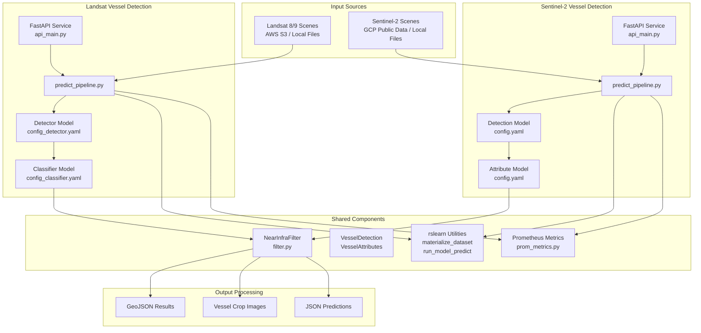
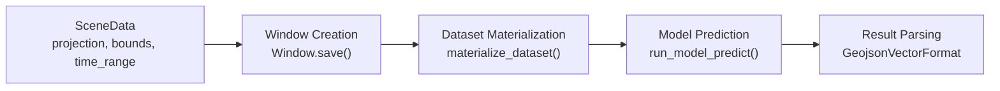
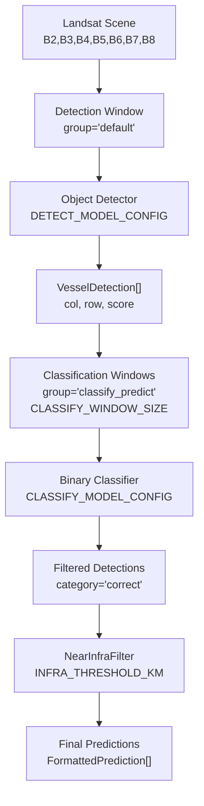
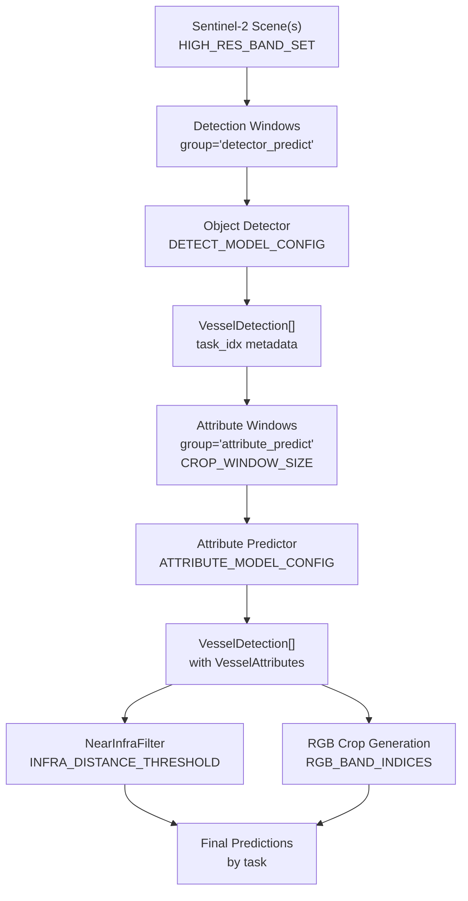
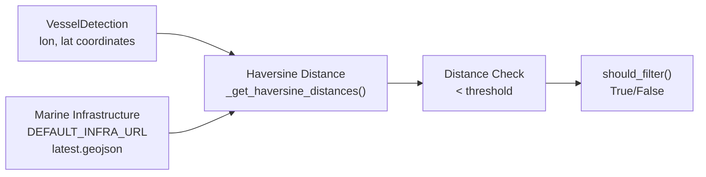
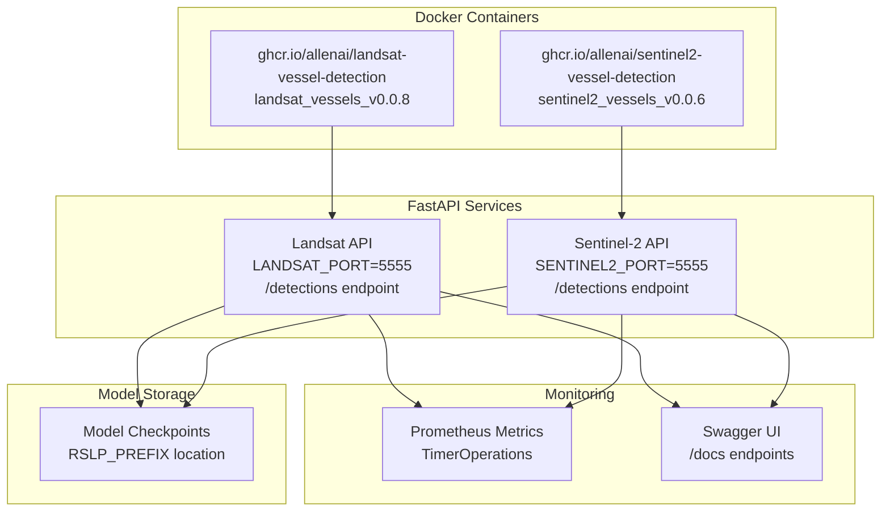

<!-- source: DeepWiki mcp.deepwiki.com · repo allenai/rslearn_projects · page 4.1 System Overview · fetched 2026-10-26 -->

# System Overview

Relevant source files

The following files were used as context for generating this wiki page:

- [ai2_docs/README.md](ai2_docs/README.md)
- [ai2_docs/batch_inference.md](ai2_docs/batch_inference.md)
- [ai2_docs/coding_best_practices_brainstorm.md](ai2_docs/coding_best_practices_brainstorm.md)
- [ai2_docs/landsat_vessels/api_use.md](ai2_docs/landsat_vessels/api_use.md)
- [ai2_docs/landsat_vessels/images/missed_vessels_B8.png](ai2_docs/landsat_vessels/images/missed_vessels_B8.png)
- [ai2_docs/landsat_vessels/images/missed_vessels_RGB.png](ai2_docs/landsat_vessels/images/missed_vessels_RGB.png)
- [ai2_docs/landsat_vessels/model_summary.md](ai2_docs/landsat_vessels/model_summary.md)
- [ai2_docs/landsat_vessels/train_eval.md](ai2_docs/landsat_vessels/train_eval.md)
- [docs/images/landsat_vessels/prediction.png](docs/images/landsat_vessels/prediction.png)
- [docs/landsat_vessels.md](docs/landsat_vessels.md)
- [docs/sentinel2_vessels.md](docs/sentinel2_vessels.md)
- [rslp/landsat_vessels/predict_pipeline.py](rslp/landsat_vessels/predict_pipeline.py)
- [rslp/sentinel2_vessels/predict_pipeline.py](rslp/sentinel2_vessels/predict_pipeline.py)
- [rslp/utils/filter.py](rslp/utils/filter.py)
- [tests/integration/test_lightning_cli.py](tests/integration/test_lightning_cli.py)
- [tests/unit/forest_loss_driver/inference/test_unit_extract_alerts.py](tests/unit/forest_loss_driver/inference/test_unit_extract_alerts.py)
- [tests/unit/test_filter.py](tests/unit/test_filter.py)

This document provides a high-level overview of the vessel detection systems in the rslearn_projects repository, covering both the Landsat and Sentinel-2 vessel detection pipelines. These systems detect and classify maritime vessels from satellite imagery using machine learning models built on the rslearn framework.

For information about the underlying rslearn framework integration, see [rslearn Framework Integration](#2.1). For details about the Docker containerization and deployment infrastructure, see [Docker and Containerization](#2.3).

## Architecture Overview

The vessel detection systems consist of two parallel pipelines that share common architectural patterns while handling different satellite data sources. Both systems follow a multi-stage prediction approach with filtering, APIs, and batch processing capabilities.

**High-Level System Architecture**

Sources: [rslp/landsat_vessels/predict_pipeline.py:1-592](), [rslp/sentinel2_vessels/predict_pipeline.py:1-572](), [rslp/utils/filter.py:1-126]()

## Common Architectural Patterns

Both vessel detection systems follow consistent patterns that enable code reuse and maintainability:

### Pipeline Structure Pattern

| Stage | Landsat Implementation | Sentinel-2 Implementation |
|-------|----------------------|---------------------------|
| **Setup** | `setup_dataset()` | `setup_dataset_with_scene_ids()` / `setup_dataset_with_image_files()` |
| **Detection** | `get_vessel_detections()` | `get_vessel_detections()` |
| **Refinement** | `run_classifier()` | `run_attribute_model()` |
| **Filtering** | `NearInfraFilter` | `NearInfraFilter` |
| **Output** | `_build_predictions_and_crops()` | `_build_predictions_and_crops()` |

### Data Flow Pattern

Both systems implement the same core data flow using rslearn components:

Sources: [rslp/landsat_vessels/predict_pipeline.py:83-163](), [rslp/sentinel2_vessels/predict_pipeline.py:248-338](), [rslp/utils/rslearn.py:40-48]()

## System-Specific Implementations

### Landsat Vessel Detection

The Landsat system implements a **two-stage detection approach**:

**Detection and Classification Flow**

**Key Configuration Constants:**
- `DETECT_MODEL_CONFIG = "data/landsat_vessels/config_detector.yaml"`
- `CLASSIFY_MODEL_CONFIG = "data/landsat_vessels/config_classifier.yaml"`
- `CLASSIFY_WINDOW_SIZE = 64` pixels
- `INFRA_THRESHOLD_KM = 0.1` km

Sources: [rslp/landsat_vessels/predict_pipeline.py:25-36](), [rslp/landsat_vessels/predict_pipeline.py:166-249]()

### Sentinel-2 Vessel Detection

The Sentinel-2 system implements **detection with attribute prediction**:

**Detection and Attribute Prediction Flow**

**Key Configuration Constants:**
- `DETECT_MODEL_CONFIG = "data/sentinel2_vessels/config.yaml"`
- `ATTRIBUTE_MODEL_CONFIG = "data/sentinel2_vessel_attribute/config.yaml"`
- `CROP_WINDOW_SIZE = 128` pixels
- `HIGH_RES_BAND_SET = ["B02", "B03", "B04", "B08"]`
- `INFRA_DISTANCE_THRESHOLD = 0.05` km

Sources: [rslp/sentinel2_vessels/predict_pipeline.py:37-62](), [rslp/sentinel2_vessels/predict_pipeline.py:341-439]()

## Shared Components and Utilities

### Vessel Data Models

Both systems use common data structures for representing vessel detections:

| Class | Purpose | Key Attributes |
|-------|---------|----------------|
| `VesselDetection` | Core detection representation | `col`, `row`, `projection`, `score`, `source`, `metadata` |
| `VesselAttributes` | Vessel physical/behavioral attributes | `length`, `width`, `speed`, `heading`, `vessel_type` |
| `VesselDetectionSource` | Enum for data source tracking | `LANDSAT`, `SENTINEL2` |

### Marine Infrastructure Filtering

Both systems implement identical filtering using `NearInfraFilter`:

**Filter Implementation:**
- Default URL: `"https://pub-956f3eb0f5974f37b9228e0a62f449bf.r2.dev/outputs/marine/latest.geojson"`
- Default threshold: `0.1 km` (Landsat) / `0.05 km` (Sentinel-2)
- Cached infrastructure data using `@functools.cache`

Sources: [rslp/utils/filter.py:26-123](), [tests/unit/test_filter.py:8-59]()

### rslearn Integration Pattern

Both systems follow identical patterns for rslearn dataset operations:

| Operation | Function | Purpose |
|-----------|----------|---------|
| **Window Creation** | `Window.get_window_root()` | Create rslearn windows for processing |
| **Materialization** | `materialize_dataset()` | Prepare satellite imagery data |
| **Model Inference** | `run_model_predict()` | Execute ML model predictions |
| **Result Reading** | `GeojsonVectorFormat().decode_vector()` | Parse model outputs |

Sources: [rslp/utils/rslearn.py:40-48](), [rslp/landsat_vessels/predict_pipeline.py:118-131](), [rslp/sentinel2_vessels/predict_pipeline.py:285-299]()

## API and Deployment Architecture

Both systems provide identical FastAPI interfaces with Docker deployment:

**API Service Architecture**

**Common API Features:**
- Port: `5555` (configurable via environment)
- Endpoints: `/detections` (POST)
- Documentation: `/docs` (Swagger UI), `/redoc` (ReDoc)
- Metrics: Prometheus integration with operation timing
- Input formats: Scene IDs, file paths, or direct image file references

Sources: [ai2_docs/landsat_vessels/api_use.md:36-136](), [docs/sentinel2_vessels.md:106-182](), [rslp/landsat_vessels/prom_metrics.py:1-50](), [rslp/sentinel2_vessels/prom_metrics.py:1-50]()

---

