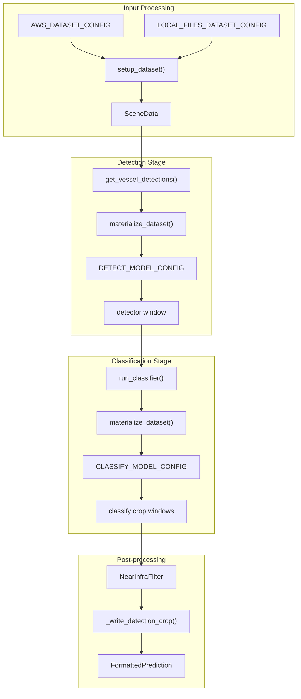
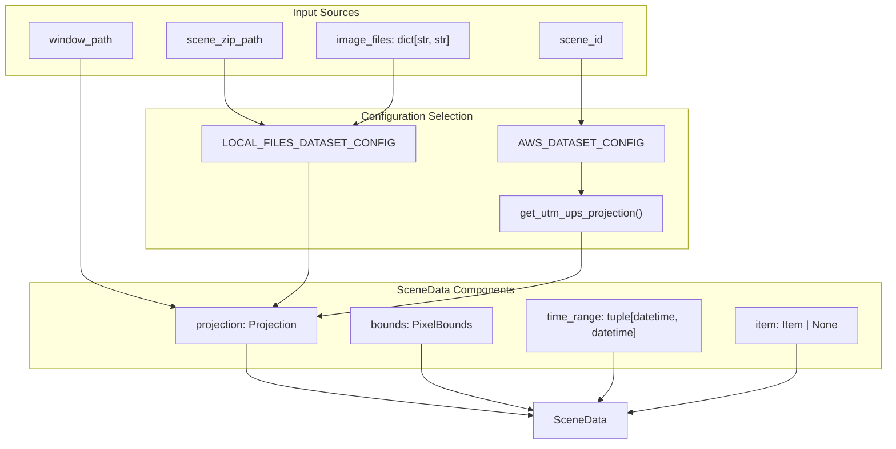
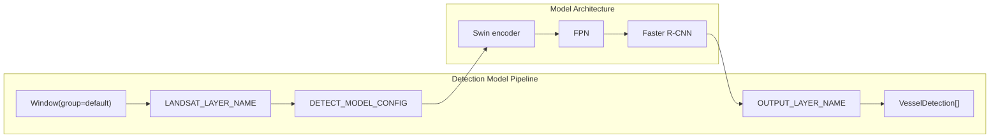
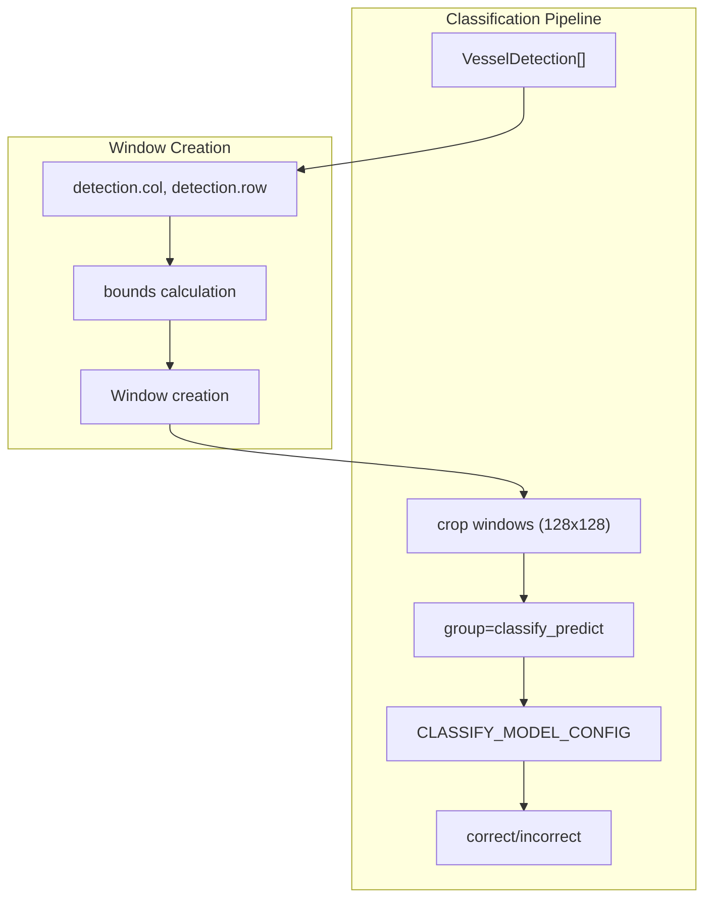
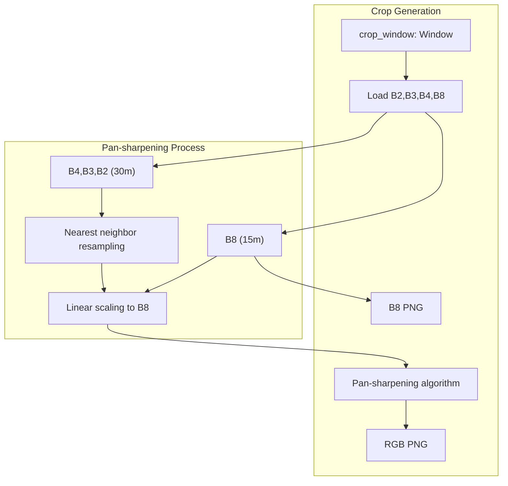
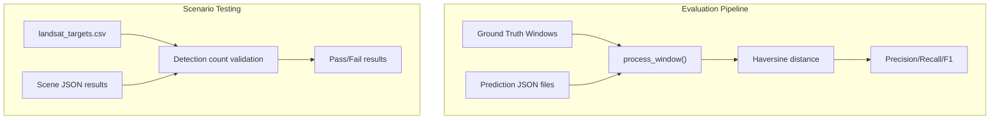

<!-- source: DeepWiki mcp.deepwiki.com · repo allenai/rslearn_projects · page 4.2 Landsat Vessel Detection · fetched 2026-10-26 -->

# Landsat Vessel Detection

Relevant source files

The following files were used as context for generating this wiki page:

- [data/landsat_vessels/config_classifier.yaml](data/landsat_vessels/config_classifier.yaml)
- [data/landsat_vessels/config_detector.yaml](data/landsat_vessels/config_detector.yaml)
- [rslp/landsat_vessels/config.py](rslp/landsat_vessels/config.py)
- [rslp/landsat_vessels/docker-compose.yaml](rslp/landsat_vessels/docker-compose.yaml)
- [rslp/landsat_vessels/evaluation/get_metrics.py](rslp/landsat_vessels/evaluation/get_metrics.py)
- [rslp/landsat_vessels/evaluation/scenario_checks.py](rslp/landsat_vessels/evaluation/scenario_checks.py)
- [rslp/landsat_vessels/predict_pipeline.py](rslp/landsat_vessels/predict_pipeline.py)
- [rslp/sentinel2_vessels/predict_pipeline.py](rslp/sentinel2_vessels/predict_pipeline.py)
- [rslp/utils/filter.py](rslp/utils/filter.py)
- [tests/unit/forest_loss_driver/inference/test_unit_extract_alerts.py](tests/unit/forest_loss_driver/inference/test_unit_extract_alerts.py)
- [tests/unit/test_filter.py](tests/unit/test_filter.py)

This document covers the Landsat vessel detection system, a two-stage machine learning pipeline that identifies vessels in Landsat satellite imagery. The system combines object detection with classification to minimize false positives, and includes infrastructure filtering and evaluation capabilities.

For information about Sentinel-2 vessel detection, see [Sentinel-2 Vessel Detection](#4.3). For the FastAPI services that expose these detection capabilities, see [API Services](#4.4).

## System Overview

The Landsat vessel detection system operates as a two-stage pipeline that processes Landsat scenes to identify vessel locations. The system supports multiple input formats including scene IDs, zip files, individual GeoTIFF files, and pre-defined window metadata.

Sources: [rslp/landsat_vessels/predict_pipeline.py:1-592](), [rslp/landsat_vessels/config.py:1-31]()

## Input Data Handling

The `setup_dataset()` function provides flexible input handling supporting four different data source modes:

| Input Mode | Description | Configuration |
|------------|-------------|---------------|
| Scene ID | Landsat scene identifier | Uses `AWS_DATASET_CONFIG` |
| Scene Zip | Compressed Landsat scene | Downloads and extracts locally |
| Image Files | Individual band GeoTIFFs | Uses `LOCAL_FILES_DATASET_CONFIG` |
| Window Path | Pre-defined window metadata | Loads projection and bounds |

The function creates a `SceneData` object containing the projection, pixel bounds, time range, and optional `Item` reference for downstream processing.

Sources: [rslp/landsat_vessels/predict_pipeline.py:270-408](), [rslp/landsat_vessels/config.py:11-12]()

## Detection Pipeline

### Stage 1: Object Detection

The `get_vessel_detections()` function implements the first stage using a Faster R-CNN model. It creates a single window covering the entire scene, materializes the Landsat imagery, and applies the detection model.

Key parameters:
- **Window Group**: `"default"`
- **Landsat Bands**: `["B2", "B3", "B4", "B5", "B6", "B7", "B8"]`
- **Model Architecture**: Swin encoder + FPN + Faster R-CNN
- **Resolution**: 15m/pixel (`LANDSAT_RESOLUTION`)

The detector outputs bounding boxes with confidence scores that are converted to `VesselDetection` objects containing pixel coordinates, projection information, and metadata.

Sources: [rslp/landsat_vessels/predict_pipeline.py:83-163](), [data/landsat_vessels/config_detector.yaml:1-145]()

### Stage 2: Classification

The `run_classifier()` function implements false positive filtering using a binary classifier. For each detection from stage 1, it creates a crop window of size `CLASSIFY_WINDOW_SIZE` (128x128 pixels) centered on the detection.

The classifier model uses:
- **Input**: 7 Landsat bands `["B8", "B2", "B3", "B4", "B5", "B6", "B7"]`
- **Architecture**: Swin encoder + PoolingDecoder
- **Output**: Binary classification ("correct" vs "incorrect")
- **Threshold**: 0.85 confidence for positive class

Sources: [rslp/landsat_vessels/predict_pipeline.py:166-249](), [data/landsat_vessels/config_classifier.yaml:1-106]()

## Post-processing and Filtering

### Marine Infrastructure Filtering

The `NearInfraFilter` removes detections near marine infrastructure to reduce false positives from ports, piers, and other coastal structures. It uses haversine distance calculation against a GeoJSON dataset of known infrastructure locations.

**Configuration**:
- **Distance Threshold**: `INFRA_THRESHOLD_KM` (0.03 km = 30 meters)
- **Data Source**: Cloudflare R2 hosted GeoJSON file
- **Algorithm**: Haversine distance calculation

### Crop Generation

The `_write_detection_crop()` function creates visual crops for each detection, generating two PNG files:
- **RGB Image**: Pan-sharpened true color using B4/B3/B2 and B8
- **B8 Image**: Panchromatic band only

The pan-sharpening algorithm scales RGB bands to match the higher resolution B8 band using nearest neighbor resampling.

Sources: [rslp/landsat_vessels/predict_pipeline.py:491-591](), [rslp/utils/filter.py:56-123](), [rslp/landsat_vessels/config.py:27]()

## Model Configurations

### Detector Model

The detector uses a multi-scale architecture optimized for small vessel detection:

| Component | Configuration |
|-----------|---------------|
| Encoder | Swin Transformer (pretrained) |
| Feature Pyramid | FPN with 128 output channels |
| Detector | Faster R-CNN with 4 scale levels |
| Anchor Sizes | [32, 64, 128, 256] pixels |
| Input Channels | 7 (all Landsat bands) |
| Classes | 2 (background, vessel) |

**Training Configuration**:
- **Patch Size**: 512x512 pixels
- **Overlap Ratio**: 0.1 for inference
- **Score Threshold**: 0.7
- **NMS**: Distance-based with 10-pixel threshold

### Classifier Model

The classifier refines detection results with a simpler architecture:

| Component | Configuration |
|-----------|---------------|
| Encoder | Swin Transformer |
| Decoder | PoolingDecoder (1024 → 2 channels) |
| Input Order | B8 first, then RGB bands |
| Positive Threshold | 0.85 confidence |
| Training Strategy | Weighted sampling |

Sources: [data/landsat_vessels/config_detector.yaml:1-145](), [data/landsat_vessels/config_classifier.yaml:1-106]()

## Evaluation System

The evaluation system computes precision, recall, and F1-score metrics by comparing predictions against ground truth labels using haversine distance matching.

### Metrics Computation

The `compute_metrics()` function in `get_metrics.py` processes evaluation results:

**Matching Criteria**:
- **Distance Threshold**: `MATCH_THRESHOLD_KM` (0.1 km = 100 meters)
- **Algorithm**: Haversine distance between prediction and ground truth
- **Coordinate System**: WGS84 (latitude/longitude)

**Output Metrics**:
- **Recall**: `matches / (matches + missed_expected)`
- **Precision**: `matches / (matches + unmatched_predicted)`
- **F1-Score**: `2 * precision * recall / (precision + recall)`

### Scenario Testing

The `scenario_checks.py` script validates model performance against predefined test scenarios with expected detection count ranges for specific scenes.

Sources: [rslp/landsat_vessels/evaluation/get_metrics.py:1-157](), [rslp/landsat_vessels/evaluation/scenario_checks.py:1-47](), [rslp/landsat_vessels/config.py:30]()

## Pipeline Orchestration

The main `predict_pipeline()` function orchestrates the complete detection workflow:

1. **Setup Phase**: Dataset configuration and `SceneData` creation
2. **Detection Phase**: First-stage object detection
3. **Classification Phase**: False positive filtering  
4. **Post-processing Phase**: Infrastructure filtering and crop generation
5. **Output Phase**: JSON/GeoJSON export and file writing

The pipeline supports both single-scene and batch processing modes, with configurable output formats including JSON detections, GeoJSON features, and visual crops.

**Performance Monitoring**:
- **Prometheus Metrics**: Timing for each pipeline stage
- **Timer Operations**: `SetupDataset`, `GetVesselDetections`, `RunClassifier`, `BuildPredictionsAndCrops`

Sources: [rslp/landsat_vessels/predict_pipeline.py:411-488](), [rslp/landsat_vessels/prom_metrics.py]()

---

