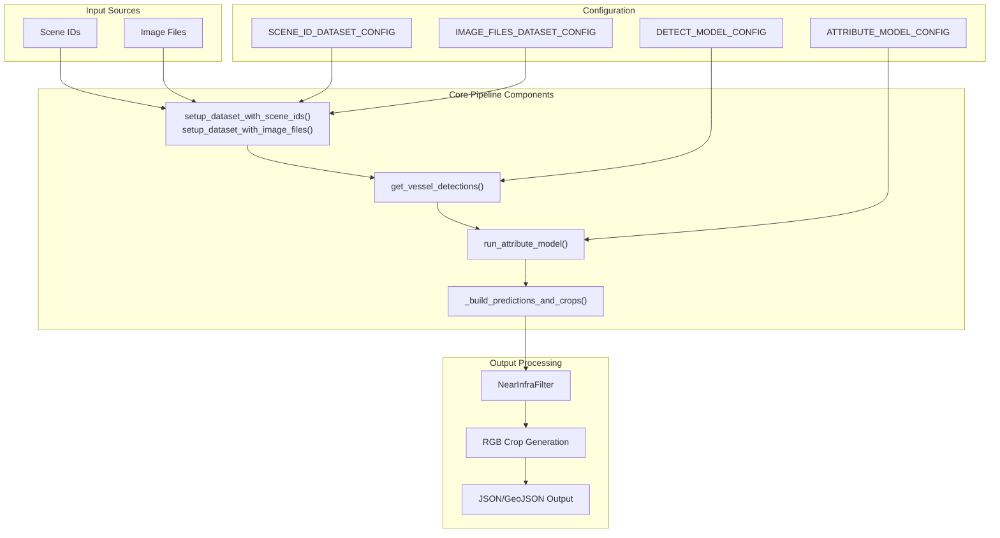
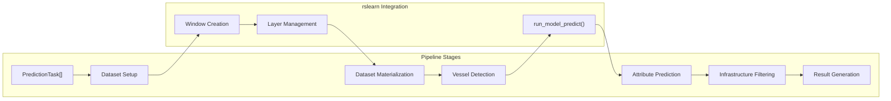
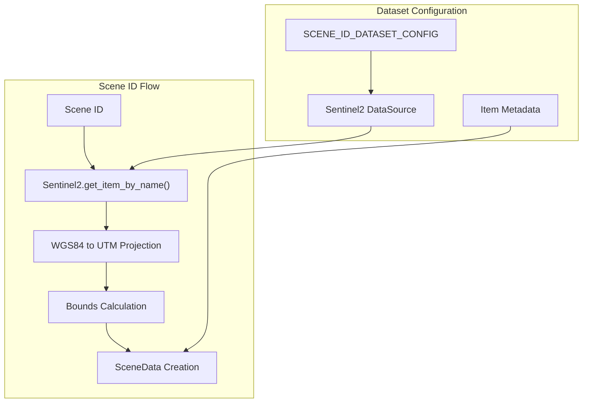
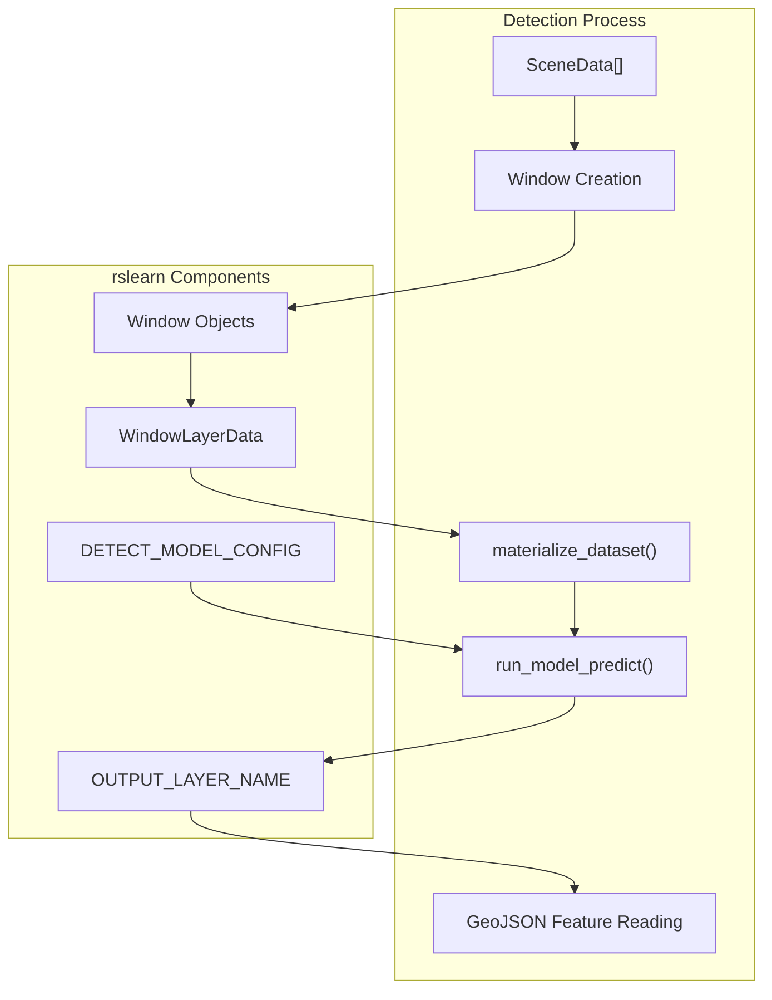
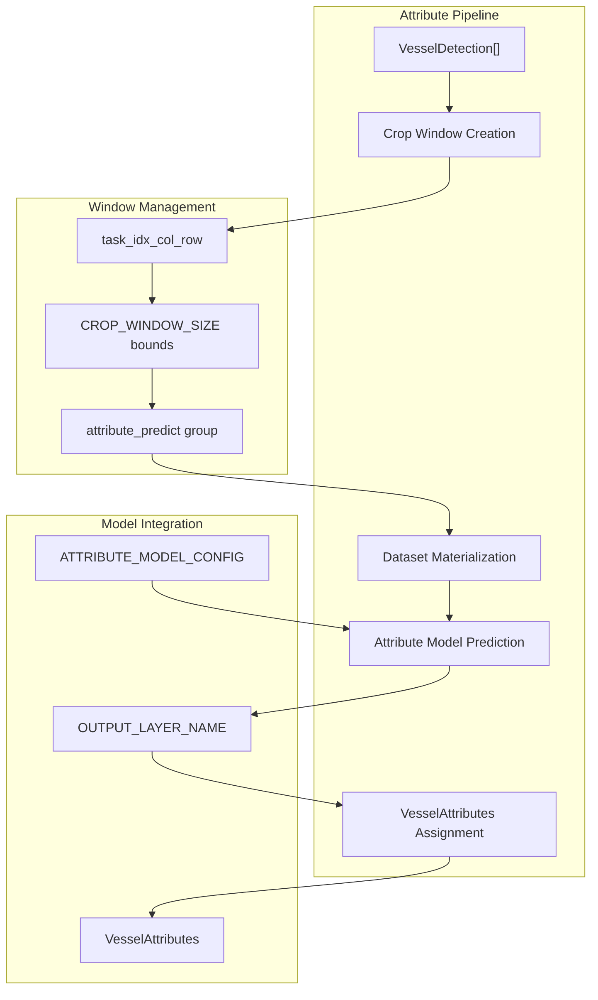
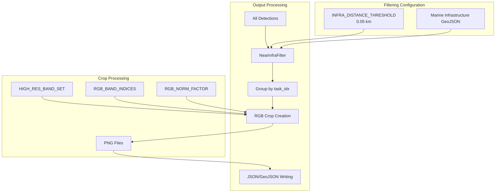

<!-- source: DeepWiki mcp.deepwiki.com · repo allenai/rslearn_projects · page 4.3 Sentinel-2 Vessel Detection · fetched 2026-10-26 -->

# Sentinel-2 Vessel Detection

Relevant source files

The following files were used as context for generating this wiki page:

- [ai2_docs/README.md](ai2_docs/README.md)
- [ai2_docs/batch_inference.md](ai2_docs/batch_inference.md)
- [ai2_docs/coding_best_practices_brainstorm.md](ai2_docs/coding_best_practices_brainstorm.md)
- [ai2_docs/landsat_vessels/api_use.md](ai2_docs/landsat_vessels/api_use.md)
- [ai2_docs/landsat_vessels/images/missed_vessels_B8.png](ai2_docs/landsat_vessels/images/missed_vessels_B8.png)
- [ai2_docs/landsat_vessels/images/missed_vessels_RGB.png](ai2_docs/landsat_vessels/images/missed_vessels_RGB.png)
- [ai2_docs/landsat_vessels/model_summary.md](ai2_docs/landsat_vessels/model_summary.md)
- [ai2_docs/landsat_vessels/train_eval.md](ai2_docs/landsat_vessels/train_eval.md)
- [docs/images/landsat_vessels/prediction.png](docs/images/landsat_vessels/prediction.png)
- [docs/landsat_vessels.md](docs/landsat_vessels.md)
- [docs/sentinel2_vessels.md](docs/sentinel2_vessels.md)
- [rslp/landsat_vessels/predict_pipeline.py](rslp/landsat_vessels/predict_pipeline.py)
- [rslp/sentinel2_vessels/predict_pipeline.py](rslp/sentinel2_vessels/predict_pipeline.py)
- [rslp/utils/filter.py](rslp/utils/filter.py)
- [tests/integration/test_lightning_cli.py](tests/integration/test_lightning_cli.py)
- [tests/unit/forest_loss_driver/inference/test_unit_extract_alerts.py](tests/unit/forest_loss_driver/inference/test_unit_extract_alerts.py)
- [tests/unit/test_filter.py](tests/unit/test_filter.py)

This document covers the Sentinel-2 vessel detection system, which detects vessels in Sentinel-2 L1C satellite imagery and predicts vessel attributes such as length, width, speed, heading, and type. The system includes batch processing capabilities, attribute prediction integration, and multiple input modalities.

For information about the Landsat vessel detection system, see [Landsat Vessel Detection](#4.2). For the API services that expose both vessel detection systems, see [API Services](#4.4).

## System Overview

The Sentinel-2 vessel detection system operates as a multi-stage pipeline that processes satellite imagery to detect vessels and predict their attributes. Unlike the Landsat system, it integrates vessel attribute prediction directly into the main pipeline.

Sources: [rslp/sentinel2_vessels/predict_pipeline.py:1-572]()

## Pipeline Architecture

The prediction pipeline is orchestrated by the `predict_pipeline()` function which coordinates multiple processing stages through a sequence of specialized functions.

### Core Processing Flow

The system uses the `PredictionTask` dataclass to define processing requirements, supporting both scene ID and image file inputs within the same batch.

Sources: [rslp/sentinel2_vessels/predict_pipeline.py:78-96](), [rslp/sentinel2_vessels/predict_pipeline.py:442-527]()

## Input Data Handling

The system supports two primary input modalities through distinct setup functions that create appropriate rslearn dataset configurations.

### Scene ID Processing

The `setup_dataset_with_scene_ids()` function handles Sentinel-2 scene IDs by creating rslearn dataset configurations that fetch imagery from Google Cloud Public Data.

### Image Files Processing

For direct image file inputs, the `setup_dataset_with_image_files()` function creates local dataset configurations with absolute file paths.

Sources: [rslp/sentinel2_vessels/predict_pipeline.py:116-171](), [rslp/sentinel2_vessels/predict_pipeline.py:174-245]()

## Vessel Detection Stage

The detection stage creates rslearn windows for each scene and applies the vessel detection model through the rslearn framework.

The system creates a separate window for each scene in the `detector_predict` group, with 32 workers for parallel processing.

Sources: [rslp/sentinel2_vessels/predict_pipeline.py:248-338]()

## Attribute Prediction Integration

The attribute prediction stage creates smaller crop windows around detected vessels and applies a separate model to predict vessel characteristics.

### Attribute Processing Workflow

The attribute model predicts length, width, speed (SOG), heading, and vessel type for each detection using 128x128 pixel crops.

Sources: [rslp/sentinel2_vessels/predict_pipeline.py:341-439]()

## Configuration and Model Paths

The system uses multiple configuration files for different processing stages and input types:

| Configuration | Purpose | File Path |
|---------------|---------|-----------|
| `SCENE_ID_DATASET_CONFIG` | GCP Sentinel-2 data access | `data/sentinel2_vessels/config_predict_gcp.json` |
| `IMAGE_FILES_DATASET_CONFIG` | Local file processing | `data/sentinel2_vessels/config_predict_local_files.json` |
| `DETECT_MODEL_CONFIG` | Vessel detection model | `data/sentinel2_vessels/config.yaml` |
| `ATTRIBUTE_MODEL_CONFIG` | Attribute prediction model | `data/sentinel2_vessel_attribute/config.yaml` |

### Band and Resolution Configuration

The system processes Sentinel-2 imagery at 10-meter resolution using the high-resolution band set:

- **HIGH_RES_BAND_SET**: `["B02", "B03", "B04", "B08"]`
- **RGB_BAND_INDICES**: `(2, 1, 0)` for B04/B03/B02 mapping
- **RGB_NORM_FACTOR**: `10` for 8-bit conversion

Sources: [rslp/sentinel2_vessels/predict_pipeline.py:43-62]()

## Output Processing and Filtering

The final stage processes detections through infrastructure filtering and generates output artifacts.

The infrastructure filter removes detections within 50 meters of marine infrastructure using haversine distance calculations. RGB crops are generated by extracting and normalizing B04/B03/B02 bands to create PNG images.

Sources: [rslp/sentinel2_vessels/predict_pipeline.py:530-571](), [rslp/utils/filter.py:56-123]()

---

