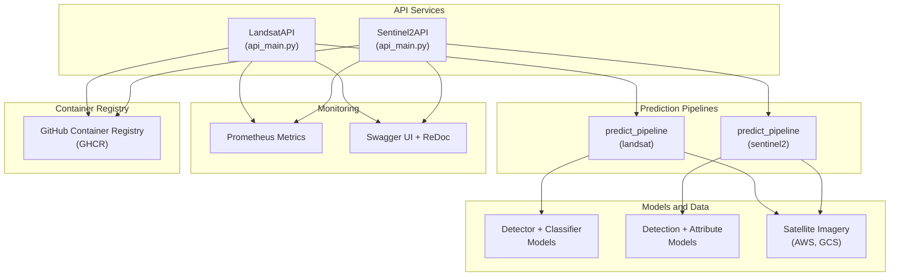
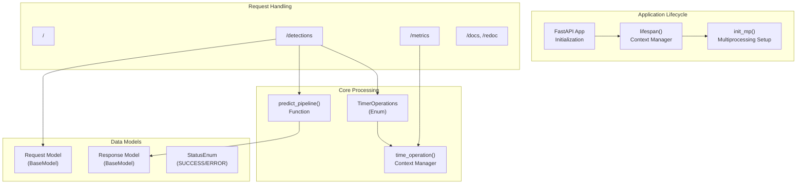
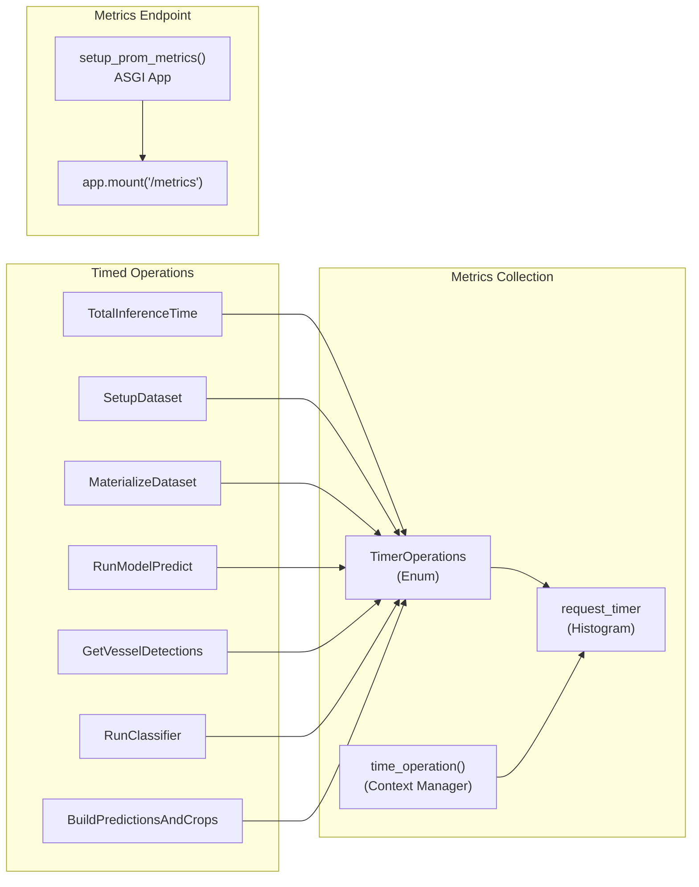

<!-- source: DeepWiki mcp.deepwiki.com · repo allenai/rslearn_projects · page 4.4 API Services · fetched 2026-10-26 -->

# API Services

<details>
<summary>Relevant source files</summary>

The following files were used as context for generating this wiki page:

- [ai2_docs/README.md](ai2_docs/README.md)
- [ai2_docs/batch_inference.md](ai2_docs/batch_inference.md)
- [ai2_docs/coding_best_practices_brainstorm.md](ai2_docs/coding_best_practices_brainstorm.md)
- [ai2_docs/landsat_vessels/api_use.md](ai2_docs/landsat_vessels/api_use.md)
- [ai2_docs/landsat_vessels/images/missed_vessels_B8.png](ai2_docs/landsat_vessels/images/missed_vessels_B8.png)
- [ai2_docs/landsat_vessels/images/missed_vessels_RGB.png](ai2_docs/landsat_vessels/images/missed_vessels_RGB.png)
- [ai2_docs/landsat_vessels/model_summary.md](ai2_docs/landsat_vessels/model_summary.md)
- [ai2_docs/landsat_vessels/train_eval.md](ai2_docs/landsat_vessels/train_eval.md)
- [docs/images/landsat_vessels/prediction.png](docs/images/landsat_vessels/prediction.png)
- [docs/landsat_vessels.md](docs/landsat_vessels.md)
- [docs/sentinel2_vessels.md](docs/sentinel2_vessels.md)
- [rslp/landsat_vessels/api_main.py](rslp/landsat_vessels/api_main.py)
- [rslp/landsat_vessels/prom_metrics.py](rslp/landsat_vessels/prom_metrics.py)
- [rslp/sentinel2_vessels/api_main.py](rslp/sentinel2_vessels/api_main.py)
- [rslp/sentinel2_vessels/prom_metrics.py](rslp/sentinel2_vessels/prom_metrics.py)
- [rslp/utils/prometheus.py](rslp/utils/prometheus.py)
- [tests/integration/test_lightning_cli.py](tests/integration/test_lightning_cli.py)

</details>


This document covers the FastAPI-based web services that provide vessel detection capabilities for satellite imagery. The API services expose machine learning models through REST endpoints, enabling external applications to perform vessel detection on Landsat and Sentinel-2 imagery.

For information about the underlying vessel detection models and training, see [Landsat Vessel Detection](#4.2) and [Sentinel-2 Vessel Detection](#4.3). For details about batch processing and job launching, see [Job Launching and Batch Processing](#4.6).

## System Overview

The repository provides two main API services, both built with FastAPI and following similar architectural patterns. Each service exposes vessel detection models through REST endpoints with comprehensive monitoring and error handling.



Sources: [rslp/landsat_vessels/api_main.py:1-224](), [rslp/sentinel2_vessels/api_main.py:1-277](), [docs/landsat_vessels.md:1-93](), [docs/sentinel2_vessels.md:106-182]()

## FastAPI Application Architecture

Both services follow a consistent FastAPI application structure with shared architectural patterns for configuration, lifecycle management, and error handling.



Sources: [rslp/landsat_vessels/api_main.py:31-53](), [rslp/sentinel2_vessels/api_main.py:37-59](), [rslp/utils/mp.py](), [rslp/utils/prometheus.py:10-27]()

## Landsat Vessel Detection Service

The Landsat service provides vessel detection capabilities for Landsat 8/9 satellite imagery through a two-stage detection and classification pipeline.

### Request and Response Models

The `LandsatRequest` model supports multiple input modes for flexibility in how imagery is provided:

| Field | Type | Description |
|-------|------|-------------|
| `scene_id` | `str \| None` | Landsat scene ID to fetch from AWS |
| `scene_zip_path` | `str \| None` | Path to zipped scene file |
| `image_files` | `dict[str, str] \| None` | Dictionary mapping band names to file paths |
| `crop_path` | `str \| None` | Optional path to save detection crops |
| `scratch_path` | `str \| None` | Optional scratch directory for processing |
| `json_path` | `str \| None` | Optional path to save JSON output |

The `LandsatResponse` model provides structured output with error handling:

```python
class LandsatResponse(BaseModel):
    status: StatusEnum
    predictions: list[FormattedPrediction]
    error_message: str | None = None
```

Sources: [rslp/landsat_vessels/api_main.py:82-146](), [rslp/landsat_vessels/api_main.py:68-80]()

### API Endpoints

The service exposes the following endpoints:

| Endpoint | Method | Purpose |
|----------|--------|---------|
| `/` | GET | Health check and service identification |
| `/detections` | POST | Vessel detection processing |
| `/metrics` | GET | Prometheus metrics |
| `/docs` | GET | Swagger UI documentation |
| `/redoc` | GET | ReDoc documentation |

The main detection endpoint processes requests through the prediction pipeline with comprehensive error handling and timing metrics:

```python
@app.post("/detections", response_model=LandsatResponse)
async def get_detections(info: LandsatRequest, response: Response) -> LandsatResponse:
    with time_operation(TimerOperations.TotalInferenceTime):
        json_data = predict_pipeline(...)
```

Sources: [rslp/landsat_vessels/api_main.py:148-212](), [rslp/landsat_vessels/api_main.py:158-173]()

## Sentinel-2 Vessel Detection Service

The Sentinel-2 service provides vessel detection and attribute prediction for Sentinel-2 L1C imagery, including vessel characteristics like length, width, speed, and type.

### Request and Response Models

The `Sentinel2Request` model supports scene ID and direct file specification:

| Field | Type | Description |
|-------|------|-------------|
| `scene_id` | `str \| None` | Sentinel-2 scene ID to fetch from GCP |
| `image_files` | `list[ImageFile] \| None` | List of image files with band specifications |
| `crop_path` | `str \| None` | Optional path to save detection crops |
| `scratch_path` | `str \| None` | Optional scratch directory for processing |

The response model returns vessel detections with attributes:

```python
class Sentinel2Response(BaseModel):
    status: StatusEnum
    predictions: list[VesselDetectionDict]
    error_message: str | None = None
```

Sources: [rslp/sentinel2_vessels/api_main.py:88-187](), [rslp/sentinel2_vessels/api_main.py:74-86]()

### ImageFile Specification

The `ImageFile` model allows precise control over which satellite bands are processed:

```python
class ImageFile(BaseModel):
    bands: list[str]  # e.g., ["B01", "B02", "B03"] or ["R", "G", "B"]
    fname: str        # File path or URI
```

This enables processing of both individual bands and composite images like TCI (True Color Image).

Sources: [rslp/sentinel2_vessels/predict_pipeline.py](), [rslp/sentinel2_vessels/api_main.py:125-184]()

## Configuration and Environment

Both services use environment-based configuration with sensible defaults:

| Variable | Default | Purpose |
|----------|---------|---------|
| `LANDSAT_HOST` / `SENTINEL2_HOST` | `0.0.0.0` | Service bind address |
| `LANDSAT_PORT` / `SENTINEL2_PORT` | `5555` | Service port |
| `RSLP_PREFIX` | Required | Model checkpoint location |
| `GOOGLE_APPLICATION_CREDENTIALS` | Required | GCS access credentials |

Configuration loading uses `python-dotenv` for local development:

```python
load_dotenv(override=True)
LANDSAT_HOST = os.getenv("LANDSAT_HOST", "0.0.0.0")
LANDSAT_PORT = int(os.getenv("LANDSAT_PORT", 5555))
```

Sources: [rslp/landsat_vessels/api_main.py:21-26](), [rslp/sentinel2_vessels/api_main.py:27-32](), [ai2_docs/landsat_vessels/api_use.md:14-33]()

## Prometheus Metrics Integration

Both services implement comprehensive monitoring through Prometheus metrics with dedicated timing operations for performance analysis.



### Metrics Configuration

The metrics system uses histogram buckets optimized for ML inference workloads, with buckets ranging from milliseconds to minutes:

```python
buckets=[0.01, 0.05, 0.1, 0.5, 1, 2, 5, 10, 30, 60, 120, 
         (60*3), (60*4), (60*5), (60*6), (60*7), (60*8), (60*9), (60*10)]
```

Operations are timed using context managers for automatic metric collection:

```python
with time_operation(TimerOperations.TotalInferenceTime):
    json_data = predict_pipeline(...)
```

Sources: [rslp/landsat_vessels/prom_metrics.py:8-50](), [rslp/sentinel2_vessels/prom_metrics.py:8-50](), [rslp/utils/prometheus.py:10-27]()

## Container Deployment

Both services are packaged as Docker containers and published to GitHub Container Registry (GHCR) with automated versioning.

### Docker Image Structure

The containers expect:
- Model checkpoints mounted at `RSLP_PREFIX` location
- Service account credentials for GCS access
- Adequate shared memory (`--shm-size=15g`)
- GPU access for model inference

### Container Execution

Example deployment command for Landsat service:

```bash
docker run \
  --rm -p 5555:5555 \
  -e GOOGLE_APPLICATION_CREDENTIALS=/app/credentials/key.json \
  -v /path/to/key.json:/app/credentials/key.json \
  --env-file .env \
  --shm-size=15g \
  --gpus all \
  ghcr.io/allenai/landsat-vessel-detection:landsat_vessels_v0.0.8
```

### Version Management

Container versions follow semantic versioning with feature-based tags:

| Service | Latest Tag | Features |
|---------|------------|----------|
| Landsat | `landsat_vessels_v0.0.8` | Progress bar control, Prometheus metrics |
| Sentinel-2 | `sentinel2_vessels_v0.0.6` | All bands support, attribute prediction |

Sources: [ai2_docs/landsat_vessels/api_use.md:44-67](), [docs/sentinel2_vessels.md:123-135](), [docs/sentinel2_vessels.md:174-181]()

## Error Handling and Validation

Both services implement comprehensive error handling with structured responses and detailed logging.

### Request Validation

Input validation ensures exactly one input method is specified:

```python
if not (info.scene_id or info.scene_zip_path or info.image_files):
    raise HTTPException(
        status_code=400,
        detail="scene_id, scene_zip_path, or image_files must be specified."
    )
```

### Exception Handling

The services distinguish between expected validation errors and unexpected system errors:

```python
except ValueError as e:
    logger.error(f"ValueError in prediction pipeline: {e}", exc_info=True)
    return LandsatResponse(
        status=StatusEnum.ERROR,
        predictions=[],
        error_message=f"ValueError in prediction pipeline: {e}"
    )
except Exception as e:
    logger.error(f"Unexpected error in prediction pipeline: {e}", exc_info=True)
    return LandsatResponse(
        status=StatusEnum.ERROR,
        predictions=[],
        error_message=f"Unexpected error in prediction pipeline: {e}"
    )
```

Sources: [rslp/landsat_vessels/api_main.py:174-211](), [rslp/sentinel2_vessels/api_main.py:218-264]()

---

