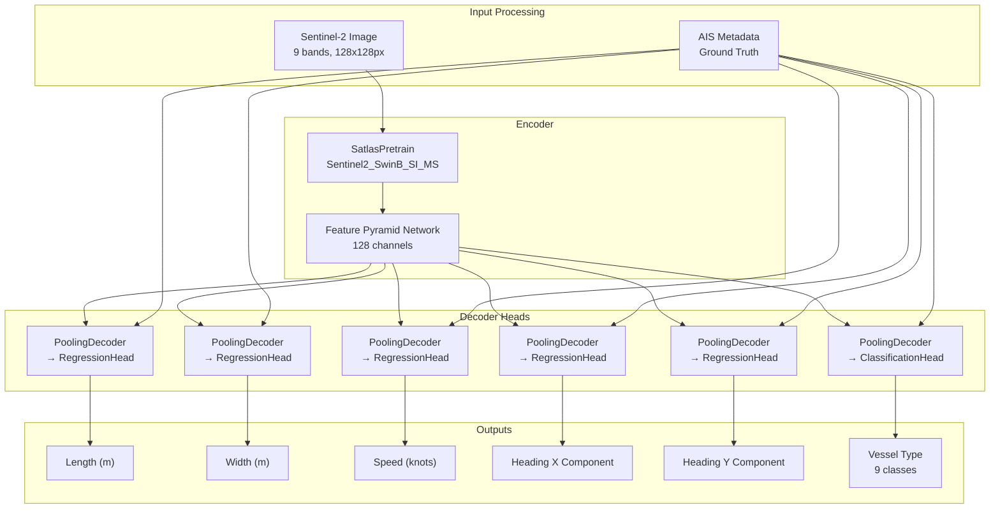
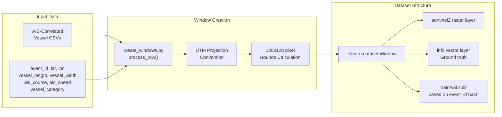
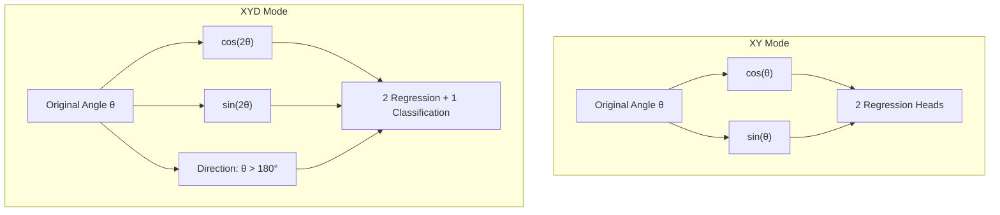
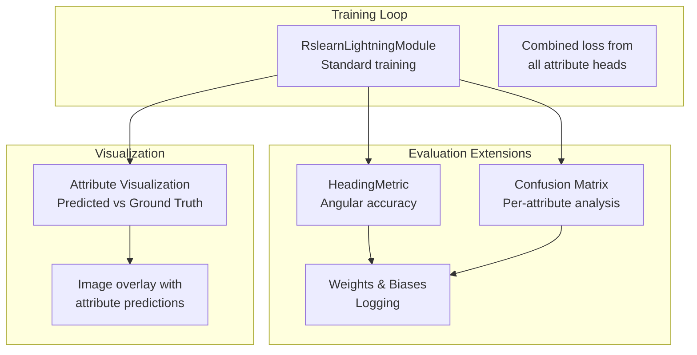
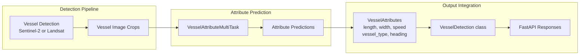

<!-- source: DeepWiki mcp.deepwiki.com · repo allenai/rslearn_projects · page 4.5 Vessel Attribute Prediction · fetched 2026-10-26 -->

# Vessel Attribute Prediction

<details>
<summary>Relevant source files</summary>

The following files were used as context for generating this wiki page:

- [data/sentinel2_vessel_attribute/config.json](data/sentinel2_vessel_attribute/config.json)
- [data/sentinel2_vessel_attribute/config.yaml](data/sentinel2_vessel_attribute/config.yaml)
- [data/sentinel2_vessel_attribute/config_bucket.yaml](data/sentinel2_vessel_attribute/config_bucket.yaml)
- [data/sentinel2_vessel_attribute/config_heading2.yaml](data/sentinel2_vessel_attribute/config_heading2.yaml)
- [data/sentinel2_vessels/config.json](data/sentinel2_vessels/config.json)
- [data/sentinel2_vessels/config.yaml](data/sentinel2_vessels/config.yaml)
- [data/sentinel2_vessels/config_predict_gcp.json](data/sentinel2_vessels/config_predict_gcp.json)
- [data/sentinel2_vessels/config_predict_local_files.json](data/sentinel2_vessels/config_predict_local_files.json)
- [rslp/sentinel2_vessel_attribute/README.md](rslp/sentinel2_vessel_attribute/README.md)
- [rslp/sentinel2_vessel_attribute/create_windows.py](rslp/sentinel2_vessel_attribute/create_windows.py)
- [rslp/sentinel2_vessel_attribute/scripts/dataset_statistics.py](rslp/sentinel2_vessel_attribute/scripts/dataset_statistics.py)
- [rslp/sentinel2_vessel_attribute/train.py](rslp/sentinel2_vessel_attribute/train.py)
- [rslp/vessels/__init__.py](rslp/vessels/__init__.py)
- [tests/integration_slow/sentinel2_vessels/test_fastapi.py](tests/integration_slow/sentinel2_vessels/test_fastapi.py)

</details>


This document covers the multi-task learning system for predicting vessel attributes (length, width, speed, heading, and type) from Sentinel-2 satellite imagery. The system uses AIS-correlated vessel detections as training data and integrates with the broader vessel detection pipeline to provide enriched vessel information.

For general vessel detection capabilities, see [Vessel Detection Systems](#4). For Sentinel-2 vessel detection specifically, see [Sentinel-2 Vessel Detection](#4.3).

## System Overview

The vessel attribute prediction system is a multi-task learning framework that predicts five key vessel attributes from 128x128 pixel Sentinel-2 image patches. The system uses the `VesselAttributeMultiTask` class to coordinate multiple prediction heads, each specialized for a different attribute.

### Multi-Task Architecture



**Sources:** [data/sentinel2_vessel_attribute/config.yaml:5-64](), [rslp/sentinel2_vessel_attribute/train.py:168-197]()

## Training Data and Preprocessing

The system uses AIS-correlated vessel detections provided by Skylight as training data. The `create_windows.py` script processes CSV files containing vessel metadata and creates 128x128 pixel windows centered on vessel positions.

### Data Processing Pipeline



**Sources:** [rslp/sentinel2_vessel_attribute/create_windows.py:29-148](), [rslp/sentinel2_vessel_attribute/create_windows.py:150-187]()

### Attribute Filtering and Validation

The system applies quality filters to ensure training data reliability:

| Attribute | Validation Rules |
|-----------|------------------|
| Length | 5m ≤ length < 460m |
| Width | 2m ≤ width < 120m |
| Speed | 0 < speed < 60 knots |
| Heading | Only for vessels with speed > 5 knots, 0° ≤ heading < 360° |
| Type | Must be in predefined vessel categories |

**Sources:** [rslp/sentinel2_vessel_attribute/create_windows.py:124-144]()

## Heading Prediction Approaches

The system supports two distinct approaches for heading prediction, implemented through the `HeadingMode` enum:

### XY Mode vs XYD Mode



The XYD mode addresses the ambiguity between forward and backward vessel orientation by:
1. Doubling the angle before computing trigonometric components
2. Separately predicting whether the vessel is facing forward or backward
3. Reconstructing the final heading using both components

**Sources:** [rslp/sentinel2_vessel_attribute/train.py:34-86](), [data/sentinel2_vessel_attribute/config_heading2.yaml:41-64]()

## Configuration Variations

The system supports multiple training configurations optimized for different use cases:

### Default Configuration (Regression)
- **File:** `config.yaml`
- **Approach:** Regression for length, width, speed; XY mode for heading
- **Use Case:** Maximum precision for production deployment

### Heading2 Configuration
- **File:** `config_heading2.yaml` 
- **Approach:** XYD mode for heading prediction
- **Use Case:** Experimental approach for ambiguous vessel orientations

### Bucket Configuration (Classification)
- **File:** `config_bucket.yaml`
- **Approach:** Classification into discrete buckets for physical attributes
- **Use Case:** Analysis and interpretability via confusion matrices

**Sources:** [data/sentinel2_vessel_attribute/config.yaml:91-145](), [data/sentinel2_vessel_attribute/config_heading2.yaml:99-165](), [data/sentinel2_vessel_attribute/config_bucket.yaml:88-152]()

## Model Training and Evaluation

### Custom Lightning Module

The `VesselAttributeLightningModule` extends the base `RslearnLightningModule` to provide specialized evaluation capabilities:



**Sources:** [rslp/sentinel2_vessel_attribute/train.py:432-561](), [rslp/sentinel2_vessel_attribute/train.py:112-166]()

### Data Augmentation

The system includes specialized augmentation through `VesselAttributeFlip` that properly handles heading transformation during horizontal and vertical flips:

```python
# Example of heading-aware augmentation
if state["horizontal"]:
    angle = 180 - angle  # Flip horizontally
if state["vertical"]:
    angle = -angle       # Flip vertically
```

**Sources:** [rslp/sentinel2_vessel_attribute/train.py:563-667]()

## Integration with Vessel Detection Pipeline

The attribute prediction system integrates with the broader vessel detection pipeline through the `VesselAttributes` interface:



**Sources:** [rslp/vessels/__init__.py:21-29](), [rslp/vessels/__init__.py:131](), [tests/integration_slow/sentinel2_vessels/test_fastapi.py:20-22]()

## Vessel Type Classification

The system predicts vessel types using a 9-class classification scheme:

| Class | Description |
|-------|-------------|
| cargo | Cargo vessels |
| tanker | Tanker vessels |
| passenger | Passenger vessels |
| service | Service vessels |
| tug | Tugboats |
| pleasure | Pleasure craft |
| fishing | Fishing vessels |
| enforcement | Law enforcement |
| sar | Search and rescue |

**Sources:** [rslp/sentinel2_vessel_attribute/train.py:21-31](), [data/sentinel2_vessel_attribute/config.yaml:130]()

---

