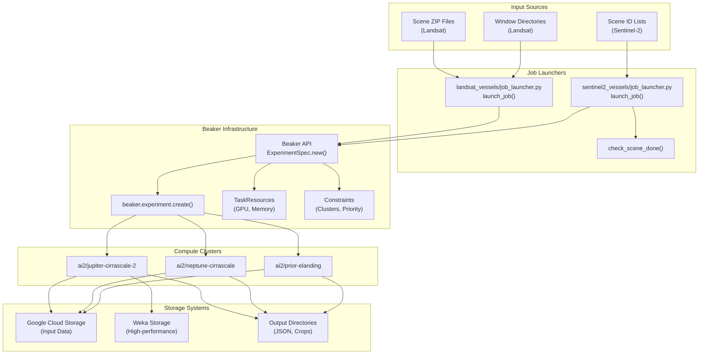
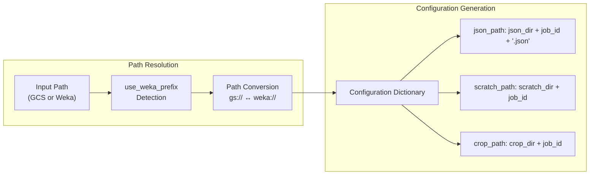
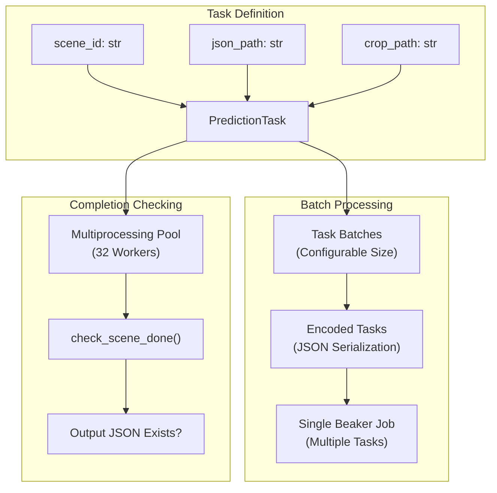
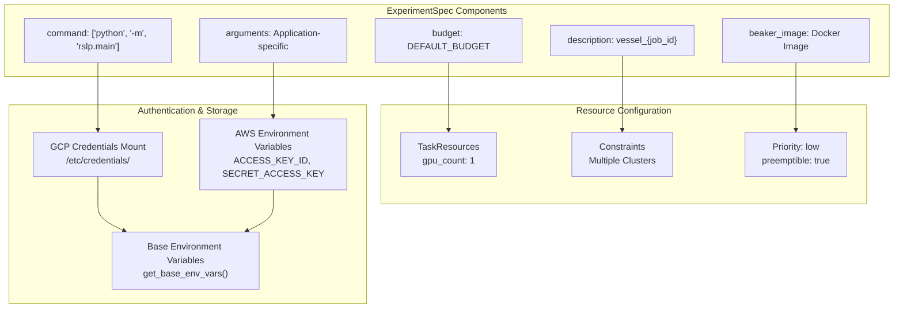
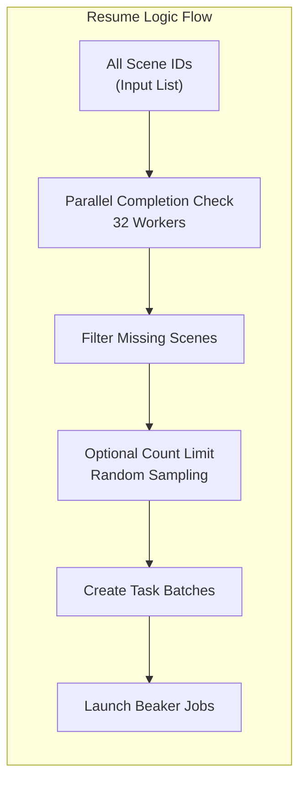

<!-- source: DeepWiki mcp.deepwiki.com · repo allenai/rslearn_projects · page 4.6 Job Launching and Batch Processing · fetched 2026-10-26 -->

# Job Launching and Batch Processing

Relevant source files

The following files were used as context for generating this wiki page:

- [one_off_projects/minderoo/classify/config.yaml](one_off_projects/minderoo/classify/config.yaml)
- [rslp/landsat_vessels/job_launcher.py](rslp/landsat_vessels/job_launcher.py)
- [rslp/sentinel2_vessels/job_launcher.py](rslp/sentinel2_vessels/job_launcher.py)

This document covers the Beaker-based job launching systems used for large-scale vessel detection inference across multiple satellite scenes. The systems enable distributed processing of Landsat and Sentinel-2 imagery for vessel detection tasks on AI2's compute clusters.

For information about the vessel detection models and pipelines themselves, see [Landsat Vessel Detection](#4.2) and [Sentinel-2 Vessel Detection](#4.3). For details about the distributed worker system used in other applications, see [Distributed Worker System](#2.4).

## System Architecture Overview

The job launching systems provide a bridge between local development environments and distributed compute resources, orchestrating large-scale inference jobs across AI2's Beaker clusters.

**Job Launching Architecture**

Sources: [rslp/landsat_vessels/job_launcher.py:1-212](), [rslp/sentinel2_vessels/job_launcher.py:1-189]()

## Landsat Vessel Job Launching

The Landsat job launcher handles individual scene processing with support for both direct scene ZIP files and pre-extracted window directories.

### Core Launch Function

The `launch_job()` function in [rslp/landsat_vessels/job_launcher.py:25-109]() creates Beaker experiments with the following key components:

| Component | Description | Configuration |
|-----------|-------------|---------------|
| **Input Modes** | Scene ZIP files or window directories | `scene_zip_path` or `window_path` |
| **Job Identification** | Extracted from file/directory names | `job_id = scene_zip_path.split("/")[-1].split(".")[0]` |
| **Resource Requirements** | GPU-enabled compute | `TaskResources(gpu_count=1)` |
| **Cluster Selection** | Multiple AI2 clusters | `prior-elanding`, `jupiter-cirrascale-2`, `neptune-cirrascale` |
| **Priority** | Low priority, preemptible | `Priority.low, preemptible=True` |

### Storage Path Handling

The launcher supports both Google Cloud Storage and Weka storage systems with automatic path conversion:

The path conversion logic in [rslp/landsat_vessels/job_launcher.py:174-179]() handles cases where WEKA protocol access is limited outside AI2 clusters by temporarily using GCS paths for enumeration.

### Batch Processing Implementation

The main execution loop processes multiple scenes sequentially:

- **Dry Run Mode**: Tests configuration with a single scene [rslp/landsat_vessels/job_launcher.py:190-200]()
- **Production Mode**: Iterates through all discovered paths with progress tracking [rslp/landsat_vessels/job_launcher.py:202-211]()
- **Path Discovery**: Uses `UPath.glob("*.zip")` for scene enumeration [rslp/landsat_vessels/job_launcher.py:168-169]()

Sources: [rslp/landsat_vessels/job_launcher.py:25-212]()

## Sentinel-2 Vessel Job Launching

The Sentinel-2 launcher implements more sophisticated batch processing with completion checking and task batching capabilities.

### Task-Based Architecture

The system uses `PredictionTask` objects to structure work units:

### Completion Checking System

The `check_scene_done()` function in [rslp/sentinel2_vessels/job_launcher.py:84-96]() prevents duplicate processing by checking for existing output files:

| Function | Purpose | Implementation |
|----------|---------|----------------|
| **Input Validation** | Scene ID list loading | `json.load(f)` from input file |
| **Parallel Checking** | Multi-process completion status | `multiprocessing.Pool(32)` |
| **File Existence** | Output JSON detection | `(out_path / (scene_id + ".json")).exists()` |
| **Missing Scene Filtering** | Identify pending work | List comprehension over completion results |

### Batch Size Optimization

The launcher supports configurable batch sizes for optimal resource utilization:

- **Default Batch Size**: 1 task per job for fine-grained control
- **Batch Grouping**: Sequential scene IDs grouped into batches [rslp/sentinel2_vessels/job_launcher.py:174-187]()
- **Job Count Limiting**: Optional maximum job count with random sampling [rslp/sentinel2_vessels/job_launcher.py:165-168]()

Sources: [rslp/sentinel2_vessels/job_launcher.py:32-189]()

## Common Infrastructure and Configuration

Both launchers share core Beaker infrastructure components and configuration patterns.

### Beaker Experiment Specification

Common experiment configuration across both systems:

### Environment Variable Management

Both systems use `get_base_env_vars()` from [rslp/utils/beaker.py]() with additional AWS credentials:

- **GCP Service Account**: Mounted as file for Google Cloud Storage access
- **AWS Credentials**: Environment variables for Landsat data access [rslp/landsat_vessels/job_launcher.py:66-77]()
- **Weka Prefix Support**: Conditional environment setup based on storage type

### Cluster Selection Strategy

**Landsat Jobs**: Broader cluster selection including `prior-elanding` [rslp/landsat_vessels/job_launcher.py:90-94]()
**Sentinel-2 Jobs**: Focused on `jupiter-cirrascale-2` only [rslp/sentinel2_vessels/job_launcher.py:27-29]()

Sources: [rslp/landsat_vessels/job_launcher.py:78-106](), [rslp/sentinel2_vessels/job_launcher.py:53-81]()

## Batch Processing Patterns

The two launchers demonstrate different batch processing strategies optimized for their respective use cases.

### Sequential vs. Batched Execution

**Landsat Pattern**: One Beaker job per scene for maximum parallelism and fault isolation
**Sentinel-2 Pattern**: Multiple scenes per Beaker job for reduced overhead and better resource utilization

| Aspect | Landsat Approach | Sentinel-2 Approach |
|--------|------------------|---------------------|
| **Job Granularity** | 1 scene per job | N scenes per job (configurable) |
| **Fault Tolerance** | High (isolated failures) | Medium (batch failures) |
| **Startup Overhead** | High (many small jobs) | Low (fewer large jobs) |
| **Resource Efficiency** | Lower (job overhead) | Higher (batch processing) |
| **Progress Tracking** | Fine-grained | Coarse-grained |

### Error Recovery and Resumption

**Sentinel-2 Completion Checking**:

**Landsat Simple Enumeration**: Direct file system enumeration without completion checking, relying on external orchestration for resume logic.

Sources: [rslp/landsat_vessels/job_launcher.py:165-211](), [rslp/sentinel2_vessels/job_launcher.py:142-189]()

---

