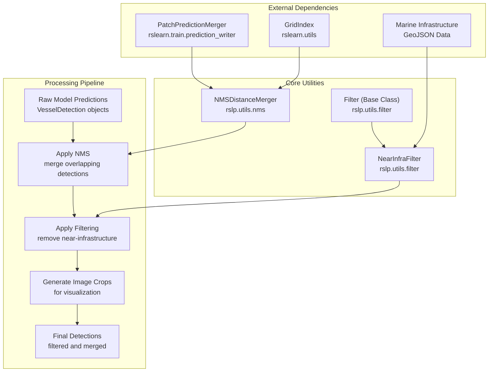
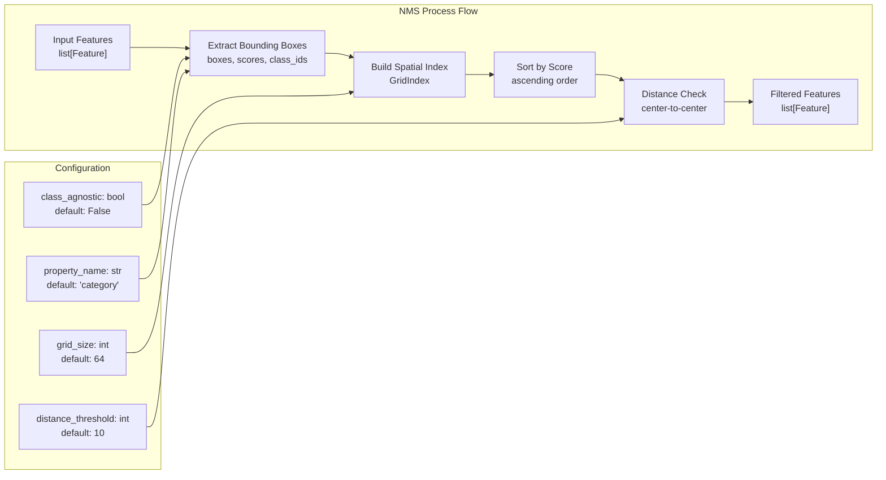
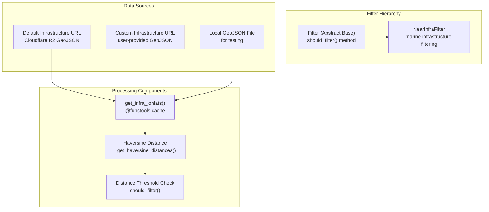
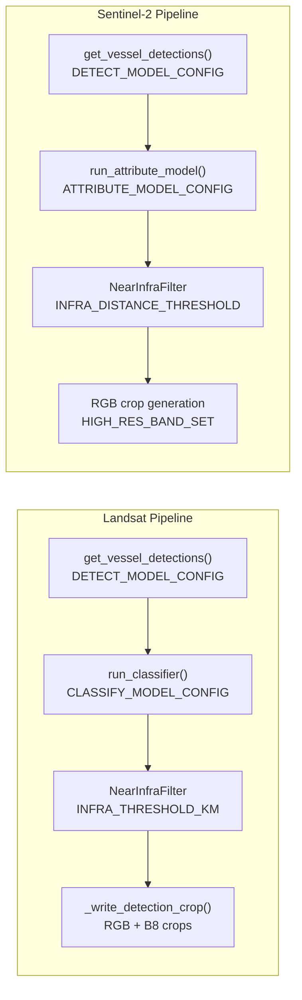

<!-- source: DeepWiki mcp.deepwiki.com · repo allenai/rslearn_projects · page 4.7 Model Components and Utilities · fetched 2026-10-26 -->

# Model Components and Utilities

<details>
<summary>Relevant source files</summary>

The following files were used as context for generating this wiki page:

- [rslp/landsat_vessels/predict_pipeline.py](rslp/landsat_vessels/predict_pipeline.py)
- [rslp/landsat_vessels/scripts/visualize_predictions.py](rslp/landsat_vessels/scripts/visualize_predictions.py)
- [rslp/sentinel2_vessels/predict_pipeline.py](rslp/sentinel2_vessels/predict_pipeline.py)
- [rslp/utils/filter.py](rslp/utils/filter.py)
- [rslp/utils/nms.py](rslp/utils/nms.py)
- [tests/unit/forest_loss_driver/inference/test_unit_extract_alerts.py](tests/unit/forest_loss_driver/inference/test_unit_extract_alerts.py)
- [tests/unit/test_filter.py](tests/unit/test_filter.py)
- [tests/unit/test_nms.py](tests/unit/test_nms.py)

</details>


This page documents the shared model components and utilities used across vessel detection systems in the repository. These components handle post-processing tasks like Non-Maximum Suppression (NMS), filtering false positives, and generating detection crops. For information about the vessel detection pipelines themselves, see [Landsat Vessel Detection](#4.2) and [Sentinel-2 Vessel Detection](#4.3).

## Component Architecture

The vessel detection utilities are organized into several key components that work together to process and refine model predictions:



**Sources:** [rslp/utils/nms.py:1-146](), [rslp/utils/filter.py:1-126](), [rslp/landsat_vessels/predict_pipeline.py:83-164](), [rslp/sentinel2_vessels/predict_pipeline.py:248-339]()

## Non-Maximum Suppression (NMS)

The `NMSDistanceMerger` class implements distance-based Non-Maximum Suppression to merge overlapping vessel detections from multiple patches or models.

### NMS Implementation Details



**Sources:** [rslp/utils/nms.py:14-146](), [tests/unit/test_nms.py:1-170]()

### NMS Configuration Options

| Parameter | Type | Default | Description |
|-----------|------|---------|-------------|
| `grid_size` | `int` | 64 | Size of the spatial grid for efficient neighbor queries |
| `distance_threshold` | `int` | 10 | Maximum distance between detection centers for suppression |
| `class_agnostic` | `bool` | False | Whether to apply NMS across all classes or per-class |
| `property_name` | `str` | "category" | Name of the property containing class information |

The NMS algorithm works by:

1. **Spatial Indexing**: Uses `GridIndex` to efficiently find nearby detections [rslp/utils/nms.py:106-110]()
2. **Score-based Processing**: Processes detections in ascending score order, keeping higher-scored detections [rslp/utils/nms.py:112-116]()
3. **Distance Calculation**: Computes Euclidean distance between detection centers [rslp/utils/nms.py:72-88]()
4. **Suppression Logic**: Suppresses lower-scored detections within the distance threshold [rslp/utils/nms.py:131-141]()

**Sources:** [rslp/utils/nms.py:90-145]()

## Marine Infrastructure Filtering

The filtering system removes vessel detections that are too close to marine infrastructure to reduce false positives from stationary objects like docks, piers, and offshore platforms.

### Filter Architecture



**Sources:** [rslp/utils/filter.py:10-126](), [tests/unit/test_filter.py:1-59]()

### Infrastructure Filter Configuration

| Parameter | Type | Default | Description |
|-----------|------|---------|-------------|
| `infra_url` | `str` | Cloudflare R2 URL | URL or path to marine infrastructure GeoJSON |
| `infra_distance_threshold` | `float` | 0.1 | Distance threshold in kilometers |

The default infrastructure URL points to: `https://pub-956f3eb0f5974f37b9228e0a62f449bf.r2.dev/outputs/marine/latest.geojson`

**Sources:** [rslp/utils/filter.py:26-31]()

### Haversine Distance Calculation

The filter uses the haversine formula to calculate great-circle distances between vessel detections and infrastructure points:

```python
# Simplified haversine calculation from the code
dlon = lons - target_lon
dlat = lats - target_lat
a = np.sin(dlat / 2) ** 2 + np.cos(target_lat) * np.cos(lats) * np.sin(dlon / 2) ** 2
c = 2 * np.arcsin(np.sqrt(a))
distances = earth_radius_km * c  # earth_radius_km = 6371.0
```

**Sources:** [rslp/utils/filter.py:74-109]()

## Detection Processing Integration

The utilities are integrated into both vessel detection pipelines with consistent patterns:



**Sources:** [rslp/landsat_vessels/predict_pipeline.py:411-592](), [rslp/sentinel2_vessels/predict_pipeline.py:442-572]()

### Pipeline-Specific Filtering Thresholds

| Pipeline | Threshold Variable | Value | Description |
|----------|-------------------|-------|-------------|
| Landsat | `INFRA_THRESHOLD_KM` | Configurable | Distance threshold for infrastructure filtering |
| Sentinel-2 | `INFRA_DISTANCE_THRESHOLD` | 0.05 km | 50-meter threshold for marine infrastructure |

**Sources:** [rslp/landsat_vessels/config.py:30](), [rslp/sentinel2_vessels/predict_pipeline.py:52-53]()

## Crop Generation Utilities

Both pipelines generate image crops of vessel detections for visualization and analysis, with pipeline-specific implementations:

### Landsat Crop Generation

Landsat crops include both RGB and panchromatic (B8) versions with pan-sharpening:

- **RGB Bands**: B4 (red), B3 (green), B2 (blue) with pan-sharpening using B8
- **Pan-sharpening**: Linear scaling of RGB bands to match B8 intensity [rslp/landsat_vessels/predict_pipeline.py:568-581]()
- **Output**: Two PNG files per detection (`{idx}_rgb.png`, `{idx}_b8.png`)

**Sources:** [rslp/landsat_vessels/predict_pipeline.py:536-592]()

### Sentinel-2 Crop Generation

Sentinel-2 crops use the high-resolution band set:

- **Bands Used**: B02, B03, B04, B08 (10m resolution)
- **RGB Mapping**: B04 (red), B03 (green), B02 (blue) [rslp/sentinel2_vessels/predict_pipeline.py:58-59]()
- **Normalization**: Division by factor of 10 for 8-bit conversion [rslp/sentinel2_vessels/predict_pipeline.py:62]()
- **Output**: Single RGB PNG file per detection

**Sources:** [rslp/sentinel2_vessels/predict_pipeline.py:554-569]()

## Testing and Validation

The utilities include comprehensive test coverage:

### NMS Testing

- **Distance-based suppression**: Validates that overlapping detections are properly merged [tests/unit/test_nms.py:17-44]()
- **Class-specific vs class-agnostic**: Tests both modes of operation [tests/unit/test_nms.py:85-142]()
- **Edge cases**: Handles equal scores, coordinate systems, and empty inputs [tests/unit/test_nms.py:144-170]()

### Filter Testing

- **Infrastructure proximity**: Tests filtering at exact, near, and far distances [tests/unit/test_filter.py:37-58]()
- **Custom GeoJSON**: Supports test fixtures with known infrastructure points [tests/unit/test_filter.py:16-35]()

**Sources:** [tests/unit/test_nms.py:1-170](), [tests/unit/test_filter.py:1-59]()

---

