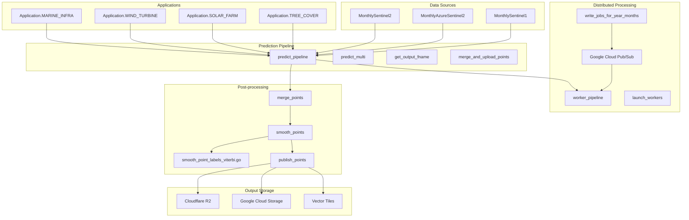
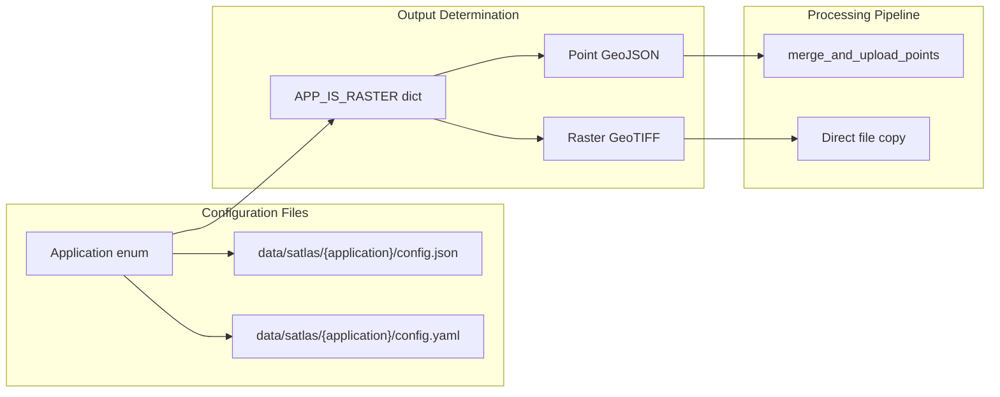
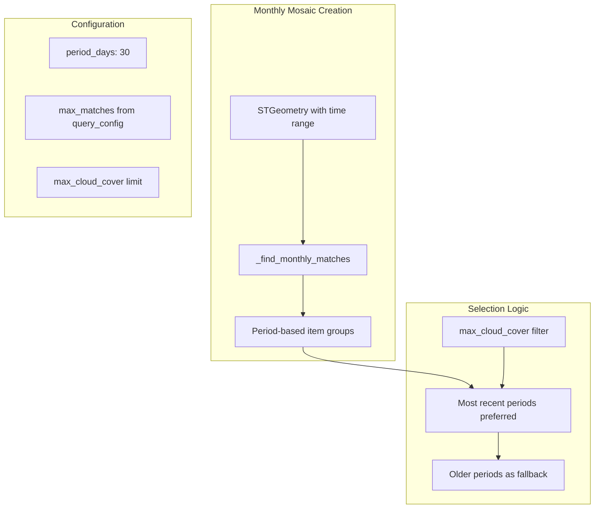
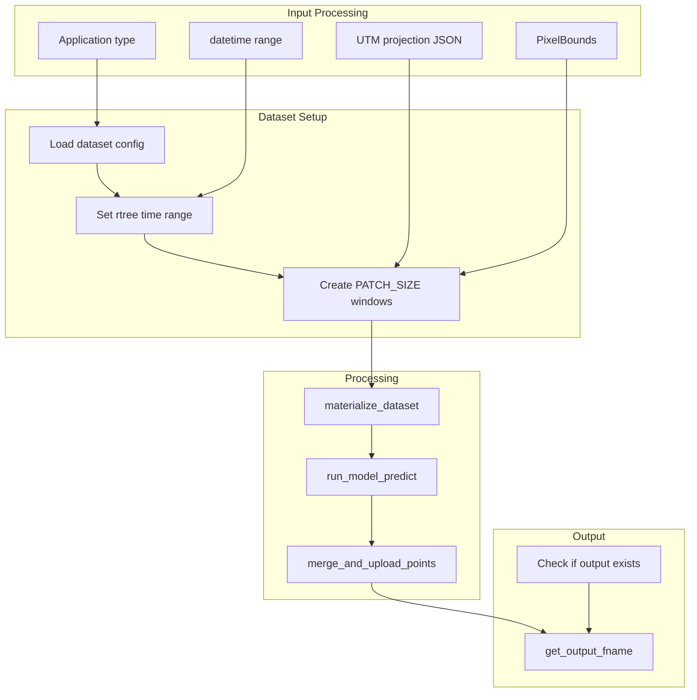
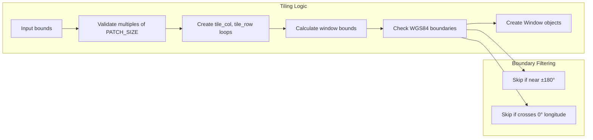
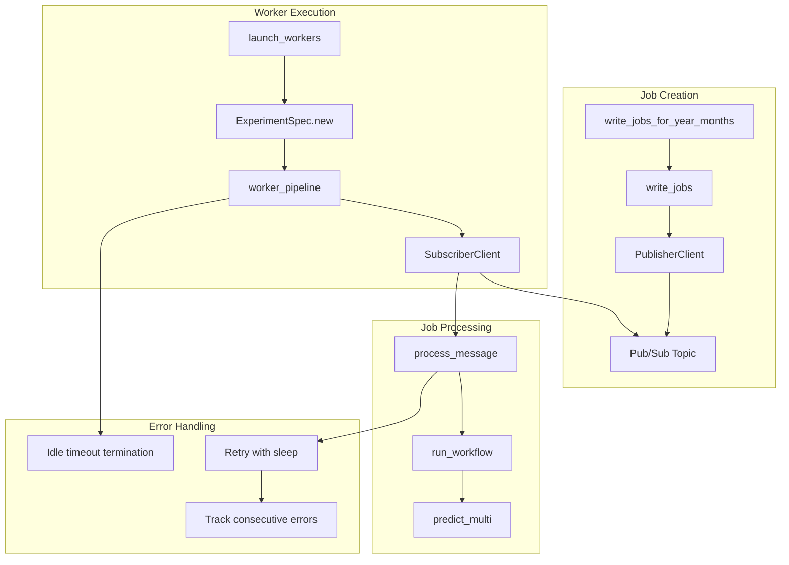
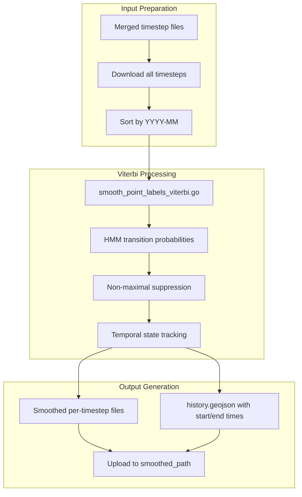

<!-- source: DeepWiki mcp.deepwiki.com · repo allenai/rslearn_projects · page 5 Satlas System · fetched 2026-10-26 -->

# Satlas System

<details>
<summary>Relevant source files</summary>

The following files were used as context for generating this wiki page:

- [data/satlas/marine_infra/config.json](data/satlas/marine_infra/config.json)
- [data/satlas/marine_infra/config.yaml](data/satlas/marine_infra/config.yaml)
- [data/satlas/wind_turbine/config_azure.json](data/satlas/wind_turbine/config_azure.json)
- [rslp/common/__init__.py](rslp/common/__init__.py)
- [rslp/common/worker.py](rslp/common/worker.py)
- [rslp/satlas/README.md](rslp/satlas/README.md)
- [rslp/satlas/__init__.py](rslp/satlas/__init__.py)
- [rslp/satlas/data_sources.py](rslp/satlas/data_sources.py)
- [rslp/satlas/postprocess.py](rslp/satlas/postprocess.py)
- [rslp/satlas/predict_pipeline.py](rslp/satlas/predict_pipeline.py)
- [rslp/satlas/publish.py](rslp/satlas/publish.py)
- [rslp/satlas/scripts/smooth_point_labels_viterbi.go](rslp/satlas/scripts/smooth_point_labels_viterbi.go)
- [tests/integration_slow/satlas/test_predict_pipeline.py](tests/integration_slow/satlas/test_predict_pipeline.py)
- [tests/unit/satlas/__init__.py](tests/unit/satlas/__init__.py)
- [tests/unit/satlas/test_postprocess.py](tests/unit/satlas/test_postprocess.py)

</details>


The Satlas System is a large-scale geospatial model inference platform that applies deep learning models to satellite imagery for detecting and monitoring infrastructure worldwide. The system processes satellite data through distributed inference pipelines, performs temporal smoothing, and publishes results as vector tiles and GeoJSON files for web applications.

This document covers the prediction pipeline, custom data sources, distributed processing architecture, and post-processing workflows. For information about the underlying ML framework, see [Core Infrastructure](#2). For details about training these models, see the rslearn framework documentation.

## System Architecture

The Satlas System consists of four main components that work together to process satellite imagery at global scale:



Sources: [rslp/satlas/predict_pipeline.py:62-68](), [rslp/satlas/data_sources.py:86-437](), [rslp/common/worker.py:67-220](), [rslp/satlas/postprocess.py:51-218](), [rslp/satlas/publish.py:104-195]()

## Applications and Models

The system supports four distinct applications, each with specialized models and configurations:

| Application | Enum Value | Purpose | Model Type | Output Format |
|-------------|------------|---------|------------|---------------|
| Marine Infrastructure | `Application.MARINE_INFRA` | Offshore platforms and wind turbines | Object Detection | Point GeoJSON |
| Wind Turbines | `Application.WIND_TURBINE` | Onshore wind turbines | Object Detection | Point GeoJSON |
| Solar Farms | `Application.SOLAR_FARM` | Solar installations | Segmentation | Raster GeoTIFF |
| Tree Cover | `Application.TREE_COVER` | Forest coverage mapping | Segmentation | Raster GeoTIFF |

The application type determines model configuration paths and output processing:



Sources: [rslp/satlas/predict_pipeline.py:62-76](), [rslp/satlas/predict_pipeline.py:27-28](), [rslp/satlas/predict_pipeline.py:315-325]()

## Custom Data Sources

The system uses specialized data sources that create monthly mosaics from satellite imagery, ensuring temporal diversity in model inputs:

### MonthlySentinel2

The `MonthlySentinel2` class wraps the standard Sentinel-2 data source to create mosaics from different 30-day periods within the query time range:



The `_find_monthly_matches` function divides the time range into periods and selects the most recent periods with available imagery, falling back to older periods when necessary.

Sources: [rslp/satlas/data_sources.py:21-83](), [rslp/satlas/data_sources.py:86-191]()

### Azure and Sentinel-1 Sources

The system also provides `MonthlyAzureSentinel2` and `MonthlySentinel1` classes that follow the same monthly mosaic pattern but use different underlying data sources and query mechanisms.

Sources: [rslp/satlas/data_sources.py:194-437]()

## Prediction Pipeline

### Core Pipeline Function

The `predict_pipeline` function orchestrates the complete inference process for a single geographic tile:



Sources: [rslp/satlas/predict_pipeline.py:176-326]()

### Window Creation and Tiling

The pipeline divides large geographic areas into manageable `PATCH_SIZE` (2048x2048 pixel) windows to enable parallel processing and reduce memory usage:



The system skips windows near longitude boundaries to avoid projection artifacts.

Sources: [rslp/satlas/predict_pipeline.py:251-297]()

## Distributed Processing and Job Management

### Worker System Architecture

The Satlas system uses Google Cloud Pub/Sub for distributed job queuing, allowing horizontal scaling across Beaker clusters:



Sources: [rslp/common/worker.py:67-220](), [rslp/common/worker.py:222-284](), [rslp/common/worker.py:287-312]()

### Task Distribution

Jobs are distributed by creating prediction tasks for different UTM zones and time periods:

| Parameter | Purpose | Example Value |
|-----------|---------|---------------|
| `year_months` | Time periods to process | `[[2024, 7]]` |
| `application` | Model application type | `MARINE_INFRA` |
| `out_path` | Output storage path | `gs://rslearn-eai/projects/satlas/marine_infra/version-20241212/{year:04d}-{month:02d}/` |
| `days_before` | Historical imagery range | `120` |
| `days_after` | Future imagery range | `90` |

Sources: [rslp/satlas/README.md:45-65]()

## Post-processing and Publishing

### Point Merging

The `merge_points` function consolidates prediction outputs from distributed tasks into timestep-specific GeoJSON files:

```mermaid
graph TB
    subgraph "Input Processing"
        predict_path[Individual task outputs]
        get_fc[_get_fc multiprocessing]
        category_map[APP_CATEGORY_MAPS remapping]
    end
    
    subgraph "Feature Processing"
        iterate_files[Iterate prediction files]
        src_projection[Extract source projection]
        convert_coords[Convert to WGS84 coordinates]
        store_pixel_coords[Store pixel coords as properties]
    end
    
    subgraph "Patch Tracking"
        valid_patches[Track valid patches]
        merge_patches[Merge valid_patches by CRS]
        patch_dict[valid_patches dict by projection]
    end
    
    subgraph "Output Generation"
        merged_features[Consolidated features list]
        feature_collection[Final FeatureCollection]
        write_geojson[Write {label}.geojson]
    end
    
    predict_path --> get_fc
    get_fc --> iterate_files
    iterate_files --> src_projection
    src_projection --> convert_coords
    convert_coords --> store_pixel_coords
    
    iterate_files --> valid_patches
    valid_patches --> merge_patches
    merge_patches --> patch_dict
    
    store_pixel_coords --> merged_features
    patch_dict --> feature_collection
    merged_features --> feature_collection
    feature_collection --> write_geojson
```

Sources: [rslp/satlas/postprocess.py:51-133]()

### Viterbi Smoothing

The `smooth_points` function applies temporal smoothing using a Go implementation of the Viterbi algorithm:



The Go implementation uses Hidden Markov Model parameters to determine when infrastructure appears and disappears over time, handling cases where detection gaps occur due to cloud cover or sensor issues.

Sources: [rslp/satlas/postprocess.py:136-218](), [rslp/satlas/scripts/smooth_point_labels_viterbi.go:1-497]()

### Publishing Pipeline

The `publish_points` function uploads results to multiple destinations:

```mermaid
graph TB
    subgraph "Cloudflare R2 Upload"
        r2_bucket[get_cloudflare_r2_bucket]
        history_upload[Upload history.geojson]
        timestep_upload[Upload recent timesteps]
        latest_symlink[Create latest.geojson]
        update_index[Update index.txt]
    end
    
    subgraph "Vector Tile Generation"
        tippecanoe_prep[Add tippecanoe layer properties]
        run_tippecanoe[Run tippecanoe command]
        bkt_conversion[make_bkt for tile format]
        gcs_upload[Upload to GCS]
    end
    
    r2_bucket --> history_upload
    history_upload --> timestep_upload
    timestep_upload --> latest_symlink
    latest_symlink --> update_index
    
    tippecanoe_prep --> run_tippecanoe
    run_tippecanoe --> bkt_conversion
    bkt_conversion --> gcs_upload
```



The publishing process creates both downloadable GeoJSON files on Cloudflare R2 and vector tiles on Google Cloud Storage for web map display.

Sources: [rslp/satlas/publish.py:104-195]()

---

