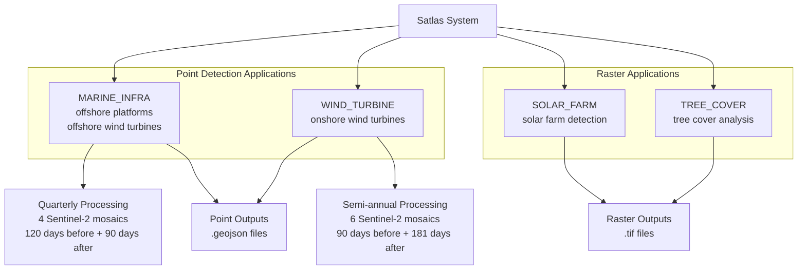
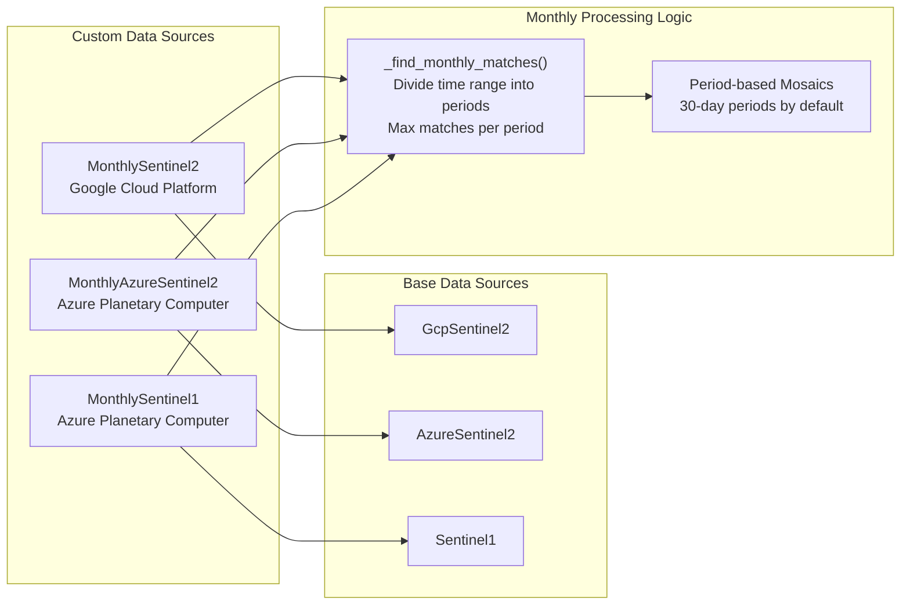
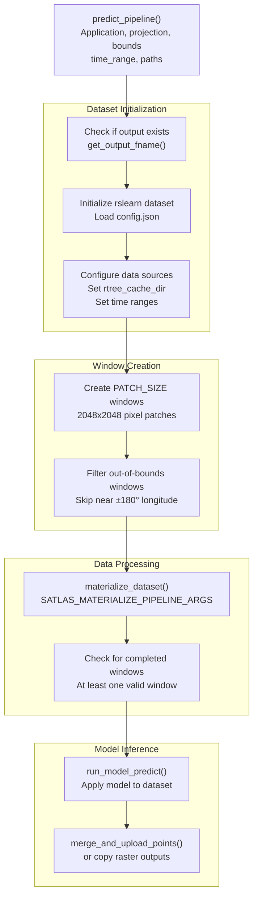
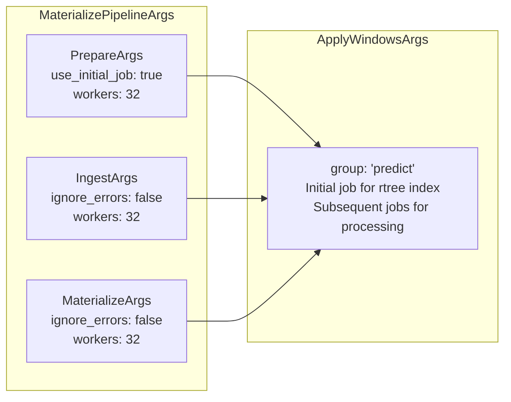

<!-- source: DeepWiki mcp.deepwiki.com · repo allenai/rslearn_projects · page 5.1 Overview and Applications · fetched 2026-10-26 -->

# Overview and Applications

Relevant source files

The following files were used as context for generating this wiki page:

- [data/satlas/marine_infra/config.json](data/satlas/marine_infra/config.json)
- [data/satlas/marine_infra/config.yaml](data/satlas/marine_infra/config.yaml)
- [data/satlas/wind_turbine/config_azure.json](data/satlas/wind_turbine/config_azure.json)
- [rslp/common/__init__.py](rslp/common/__init__.py)
- [rslp/common/worker.py](rslp/common/worker.py)
- [rslp/satlas/README.md](rslp/satlas/README.md)
- [rslp/satlas/__init__.py](rslp/satlas/__init__.py)
- [rslp/satlas/data_sources.py](rslp/satlas/data_sources.py)
- [rslp/satlas/postprocess.py](rslp/satlas/postprocess.py)
- [rslp/satlas/predict_pipeline.py](rslp/satlas/predict_pipeline.py)
- [rslp/satlas/publish.py](rslp/satlas/publish.py)
- [rslp/satlas/scripts/smooth_point_labels_viterbi.go](rslp/satlas/scripts/smooth_point_labels_viterbi.go)
- [tests/integration_slow/satlas/test_predict_pipeline.py](tests/integration_slow/satlas/test_predict_pipeline.py)
- [tests/unit/satlas/__init__.py](tests/unit/satlas/__init__.py)
- [tests/unit/satlas/test_postprocess.py](tests/unit/satlas/test_postprocess.py)

The Satlas system provides large-scale geospatial model inference for detecting and monitoring infrastructure and natural features from satellite imagery. This document covers the applications supported by the system, their data sources, and the core prediction pipeline architecture.

For information about distributed processing and job management, see [5.3](#5.3). For details about post-processing and publishing workflows, see [5.4](#5.4).

## System Purpose and Scope

The Satlas system implements automated detection and temporal monitoring of geospatial features using deep learning models applied to satellite imagery. It processes imagery at global scale using distributed workers and provides temporal smoothing to track changes over time. The system serves models deployed at https://satlas.allen.ai/ and supports both point-based detection (infrastructure) and raster-based analysis.

Sources: [rslp/satlas/__init__.py:1-8](), [rslp/satlas/README.md:1-2]()

## Supported Applications

The system supports four main detection applications defined in the `Application` enum:

Sources: [rslp/satlas/predict_pipeline.py:62-68](), [rslp/satlas/predict_pipeline.py:71-76](), [rslp/satlas/README.md:4-22]()

### Marine Infrastructure Detection

The `MARINE_INFRA` application detects offshore infrastructure in two categories: offshore wind turbines and offshore platforms. The model uses four Sentinel-2 image mosaics, each from a distinct month, with a maximum cloud cover threshold of 50%.

**Processing Schedule**: Quarterly (every 3 months)
**Input Period**: 120 days before quarter start + 90 days during quarter
**Categories**: `platform`, `turbine` (remapped to `offshore_platform`, `offshore_wind_turbine`)

Sources: [rslp/satlas/README.md:4-22](), [rslp/satlas/postprocess.py:23-31](), [data/satlas/marine_infra/config.yaml:86-87]()

### Wind Turbine Detection

The `WIND_TURBINE` application detects onshore wind turbines using six Sentinel-2 image mosaics from different months.

**Processing Schedule**: Semi-annual (every 6 months)
**Input Period**: 90 days before + 181 days after timestamp
**Categories**: `turbine` (remapped to `wind_turbine`)

Sources: [rslp/satlas/README.md:106-126](), [rslp/satlas/postprocess.py:28-30]()

### Solar Farm and Tree Cover

The `SOLAR_FARM` and `TREE_COVER` applications produce raster outputs rather than point detections. These applications are configured but not yet fully documented in the current implementation.

Sources: [rslp/satlas/predict_pipeline.py:71-76]()

## Core Data Sources

The system uses custom monthly data sources that extend standard satellite imagery APIs to provide temporal diversity:

The `_find_monthly_matches` function divides the geometry's time range into periods (typically 30 days) and creates one mosaic per period, preferring the most recent periods with available imagery.

Sources: [rslp/satlas/data_sources.py:21-83](), [rslp/satlas/data_sources.py:86-125](), [rslp/satlas/data_sources.py:194-225](), [rslp/satlas/data_sources.py:318-347]()

## Prediction Pipeline Architecture

The core prediction pipeline implements the `predict_pipeline` function which processes individual tiles:

Sources: [rslp/satlas/predict_pipeline.py:176-326](), [rslp/satlas/predict_pipeline.py:30](), [rslp/satlas/predict_pipeline.py:36-57]()

### Window Management and Geographic Tiling

The system divides large geographic areas into manageable `PATCH_SIZE` (2048x2048 pixel) windows to optimize memory usage and enable parallel processing:

| Parameter | Value | Purpose |
|-----------|-------|---------|
| `PATCH_SIZE` | 2048 | Window size in pixels |
| Projection | UTM zones | 10m/pixel resolution |
| Bounds filtering | ±180° longitude | Avoid projection edge cases |
| Geographic bounds | WGS84 validation | Skip invalid coordinate regions |

The `get_output_fname` function generates standardized filenames using the pattern: `{projection_crs}_{start_col}_{start_row}.{extension}`.

Sources: [rslp/satlas/predict_pipeline.py:30](), [rslp/satlas/predict_pipeline.py:251-297](), [rslp/satlas/predict_pipeline.py:79-101]()

### Data Materialization Configuration

The system uses `SATLAS_MATERIALIZE_PIPELINE_ARGS` which configures the rslearn dataset materialization process:

The `use_initial_job=True` setting ensures that rtree index creation and tile index caching are performed only once per prediction task.

Sources: [rslp/satlas/predict_pipeline.py:36-57]()

## Application Configuration Files

Each application has dedicated configuration files that define the model architecture and dataset parameters:

| Application | Dataset Config | Model Config |
|-------------|----------------|--------------|
| `MARINE_INFRA` | `data/satlas/marine_infra/config.json` | `data/satlas/marine_infra/config.yaml` |
| `WIND_TURBINE` | `data/satlas/wind_turbine/config_azure.json` | `data/satlas/wind_turbine/config.yaml` |

The dataset configurations specify data sources, band sets, and processing parameters, while model configurations define the neural network architecture using rslearn's `MultiTaskModel` with Swin transformer encoders and FPN feature pyramid networks.

Sources: [rslp/satlas/predict_pipeline.py:27-28](), [data/satlas/marine_infra/config.json](), [data/satlas/marine_infra/config.yaml:4-27]()

---

