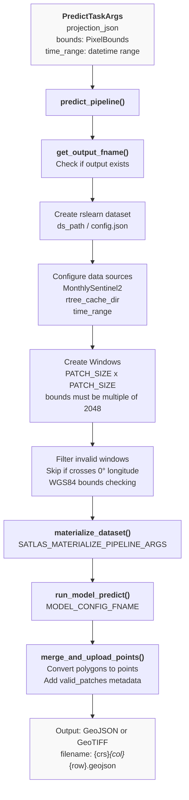
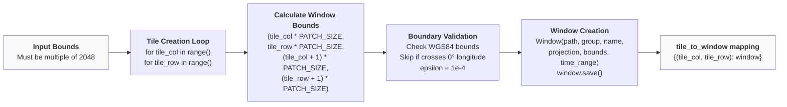
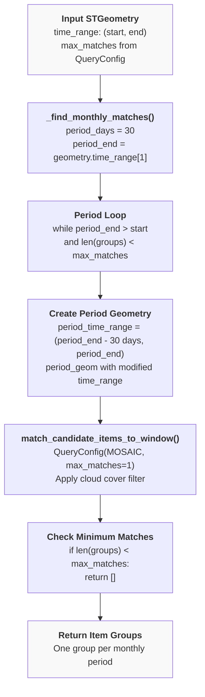
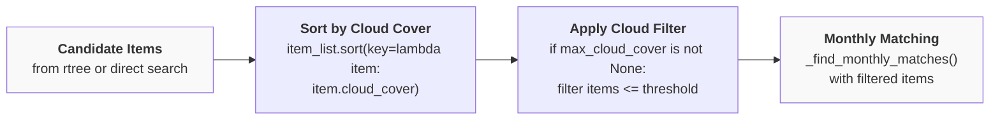
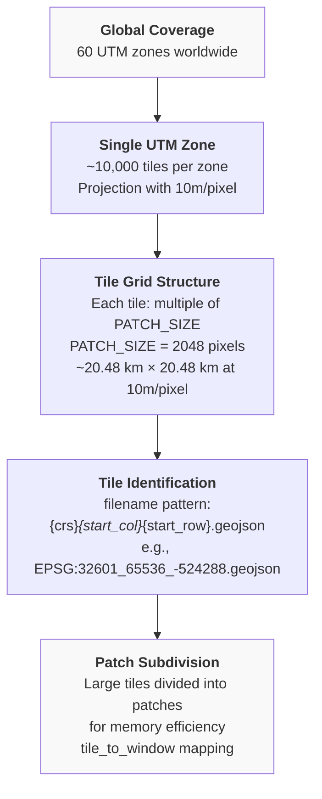
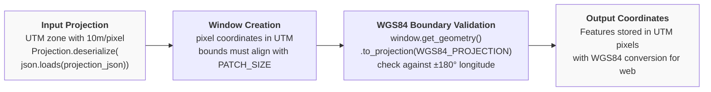
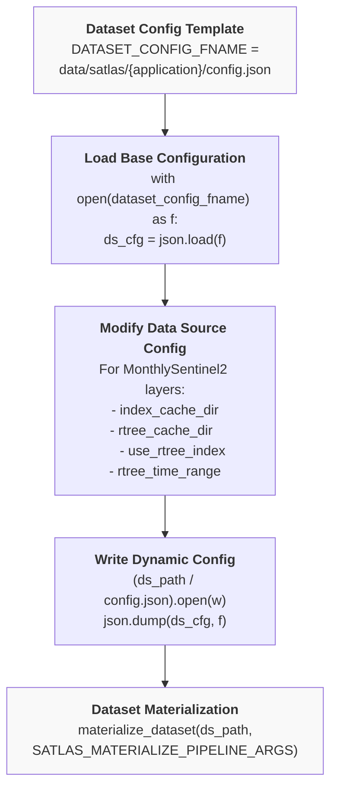
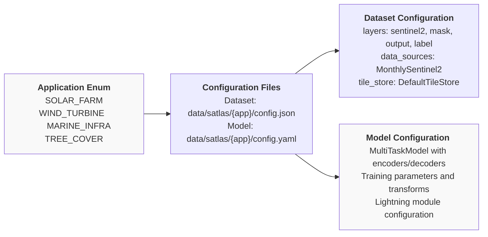

<!-- source: DeepWiki mcp.deepwiki.com · repo allenai/rslearn_projects · page 5.2 Prediction Pipeline and Data Sources · fetched 2026-10-26 -->

# Prediction Pipeline and Data Sources

Relevant source files

The following files were used as context for generating this wiki page:

- [data/satlas/marine_infra/config.json](data/satlas/marine_infra/config.json)
- [data/satlas/marine_infra/config.yaml](data/satlas/marine_infra/config.yaml)
- [data/satlas/wind_turbine/config_azure.json](data/satlas/wind_turbine/config_azure.json)
- [rslp/common/__init__.py](rslp/common/__init__.py)
- [rslp/common/worker.py](rslp/common/worker.py)
- [rslp/satlas/README.md](rslp/satlas/README.md)
- [rslp/satlas/__init__.py](rslp/satlas/__init__.py)
- [rslp/satlas/data_sources.py](rslp/satlas/data_sources.py)
- [rslp/satlas/postprocess.py](rslp/satlas/postprocess.py)
- [rslp/satlas/predict_pipeline.py](rslp/satlas/predict_pipeline.py)
- [rslp/satlas/publish.py](rslp/satlas/publish.py)
- [rslp/satlas/scripts/smooth_point_labels_viterbi.go](rslp/satlas/scripts/smooth_point_labels_viterbi.go)
- [tests/integration_slow/satlas/test_predict_pipeline.py](tests/integration_slow/satlas/test_predict_pipeline.py)
- [tests/unit/satlas/__init__.py](tests/unit/satlas/__init__.py)
- [tests/unit/satlas/test_postprocess.py](tests/unit/satlas/test_postprocess.py)

This document covers the core prediction pipeline and custom data sources that power the Satlas system's large-scale geospatial model inference. It focuses on how individual prediction tasks are executed, how satellite imagery is sourced and processed through custom monthly data sources, and how the geographic tiling system organizes global inference. For information about the distributed processing and job management that coordinates these tasks across workers, see [Distributed Processing and Job Management](#5.3). For details on post-processing and publishing of results, see [Post-processing and Publishing](#5.4).

## Core Prediction Pipeline

The Satlas prediction pipeline executes model inference on individual geographic tiles through the `predict_pipeline` function. Each task processes a specific UTM zone tile with defined bounds and time range, creating satellite imagery mosaics and applying trained models to generate outputs.

**Sources:** [rslp/satlas/predict_pipeline.py:176-389]()

The pipeline supports two output modes based on application type. Point detection applications (marine infrastructure, wind turbines) generate GeoJSON files with detected features converted from bounding boxes to point coordinates. Raster applications (tree cover, solar farms) produce GeoTIFF outputs, though this functionality is not yet fully implemented.

### Window Creation and Validation

The pipeline divides large geographic bounds into smaller `PATCH_SIZE` × `PATCH_SIZE` windows (2048×2048 pixels) to optimize memory usage and enable parallelism. Each window becomes an rslearn `Window` object with specific projection, bounds, and time range.

**Sources:** [rslp/satlas/predict_pipeline.py:241-298]()

Critical boundary validation prevents processing windows that cross the 0° longitude line or extend beyond valid coordinate ranges, which could cause projection issues or data retrieval failures.

## Custom Monthly Data Sources

The Satlas system uses specialized data sources that create temporal mosaics from satellite imagery, with each mosaic representing a distinct monthly period. This approach provides temporal diversity essential for change detection and reduces cloud contamination.

### MonthlySentinel2 Data Source

The `MonthlySentinel2` class wraps the standard rslearn Sentinel-2 data source to implement monthly mosaic creation. It divides the requested time range into 30-day periods and creates one mosaic per period, selecting the most recent periods that contain valid imagery.

**Sources:** [rslp/satlas/data_sources.py:86-176](), [rslp/satlas/data_sources.py:21-83]()

### Multi-Platform Data Source Support

The system provides multiple implementations for different satellite data platforms and sensors:

| Data Source Class | Platform | Sensor | Key Features |
|------------------|----------|---------|--------------|
| `MonthlySentinel2` | Google Cloud | Sentinel-2 L1C | Cloud cover filtering, rtree indexing |
| `MonthlyAzureSentinel2` | Azure Planetary Computer | Sentinel-2 L2A | STAC API integration, caching |
| `MonthlySentinel1` | Azure Planetary Computer | Sentinel-1 | SAR data, instrument mode filtering |

**Sources:** [rslp/satlas/data_sources.py:86-192](), [rslp/satlas/data_sources.py:194-315](), [rslp/satlas/data_sources.py:318-437]()

Each data source implements the same interface but adapts to platform-specific APIs and data access patterns. The Azure-based sources use STAC catalogs for item discovery, while the Google Cloud source leverages pre-built spatial indexes.

### Cloud Cover and Quality Filtering

The `MonthlySentinel2` data source applies scene-level quality filtering before mosaic creation:

**Sources:** [rslp/satlas/data_sources.py:157-175]()

## Geographic Tiling System

The Satlas system organizes global inference using a UTM-based tiling scheme that divides each UTM zone into regular grid tiles. This approach maintains spatial accuracy while enabling efficient parallel processing.

### UTM Zone and Tile Structure

**Sources:** [rslp/satlas/predict_pipeline.py:30](), [rslp/satlas/predict_pipeline.py:241-263]()

### Coordinate System Management

The prediction pipeline handles coordinate transformations between different spatial reference systems:

**Sources:** [rslp/satlas/predict_pipeline.py:274-294]()

## Dataset Configuration and Materialization

The prediction pipeline creates temporary rslearn datasets for each task, with configuration adapted from application-specific templates to include dynamic parameters like time ranges and cache directories.

### Dynamic Configuration Generation

**Sources:** [rslp/satlas/predict_pipeline.py:214-239](), [rslp/satlas/predict_pipeline.py:300-303]()

### Materialization Pipeline Configuration

The `SATLAS_MATERIALIZE_PIPELINE_ARGS` defines the standard pipeline for Satlas dataset preparation:

| Pipeline Stage | Configuration | Purpose |
|----------------|---------------|---------|
| **Prepare** | `use_initial_job=True`, `workers=32` | Tile index caching, one-time setup |
| **Ingest** | `ignore_errors=False`, `workers=32` | Download and cache satellite imagery |
| **Materialize** | `ignore_errors=False`, `workers=32` | Create final data layers |

**Sources:** [rslp/satlas/predict_pipeline.py:35-57]()

The initial job flag ensures that index creation and other setup tasks run once before parallel workers begin processing individual windows.

### Application-Specific Configurations

Each Satlas application maintains separate configuration files that define data sources, layer structures, and processing parameters:

**Sources:** [rslp/satlas/predict_pipeline.py:62-69](), [data/satlas/marine_infra/config.json:1-111](), [data/satlas/marine_infra/config.yaml:1-220]()

The marine infrastructure configuration demonstrates the typical structure, with multiple Sentinel-2 band sets at different zoom levels, cloud cover filtering, and monthly mosaic creation parameters.

---

