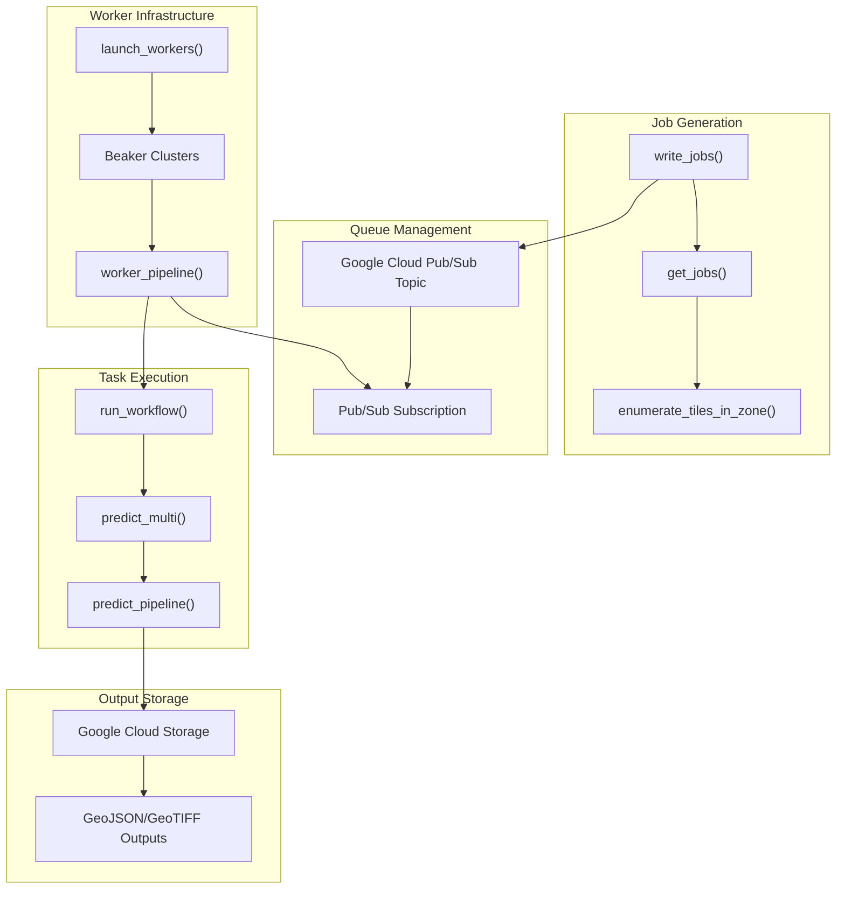
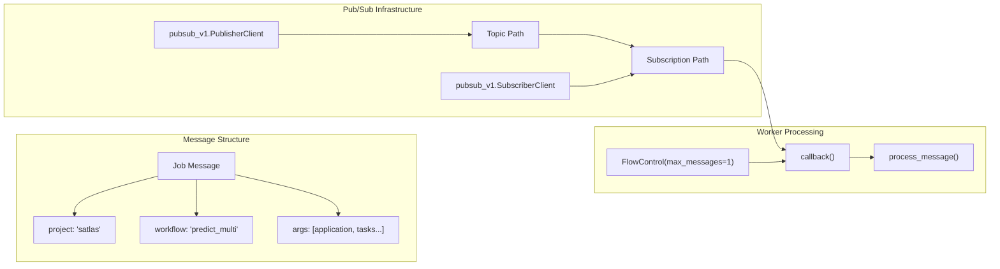
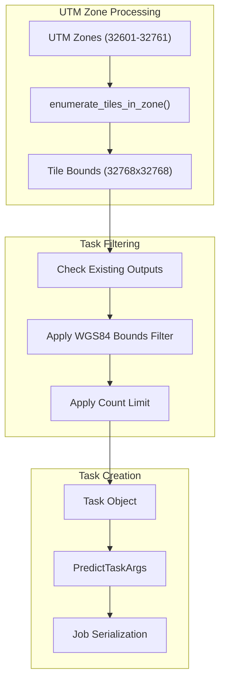
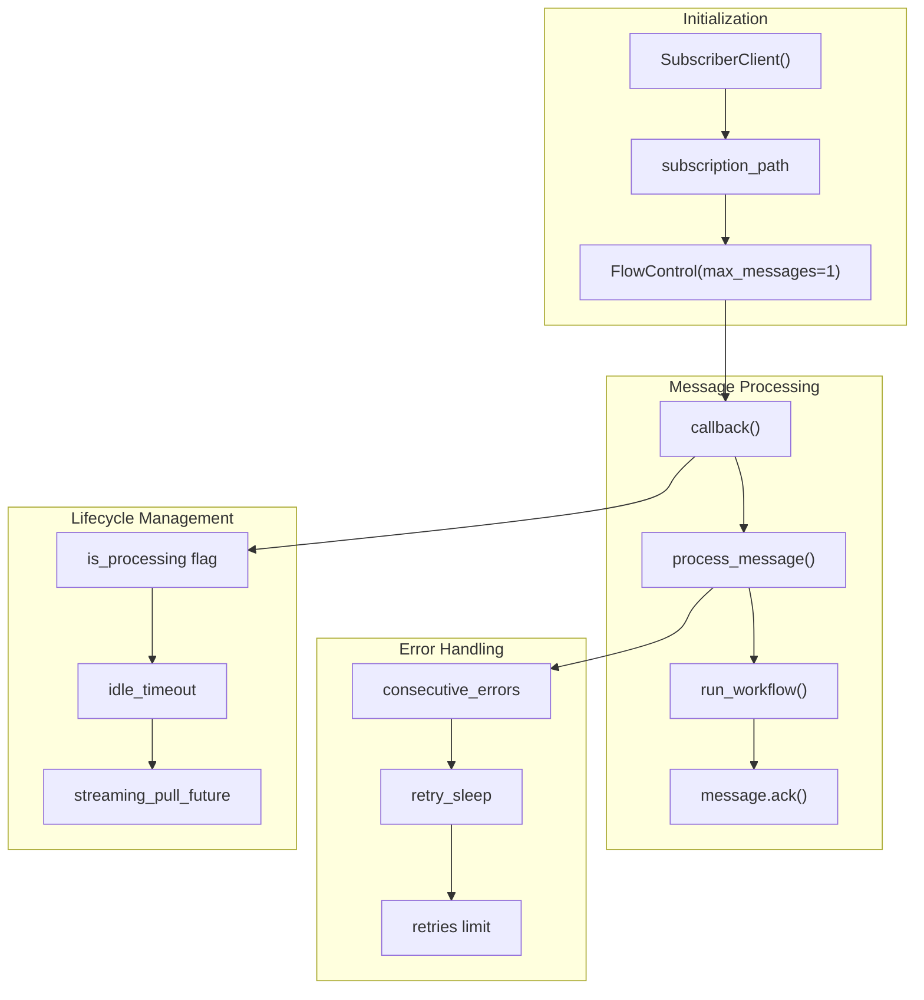
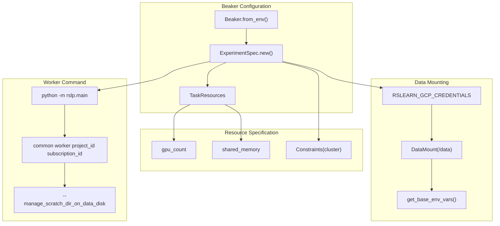
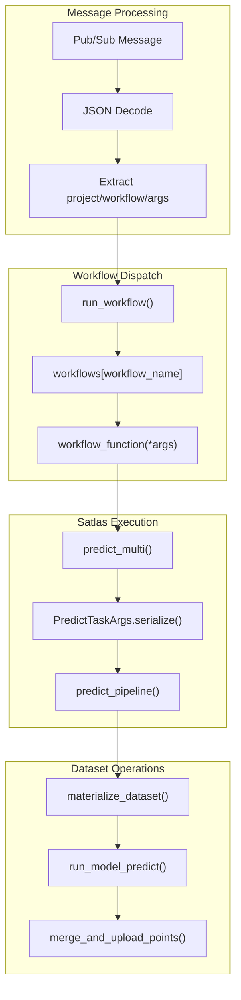

<!-- source: DeepWiki mcp.deepwiki.com · repo allenai/rslearn_projects · page 5.3 Distributed Processing and Job Management · fetched 2026-10-26 -->

# Distributed Processing and Job Management

Relevant source files

The following files were used as context for generating this wiki page:

- [data/satlas/marine_infra/config.json](data/satlas/marine_infra/config.json)
- [data/satlas/marine_infra/config.yaml](data/satlas/marine_infra/config.yaml)
- [data/satlas/wind_turbine/config_azure.json](data/satlas/wind_turbine/config_azure.json)
- [rslp/common/README.md](rslp/common/README.md)
- [rslp/common/__init__.py](rslp/common/__init__.py)
- [rslp/common/worker.py](rslp/common/worker.py)
- [rslp/common/write_file.py](rslp/common/write_file.py)
- [rslp/satlas/README.md](rslp/satlas/README.md)
- [rslp/satlas/__init__.py](rslp/satlas/__init__.py)
- [rslp/satlas/data_sources.py](rslp/satlas/data_sources.py)
- [rslp/satlas/postprocess.py](rslp/satlas/postprocess.py)
- [rslp/satlas/predict_pipeline.py](rslp/satlas/predict_pipeline.py)
- [rslp/satlas/publish.py](rslp/satlas/publish.py)
- [rslp/satlas/scripts/smooth_point_labels_viterbi.go](rslp/satlas/scripts/smooth_point_labels_viterbi.go)
- [rslp/satlas/write_jobs.py](rslp/satlas/write_jobs.py)
- [tests/integration/common/__init__.py](tests/integration/common/__init__.py)
- [tests/integration/common/test_worker.py](tests/integration/common/test_worker.py)
- [tests/integration/satlas/test_data_sources.py](tests/integration/satlas/test_data_sources.py)
- [tests/integration_slow/satlas/test_predict_pipeline.py](tests/integration_slow/satlas/test_predict_pipeline.py)
- [tests/unit/satlas/__init__.py](tests/unit/satlas/__init__.py)
- [tests/unit/satlas/test_postprocess.py](tests/unit/satlas/test_postprocess.py)

This document covers the distributed processing infrastructure used by the Satlas system for large-scale geospatial model inference. It describes the job queuing, worker management, and execution orchestration that enables running thousands of prediction tasks across Beaker clusters.

For information about the specific prediction tasks being executed, see [Prediction Pipeline and Data Sources](#5.2). For post-processing of distributed outputs, see [Post-processing and Publishing](#5.4).

## Architecture Overview

The distributed processing system uses Google Cloud Pub/Sub for job queuing, Beaker for compute resource management, and a worker-based execution model to process large-scale inference tasks.

### System Components

**Sources:** [rslp/common/worker.py:1-313](), [rslp/satlas/write_jobs.py:1-316](), [rslp/satlas/predict_pipeline.py:1-389]()

### Message Flow Architecture

**Sources:** [rslp/common/worker.py:108-182](), [rslp/common/worker.py:287-312]()

## Job Generation and Queuing

### Task Enumeration

The system generates prediction tasks by enumerating tiles across UTM zones and time ranges. Each task represents a specific geographic region and temporal window for model inference.

The `get_jobs()` function in [rslp/satlas/write_jobs.py:97-228]() implements the core task enumeration logic:

**Sources:** [rslp/satlas/write_jobs.py:67-95](), [rslp/satlas/write_jobs.py:123-177](), [rslp/satlas/write_jobs.py:180-228]()

### Message Publishing

Tasks are serialized as JSON messages and published to Pub/Sub topics using the `write_jobs()` function in [rslp/common/worker.py:287-312]():

| Field | Description | Example |
|-------|-------------|---------|
| `project` | RSLP project identifier | `"satlas"` |
| `workflow` | Workflow function name | `"predict_multi"` |
| `args` | Serialized task arguments | `["--application", "MARINE_INFRA", "--tasks", "..."]` |

**Sources:** [rslp/common/worker.py:303-312](), [rslp/satlas/write_jobs.py:216-226]()

## Worker System

### Worker Pipeline

The `worker_pipeline()` function in [rslp/common/worker.py:67-220]() implements the core worker execution loop:

**Sources:** [rslp/common/worker.py:108-219](), [rslp/common/worker.py:125-166]()

### Message Processing Flow

The worker processes messages through a structured callback system in [rslp/common/worker.py:112-166]():

1. **Message Deserialization**: JSON data is parsed to extract project, workflow, and arguments
2. **Workflow Execution**: `run_workflow()` is called with the parsed parameters  
3. **Error Handling**: Exceptions trigger retry logic with exponential backoff
4. **Acknowledgment**: Successful completion results in message acknowledgment

**Sources:** [rslp/common/worker.py:112-118](), [rslp/common/worker.py:130-166]()

### Resource Management

Workers implement several resource management features:

- **Scratch Directory Management**: Configurable scratch storage with cleanup on termination [rslp/common/worker.py:96-107]()
- **Flow Control**: Single message processing to utilize full CPU/GPU resources [rslp/common/worker.py:170-175]()  
- **Lease Extension**: Up to 24-hour lease duration for long-running tasks [rslp/common/worker.py:173]()

**Sources:** [rslp/common/worker.py:38-48](), [rslp/common/worker.py:170-175]()

## Beaker Integration

### Worker Deployment

The `launch_workers()` function in [rslp/common/worker.py:222-284]() handles distributed worker deployment across Beaker clusters:

**Sources:** [rslp/common/worker.py:246-284](), [rslp/utils/beaker.py:1-50]()

### Cluster Resource Configuration

| Parameter | Purpose | Example Value |
|-----------|---------|---------------|
| `gpus` | GPU count per worker | `1` |
| `shared_memory` | Shared memory allocation | `"256GiB"` |
| `cluster` | Target cluster list | `["ai2/jupiter-cirrascale-2"]` |
| `preemptible` | Use preemptible instances | `True` |

**Sources:** [rslp/common/worker.py:227-244](), [rslp/common/worker.py:269-281]()

## Task Execution Flow

### Workflow Orchestration

The execution flow from message receipt to task completion involves several layers:

**Sources:** [rslp/main.py:1-50](), [rslp/satlas/__init__.py:15-23](), [rslp/satlas/predict_pipeline.py:363-389]()

### Task Batching and Execution

The `predict_multi()` function in [rslp/satlas/predict_pipeline.py:363-389]() processes multiple tasks sequentially within a single worker:

1. **Temporary Directory Management**: Each task gets isolated scratch space
2. **Task Deserialization**: `PredictTaskArgs` objects are reconstructed from JSON
3. **Sequential Processing**: Tasks execute one at a time to avoid resource conflicts
4. **Output Isolation**: Each task writes to separate output files

**Sources:** [rslp/satlas/predict_pipeline.py:376-389](), [rslp/satlas/predict_pipeline.py:328-361]()

### Error Recovery and Monitoring

The system includes comprehensive error handling and monitoring:

- **Consecutive Error Tracking**: Workers terminate after configurable error thresholds [rslp/common/worker.py:147-162]()
- **Idle Timeout**: Workers shut down when no messages are available [rslp/common/worker.py:188-215]()
- **Message Redelivery**: Failed messages are automatically redelivered by Pub/Sub
- **Integration Testing**: Comprehensive test coverage validates worker behavior [tests/integration/common/test_worker.py:1-67]()

**Sources:** [rslp/common/worker.py:125-166](), [rslp/common/worker.py:188-219](), [tests/integration/common/test_worker.py:27-66]()

---

