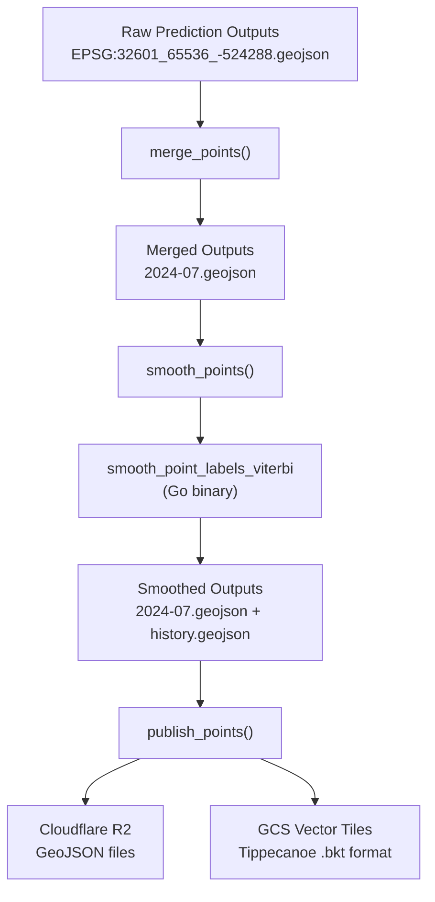
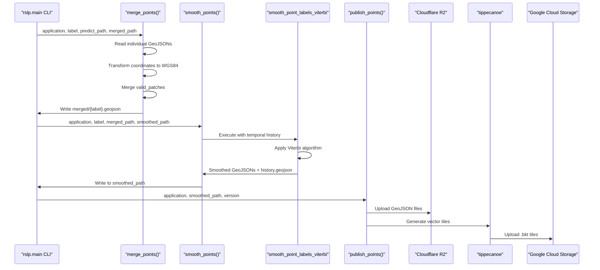
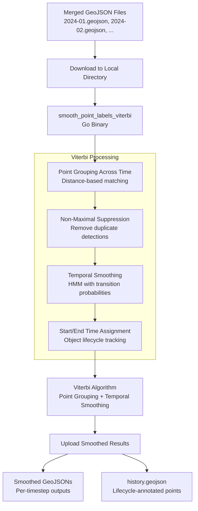
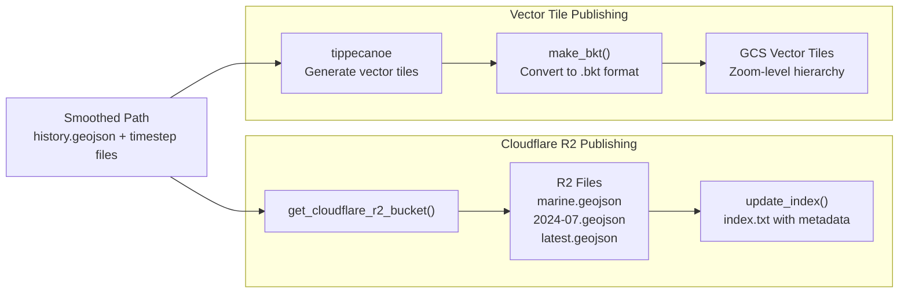

<!-- source: DeepWiki mcp.deepwiki.com · repo allenai/rslearn_projects · page 5.4 Post-processing and Publishing · fetched 2026-10-26 -->

# Post-processing and Publishing

<details>
<summary>Relevant source files</summary>

The following files were used as context for generating this wiki page:

- [data/satlas/marine_infra/config.json](data/satlas/marine_infra/config.json)
- [data/satlas/marine_infra/config.yaml](data/satlas/marine_infra/config.yaml)
- [data/satlas/wind_turbine/config_azure.json](data/satlas/wind_turbine/config_azure.json)
- [rslp/common/__init__.py](rslp/common/__init__.py)
- [rslp/common/worker.py](rslp/common/worker.py)
- [rslp/satlas/README.md](rslp/satlas/README.md)
- [rslp/satlas/__init__.py](rslp/satlas/__init__.py)
- [rslp/satlas/data_sources.py](rslp/satlas/data_sources.py)
- [rslp/satlas/postprocess.py](rslp/satlas/postprocess.py)
- [rslp/satlas/predict_pipeline.py](rslp/satlas/predict_pipeline.py)
- [rslp/satlas/publish.py](rslp/satlas/publish.py)
- [rslp/satlas/scripts/smooth_point_labels_viterbi.go](rslp/satlas/scripts/smooth_point_labels_viterbi.go)
- [tests/integration_slow/satlas/test_predict_pipeline.py](tests/integration_slow/satlas/test_predict_pipeline.py)
- [tests/unit/satlas/__init__.py](tests/unit/satlas/__init__.py)
- [tests/unit/satlas/test_postprocess.py](tests/unit/satlas/test_postprocess.py)

</details>


This document covers the post-processing and publishing pipeline for Satlas system outputs after distributed inference completes. The pipeline consists of three main stages: point merging, temporal smoothing with Viterbi algorithm, and publishing to Cloudflare R2 and Google Cloud Storage.

For information about the prediction pipeline that generates the raw outputs, see [Prediction Pipeline and Data Sources](#5.2). For details about the distributed processing system, see [Distributed Processing and Job Management](#5.3).

## Pipeline Overview

The post-processing pipeline transforms raw prediction outputs from distributed inference tasks into temporally consistent, publishable datasets through a multi-stage process.

### Post-processing Data Flow



**Sources:** [rslp/satlas/postprocess.py:51-134](), [rslp/satlas/postprocess.py:136-218](), [rslp/satlas/publish.py:104-196]()

### Function Call Sequence



**Sources:** [rslp/satlas/__init__.py:15-23](), [rslp/satlas/README.md:76-104]()

## Point Merging

The `merge_points` function consolidates prediction outputs from individual distributed tasks into unified GeoJSON files per timestamp. Each prediction task produces a separate GeoJSON file for its assigned geographic tile, and merging combines these into a single coherent dataset.

### Merge Process

The merging process handles coordinate transformation, category remapping, and valid patch tracking:

| Step | Operation | Input | Output |
|------|-----------|--------|--------|
| 1 | Read task outputs | `EPSG:32601_65536_-524288.geojson` | Individual FeatureCollections |
| 2 | Transform coordinates | UTM pixel coordinates | WGS84 longitude/latitude |
| 3 | Remap categories | `APP_CATEGORY_MAPS` | Standardized category names |
| 4 | Merge valid patches | Per-task patch lists | Global valid patch index |
| 5 | Write merged output | Combined features | `{label}.geojson` |

### Coordinate Transformation

Points are converted from UTM projection pixel coordinates to WGS84 geographic coordinates while preserving the original projection information as feature properties:

```python
# Original coordinates stored as properties for Viterbi processing
feat["properties"]["col"] = int(col)
feat["properties"]["row"] = int(row)  
feat["properties"]["projection"] = crs_str

# Geometry coordinates converted to WGS84
src_geom = STGeometry(src_projection, shapely.Point(col, row), None)
dst_geom = src_geom.to_projection(WGS84_PROJECTION)
feat["geometry"]["coordinates"] = [dst_geom.shp.x, dst_geom.shp.y]
```

### Category Remapping

Applications use different internal category names than the global standardized names. The `APP_CATEGORY_MAPS` provides mapping for consistent output:

```python
APP_CATEGORY_MAPS = {
    Application.MARINE_INFRA: {
        "platform": "offshore_platform",
        "turbine": "offshore_wind_turbine",
    },
    Application.WIND_TURBINE: {
        "turbine": "wind_turbine", 
    },
}
```

**Sources:** [rslp/satlas/postprocess.py:51-134](), [rslp/satlas/postprocess.py:23-31](), [rslp/satlas/postprocess.py:88-108]()

## Viterbi Smoothing

The `smooth_points` function applies temporal consistency using a Viterbi algorithm implemented in Go. This process tracks points across time and determines when objects appear and disappear in the real world versus when they are detected in satellite imagery.

### Smoothing Architecture



**Sources:** [rslp/satlas/postprocess.py:136-218](), [rslp/satlas/scripts/smooth_point_labels_viterbi.go:1-497]()

### Go Script Parameters

The Viterbi smoothing is implemented as a standalone Go binary with the following key parameters:

| Parameter | Description | Default Value |
|-----------|-------------|---------------|
| `--labels` | Comma-separated YYYY-MM timestamps | Required |
| `--fname` | Input filename template with LABEL placeholder | Required |
| `--out` | Output filename template with LABEL placeholder | Required |
| `--hist` | History output filename | Required |
| `--max_dist` | Point matching distance threshold (meters) | 200 |
| `--nms_dist` | Non-maximal suppression distance (degrees) | ~200m in degrees |
| `--threads` | Number of processing threads | 32 |

### Temporal Smoothing Algorithm

The Viterbi algorithm models object presence as a Hidden Markov Model with two states: present (1) and absent (0). The algorithm uses these probability matrices:

```go
initialProbs := []float64{0.5, 0.5}
transitionProbs := [][]float64{
    {0.95, 0.05},  // present -> present: 95%, present -> absent: 5%
    {0.01, 0.99},  // absent -> present: 1%, absent -> absent: 99%  
}
emissionProbs := [][]float64{
    {0.8, 0.2},    // present state: 80% detection, 20% miss
    {0.2, 0.8},    // absent state: 20% false positive, 80% correct
}
```

**Sources:** [rslp/satlas/scripts/smooth_point_labels_viterbi.go:278-287](), [rslp/satlas/scripts/smooth_point_labels_viterbi.go:99-107]()

## Publishing Pipeline

The `publish_points` function publishes smoothed outputs to two destinations: Cloudflare R2 for GeoJSON file serving and Google Cloud Storage for vector tiles used by the web application.

### Publishing Destinations



**Sources:** [rslp/satlas/publish.py:104-196](), [rslp/satlas/publish.py:46-55]()

### R2 Bucket Configuration

Cloudflare R2 access requires environment variables for authentication:

| Environment Variable | Purpose |
|---------------------|---------|
| `SATLAS_R2_ENDPOINT` | R2 API endpoint URL |
| `SATLAS_R2_ACCESS_KEY_ID` | Access key for authentication |
| `SATLAS_R2_SECRET_ACCESS_KEY` | Secret key for authentication |
| `SATLAS_R2_BUCKET_NAME` | Target bucket name |

### Vector Tile Generation

Vector tiles are generated using tippecanoe with specific parameters optimized for Satlas point data:

```bash
tippecanoe -z13 -r1 --cluster-densest-as-needed --no-tile-compression \
  -e <output_directory> <input_geojson>
```

The tiles are then converted to `.bkt` format using the `make_bkt` function and uploaded to Google Cloud Storage at the path pattern:
```
output_mosaic/{version}/history/{zoom}/0/0.bkt
```

### Publishing Scope

Only the most recent `NUM_RECOMPUTE` timesteps (default: 6) are re-published when smoothing updates historical data, reducing upload bandwidth while ensuring recent data accuracy.

**Sources:** [rslp/satlas/publish.py:22-25](), [rslp/satlas/publish.py:180-195](), [rslp/satlas/bkt.py:1]()

---

