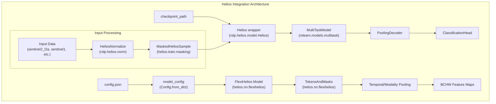
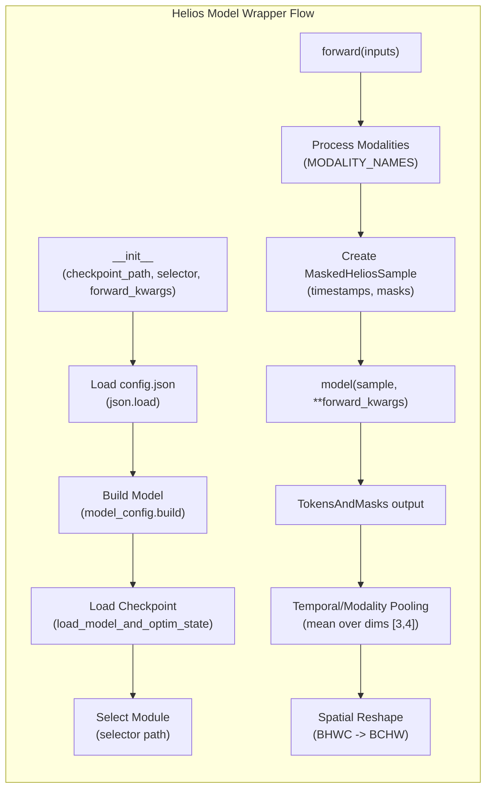
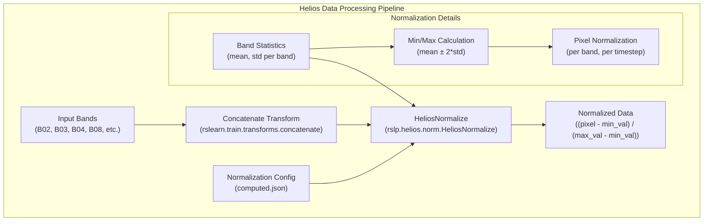
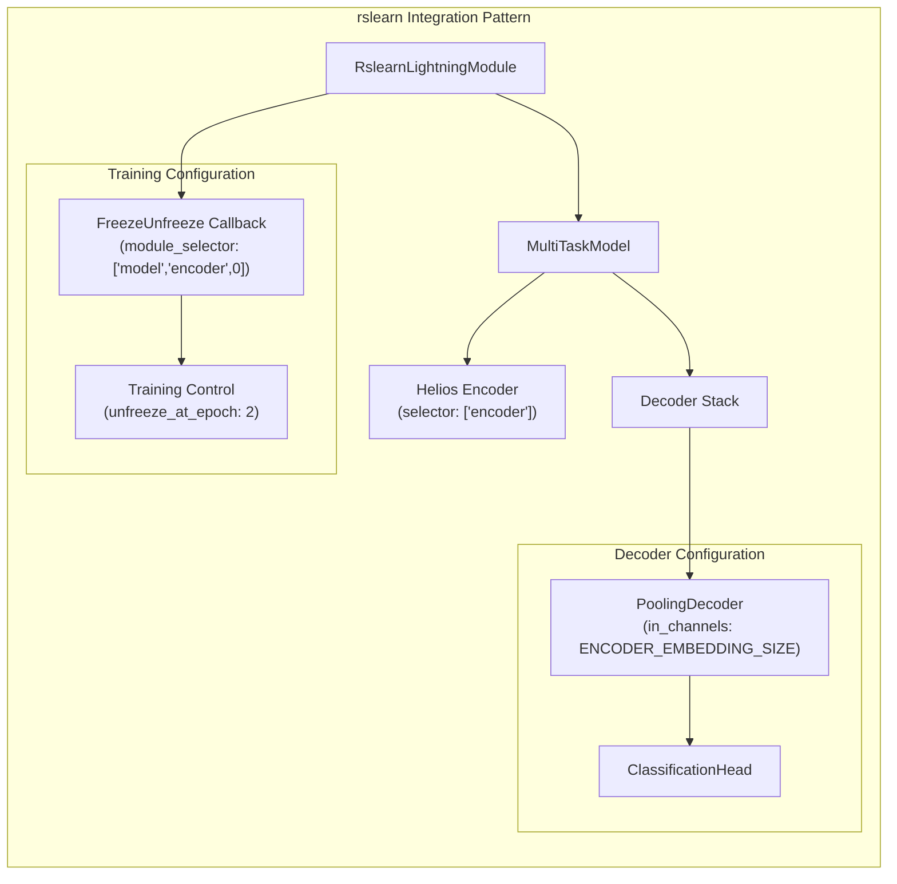

<!-- source: DeepWiki mcp.deepwiki.com · repo allenai/rslearn_projects · page 6 Helios Foundation Model · fetched 2026-10-26 -->

# Helios Foundation Model

Relevant source files

The following files were used as context for generating this wiki page:

- [data/helios/crop_type_mapping/finetune_12months.yaml](data/helios/crop_type_mapping/finetune_12months.yaml)
- [data/helios/crop_type_mapping/finetune_1month.yaml](data/helios/crop_type_mapping/finetune_1month.yaml)
- [data/helios/crop_type_mapping/frozen_12months.yaml](data/helios/crop_type_mapping/frozen_12months.yaml)
- [data/helios/crop_type_mapping/random_12months.yaml](data/helios/crop_type_mapping/random_12months.yaml)
- [rslp/helios/model.py](rslp/helios/model.py)
- [rslp/helios/norm.py](rslp/helios/norm.py)

The Helios Foundation Model system provides integration of the Helios multimodal foundation model for remote sensing within the rslearn framework. This system enables fine-tuning of Helios models for various downstream tasks including crop type mapping, EuroSAT classification, and vessel attribute prediction.

For information about other foundation models used in the repository, see the SatlasPretrain models which are documented as part of the core infrastructure. For details about specific applications that use Helios, see [Crop Type Mapping](#7.2) and [Vessel Attribute Prediction](#4.5).

## System Architecture

The Helios system integrates into the broader rslearn infrastructure as an encoder within `MultiTaskModel` architectures. The system supports multiple modalities including Sentinel-2 L2A, Sentinel-1, WorldCover, and OpenStreetMap raster data.

Sources: [rslp/helios/model.py:26-159](), [data/helios/crop_type_mapping/finetune_12months.yaml:1-27]()

## Model Wrapper Implementation

The `Helios` class serves as a PyTorch module wrapper that integrates the Helios foundation model with rslearn's training infrastructure. The wrapper handles checkpoint loading, model selection, and feature extraction.

Sources: [rslp/helios/model.py:29-79](), [rslp/helios/model.py:81-145]()

## Configuration Patterns

The system supports multiple training strategies through different configuration patterns. Each pattern is designed for specific use cases and training objectives.

| Configuration Type | File | Random Init | Freeze Strategy | Use Case |
|-------------------|------|-------------|-----------------|----------|
| Fine-tuning (12 months) | `finetune_12months.yaml` | False | Unfreeze at epoch 2 | Full temporal fine-tuning |
| Fine-tuning (1 month) | `finetune_1month.yaml` | False | Unfreeze at epoch 2 | Single timestep fine-tuning |
| Random baseline | `random_12months.yaml` | True | Unfreeze at epoch 0 | Performance baseline |
| Frozen features | `frozen_12months.yaml` | False | Always frozen | Feature extraction only |

Sources: [data/helios/crop_type_mapping/finetune_12months.yaml:8-14](), [data/helios/crop_type_mapping/finetune_1month.yaml:8-14](), [data/helios/crop_type_mapping/random_12months.yaml:8-14](), [data/helios/crop_type_mapping/frozen_12months.yaml:8-14]()

## Data Processing and Normalization

The Helios system includes specialized data processing components to handle the multimodal and multitemporal nature of remote sensing data.

Sources: [rslp/helios/norm.py:9-58](), [data/helios/crop_type_mapping/finetune_12months.yaml:143-147]()

## Modality and Temporal Handling

The Helios wrapper processes multiple satellite data modalities and handles both single and multitemporal inputs through a unified interface.

| Modality | Description | Bands | Temporal Support |
|----------|-------------|-------|------------------|
| `sentinel2_l2a` | Sentinel-2 Level 2A | 12 bands (B01-B12) | Multitemporal |
| `sentinel1` | Sentinel-1 SAR | Multiple polarizations | Multitemporal |
| `worldcover` | ESA WorldCover | Land cover classes | Single timestep |
| `openstreetmap_raster` | OSM rasterized data | Multiple features | Single timestep |

The wrapper automatically detects the temporal dimension and creates appropriate masks and timestamps for the Helios model:

- **Timestamp Generation**: Creates month-based timestamps for temporal position encoding [rslp/helios/model.py:115-126]()
- **Mask Creation**: Generates `ONLINE_ENCODER` masks for all valid data [rslp/helios/model.py:106-113]()
- **Temporal Pooling**: Averages features across timesteps and band sets [rslp/helios/model.py:134-144]()

Sources: [rslp/helios/model.py:18-23](), [rslp/helios/model.py:91-127]()

## Integration with rslearn Framework

The Helios model integrates seamlessly with rslearn's `MultiTaskModel` architecture, serving as an encoder that can be combined with various decoders for downstream tasks.

The integration supports configurable parameters through template variables:
- `{CHECKPOINT_PATH}`: Path to Helios model checkpoint
- `{PATCH_SIZE}`: Spatial patch size for feature extraction  
- `{ENCODER_EMBEDDING_SIZE}`: Output feature dimension

Sources: [data/helios/crop_type_mapping/finetune_12months.yaml:4-20](), [data/helios/crop_type_mapping/finetune_12months.yaml:172-175]()

---

