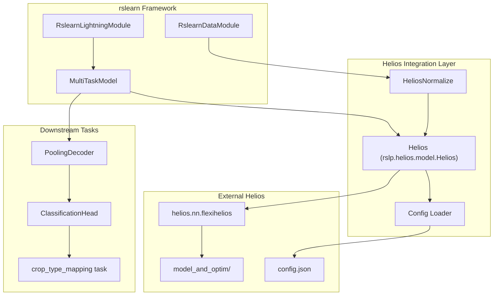
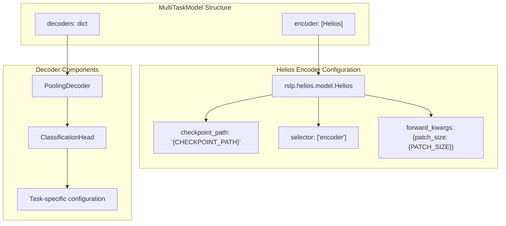
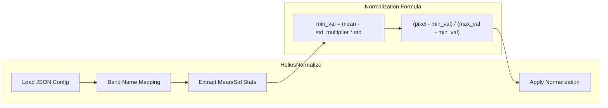

<!-- source: DeepWiki mcp.deepwiki.com · repo allenai/rslearn_projects · page 6.1 Model Integration · fetched 2026-10-26 -->

# Model Integration

<details>
<summary>Relevant source files</summary>

The following files were used as context for generating this wiki page:

- [data/helios/crop_type_mapping/finetune_12months.yaml](data/helios/crop_type_mapping/finetune_12months.yaml)
- [data/helios/crop_type_mapping/finetune_1month.yaml](data/helios/crop_type_mapping/finetune_1month.yaml)
- [data/helios/crop_type_mapping/frozen_12months.yaml](data/helios/crop_type_mapping/frozen_12months.yaml)
- [data/helios/crop_type_mapping/random_12months.yaml](data/helios/crop_type_mapping/random_12months.yaml)
- [rslp/helios/model.py](rslp/helios/model.py)
- [rslp/helios/norm.py](rslp/helios/norm.py)

</details>


This document covers how the Helios foundation model is integrated into the rslearn framework as an encoder component within `MultiTaskModel` architectures. This integration enables Helios to be used as a feature extractor for various downstream remote sensing tasks.

For information about automated fine-tuning orchestration and experiment management, see [Fine-tuning Framework](#6.2). For specific applications using Helios, see [Task-Specific Applications](#6.3).

## Architecture Overview

The Helios integration follows a wrapper pattern that adapts the external Helios model to work seamlessly with rslearn's training and inference infrastructure.



**Sources:** [rslp/helios/model.py:26-80](), [data/helios/crop_type_mapping/finetune_12months.yaml:1-21]()

## Core Helios Wrapper Component

The `Helios` class serves as the primary integration point, wrapping the external Helios model to conform to rslearn's encoder interface.

### Class Architecture

```mermaid
graph TB
    subgraph "Helios Class Structure"
        HeliosInit["__init__()"]
        HeliosForward["forward()"]
        HeliosChannels["get_backbone_channels()"]
    end
    
    subgraph "Initialization Parameters"
        CheckpointPath["checkpoint_path: str"]
        Selector["selector: list[str|int]"]
        ForwardKwargs["forward_kwargs: dict"]
        RandomInit["random_initialization: bool"]
        EmbeddingSize["embedding_size: int"]
        PatchSize["patch_size: int"]
    end
    
    subgraph "External Dependencies"
        OlmoConfig["olmo_core.config.Config"]
        HeliosCheckpointLoader["load_model_and_optim_state"]
        MaskedHeliosSample["MaskedHeliosSample"]
        TokensAndMasks["TokensAndMasks"]
    end
    
    HeliosInit --> CheckpointPath
    HeliosInit --> Selector
    HeliosInit --> ForwardKwargs
    HeliosInit --> RandomInit
    HeliosInit --> EmbeddingSize
    HeliosInit --> PatchSize
    
    HeliosInit --> OlmoConfig
    HeliosInit --> HeliosCheckpointLoader
    HeliosForward --> MaskedHeliosSample
    HeliosForward --> TokensAndMasks
```



**Sources:** [rslp/helios/model.py:26-53](), [rslp/helios/model.py:59-79]()

### Key Integration Features

| Feature | Implementation | Purpose |
|---------|---------------|---------|
| **Checkpoint Loading** | `load_model_and_optim_state()` | Loads pre-trained Helios weights |
| **Model Selection** | `selector` parameter | Extracts specific model components (e.g., `["encoder"]`) |
| **Random Initialization** | `random_initialization` flag | Enables training from scratch for ablation studies |
| **Modality Handling** | `MODALITY_NAMES` constant | Supports multiple input modalities |
| **rslearn Compatibility** | `get_backbone_channels()` | Provides channel information for downstream components |

**Sources:** [rslp/helios/model.py:18-24](), [rslp/helios/model.py:68-79](), [rslp/helios/model.py:147-159]()

## Data Processing Pipeline

The integration includes a specialized data processing pipeline that handles Helios-specific input formatting and normalization requirements.

```mermaid
graph LR
    subgraph "Input Processing"
        RawInputs["Raw Satellite Data"]
        ModalityCheck["Modality Detection"]
        Concatenate["Concatenate Transform"]
        HeliosNorm["HeliosNormalize"]
    end
    
    subgraph "Helios-Specific Processing"
        ModalityStacking["Modality Stacking"]
        TimestampGeneration["Timestamp Generation"]
        MaskCreation["Mask Creation"]
        SampleConstruction["MaskedHeliosSample"]
    end
    
    subgraph "Feature Extraction"
        HeliosModel["Helios Model Forward"]
        TokensExtraction["TokensAndMasks"]
        ModalityPooling["Modality/Temporal Pooling"]
        FeatureOutput["BCHW Feature Maps"]
    end
    
    RawInputs --> ModalityCheck
    ModalityCheck --> Concatenate
    Concatenate --> HeliosNorm
    HeliosNorm --> ModalityStacking
    
    ModalityStacking --> TimestampGeneration
    TimestampGeneration --> MaskCreation
    MaskCreation --> SampleConstruction
    
    SampleConstruction --> HeliosModel
    HeliosModel --> TokensExtraction
    TokensExtraction --> ModalityPooling
    ModalityPooling --> FeatureOutput
```



**Sources:** [rslp/helios/model.py:81-145](), [rslp/helios/norm.py:9-58]()

### Modality Processing

The wrapper handles multiple satellite data modalities defined in `MODALITY_NAMES`:

```python
MODALITY_NAMES = [
    "sentinel2_l2a",
    "sentinel1", 
    "worldcover",
    "openstreetmap_raster",
]
```

The forward pass processes these modalities by:
1. **Stacking inputs** across batch dimension
2. **Reshaping for multi-temporal data** using `rearrange(cur, "b (t c) h w -> b h w t c", t=num_timesteps)`
3. **Creating modality masks** with `MaskValue.ONLINE_ENCODER.value`
4. **Generating timestamps** for temporal position encoding

**Sources:** [rslp/helios/model.py:18-24](), [rslp/helios/model.py:94-113](), [rslp/helios/model.py:115-127]()

## MultiTaskModel Integration

Helios integrates into rslearn's `MultiTaskModel` architecture as an encoder component, following the standard encoder-decoder pattern.



**Sources:** [data/helios/crop_type_mapping/finetune_12months.yaml:4-21]()

### Configuration Templates

The integration uses templated YAML configurations with placeholder variables:

| Variable | Purpose | Example Value |
|----------|---------|---------------|
| `{CHECKPOINT_PATH}` | Path to Helios checkpoint directory | `/path/to/helios/checkpoint` |
| `{PATCH_SIZE}` | Spatial resolution for feature extraction | `16` |
| `{ENCODER_EMBEDDING_SIZE}` | Output channel dimension | `768` |

**Sources:** [data/helios/crop_type_mapping/finetune_12months.yaml:10-19]()

## Normalization and Preprocessing

The `HeliosNormalize` transform provides Helios-specific data normalization using pre-computed statistics.

### Normalization Process



**Sources:** [rslp/helios/norm.py:9-58]()

### Multi-temporal Handling

The normalization component handles multi-temporal data by:
1. **Detecting timesteps** with `num_timesteps = image.shape[0] // len(cur_band_names)`
2. **Normalizing each timestep separately** in the temporal loop
3. **Tracking normalization coverage** to ensure all bands are processed

**Sources:** [rslp/helios/norm.py:42-51]()

## Training Modes and Flexibility

The integration supports multiple training strategies through configuration variations:

| Training Mode | Configuration | Use Case |
|---------------|---------------|----------|
| **Fine-tuning** | `random_initialization: false` | Transfer learning from pre-trained Helios |
| **Random Initialization** | `random_initialization: true` | Ablation studies, architecture validation |
| **Frozen Features** | `FreezeUnfreeze` callback | Feature extraction without encoder updates |

**Sources:** [data/helios/crop_type_mapping/finetune_12months.yaml:172-175](), [data/helios/crop_type_mapping/random_12months.yaml:14](), [data/helios/crop_type_mapping/frozen_12months.yaml:172-175]()

---

