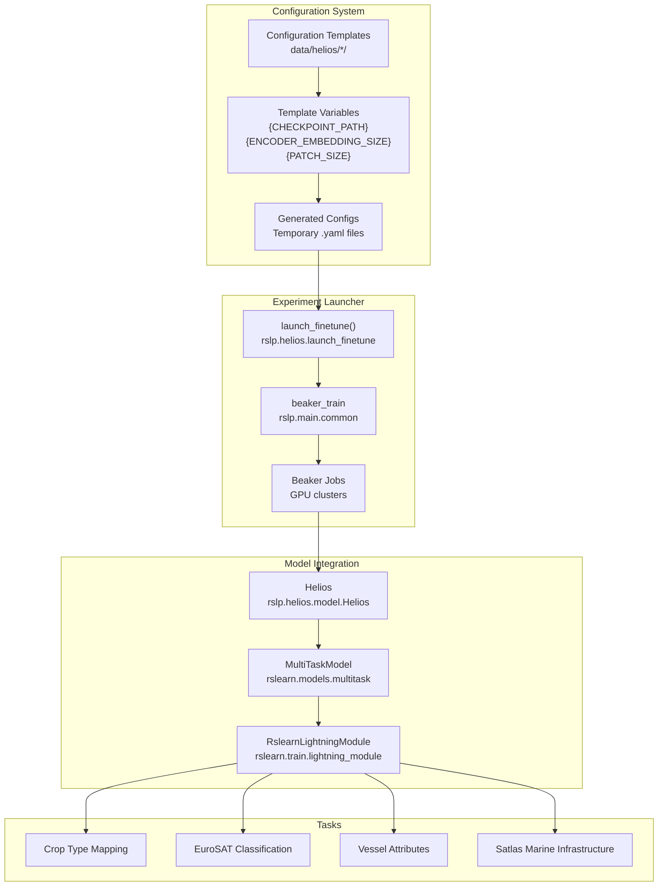
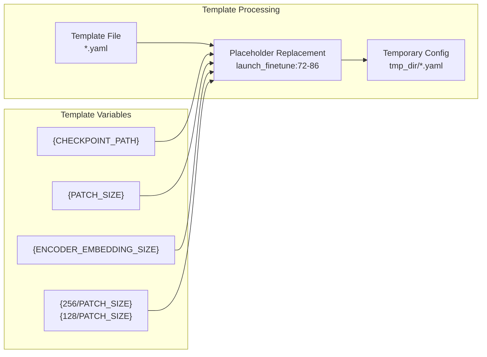
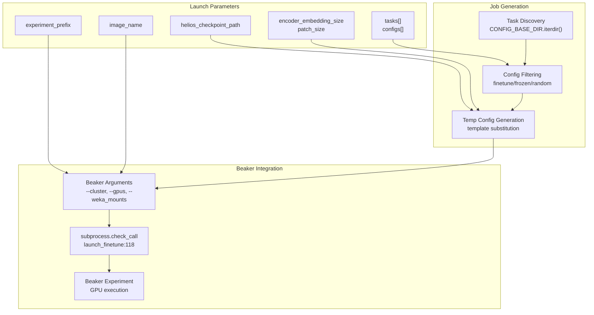
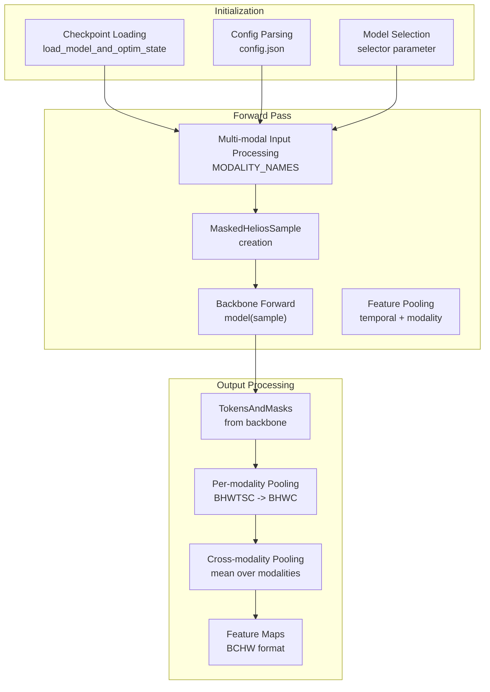
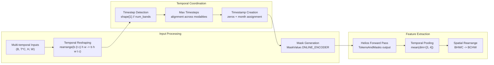

<!-- source: DeepWiki mcp.deepwiki.com · repo allenai/rslearn_projects · page 6.2 Fine-tuning Framework · fetched 2026-10-26 -->

# Fine-tuning Framework

Relevant source files

The following files were used as context for generating this wiki page:

- [data/helios/crop_type_mapping/config.json](data/helios/crop_type_mapping/config.json)
- [data/helios/crop_type_mapping/finetune_12months.yaml](data/helios/crop_type_mapping/finetune_12months.yaml)
- [data/helios/crop_type_mapping/finetune_1month.yaml](data/helios/crop_type_mapping/finetune_1month.yaml)
- [data/helios/crop_type_mapping/frozen_12months.yaml](data/helios/crop_type_mapping/frozen_12months.yaml)
- [data/helios/crop_type_mapping/random_12months.yaml](data/helios/crop_type_mapping/random_12months.yaml)
- [rslp/helios/launch_finetune.py](rslp/helios/launch_finetune.py)
- [rslp/helios/model.py](rslp/helios/model.py)
- [rslp/helios/norm.py](rslp/helios/norm.py)

The Fine-tuning Framework provides automated orchestration for fine-tuning the Helios foundation model on downstream remote sensing tasks. This system manages experiment configuration, Beaker job launching, and model integration within the rslearn framework. For information about the Helios model integration itself, see [Model Integration](#6.1). For details about specific downstream applications, see [Task-Specific Applications](#6.3).

## System Overview

The fine-tuning framework consists of three main components: configuration templating, automated experiment launching, and model wrapper integration. The system supports multiple fine-tuning strategies including full fine-tuning, frozen backbone training, and random initialization baselines.

**Sources:** [rslp/helios/launch_finetune.py:1-119](), [rslp/helios/model.py:1-160]()

## Configuration Template System

The framework uses a template-based configuration system that allows parameterized experiments across different tasks and fine-tuning strategies. Each task has its own directory under `data/helios/` containing configuration variants.

| Configuration Type | Purpose | Key Parameters |
|-------------------|---------|---------------|
| `finetune` | Full fine-tuning of Helios backbone | `unfreeze_at_epoch: 2` |
| `frozen` | Frozen backbone, train only decoder | No unfreezing callback |
| `random` | Random initialization baseline | `random_initialization: true` |

The template system supports runtime parameter substitution for key model parameters:

- `{CHECKPOINT_PATH}`: Path to the Helios checkpoint directory
- `{PATCH_SIZE}`: Patch size for the model (affects spatial resolution)
- `{ENCODER_EMBEDDING_SIZE}`: Embedding dimension of the encoder
- `{256/PATCH_SIZE}`, `{128/PATCH_SIZE}`: Derived spatial dimensions

**Sources:** [rslp/helios/launch_finetune.py:69-86](), [data/helios/crop_type_mapping/finetune_12months.yaml:10-18]()

## Automated Experiment Launching

The `launch_finetune` function provides batch launching of fine-tuning experiments across multiple tasks and configurations. It handles Beaker job creation, resource allocation, and experiment organization.

The launcher supports flexible experiment configuration:

| Parameter | Default | Description |
|-----------|---------|-------------|
| `cluster` | `["ai2/jupiter-cirrascale-2", "ai2/saturn-cirrascale", "ai2/neptune-cirrascale"]` | Beaker cluster preferences |
| `gpus` | `1` | GPU allocation per job |
| `rslp_project` | `"helios_finetuning"` | W&B project name |
| `weka_mounts` | `dfive-default` | Weka storage mounts |

**Sources:** [rslp/helios/launch_finetune.py:22-50](), [rslp/helios/launch_finetune.py:92-118]()

## Model Wrapper Integration

The `Helios` class provides the interface between the Helios foundation model and the rslearn framework. It handles model loading, multi-modal input processing, and feature extraction.

The wrapper supports multiple satellite modalities defined in `MODALITY_NAMES`:

- `sentinel2_l2a`: Optical imagery from Sentinel-2
- `sentinel1`: SAR imagery from Sentinel-1  
- `worldcover`: Land cover classification data
- `openstreetmap_raster`: Rasterized OSM features

**Sources:** [rslp/helios/model.py:26-79](), [rslp/helios/model.py:81-145](), [rslp/helios/model.py:18-23]()

## Multi-temporal Data Handling

The framework supports both single-temporal and multi-temporal satellite imagery through sophisticated input reshaping and temporal pooling mechanisms.

**Sources:** [rslp/helios/model.py:91-126](), [rslp/helios/model.py:134-144]()

## Normalization and Preprocessing

The framework includes specialized normalization through the `HeliosNormalize` transform, which applies band-specific normalization based on pre-computed statistics.

| Component | Purpose | Configuration |
|-----------|---------|---------------|
| `HeliosNormalize` | Band-specific normalization | JSON config with mean/std per band |
| `std_multiplier` | Normalization range control | Default: 2 (±2σ range) |
| Multi-temporal support | Per-timestep normalization | Handles varying temporal dimensions |

The normalization process applies per-band statistics:
- `min_val = mean - std_multiplier * std`  
- `max_val = mean + std_multiplier * std`
- `normalized = (value - min_val) / (max_val - min_val)`

**Sources:** [rslp/helios/norm.py:9-58](), [data/helios/crop_type_mapping/finetune_12months.yaml:143-147]()

---

