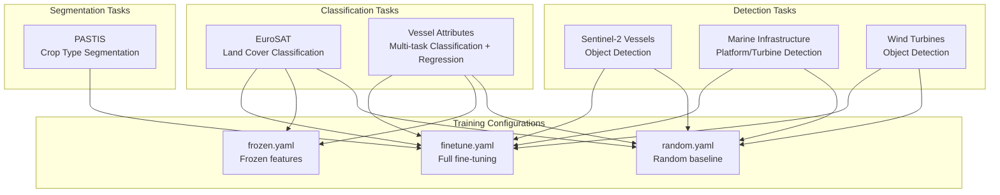
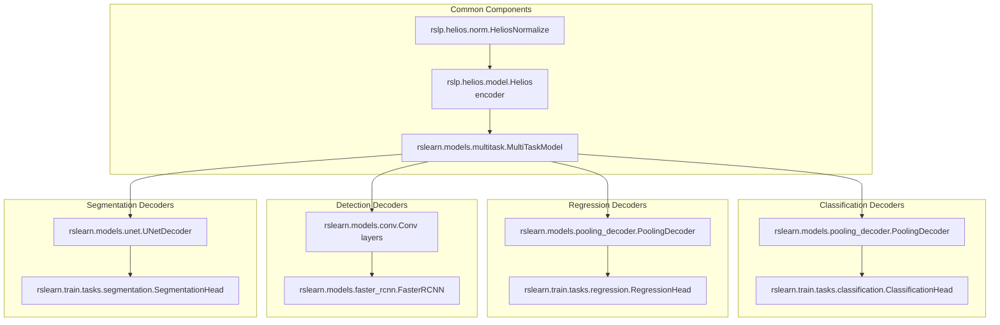
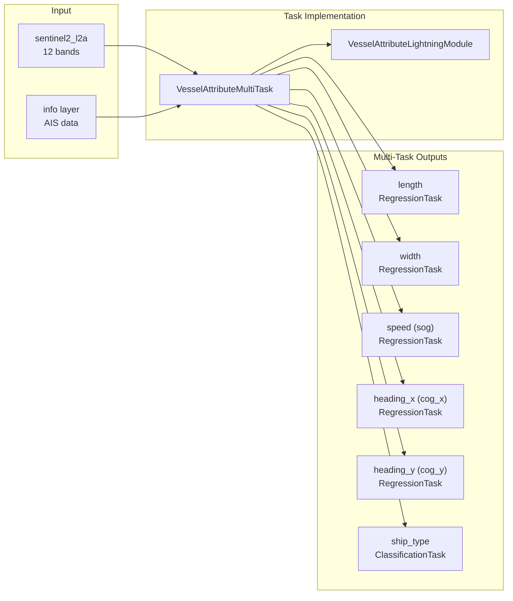
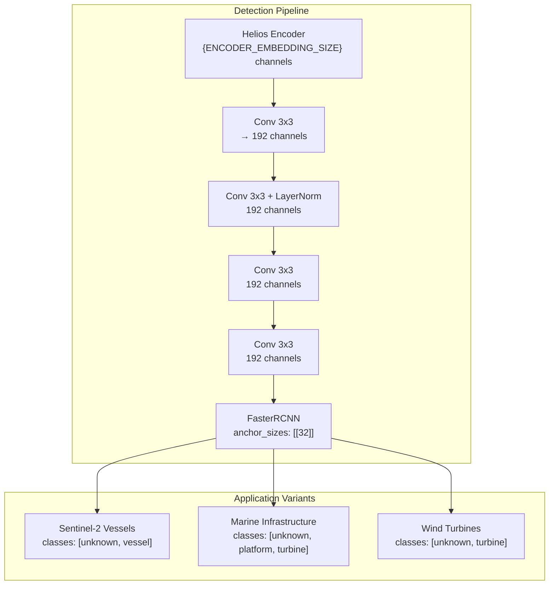
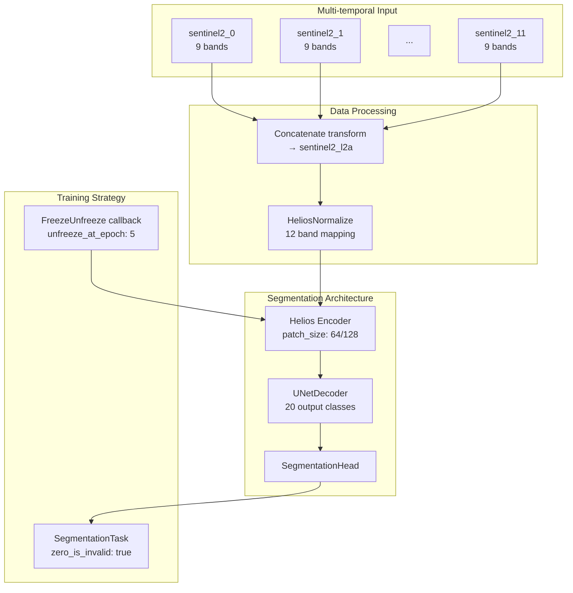
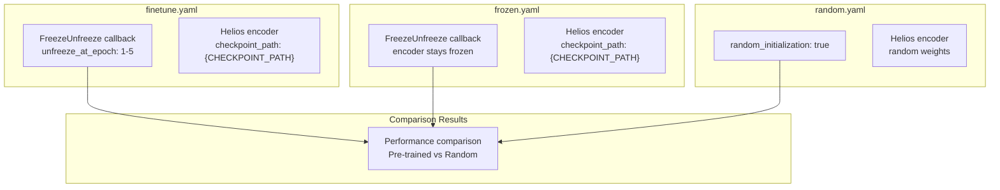

<!-- source: DeepWiki mcp.deepwiki.com · repo allenai/rslearn_projects · page 6.3 Task-Specific Applications · fetched 2026-10-26 -->

# Task-Specific Applications

Relevant source files

The following files were used as context for generating this wiki page:

- [data/helios/eurosat/finetune.yaml](data/helios/eurosat/finetune.yaml)
- [data/helios/eurosat/frozen.yaml](data/helios/eurosat/frozen.yaml)
- [data/helios/eurosat/random.yaml](data/helios/eurosat/random.yaml)
- [data/helios/pastis/baseline_satlaspretrain.yaml](data/helios/pastis/baseline_satlaspretrain.yaml)
- [data/helios/pastis/finetune1.yaml](data/helios/pastis/finetune1.yaml)
- [data/helios/pastis/finetune2.yaml](data/helios/pastis/finetune2.yaml)
- [data/helios/satlas_marine_infra/finetune.yaml](data/helios/satlas_marine_infra/finetune.yaml)
- [data/helios/satlas_marine_infra/random.yaml](data/helios/satlas_marine_infra/random.yaml)
- [data/helios/satlas_wind_turbine/finetune.yaml](data/helios/satlas_wind_turbine/finetune.yaml)
- [data/helios/satlas_wind_turbine/random.yaml](data/helios/satlas_wind_turbine/random.yaml)
- [data/helios/sentinel2_vessel_attribute/finetune.yaml](data/helios/sentinel2_vessel_attribute/finetune.yaml)
- [data/helios/sentinel2_vessel_attribute/frozen.yaml](data/helios/sentinel2_vessel_attribute/frozen.yaml)
- [data/helios/sentinel2_vessel_attribute/random.yaml](data/helios/sentinel2_vessel_attribute/random.yaml)
- [data/helios/sentinel2_vessels/finetune.yaml](data/helios/sentinel2_vessels/finetune.yaml)
- [data/helios/sentinel2_vessels/random.yaml](data/helios/sentinel2_vessels/random.yaml)
- [one_off_projects/2025_05_13_pastis/config.json](one_off_projects/2025_05_13_pastis/config.json)
- [one_off_projects/2025_05_13_pastis/convert.py](one_off_projects/2025_05_13_pastis/convert.py)

This page documents the downstream applications that utilize the Helios foundation model for various remote sensing tasks. These applications demonstrate how Helios can be fine-tuned or used as a frozen feature extractor across different problem domains including classification, detection, regression, and segmentation tasks.

For information about Helios model integration patterns, see [Model Integration](#6.1). For details about the fine-tuning orchestration system, see [Fine-tuning Framework](#6.2).

## Application Overview

The Helios foundation model supports six primary downstream applications, each configured with multiple training strategies to evaluate the benefits of pre-training versus random initialization.

Sources: [data/helios/eurosat/finetune.yaml:1-98](), [data/helios/sentinel2_vessel_attribute/finetune.yaml:1-191](), [data/helios/sentinel2_vessels/finetune.yaml:1-153](), [data/helios/satlas_marine_infra/finetune.yaml:1-153](), [data/helios/satlas_wind_turbine/finetune.yaml:1-150](), [data/helios/pastis/finetune1.yaml:1-192]()

## Architecture Patterns

Each application follows a consistent architecture pattern using `MultiTaskModel` with Helios as the encoder and task-specific decoders.

### Task-Specific Decoder Architecture

Sources: [data/helios/eurosat/finetune.yaml:14-22](), [data/helios/sentinel2_vessel_attribute/finetune.yaml:14-62](), [data/helios/sentinel2_vessels/finetune.yaml:14-47](), [data/helios/pastis/finetune1.yaml:14-22]()

## Classification Applications

### EuroSAT Land Cover Classification

EuroSAT performs single-image land cover classification using Sentinel-2 imagery across 10 classes.

| Configuration | Model Architecture | Task Details |
|---------------|-------------------|--------------|
| Input | `sentinel2_l2a` with 12 bands | Single 64x64 pixel patches |
| Classes | 10 land cover types | AnnualCrop, Forest, HerbaceousVegetation, Highway, Industrial, Pasture, PermanentCrop, Residential, River, SeaLake |
| Decoder | `PoolingDecoder` → `ClassificationHead` | `in_channels: {ENCODER_EMBEDDING_SIZE}`, `out_channels: 10` |
| Dataset | `gs://rslearn-eai/datasets/eurosat/rslearn_dataset/` | Train/val splits via `tags.split` |

Sources: [data/helios/eurosat/finetune.yaml:32-57](), [data/helios/eurosat/finetune.yaml:48-54]()

### Vessel Attribute Prediction

A multi-task learning application that predicts multiple vessel properties from Sentinel-2 imagery.

The vessel attribute prediction uses a custom `VesselAttributeMultiTask` class that handles the complex multi-task setup with different loss functions and metrics for regression and classification tasks.

Sources: [data/helios/sentinel2_vessel_attribute/finetune.yaml:84-144](), [data/helios/sentinel2_vessel_attribute/finetune.yaml:90-129]()

## Detection Applications

### Object Detection Architecture

All detection applications share a common architecture pattern with convolutional feature processing followed by Faster R-CNN detection heads.

Sources: [data/helios/sentinel2_vessels/finetune.yaml:16-47](), [data/helios/satlas_marine_infra/finetune.yaml:16-47](), [data/helios/satlas_wind_turbine/finetune.yaml:16-47]()

### Detection Task Configuration

| Application | Dataset Path | Classes | Special Features |
|-------------|-------------|---------|------------------|
| Sentinel-2 Vessels | `gs://rslearn-eai/datasets/sentinel2_vessels/dataset_v1/20250213/` | `["unknown", "vessel"]` | NMS post-processing with `NMSDistanceMerger` |
| Marine Infrastructure | `gs://rslearn-eai/datasets/marine_infra/dataset_v1/20241210/` | `["unknown", "platform", "turbine"]` | Custom `MarineInfraTask` with center exclusion |
| Wind Turbines | `gs://rslearn-eai/datasets/wind_turbine/dataset_v1/20241002/` | `["unknown", "turbine"]` | Uses `sentinel2_a` layer |

Sources: [data/helios/sentinel2_vessels/finetune.yaml:57-98](), [data/helios/satlas_marine_infra/finetune.yaml:57-100](), [data/helios/satlas_wind_turbine/finetune.yaml:57-96]()

## Segmentation Applications

### PASTIS Crop Type Segmentation

PASTIS performs semantic segmentation of crop types using multi-temporal Sentinel-2 data across 12 time steps.

The PASTIS application uses a sophisticated multi-temporal approach where 12 Sentinel-2 observations are concatenated and processed through Helios normalization before segmentation.

Sources: [data/helios/pastis/finetune1.yaml:118-167](), [data/helios/pastis/finetune1.yaml:14-22](), [data/helios/pastis/finetune1.yaml:180-183]()

## Training Configuration Patterns

### Common Training Parameters

All applications share consistent training hyperparameters and callback configurations:

| Parameter | Value | Purpose |
|-----------|-------|---------|
| `lr` | 0.0001 | Initial learning rate |
| `plateau` | true | Enable plateau scheduling |
| `plateau_factor` | 0.2 | LR reduction factor |
| `plateau_patience` | 2 | Epochs before reduction |
| `rslp_project` | "helios_finetuning" | W&B project name |

### Training Strategy Variants

Sources: [data/helios/eurosat/finetune.yaml:92-95](), [data/helios/eurosat/frozen.yaml:92-94](), [data/helios/eurosat/random.yaml:14]()

## Dataset Integration

### PASTIS Dataset Conversion

The PASTIS-R dataset requires special conversion from the original format to rslearn-compatible format using a dedicated conversion script.

The conversion process handles multi-temporal data selection using cloud score optimization and remaps class labels for compatibility with rslearn's `zero_is_invalid` configuration.

Sources: [one_off_projects/2025_05_13_pastis/convert.py:30-115](), [one_off_projects/2025_05_13_pastis/config.json:1-71]()

---

