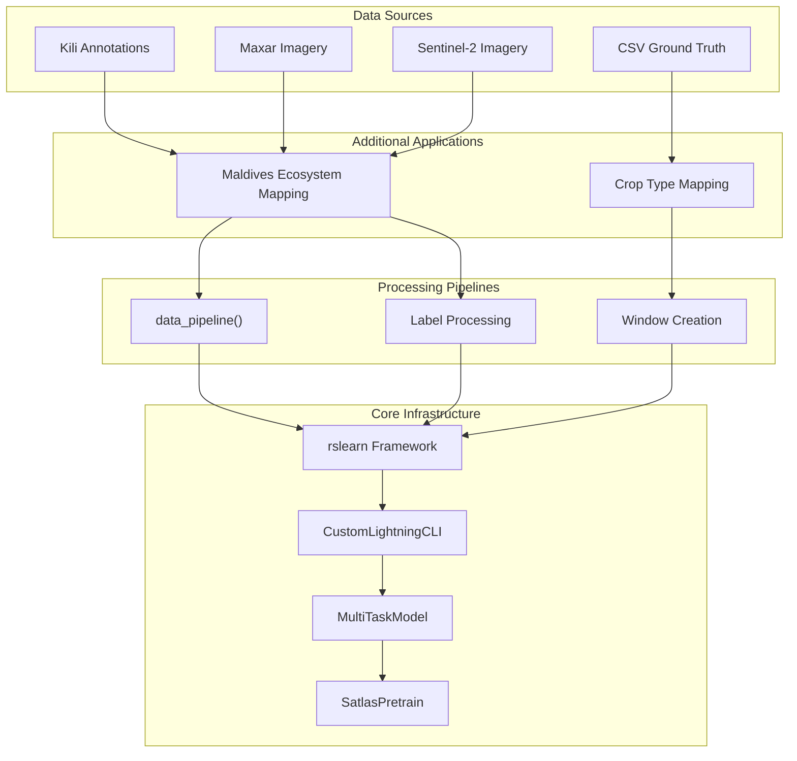
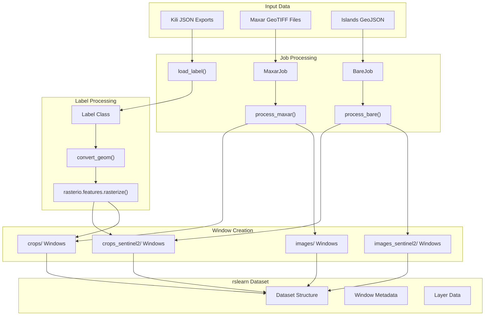
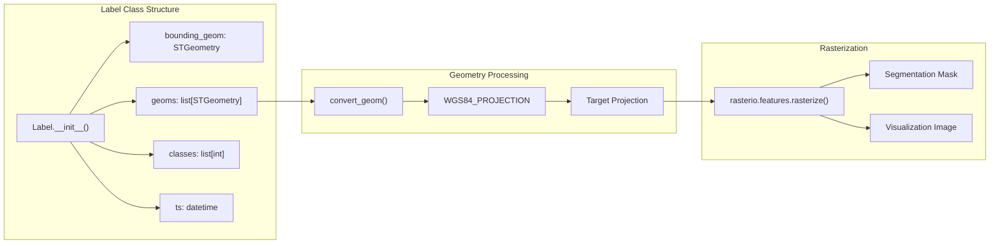
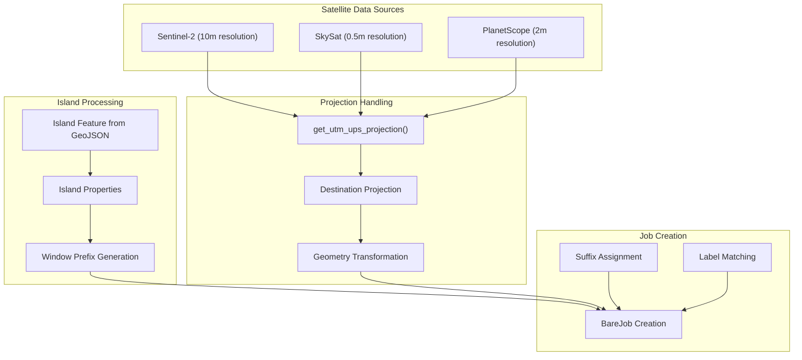

<!-- source: DeepWiki mcp.deepwiki.com · repo allenai/rslearn_projects · page 7 Additional Applications · fetched 2026-10-26 -->

# Additional Applications

Relevant source files

The following files were used as context for generating this wiki page:

- [data/maldives_ecosystem_mapping/config_sentinel2.yaml](data/maldives_ecosystem_mapping/config_sentinel2.yaml)
- [rslp/maldives_ecosystem_mapping/README.md](rslp/maldives_ecosystem_mapping/README.md)
- [rslp/maldives_ecosystem_mapping/data_pipeline.py](rslp/maldives_ecosystem_mapping/data_pipeline.py)

This document covers specialized machine learning applications for remote sensing tasks that extend beyond the core systems covered in other sections. These applications demonstrate the flexibility of the rslearn framework for domain-specific remote sensing problems.

The applications documented here include ecosystem mapping for the Maldives using semantic segmentation and crop type classification systems. For comprehensive vessel detection systems, see [Vessel Detection Systems](#4). For large-scale geospatial inference, see [Satlas System](#5). For foundation model applications, see [Helios Foundation Model](#6).

## System Overview

The additional applications leverage the core rslearn framework infrastructure while implementing specialized data processing pipelines and model architectures for specific remote sensing tasks.

**Additional Applications Architecture**

Sources: [rslp/maldives_ecosystem_mapping/data_pipeline.py:1-690](), [data/maldives_ecosystem_mapping/config_sentinel2.yaml:1-161]()

## Maldives Ecosystem Mapping

The Maldives ecosystem mapping system performs semantic segmentation of marine ecosystems using annotations from Kili and multiple satellite data sources. The system processes both labeled crops for training and unlabeled full images for inference.

### Data Pipeline Architecture

The Maldives system implements a sophisticated data pipeline that handles multiple satellite data sources and creates rslearn-compatible datasets from Kili annotations.

**Maldives Data Pipeline Flow**

Sources: [rslp/maldives_ecosystem_mapping/data_pipeline.py:572-690](), [rslp/maldives_ecosystem_mapping/data_pipeline.py:214-246]()

### Core Classes and Components

The data pipeline is built around several key classes that handle different aspects of data processing:

| Class | Purpose | Key Methods |
|-------|---------|-------------|
| `DataPipelineConfig` | Configuration management | Inherits from `BaseDataPipelineConfig` |
| `Label` | Segmentation label representation | `__init__()` with geometries and classes |
| `MaxarJob` | Maxar scene processing | Used with `process_maxar()` |
| `BareJob` | Non-Maxar window creation | Used with `process_bare()` |

The `Label` class encapsulates segmentation annotations with spatial and temporal information:

**Label Processing Architecture**

Sources: [rslp/maldives_ecosystem_mapping/data_pipeline.py:70-92](), [rslp/maldives_ecosystem_mapping/data_pipeline.py:181-211]()

### Multi-Source Data Integration

The system handles multiple satellite data sources through a unified approach using the `get_bare_jobs()` function:

**Multi-Source Data Integration**

Sources: [rslp/maldives_ecosystem_mapping/data_pipeline.py:494-570](), [rslp/maldives_ecosystem_mapping/data_pipeline.py:547-567]()

### Model Configuration

The system uses a `MultiTaskModel` with `SatlasPretrain` encoder for semantic segmentation:

| Configuration Aspect | Implementation |
|---------------------|----------------|
| **Encoder** | `SatlasPretrain` with `Sentinel2_SwinB_MI_MS` |
| **Time Series** | `SimpleTimeSeries` with 6 temporal groups |
| **Decoder** | `UNetDecoder` with `SegmentationHead` |
| **Input Channels** | 9 Sentinel-2 bands |
| **Output Classes** | 17 ecosystem categories |
| **Loss Function** | Cross-entropy with class remapping |

Sources: [data/maldives_ecosystem_mapping/config_sentinel2.yaml:1-161]()

### Usage and Workflow

The complete workflow for Maldives ecosystem mapping follows these steps:

1. **Data Preprocessing**: Run `data_pipeline()` to create rslearn dataset
2. **Model Training**: Use `CustomLightningCLI` with configuration files
3. **Inference**: Apply trained model to full images for ecosystem mapping

The system creates multiple window groups for different purposes:
- `images/`: Full Maxar scenes (unlabeled)
- `crops/`: Labeled patches from Maxar scenes
- `images_sentinel2/`: Full island coverage (unlabeled)
- `crops_sentinel2/`: Labeled patches for training

Sources: [rslp/maldives_ecosystem_mapping/README.md:1-55](), [rslp/maldives_ecosystem_mapping/data_pipeline.py:572-690]()

## Crop Type Mapping

The crop type mapping system generates spatial-temporal windows from CSV ground truth data for crop classification tasks. This system creates training data by extracting satellite imagery windows based on ground truth locations and timestamps provided in CSV format.

The crop mapping application demonstrates how the rslearn framework can be extended for agricultural remote sensing applications where ground truth data is provided in tabular format rather than as spatial annotations.

Sources: Based on table of contents structure, specific implementation files not provided.

## Integration with Core Infrastructure

These additional applications integrate seamlessly with the core rslearn infrastructure:

- **Dataset Management**: Use rslearn `Dataset` and `Window` classes
- **Model Training**: Leverage `CustomLightningCLI` and `MultiTaskModel`
- **Data Processing**: Utilize rslearn transforms and data modules
- **Distributed Computing**: Support Beaker cluster execution

The applications demonstrate the extensibility of the rslearn framework for specialized remote sensing tasks while maintaining consistency with the overall system architecture.

Sources: [rslp/maldives_ecosystem_mapping/data_pipeline.py:20-31](), [data/maldives_ecosystem_mapping/config_sentinel2.yaml:30-140]()

---

