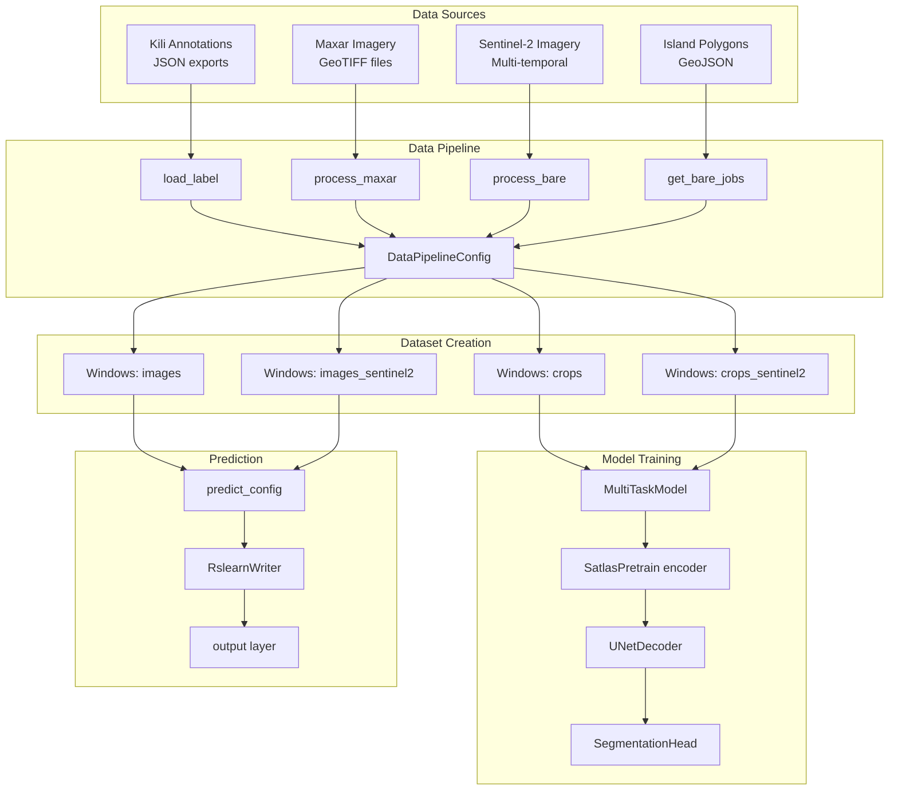
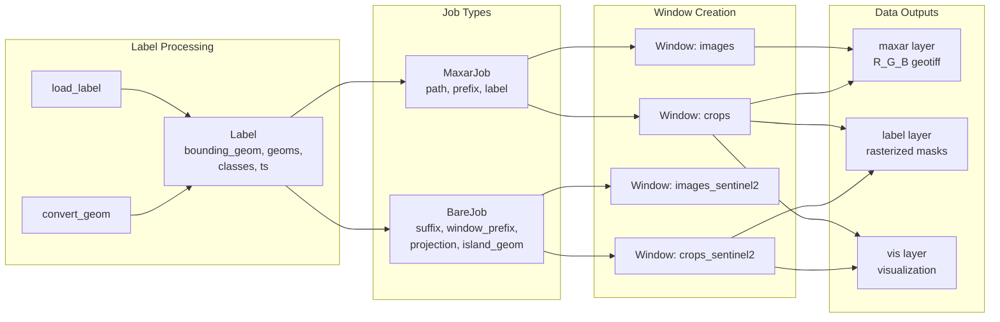
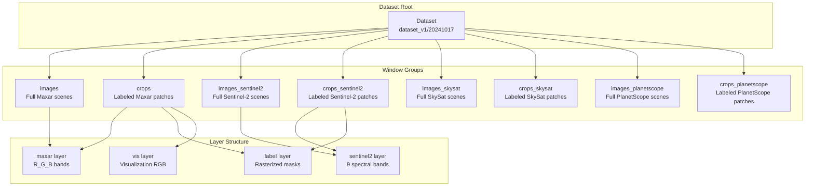

<!-- source: DeepWiki mcp.deepwiki.com · repo allenai/rslearn_projects · page 7.1 Maldives Ecosystem Mapping · fetched 2026-10-26 -->

# Maldives Ecosystem Mapping

<details>
<summary>Relevant source files</summary>

The following files were used as context for generating this wiki page:

- [data/maldives_ecosystem_mapping/config_sentinel2.yaml](data/maldives_ecosystem_mapping/config_sentinel2.yaml)
- [rslp/maldives_ecosystem_mapping/README.md](rslp/maldives_ecosystem_mapping/README.md)
- [rslp/maldives_ecosystem_mapping/data_pipeline.py](rslp/maldives_ecosystem_mapping/data_pipeline.py)

</details>


## Purpose and Scope

The Maldives Ecosystem Mapping system provides semantic segmentation capabilities for mapping marine and terrestrial ecosystems across the Maldives archipelago. This system processes high-resolution satellite imagery from multiple sources (Maxar, Sentinel-2, SkySat, PlanetScope) along with ground truth annotations created in Kili to train deep learning models for ecosystem classification.

The system creates rslearn datasets with both labeled crop patches and full-scene images, trains MultiTaskModel architectures with SatlasPretrain encoders, and supports large-scale prediction across the Maldives islands. For vessel detection applications, see [Vessel Detection Systems](#4). For other geospatial applications, see [Satlas System](#5).

## System Architecture

The Maldives ecosystem mapping system consists of three main components: data pipeline processing, model training, and prediction inference. The system integrates with the rslearn framework and supports multiple satellite data sources.



Sources: [rslp/maldives_ecosystem_mapping/data_pipeline.py:40-690](), [data/maldives_ecosystem_mapping/config_sentinel2.yaml:1-161]()

## Data Pipeline Components

### Label Processing and Window Creation

The data pipeline processes Kili annotation exports and creates rslearn dataset windows. The system handles two types of jobs: `MaxarJob` for processing existing Maxar imagery and `BareJob` for creating windows for other satellite data sources.



Sources: [rslp/maldives_ecosystem_mapping/data_pipeline.py:70-150](), [rslp/maldives_ecosystem_mapping/data_pipeline.py:214-246](), [rslp/maldives_ecosystem_mapping/data_pipeline.py:248-400]()

### Multi-Source Data Integration

The system creates windows for multiple satellite data sources with different spatial resolutions. The `get_bare_jobs` function matches island polygons with available labels and creates appropriate projection transformations.

| Data Source | Resolution | Suffix | Projection |
|-------------|------------|--------|------------|
| Sentinel-2 | 10m | `sentinel2` | UTM/UPS |
| SkySat | 0.5m | `skysat` | UTM/UPS |
| PlanetScope | 2m | `planetscope` | UTM/UPS |

The system uses `get_utm_ups_projection` to determine appropriate coordinate systems based on island centroids and applies geometric transformations using `STGeometry.to_projection`.

Sources: [rslp/maldives_ecosystem_mapping/data_pipeline.py:494-569](), [rslp/maldives_ecosystem_mapping/data_pipeline.py:547-567]()

## Model Architecture

### MultiTaskModel Configuration

The model uses a `MultiTaskModel` architecture with a `SatlasPretrain` encoder and `UNetDecoder` for semantic segmentation. The configuration supports multi-temporal Sentinel-2 input with 6 time steps.

```mermaid
graph TB
    subgraph "Input Processing"
        sentinel2_0[sentinel2 t0<br/>9 bands]
        sentinel2_1[sentinel2.1 t1<br/>9 bands]
        sentinel2_2[sentinel2.2 t2<br/>9 bands]
        sentinel2_3[sentinel2.3 t3<br/>9 bands]
        sentinel2_4[sentinel2.4 t4<br/>9 bands]
        sentinel2_5[sentinel2.5 t5<br/>9 bands]
        concatenate[Concatenate<br/>54 channels total]
        normalize[Normalize<br/>mean=0, std=3000]
    end
    
    subgraph "Model Architecture"
        simple_ts[SimpleTimeSeries<br/>image_channels=9<br/>groups=[[0,1,2,3,4,5]]]
        satlaspretrain[SatlasPretrain<br/>Sentinel2_SwinB_MI_MS]
        unet[UNetDecoder<br/>in_channels=[128,256,512,1024]<br/>out_channels=17]
        seg_head[SegmentationHead<br/>17 classes]
    end
    
    subgraph "Training Config"
        seg_task[SegmentationTask<br/>num_classes=17<br/>remap_values=[[0,1],[0,255]]<br/>zero_is_invalid=true]
        multi_task[MultiTask<br/>tasks: segment]
    end
    
    sentinel2_0 --> concatenate
    sentinel2_1 --> concatenate
    sentinel2_2 --> concatenate
    sentinel2_3 --> concatenate
    sentinel2_4 --> concatenate
    sentinel2_5 --> concatenate
    
    concatenate --> normalize
    normalize --> simple_ts
    simple_ts --> satlaspretrain
    satlaspretrain --> unet
    unet --> seg_head
    
    seg_head --> seg_task
    seg_task --> multi_task
```

Sources: [data/maldives_ecosystem_mapping/config_sentinel2.yaml:1-40](), [data/maldives_ecosystem_mapping/config_sentinel2.yaml:70-84]()

### Training Configuration

The model training uses specific configurations for different dataset groups:

- **Training**: Uses `crops_sentinel2` group with 32x32 patches, includes flip augmentation
- **Validation**: Uses `crops_sentinel2` group with 32x32 patches, no augmentation  
- **Prediction**: Uses `images_sentinel2` group with 128x128 patches, loads all patches

The system implements learning rate scheduling with plateau reduction and model checkpointing based on validation accuracy.

Sources: [data/maldives_ecosystem_mapping/config_sentinel2.yaml:103-140](), [data/maldives_ecosystem_mapping/config_sentinel2.yaml:141-161]()

## Dataset Structure and Processing

### Window Organization

The dataset creates separate window groups for different data sources and purposes:



Sources: [rslp/maldives_ecosystem_mapping/data_pipeline.py:296-387](), [rslp/maldives_ecosystem_mapping/data_pipeline.py:424-491]()

### Train/Validation Split

The system implements deterministic train/validation splits using SHA256 hashing of window prefixes. Windows with hash prefixes starting with "0" or "1" are assigned to validation, while others go to training.

```python
is_val = hashlib.sha256(window_prefix.encode()).hexdigest()[0] in ["0", "1"]
split = "val" if is_val else "train"
```

Sources: [rslp/maldives_ecosystem_mapping/data_pipeline.py:260-264](), [rslp/maldives_ecosystem_mapping/data_pipeline.py:410-414]()

## Ecosystem Classification

### Category System

The system classifies 17 different ecosystem types using the `CATEGORIES` and `COLORS` definitions. The `convert_geom` function processes Kili bounding polygons into appropriate coordinate systems, while `rasterio.features.rasterize` converts vector labels into pixel masks.

Label processing includes:
- Conversion from normalized Kili coordinates to projected coordinates
- Support for exterior and interior polygon rings
- Rasterization with category-specific class IDs
- Visualization layer generation with color mapping

Sources: [rslp/maldives_ecosystem_mapping/config.py:35](), [rslp/maldives_ecosystem_mapping/data_pipeline.py:181-211](), [rslp/maldives_ecosystem_mapping/data_pipeline.py:378-397]()

## Usage and Deployment

### Data Pipeline Execution

The data pipeline runs through the `data_pipeline` function which orchestrates:
1. Loading and processing Kili annotations via `load_label`
2. Creating `MaxarJob` instances for available imagery
3. Processing Maxar scenes with `process_maxar`
4. Matching labels to island polygons with `get_bare_jobs`
5. Creating additional windows with `process_bare`
6. Optional rslearn dataset preparation, ingestion, and materialization

```bash
python -m rslp.main maldives_ecosystem_mapping data --dp_config.workers 32
```

Sources: [rslp/maldives_ecosystem_mapping/data_pipeline.py:572-690](), [rslp/maldives_ecosystem_mapping/README.md:22-36]()

### Model Training and Prediction

Training uses the rslearn CLI with specific configuration files:

```bash
python -m rslp.rslearn_main model fit --config data/maldives_ecosystem_mapping/config_sentinel2.yaml --autoresume=true
```

Prediction generates outputs using the `RslearnWriter` callback which writes segmentation results to the specified output layer.

Sources: [rslp/maldives_ecosystem_mapping/README.md:38-55](), [data/maldives_ecosystem_mapping/config_sentinel2.yaml:147-152]()

---

