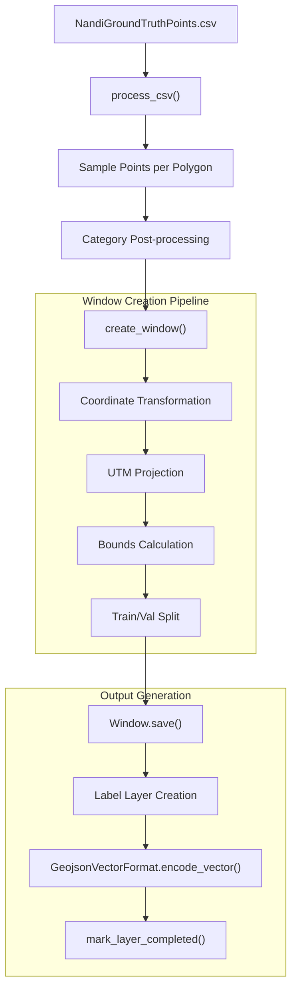
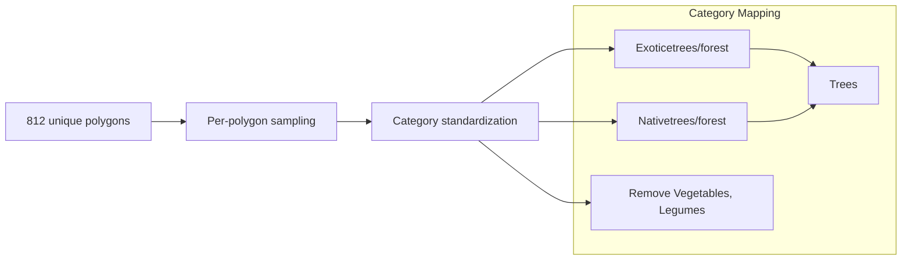
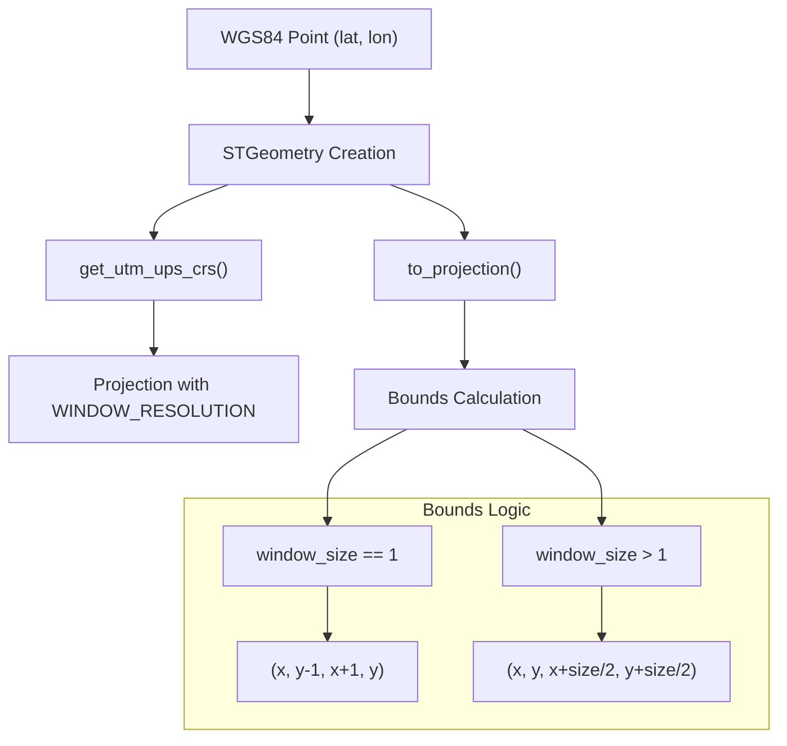

<!-- source: DeepWiki mcp.deepwiki.com · repo allenai/rslearn_projects · page 7.2 Crop Type Mapping · fetched 2026-10-26 -->

# Crop Type Mapping

<details>
<summary>Relevant source files</summary>

The following files were used as context for generating this wiki page:

- [rslp/crop_type_mapping/create_windows.py](rslp/crop_type_mapping/create_windows.py)

</details>


## Purpose and Scope

The Crop Type Mapping system generates spatial-temporal training windows from CSV ground truth data for crop classification tasks. This system creates rslearn-compatible datasets by converting point-based crop observations into georeferenced windows with appropriate train/validation splits and temporal alignment.

For information about other agricultural applications using the Helios foundation model, see [Task-Specific Applications](#6.3). For details about the core rslearn framework integration, see [rslearn Framework Integration](#2.1).

## System Overview

The crop type mapping system transforms CSV-based ground truth data into structured training datasets for machine learning models. The system focuses on Kenya's Nandi region, processing CGIAR ground truth points into temporal windows suitable for satellite imagery analysis.

### Data Flow Architecture



Sources: [rslp/crop_type_mapping/create_windows.py:1-245]()

## Data Processing Pipeline

### CSV Data Processing

The `process_csv()` function handles the initial data preparation and cleaning:

| Operation | Purpose | Implementation |
|-----------|---------|----------------|
| Column Selection | Extract relevant fields | `unique_id`, `latitude`, `longitude`, `LR_plantin`, `LR_Harvest`, `LR_harvetd`, `Category` |
| Sampling | Reduce polygon density | Sample `num_pixels` points per polygon (default: 10) |
| Category Cleanup | Standardize crop types | Merge exotic/native trees, remove vegetables/legumes |

### Key Processing Steps



The system processes categories as follows:
- Merges "Exoticetrees/forest" and "Nativetrees/forest" into "Trees"  
- Removes "Vegetables" and "Legumes" categories
- Maintains original categories for other crop types

Sources: [rslp/crop_type_mapping/create_windows.py:27-72]()

## Window Creation Process

### Spatial-Temporal Configuration

The window creation process uses fixed temporal and spatial parameters:

| Parameter | Value | Purpose |
|-----------|-------|---------|
| `WINDOW_RESOLUTION` | 10 meters | Match common satellite imagery resolution |
| `START_TIME` | 2023-03-01 | Center between planting seasons |
| `END_TIME` | 2023-03-31 | Single month temporal window |
| `LABEL_LAYER` | "label" | Standard rslearn label layer name |

### Coordinate Transformation Pipeline



The system performs precise coordinate transformations:
1. Creates `STGeometry` object in WGS84 projection
2. Determines appropriate UTM/UPS CRS using `get_utm_ups_crs()`
3. Creates destination projection with 10m resolution
4. Transforms geometry to UTM coordinates
5. Calculates integer pixel bounds

Sources: [rslp/crop_type_mapping/create_windows.py:95-117]()

### Train/Validation Split Strategy

The system supports two splitting strategies controlled by `split_by_polygon`:

#### Polygon-Based Split
```python
# Ensures no samples from same polygon appear in both splits
is_val = hashlib.md5(str(polygon_id).encode()).hexdigest()[0] in ["0", "1"]
```

#### Random Split  
```python
# Allows samples from same polygon in different splits
is_val = hashlib.md5(str(window_name).encode()).hexdigest()[0] in ["0", "1"]
```

Both strategies use MD5 hashing to ensure reproducible 20% validation splits.

Sources: [rslp/crop_type_mapping/create_windows.py:125-134]()

## Window and Label Generation

### rslearn Window Creation

Each ground truth point becomes an rslearn `Window` object with comprehensive metadata:

```mermaid
graph TB
    window_creation["Window()"]
    
    subgraph "Window Configuration"
        path["window_root path"]
        group["group assignment"]
        name["window_name"]
        projection["UTM projection"]
        bounds["pixel bounds"]
        time_range["temporal window"]
    end
    
    subgraph "Options Metadata"
        split["train/val split"]
        planted_date["LR_plantin"]
        harvested_info["LR_Harvest, LR_harvetd"]
        category["crop category"]
        weight["sample weight = 1"]
    end
    
    window_creation --> path
    window_creation --> group
    window_creation --> name
    window_creation --> projection
    window_creation --> bounds
    window_creation --> time_range
    window_creation --> split
    window_creation --> planted_date
    window_creation --> harvested_info
    window_creation --> category
    window_creation --> weight
```



### Label Layer Generation

The system creates vector labels using rslearn's standard format:

1. **Feature Creation**: Creates `Feature` object with crop category
2. **GeoJSON Encoding**: Uses `GeojsonVectorFormat().encode_vector()`
3. **Layer Completion**: Calls `window.mark_layer_completed(LABEL_LAYER)`

This ensures compatibility with rslearn's training pipelines and data loading mechanisms.

Sources: [rslp/crop_type_mapping/create_windows.py:136-163]()

## Configuration and Execution

### Command Line Interface

The system provides configurable parameters through `argparse`:

| Parameter | Default | Purpose |
|-----------|---------|---------|
| `--csv_path` | CGIAR GCS path | Input ground truth CSV |
| `--ds_path` | Weka storage path | Output dataset location |
| `--window_size` | 1 | Spatial window size in pixels |
| `--num_pixels` | 10 | Samples per polygon |
| `--split_by_polygon` | False | Splitting strategy |

### Parallel Processing

The system uses multiprocessing for efficient window creation:


The system creates 32 parallel workers using `multiprocessing.Pool(32)` and processes jobs using `star_imap_unordered()` for optimal throughput.

Sources: [rslp/crop_type_mapping/create_windows.py:183-201](), [rslp/crop_type_mapping/create_windows.py:203-244]()

## Integration with rslearn Framework

The crop type mapping system seamlessly integrates with the broader rslearn ecosystem:

- **Dataset Compatibility**: Generates standard rslearn `Window` objects
- **Projection System**: Uses rslearn's `Projection` and `STGeometry` classes
- **Vector Format**: Employs `GeojsonVectorFormat` for label encoding
- **Storage**: Compatible with both Weka and GCS storage backends

This integration enables the generated datasets to be used with any rslearn-based training pipeline, including the Helios fine-tuning framework documented in [Fine-tuning Framework](#6.2).

Sources: [rslp/crop_type_mapping/create_windows.py:11-17]()

---

