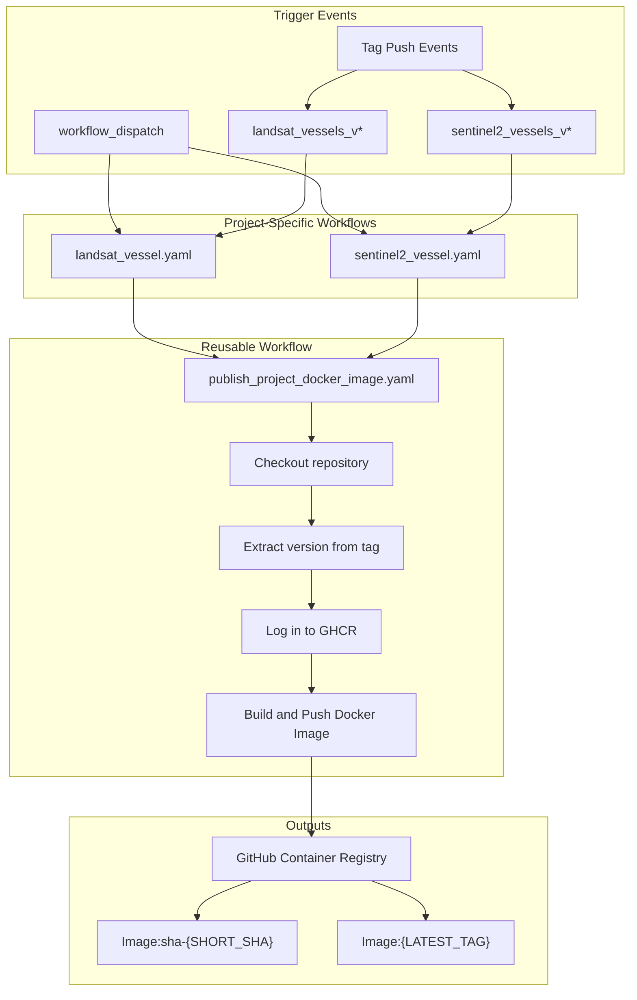
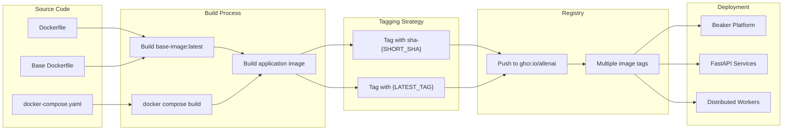
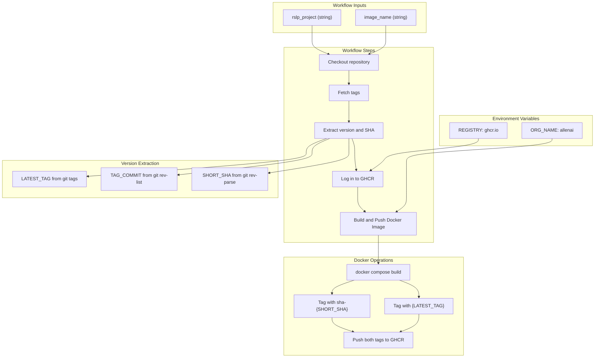
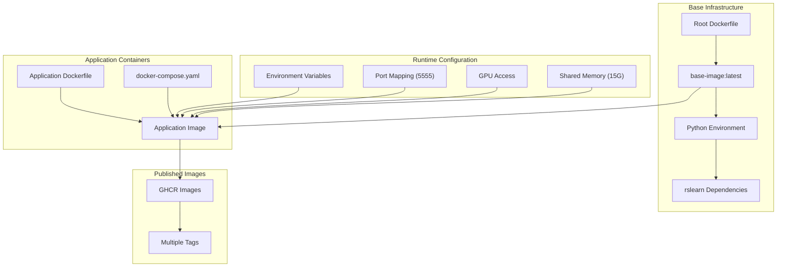

<!-- source: DeepWiki mcp.deepwiki.com · repo allenai/rslearn_projects · page 8 CI/CD and Deployment · fetched 2026-10-26 -->

# CI/CD and Deployment

Relevant source files

The following files were used as context for generating this wiki page:

- [.github/workflows/landsat_vessel.yaml](.github/workflows/landsat_vessel.yaml)
- [.github/workflows/publish_project_docker_image.yaml](.github/workflows/publish_project_docker_image.yaml)
- [.github/workflows/sentinel2_vessel.yaml](.github/workflows/sentinel2_vessel.yaml)
- [rslp/sentinel2_vessels/Dockerfile](rslp/sentinel2_vessels/Dockerfile)
- [rslp/sentinel2_vessels/docker-compose.yaml](rslp/sentinel2_vessels/docker-compose.yaml)

This document covers the continuous integration, continuous deployment (CI/CD), and deployment infrastructure for the rslearn_projects repository. The CI/CD system automates building, testing, and publishing Docker images for various applications, primarily using GitHub Actions workflows and Docker containerization.

The deployment system supports multiple applications with standardized patterns for container publishing to GitHub Container Registry (GHCR) and integration with Beaker compute clusters. For information about the distributed worker system and job orchestration, see [Distributed Worker System](#2.4). For application-specific deployment details, see [Forest Loss Driver System](#3) and [Vessel Detection Systems](#4).

## CI/CD Architecture Overview

The CI/CD system follows a modular architecture with reusable workflows and standardized containerization patterns across all applications.

### CI/CD Workflow Architecture

Sources: [.github/workflows/landsat_vessel.yaml:1-15](), [.github/workflows/sentinel2_vessel.yaml:1-15](), [.github/workflows/publish_project_docker_image.yaml:1-62]()

### Docker Build and Deployment Flow

Sources: [.github/workflows/publish_project_docker_image.yaml:54-61](), [rslp/sentinel2_vessels/docker-compose.yaml:1-30]()

## GitHub Actions Workflows

The repository uses a standardized approach to CI/CD with project-specific trigger workflows that call a reusable workflow for Docker image publishing.

### Project-Specific Workflows

Each application maintains its own workflow file that defines trigger conditions and calls the shared publishing workflow:

| Application | Workflow File | Tag Pattern | Image Name |
|-------------|---------------|-------------|------------|
| Landsat Vessels | `landsat_vessel.yaml` | `landsat_vessels_v*` | `landsat-vessel-detection` |
| Sentinel-2 Vessels | `sentinel2_vessel.yaml` | `sentinel2_vessels_v*` | `sentinel2-vessel-detection` |

The workflows support two trigger mechanisms:
- **Manual Trigger**: `workflow_dispatch` allows manual execution
- **Tag-Based Trigger**: Automatic execution when version tags are pushed

Sources: [.github/workflows/landsat_vessel.yaml:3-14](), [.github/workflows/sentinel2_vessel.yaml:3-14]()

### Reusable Publishing Workflow

The `publish_project_docker_image.yaml` workflow implements the core CI/CD logic:

Sources: [.github/workflows/publish_project_docker_image.yaml:6-13](), [.github/workflows/publish_project_docker_image.yaml:36-44](), [.github/workflows/publish_project_docker_image.yaml:54-61]()

## Docker Containerization

The containerization strategy uses a multi-stage approach with a shared base image and application-specific containers.

### Container Architecture

Sources: [rslp/sentinel2_vessels/Dockerfile:1-12](), [rslp/sentinel2_vessels/docker-compose.yaml:4-29]()

### Docker Compose Configuration

The `docker-compose.yaml` files define the build dependencies and runtime configuration:

**Key Configuration Elements:**
- **Base Image Dependency**: Applications depend on `base-image:latest`
- **GPU Support**: NVIDIA runtime with GPU device access
- **Memory Allocation**: 15GB shared memory for ML workloads
- **Port Exposure**: Standard port 5555 for API services
- **Environment Variables**: `PYTHONPATH` and application-specific variables

Sources: [rslp/sentinel2_vessels/docker-compose.yaml:12-29]()

### Image Tagging Strategy

The CI/CD system implements a dual-tagging strategy for Docker images:

1. **SHA-based Tags**: `sha-{SHORT_SHA}` for specific commit identification
2. **Version Tags**: `{LATEST_TAG}` for semantic versioning

This approach enables both pinned deployments (using SHA tags) and flexible version-based deployments (using version tags).

Sources: [.github/workflows/publish_project_docker_image.yaml:58-61]()

## Registry and Distribution

Docker images are published to GitHub Container Registry (GHCR) under the `ghcr.io/allenai` namespace. The registry serves as the central distribution point for all containerized applications.

### Published Images

Current applications with automated publishing:

| Application | Registry Path | Purpose |
|-------------|---------------|---------|
| Landsat Vessel Detection | `ghcr.io/allenai/landsat-vessel-detection` | Landsat vessel detection API |
| Sentinel-2 Vessel Detection | `ghcr.io/allenai/sentinel2-vessel-detection` | Sentinel-2 vessel detection API |

### Image Consumption

The published images are consumed by:
- **Beaker Platform**: For distributed training and inference jobs
- **API Services**: For FastAPI-based prediction services
- **Local Development**: For consistent development environments

Sources: [.github/workflows/publish_project_docker_image.yaml:16-17](), [.github/workflows/publish_project_docker_image.yaml:58-61]()

## Integration with Deployment Platforms

The CI/CD system integrates with the broader deployment infrastructure through standardized container interfaces.

### Beaker Integration

Docker images published to GHCR are consumed by Beaker clusters for:
- Model training jobs
- Large-scale inference tasks
- Distributed worker deployment

### API Service Deployment

Containerized applications support direct deployment as API services with:
- FastAPI framework integration
- Prometheus metrics exposure
- Swagger UI documentation
- GPU-accelerated inference

Sources: [rslp/sentinel2_vessels/Dockerfile:6-12](), [rslp/sentinel2_vessels/docker-compose.yaml:19-29]()

The CI/CD system provides the foundation for scalable, reproducible deployments across the entire rslearn_projects ecosystem, supporting both development workflows and production deployments.

---

