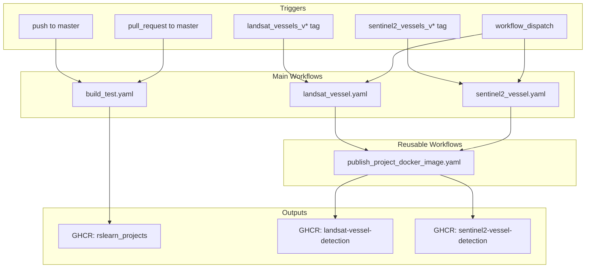
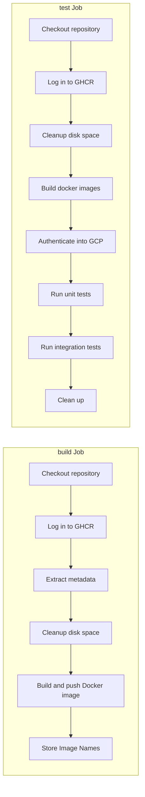
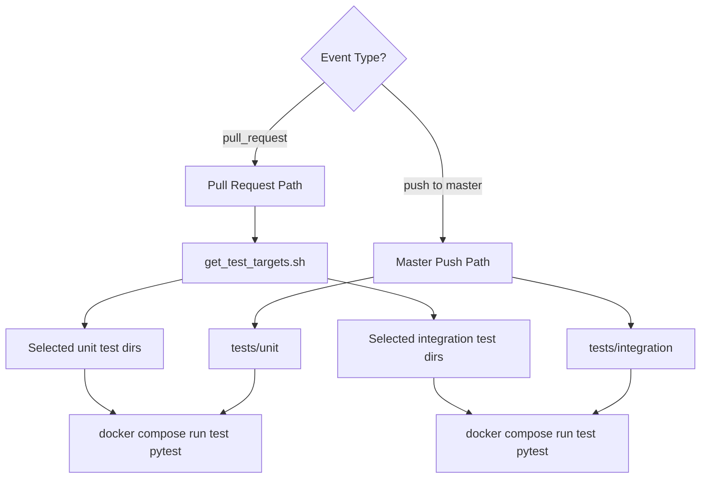
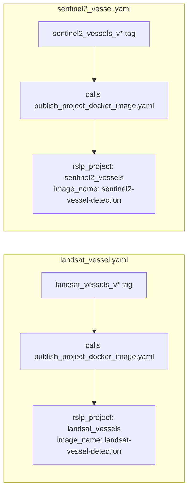
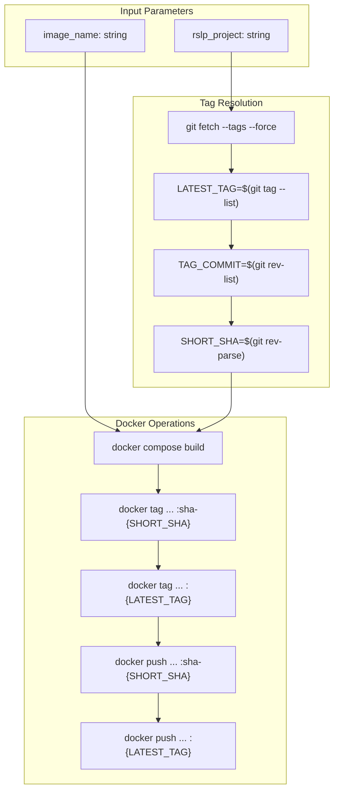

<!-- source: DeepWiki mcp.deepwiki.com · repo allenai/rslearn_projects · page 8.1 GitHub Actions Workflows · fetched 2026-10-26 -->

# GitHub Actions Workflows

<details>
<summary>Relevant source files</summary>

The following files were used as context for generating this wiki page:

- [.github/workflows/build_test.yaml](.github/workflows/build_test.yaml)
- [.github/workflows/get_test_targets.sh](.github/workflows/get_test_targets.sh)
- [.github/workflows/landsat_vessel.yaml](.github/workflows/landsat_vessel.yaml)
- [.github/workflows/publish_project_docker_image.yaml](.github/workflows/publish_project_docker_image.yaml)
- [.github/workflows/sentinel2_vessel.yaml](.github/workflows/sentinel2_vessel.yaml)
- [docker-compose.yaml](docker-compose.yaml)
- [rslp/landsat_vessels/Dockerfile](rslp/landsat_vessels/Dockerfile)
- [rslp/sentinel2_vessels/Dockerfile](rslp/sentinel2_vessels/Dockerfile)
- [rslp/sentinel2_vessels/docker-compose.yaml](rslp/sentinel2_vessels/docker-compose.yaml)
- [rslp/utils/rslearn.py](rslp/utils/rslearn.py)
- [tests/integration/forest_loss_driver/conftest.py](tests/integration/forest_loss_driver/conftest.py)
- [tests/integration/forest_loss_driver/inference/test_materialize_dataset.py](tests/integration/forest_loss_driver/inference/test_materialize_dataset.py)
- [tests/integration/forest_loss_driver/inference/test_model_predict.py](tests/integration/forest_loss_driver/inference/test_model_predict.py)

</details>


This document covers the continuous integration and deployment (CI/CD) system implemented through GitHub Actions workflows. The workflows handle automated building, testing, and publishing of Docker images for the various machine learning applications in the repository.

For information about the Docker containerization strategy itself, see [Docker and Containerization](#2.3). For details about the testing infrastructure and test execution, see [Testing Infrastructure](#8.3).

## Workflow Architecture

The GitHub Actions system consists of a main CI/CD pipeline and specialized application-specific workflows that leverage reusable workflow patterns.



Sources: [.github/workflows/build_test.yaml:1-207](), [.github/workflows/landsat_vessel.yaml:1-15](), [.github/workflows/sentinel2_vessel.yaml:1-15](), [.github/workflows/publish_project_docker_image.yaml:1-62]()

## Main CI/CD Pipeline

The `build_test.yaml` workflow serves as the primary CI/CD pipeline, executing on pushes to master and pull requests. It performs three main jobs: build, test, and conditional publishing.



### Build Job Configuration

The build job publishes Docker images to GitHub Container Registry with multiple tagging strategies:

| Tag Type | Format | Condition |
|----------|---------|----------|
| SHA (long) | `sha,format=long` | Always |
| SHA (short) | `sha,format=short` | Always |
| Latest | `latest` | Default branch only |

The build process uses Docker BuildKit and includes Git credentials for private repository access:

Sources: [.github/workflows/build_test.yaml:19-77]()

### Test Execution Strategy

The test job runs on `ubuntu-latest-m` runners and executes both unit and integration tests using Docker Compose. Test selection is conditional based on the trigger type:

- **Pull Requests**: Uses `get_test_targets.sh` to run only tests for changed components
- **Push to master**: Runs all tests in the respective directories



The integration tests require extensive environment configuration including Google Cloud Platform authentication and various service credentials:

Sources: [.github/workflows/build_test.yaml:78-153](), [.github/workflows/get_test_targets.sh:1-28]()

## Application-Specific Workflows

The repository includes specialized workflows for deploying individual applications as containerized services. These workflows are triggered by version tags following the pattern `{project}_v*`.

### Vessel Detection Workflows

Both Landsat and Sentinel-2 vessel detection systems have dedicated workflows that follow identical patterns:



Sources: [.github/workflows/landsat_vessel.yaml:1-15](), [.github/workflows/sentinel2_vessel.yaml:1-15]()

## Reusable Workflow Pattern

The `publish_project_docker_image.yaml` implements a reusable workflow pattern that standardizes Docker image publishing for individual projects. This workflow:

1. **Tag Resolution**: Extracts the latest version tag and associated commit SHA
2. **Image Building**: Uses project-specific `docker-compose.yaml` files in `rslp/{project}/`
3. **Multi-Tag Publishing**: Publishes images with both SHA and version tags



The workflow operates in the `rslp/{rslp_project}` directory and expects a `docker-compose.yaml` file with appropriate build configuration:

Sources: [.github/workflows/publish_project_docker_image.yaml:1-62]()

## Environment Configuration

The workflows rely on several environment variables and secrets for proper operation:

| Variable/Secret | Purpose | Used In |
|-----------------|---------|---------|
| `GITHUB_TOKEN` | GHCR authentication | All workflows |
| `GIT_USERNAME` | Private repo access | Build args |
| `GIT_TOKEN` | Private repo access | Build args |
| `GOOGLE_CREDENTIALS` | GCP authentication | Integration tests |
| `AWS_ACCESS_KEY_ID` | AWS services | Integration tests |
| `BKT_PROJECT_ID` | Bigtable testing | Integration tests |

The integration test environment includes comprehensive configuration for cloud services including Google Cloud Storage, Pub/Sub, and Bigtable for testing the distributed systems:

Sources: [.github/workflows/build_test.yaml:133-146]()

## Disk Space Management

All workflows include disk cleanup steps to prevent build failures due to insufficient disk space on GitHub Actions runners:

```bash
sudo docker rmi $(docker image ls -aq) >/dev/null 2>&1 || true
sudo docker image prune --all --force >/dev/null 2>&1 || true
sudo rm -rf /usr/share/dotnet
sudo rm -rf /opt/ghc
sudo rm -rf /usr/local/share/boost
```

This cleanup removes existing Docker images and large software packages that are not needed for the builds:

Sources: [.github/workflows/build_test.yaml:49-56](), [.github/workflows/build_test.yaml:94-101]()

---

