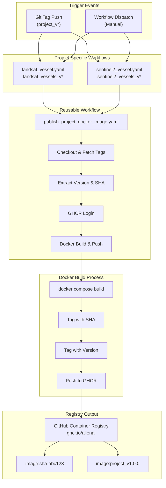
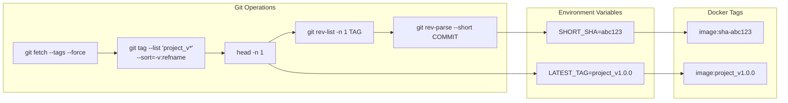

<!-- source: DeepWiki mcp.deepwiki.com · repo allenai/rslearn_projects · page 8.2 Docker Image Publishing · fetched 2026-10-26 -->

# Docker Image Publishing

<details>
<summary>Relevant source files</summary>

The following files were used as context for generating this wiki page:

- [.github/workflows/landsat_vessel.yaml](.github/workflows/landsat_vessel.yaml)
- [.github/workflows/publish_project_docker_image.yaml](.github/workflows/publish_project_docker_image.yaml)
- [.github/workflows/sentinel2_vessel.yaml](.github/workflows/sentinel2_vessel.yaml)
- [rslp/sentinel2_vessels/Dockerfile](rslp/sentinel2_vessels/Dockerfile)
- [rslp/sentinel2_vessels/docker-compose.yaml](rslp/sentinel2_vessels/docker-compose.yaml)

</details>


This document covers the automated Docker image building and publishing system used to deploy containerized applications from the rslearn_projects repository to GitHub Container Registry (GHCR). The system provides a reusable CI/CD pipeline that builds and publishes Docker images for various applications when version tags are pushed to the repository.

For information about Docker containerization and image structure, see [Docker and Containerization](#2.3). For details about the broader CI/CD infrastructure, see [GitHub Actions Workflows](#8.1).

## Publishing Architecture Overview

The Docker image publishing system follows a tag-driven, reusable workflow pattern that automatically builds and publishes images to GHCR when version tags are pushed.

### Publishing Workflow Architecture



Sources: [.github/workflows/publish_project_docker_image.yaml:1-62](), [.github/workflows/landsat_vessel.yaml:1-15](), [.github/workflows/sentinel2_vessel.yaml:1-15]()

## Trigger Mechanisms

The publishing system uses git tag patterns to automatically trigger builds for specific projects. Each project has its own tag namespace to prevent cross-project interference.

### Tag-Based Triggering

| Project | Tag Pattern | Workflow File | Image Name |
|---------|-------------|---------------|------------|
| Landsat Vessels | `landsat_vessels_v*` | `landsat_vessel.yaml` | `landsat-vessel-detection` |
| Sentinel-2 Vessels | `sentinel2_vessels_v*` | `sentinel2_vessel.yaml` | `sentinel2-vessel-detection` |

The tag pattern matching is implemented using the `push.tags` trigger in GitHub Actions:

```yaml
on:
  push:
    tags:
      - "landsat_vessels_v*"
```

Manual triggering is also supported through `workflow_dispatch` for testing and emergency deployments.

Sources: [.github/workflows/landsat_vessel.yaml:5-7](), [.github/workflows/sentinel2_vessel.yaml:5-7]()

## Reusable Workflow System

The publishing system is built around a central reusable workflow that eliminates code duplication and ensures consistent publishing behavior across projects.

### Workflow Call Interface

The reusable workflow `publish_project_docker_image.yaml` accepts two required inputs:

```yaml
inputs:
  rslp_project:
    required: true
    type: string
  image_name:
    required: true
    type: string
```

Project-specific workflows call this reusable workflow with their configuration:

```yaml
jobs:
  build-and-push:
    uses: ./.github/workflows/publish_project_docker_image.yaml
    with:
      rslp_project: "landsat_vessels"
      image_name: "landsat-vessel-detection"
```

This pattern allows new projects to be added by creating a simple wrapper workflow without duplicating the complex build logic.

Sources: [.github/workflows/publish_project_docker_image.yaml:6-13](), [.github/workflows/landsat_vessel.yaml:10-14]()

## Version Extraction and Tagging Strategy

The publishing system implements a sophisticated tagging strategy that provides both human-readable version tags and commit-specific SHA tags.

### Version Extraction Process



The version extraction logic ensures that the most recent version tag for each project is used, even when multiple projects have tags in the repository:

```bash
LATEST_TAG=$(git tag --list "${{ inputs.rslp_project }}_v*" --sort=-v:refname | head -n 1)
TAG_COMMIT=$(git rev-list -n 1 $LATEST_TAG)
SHORT_SHA=$(git rev-parse --short $TAG_COMMIT)
```

Sources: [.github/workflows/publish_project_docker_image.yaml:38-43]()

## Docker Build and Push Process

The build process uses Docker Compose to build images and then applies multiple tags before pushing to the registry.

### Build Command Sequence

The build process follows these steps within the project directory:

1. **Build with Compose**: `docker compose build` - Uses the project's `docker-compose.yaml` to build the image
2. **Tag with SHA**: Tags the image with the commit SHA for precise version tracking
3. **Tag with Version**: Tags the image with the human-readable version tag
4. **Push Both Tags**: Pushes both tagged versions to GHCR

```bash
docker compose build
docker tag ${{ inputs.rslp_project }}:latest ${{ env.REGISTRY }}/${{ env.ORG_NAME }}/${{ inputs.image_name }}:sha-${{ env.SHORT_SHA }}
docker tag ${{ inputs.rslp_project }}:latest ${{ env.REGISTRY }}/${{ env.ORG_NAME }}/${{ inputs.image_name }}:${{ env.LATEST_TAG }}
docker push ${{ env.REGISTRY }}/${{ env.ORG_NAME }}/${{ inputs.image_name }}:sha-${{ env.SHORT_SHA }}
docker push ${{ env.REGISTRY }}/${{ env.ORG_NAME }}/${{ inputs.image_name }}:${{ env.LATEST_TAG }}
```

The build assumes each project has a `docker-compose.yaml` file in its directory that properly configures the build context and dependencies.

Sources: [.github/workflows/publish_project_docker_image.yaml:55-61]()

## Registry Configuration and Authentication

The system publishes to GitHub Container Registry (ghcr.io) using GitHub's built-in authentication mechanisms.

### Registry Configuration

The publishing workflow configures the following registry settings:

- **Registry**: `ghcr.io` (GitHub Container Registry)
- **Organization**: `allenai` 
- **Authentication**: GitHub token with packages write permission
- **Image Naming**: `ghcr.io/allenai/{image_name}:{tag}`

Authentication is handled automatically using the repository's `GITHUB_TOKEN` secret, which provides the necessary permissions to push to GHCR when the workflow has `packages: write` permission.

```yaml
permissions:
  contents: read
  packages: write
```

Sources: [.github/workflows/publish_project_docker_image.yaml:15-17](), [.github/workflows/publish_project_docker_image.yaml:22-24](), [.github/workflows/publish_project_docker_image.yaml:46-51]()

## Project-Specific Docker Configuration

Each project maintains its own Docker configuration files that define how the image should be built and configured.

### Docker Compose Structure

Projects use a two-tier build system with a base image and project-specific image:

```yaml
services:
  base-image:
    build:
      context: ../..
      dockerfile: Dockerfile
    image: base-image:latest
  
  project-service:
    build:
      context: .
      dockerfile: Dockerfile
    image: project_name:latest
    depends_on:
      - base-image
```

The project-specific `Dockerfile` typically extends the base image and adds project-specific configuration:

```dockerfile
FROM base-image:latest
ENV PYTHONPATH="/opt/rslearn_projects:${PYTHONPATH}"
ENV PROJECT_PORT=5555
EXPOSE $PROJECT_PORT
CMD ["python3", "rslp/project_name/api_main.py"]
```

This structure allows sharing common dependencies in the base image while keeping project-specific customizations isolated.

Sources: [rslp/sentinel2_vessels/docker-compose.yaml:1-30](), [rslp/sentinel2_vessels/Dockerfile:1-13]()

---

