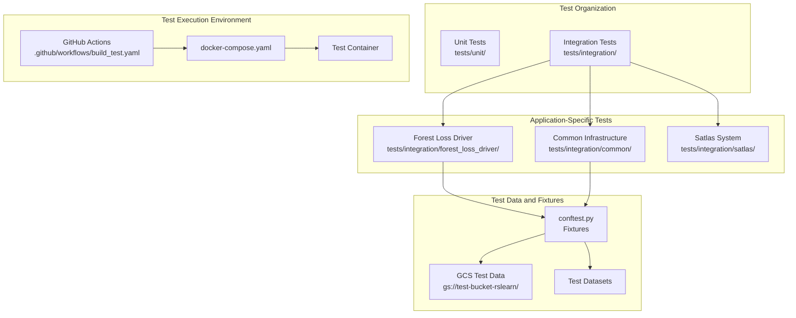
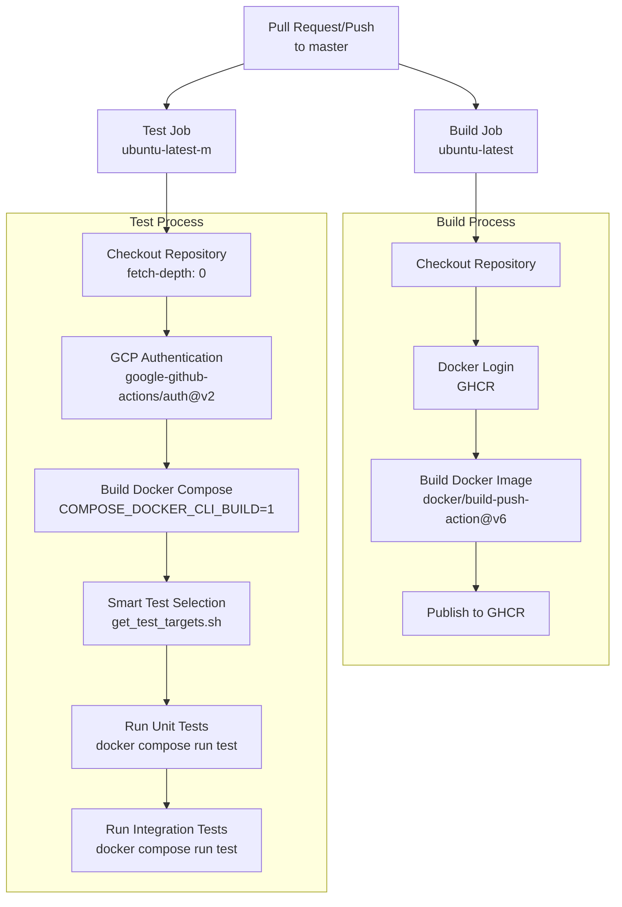
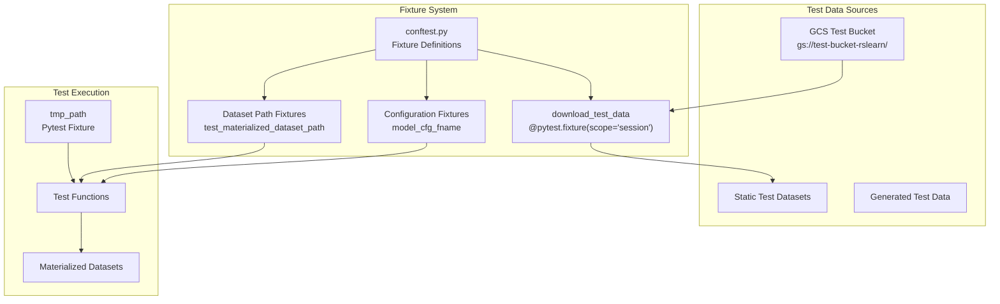

<!-- source: DeepWiki mcp.deepwiki.com · repo allenai/rslearn_projects · page 8.3 Testing Infrastructure · fetched 2026-10-26 -->

# Testing Infrastructure

<details>
<summary>Relevant source files</summary>

The following files were used as context for generating this wiki page:

- [.github/workflows/build_test.yaml](.github/workflows/build_test.yaml)
- [.github/workflows/get_test_targets.sh](.github/workflows/get_test_targets.sh)
- [docker-compose.yaml](docker-compose.yaml)
- [rslp/common/README.md](rslp/common/README.md)
- [rslp/common/write_file.py](rslp/common/write_file.py)
- [rslp/landsat_vessels/Dockerfile](rslp/landsat_vessels/Dockerfile)
- [rslp/satlas/write_jobs.py](rslp/satlas/write_jobs.py)
- [rslp/utils/rslearn.py](rslp/utils/rslearn.py)
- [tests/integration/common/__init__.py](tests/integration/common/__init__.py)
- [tests/integration/common/test_worker.py](tests/integration/common/test_worker.py)
- [tests/integration/forest_loss_driver/conftest.py](tests/integration/forest_loss_driver/conftest.py)
- [tests/integration/forest_loss_driver/inference/test_materialize_dataset.py](tests/integration/forest_loss_driver/inference/test_materialize_dataset.py)
- [tests/integration/forest_loss_driver/inference/test_model_predict.py](tests/integration/forest_loss_driver/inference/test_model_predict.py)
- [tests/integration/satlas/test_data_sources.py](tests/integration/satlas/test_data_sources.py)

</details>


This document covers the testing infrastructure for the rslearn_projects repository, including unit and integration tests, containerized test execution, CI/CD integration, and cloud service testing utilities. The testing system supports both local development and automated CI/CD workflows with Docker-based isolation and smart test selection.

For information about the broader CI/CD system and deployment workflows, see [GitHub Actions Workflows](#8.1). For details about Docker containerization used in testing, see [Docker and Containerization](#2.3).

## Test Organization and Types

The repository implements a hierarchical testing structure with two primary test categories:

- **Unit Tests** (`tests/unit/`): Fast, isolated tests that don't require external dependencies
- **Integration Tests** (`tests/integration/`): Tests that interact with cloud services, Docker containers, and complex workflows

Tests are organized by application domain, mirroring the main codebase structure:

| Test Directory | Purpose | Key Dependencies |
|----------------|---------|------------------|
| `tests/integration/forest_loss_driver/` | Forest loss pipeline testing | GCS, materialized datasets |
| `tests/integration/common/` | Worker system and shared infrastructure | Google Cloud Pub/Sub |
| `tests/integration/satlas/` | Satlas data source testing | Azure, GCP services |

**Test Architecture Overview**



Sources: [.github/workflows/build_test.yaml:1-207](), [tests/integration/forest_loss_driver/conftest.py:1-105](), [tests/integration/common/test_worker.py:1-67]()

## CI/CD Integration and Docker-Based Testing

The testing infrastructure integrates tightly with the CI/CD pipeline through GitHub Actions and Docker containerization. Tests execute in isolated Docker environments to ensure consistency across development and production environments.

**CI/CD Test Execution Flow**



The CI/CD system implements smart test selection using `get_test_targets.sh`, which analyzes changed files to determine which test directories to execute:

```bash
# Example: Only test forest loss driver if related files changed
if echo "$CHANGED_FILES" | grep -q "^rslp/forest_loss_driver/"; then
    TEST_DIRS+=("tests/integration/forest_loss_driver/**")
fi
```

**Test Execution Commands**

Unit tests run with minimal dependencies:
```bash
docker compose run -e CI="true" test pytest ${TEST_DIRS}
```

Integration tests include full cloud service configuration:
```bash
docker compose run \
  -e AWS_ACCESS_KEY_ID=${{ secrets.AWS_ACCESS_KEY_ID }} \
  -e GOOGLE_APPLICATION_CREDENTIALS=/tmp/gcp-credentials.json \
  -e RSLP_BUCKET=rslearn-eai \
  -e TEST_PUBSUB_PROJECT=earthsystem-dev-c3po \
  test pytest ${TEST_DIRS} -vv
```

Sources: [.github/workflows/build_test.yaml:79-147](), [.github/workflows/get_test_targets.sh:1-28](), [docker-compose.yaml:1-14]()

## Test Data Management and Fixtures

The testing infrastructure includes sophisticated test data management through pytest fixtures and automated data downloading from Google Cloud Storage. Test fixtures handle both static test data and dynamic dataset generation.

**Test Data Flow**



**Key Test Fixtures**

The forest loss driver tests demonstrate the fixture pattern:

- `download_test_data`: Session-scoped fixture that downloads test data from GCS
- `test_materialized_dataset_path`: Provides path to pre-materialized datasets
- `country_data_path`: Provides geographic boundary data for testing
- `clear_sys_argv`: Ensures clean test environment by clearing command line arguments

The download fixture automatically manages test data availability:

```python
@pytest.fixture(scope="session", autouse=True)
def download_test_data() -> Generator[None, None, None]:
    """Download test data from GCS bucket if not present locally."""
    folders_to_download = [
        "test_materialized_dataset",
        "alert_dates", 
        "alert_tiffs",
        "artifacts",
    ]
```

Sources: [tests/integration/forest_loss_driver/conftest.py:59-105](), [tests/integration/forest_loss_driver/inference/test_materialize_dataset.py:16-23]()

## Integration Testing Patterns

Integration tests follow consistent patterns for testing complex workflows that involve multiple systems, cloud services, and data processing pipelines.

### Forest Loss Driver Integration Tests

The forest loss driver integration tests demonstrate end-to-end pipeline testing:

**Dataset Materialization Testing**
- Tests the complete `materialize_dataset` pipeline from [rslp/utils/rslearn.py:82-127]()
- Verifies prepare, ingest, and materialize steps produce expected outputs
- Validates layer structure and file counts in materialized datasets

**Model Prediction Testing** 
- Tests the `run_model_predict` function from [rslp/utils/rslearn.py:129-162]()
- Verifies model outputs match expected GeoJSON structure and probability distributions
- Uses pre-materialized test datasets for consistent results

### Worker System Integration Tests

The worker system tests validate the distributed processing infrastructure:

**PubSub Integration Testing**
- Tests `worker_pipeline` function from `rslp.common.worker`
- Verifies message processing, idle timeout behavior, and job execution
- Uses dedicated test PubSub topic and subscription for isolation

**Job Execution Testing**
- Tests end-to-end job processing including job writing and worker execution
- Validates the `write_file` workflow as a simple test case
- Ensures proper cleanup and error handling

```python
def test_single_task(self, tmp_path: pathlib.Path) -> None:
    """Check that worker can do one task."""
    job_args = ["--fname", str(dst_fname), "--contents", "abc"]
    write_jobs(
        project_id=os.environ["TEST_PUBSUB_PROJECT"],
        topic_id=os.environ["TEST_PUBSUB_TOPIC"], 
        rslp_project="common",
        rslp_workflow="write_file",
        args_list=[job_args],
    )
```

Sources: [tests/integration/forest_loss_driver/inference/test_model_predict.py:25-90](), [tests/integration/forest_loss_driver/inference/test_materialize_dataset.py:25-94](), [tests/integration/common/test_worker.py:41-67]()

## Cloud Service Testing Integration

The testing infrastructure integrates with multiple cloud services to enable realistic integration testing while maintaining isolation and reproducibility.

### Google Cloud Platform Integration

**Authentication and Configuration**
- Tests authenticate using service account credentials via `google-github-actions/auth@v2`
- Environment variables configure GCP project IDs, bucket names, and service endpoints
- Bigtable and Pub/Sub services use dedicated test instances

**GCP Service Configuration**
```bash
-e BKT_PROJECT_ID=earthsystem-dev-c3po
-e BKT_BUCKET_NAME=rslp-tests  
-e BKT_BIGTABLE_PROJECT_ID=earthsystem-dev-c3po
-e BKT_BIGTABLE_INSTANCE_ID=rslp-bigtable-test-instance
-e TEST_PUBSUB_PROJECT=earthsystem-dev-c3po
-e TEST_PUBSUB_TOPIC=rslearn_projects_test_topic
```

### Azure and AWS Integration

**Multi-Cloud Data Source Testing**
- Satlas tests validate Azure Sentinel-2 and AWS-based data sources
- Tests verify monthly data aggregation and spatial-temporal querying
- Integration with Planetary Computer and GCP Public Datasets

The `TestGetItems` class demonstrates multi-cloud testing patterns:
- Tests `MonthlySentinel1`, `MonthlySentinel2`, and `MonthlyAzureSentinel2` data sources
- Validates time-based data aggregation across different cloud providers
- Ensures consistent behavior across platform-specific implementations

Sources: [.github/workflows/build_test.yaml:133-146](), [tests/integration/satlas/test_data_sources.py:30-112](), [tests/integration/common/test_worker.py:16-25]()

---

