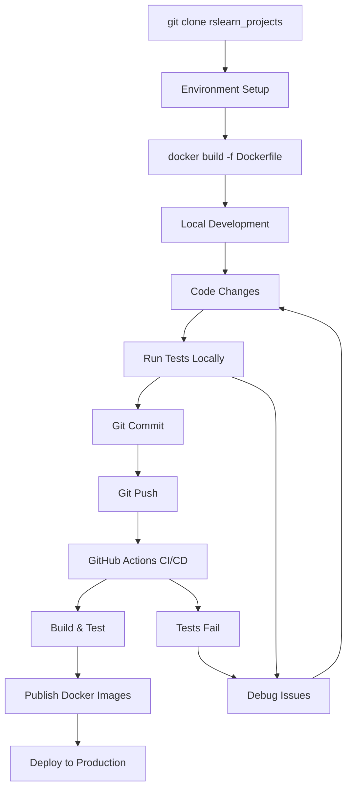
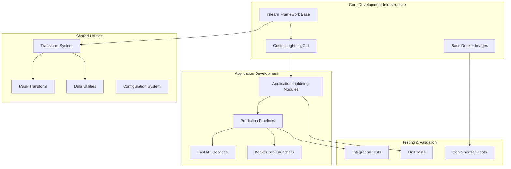
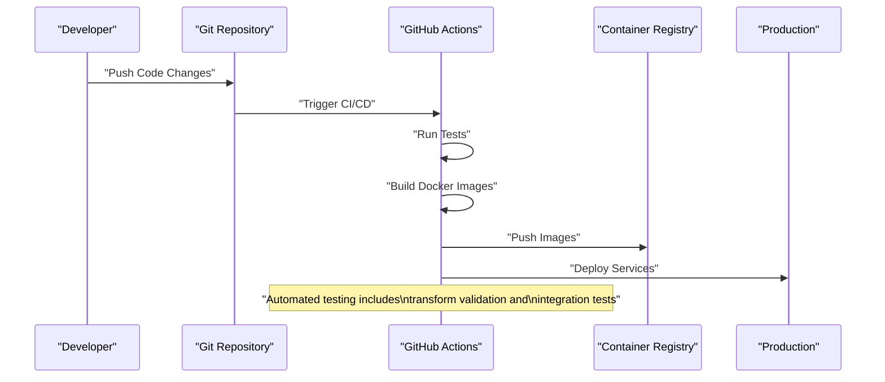

<!-- source: DeepWiki mcp.deepwiki.com · repo allenai/rslearn_projects · page 9 Development Guide · fetched 2026-10-26 -->

# Development Guide

<details>
<summary>Relevant source files</summary>

The following files were used as context for generating this wiki page:

- [rslp/transforms/mask.py](rslp/transforms/mask.py)

</details>


This document provides practical guidance for developers working with the rslearn_projects repository. It covers development setup, common patterns, key utilities, and workflows for contributing to the various machine learning applications built on the rslearn framework.

For information about specific applications, see the individual system documentation: [Forest Loss Driver System](#3), [Vessel Detection Systems](#4), [Satlas System](#5), and [Helios Foundation Model](#6). For deployment and CI/CD processes, see [CI/CD and Deployment](#8).

## Development Environment Setup

The rslearn_projects repository is built on a foundation of shared infrastructure and utilities that support multiple remote sensing applications. Understanding the development environment and key patterns is essential for effective contribution.

### Development Workflow



Sources: Repository structure analysis, GitHub Actions workflows

### Core Development Components

The repository provides several key utilities and patterns that developers should understand:



Sources: [rslp/transforms/mask.py:1-52](), repository structure analysis

## Transform and Utility Systems

The repository includes a comprehensive transform system built on the rslearn framework for data preprocessing and augmentation. These utilities are shared across applications and provide consistent data handling patterns.

### Transform Architecture

The transform system extends rslearn's base Transform class to provide application-specific data processing capabilities:

| Transform Type | Purpose | Key Classes |
|---------------|---------|-------------|
| Mask Transforms | Apply masks to imagery | `Mask` |
| Data Augmentation | Image preprocessing | Various transforms |
| Normalization | Data standardization | Normalization transforms |
| Spatial Transforms | Geometric operations | Spatial transforms |

### Mask Transform Implementation

The `Mask` transform provides a flexible way to apply masks to satellite imagery and other data:

```mermaid
classDiagram
    class Transform {
        <<abstract>>
        +forward(input_dict, target_dict)
        +apply_fn()
        +read_selector()
    }
    
    class Mask {
        -selectors: list[str]
        -mask_selector: str
        +__init__(selectors, mask_selector)
        +apply_image(image, mask) torch.Tensor
        +forward(input_dict, target_dict) tuple
    }
    
    Transform <|-- Mask
    
    note for Mask : "Applies masks to selected images\nusing element-wise multiplication"
```

The `Mask` transform follows a standard pattern:
- **Initialization**: Configures which images to mask and which selector contains the mask
- **Application**: Multiplies images by mask values, setting masked pixels to zero
- **Integration**: Works seamlessly with rslearn's data pipeline architecture

Sources: [rslp/transforms/mask.py:7-51]() 

### Common Development Patterns

#### Transform Usage Pattern

When implementing new transforms, follow the established pattern demonstrated in the `Mask` class:

1. **Inherit from Transform**: Extend `rslearn.train.transforms.transform.Transform`
2. **Configure Selectors**: Define which data fields the transform operates on
3. **Implement Logic**: Create specific methods for transform operations
4. **Handle Dictionaries**: Process both input and target dictionaries appropriately

#### Configuration Management

The repository uses a configuration-driven approach where transforms and other components are configured through YAML files and command-line arguments processed by `CustomLightningCLI`.

#### Error Handling and Validation

Transforms should validate input data and provide meaningful error messages. The mask transform ensures proper tensor operations by converting masks to float tensors.

## Development Workflow Integration

### Local Development

1. **Environment Setup**: Use Docker containers for consistent development environments
2. **Code Changes**: Implement features using established patterns and utilities
3. **Testing**: Run both unit and integration tests locally before committing
4. **Debugging**: Utilize the transform system's built-in error handling and logging

### Integration with CI/CD

The development workflow integrates with GitHub Actions for automated testing and deployment:



Sources: GitHub Actions workflows, repository CI/CD configuration

### Best Practices

1. **Use Established Patterns**: Follow the patterns demonstrated in existing transforms and utilities
2. **Test Thoroughly**: Implement comprehensive tests for new transforms and utilities
3. **Document Changes**: Update documentation when adding new development utilities
4. **Container Compatibility**: Ensure code works in Docker environments used for deployment
5. **Configuration Consistency**: Use the established configuration patterns for new components

This development guide provides the foundation for contributing to the rslearn_projects repository. The transform system and shared utilities form the backbone of data processing across all applications, making them essential components for developers to understand and utilize effectively.

Sources: [rslp/transforms/mask.py:1-52](), repository structure analysis, development workflow patterns

---

