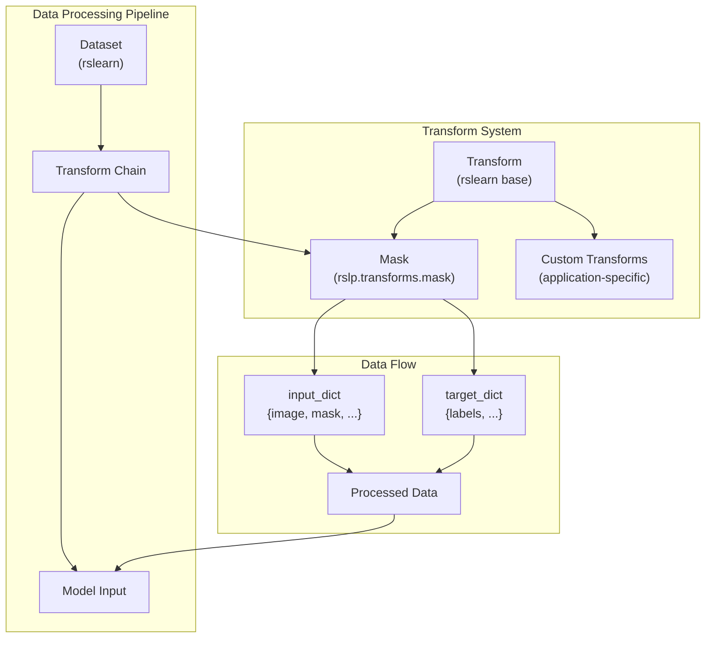
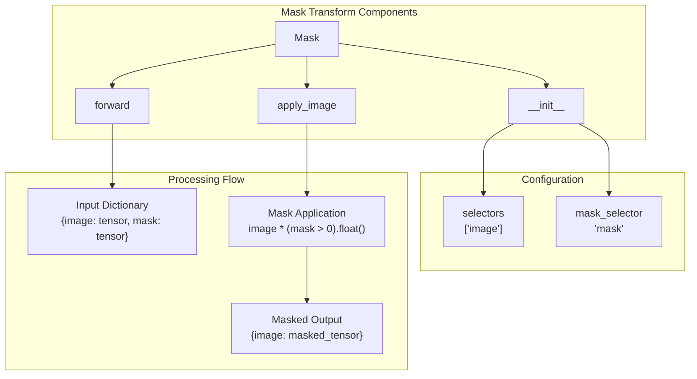
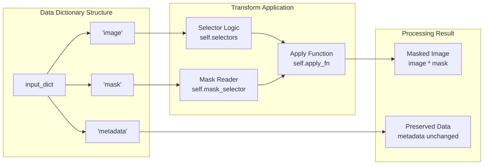

<!-- source: DeepWiki mcp.deepwiki.com · repo allenai/rslearn_projects · page 9.1 Transform and Utility Systems · fetched 2026-10-26 -->

# Transform and Utility Systems

Relevant source files

The following files were used as context for generating this wiki page:

- [rslp/transforms/mask.py](rslp/transforms/mask.py)

This document covers the data transformation utilities, mask operations, and other shared components used for data processing across the rslearn_projects repository. These utilities provide reusable functionality for preprocessing satellite imagery and applying common transformations within the machine learning pipeline.

For information about the broader data processing pipeline and augmentation systems, see [Core Infrastructure](#2). For application-specific data processing configurations, see [Forest Loss Driver System](#3) and [Vessel Detection Systems](#4).

## Transform System Architecture

The transform system extends the rslearn framework's transform infrastructure to provide specialized operations for remote sensing data. The system follows a consistent pattern where transforms inherit from `rslearn.train.transforms.transform.Transform` and implement standardized interfaces for applying operations to input and target dictionaries.

### Transform Pipeline Integration

Sources: [rslp/transforms/mask.py:1-52]()

## Mask Transform Implementation

The `Mask` transform provides functionality to apply binary or continuous masks to satellite imagery, enabling selective processing of image regions based on validity masks, cloud masks, or other spatial constraints.

### Mask Transform Class Structure

Sources: [rslp/transforms/mask.py:7-51]()

### Key Implementation Details

| Component | Purpose | Configuration |
|-----------|---------|---------------|
| `selectors` | Specifies which image keys to mask | Default: `["image"]` |
| `mask_selector` | Identifies the mask tensor in data dict | Default: `"mask"` |
| `apply_image` | Core masking operation | Applies `image * (mask > 0).float()` |
| `forward` | Main transform interface | Processes both input and target dicts |

The mask operation uses a threshold-based approach where mask values greater than 0 are treated as valid regions. The masking is applied by element-wise multiplication with the converted mask tensor.

Sources: [rslp/transforms/mask.py:10-35]()

## Transform Integration Patterns

### Selector-Based Processing

The transform system uses a selector-based pattern where transforms can target specific tensors within the input and target dictionaries. This allows for flexible application of transformations to different components of the data:

Sources: [rslp/transforms/mask.py:22-49]()

### Transform Chain Compatibility

The transform system is designed to work within rslearn's transform chain infrastructure, where multiple transforms can be composed together. Each transform receives and returns the standard `(input_dict, target_dict)` tuple format, ensuring compatibility across the pipeline.

The `Mask` transform demonstrates the standard pattern:
- Inherits from `rslearn.train.transforms.transform.Transform`
- Implements `forward` method with consistent signature
- Uses `self.read_selector` and `self.apply_fn` utility methods from base class
- Preserves data dictionary structure while modifying selected tensors

Sources: [rslp/transforms/mask.py:4-51]()

## Usage Examples and Applications

The mask transform is typically used in scenarios involving:

1. **Cloud Masking**: Removing cloud-contaminated pixels from satellite imagery
2. **Validity Masking**: Excluding invalid or no-data regions from processing
3. **ROI Masking**: Focusing analysis on specific regions of interest
4. **Quality Filtering**: Applying quality masks from satellite data providers

The transform integrates seamlessly with the broader data processing pipeline used across applications like forest loss detection, vessel detection, and other remote sensing tasks documented in sections [3](#3), [4](#4), and [5](#5).

Sources: [rslp/transforms/mask.py:1-52]()