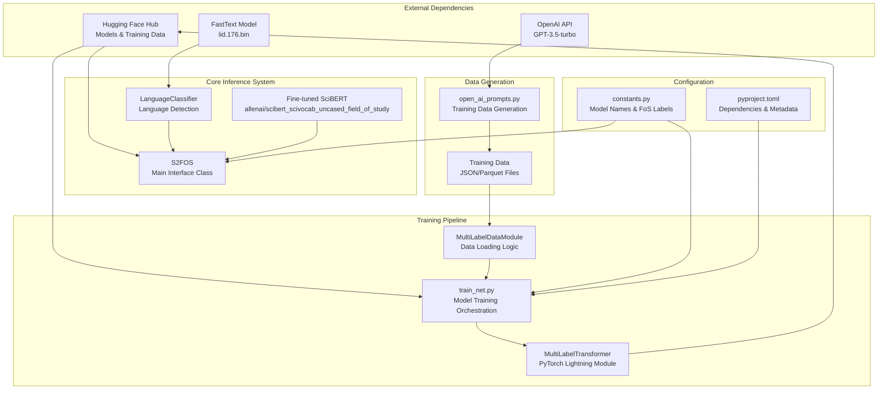
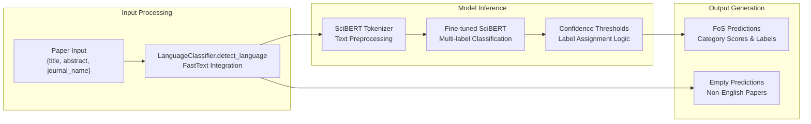
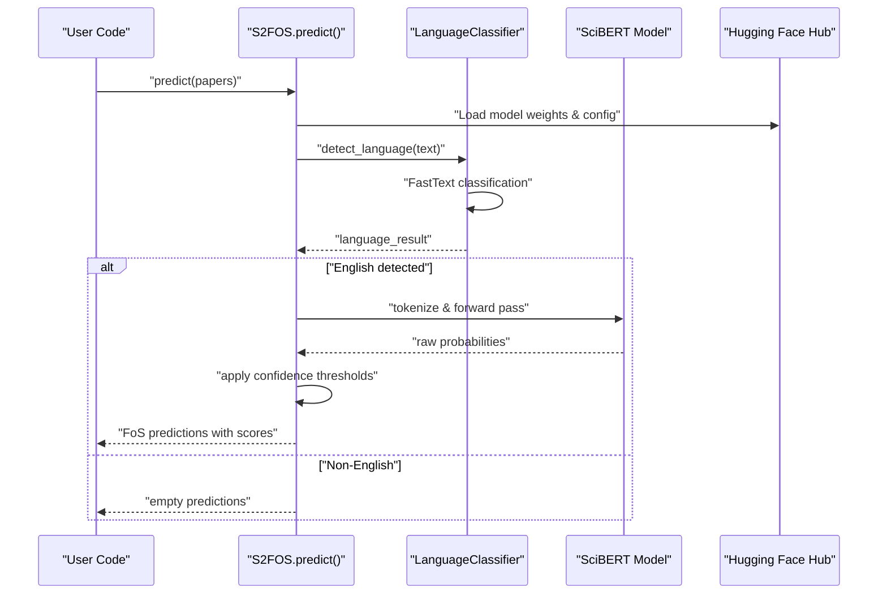

<!-- source: DeepWiki mcp.deepwiki.com · repo allenai/s2_fos · page 1 Overview · fetched 2026-10-26 -->

# Overview

Relevant source files

The following files were used as context for generating this wiki page:

- [.gitignore](.gitignore)
- [README.md](README.md)

This document provides a high-level overview of the s2_fos system, its architecture, and core components. The s2_fos system is a Field of Study (FoS) classification system designed to predict academic research categories for scholarly papers using machine learning models.

For detailed usage instructions and installation, see [Getting Started](#2). For information about the main inference interface, see [S2FOS Interface](#3.1). For model training procedures, see [Training System](#4).

## Purpose and Scope

The s2_fos system serves as Semantic Scholar's Field of Study classifier, designed to automatically categorize academic papers into predefined research domains. The system processes paper metadata (title, abstract, journal) and outputs probability scores across 23 field of study categories such as Computer Science, Biology, Mathematics, etc.

The system implements a two-stage classification pipeline:
1. **Language Detection**: Filters papers to English-only using FastText language identification
2. **Field Classification**: Applies a fine-tuned SciBERT model to predict field of study categories

**Sources:** [README.md:1-8]()

## System Architecture

The s2_fos system consists of three primary subsystems that work together to provide field of study classification capabilities:

### High-Level System Components

**Sources:** [README.md:44-67](), [README.md:113-145]()

### Core Data Flow

**Sources:** [README.md:6-8](), [README.md:68-95]()

## Key Components

### Primary Interface Components

| Component | File Location | Purpose |
|-----------|---------------|---------|
| `S2FOS` | `src/s2_fos/s2_fos.py` | Main prediction interface class |
| `LanguageClassifier` | `src/s2_fos/language_classifier.py` | Language detection using FastText |
| `constants.py` | `src/s2_fos/constants.py` | Model identifiers and FoS label definitions |

### Training Components

| Component | File Location | Purpose |
|-----------|---------------|---------|
| `train_net.py` | `src/s2_fos/training/train_net.py` | Training orchestration script |
| `MultiLabelTransformer` | Training modules | PyTorch Lightning training logic |
| `open_ai_prompts.py` | `src/s2_fos/training/open_ai_prompts.py` | OpenAI API data generation |

**Sources:** [README.md:113-145]()

## External Dependencies

The system relies on several external services and models:

### Model Dependencies
- **SciBERT Model**: `allenai/scibert_scivocab_uncased_field_of_study` hosted on Hugging Face Hub
- **FastText Language Model**: `lid.176.bin` for language identification  
- **Training Data**: `allenai/fos_model_training_data_open_ai_annotations` dataset on Hugging Face

### API Dependencies  
- **OpenAI API**: GPT-3.5-turbo for generating training data labels
- **Hugging Face Hub**: Model hosting and dataset distribution

**Sources:** [README.md:44-67](), [README.md:37-42]()

## Inference Workflow

The main prediction workflow follows this sequence:

**Sources:** [README.md:6-8](), [README.md:68-95]()

## Field of Study Categories

The system predicts across 23 predefined field of study categories. Each prediction includes both binary labels and confidence scores, allowing users to filter results based on confidence thresholds.

For detailed information about the specific categories and their definitions, see [Constants and Labels](#3.3).

**Sources:** [README.md:4-5]()

## Development and Training

The repository supports both inference and model development workflows:

- **Inference**: Production-ready classification through the `S2FOS` interface
- **Training**: Model fine-tuning capabilities via `train_net.py` with PyTorch Lightning
- **Data Generation**: OpenAI API integration for creating training datasets

For comprehensive development setup instructions, see [Development](#5). For training procedures and configuration options, see [Training System](#4).

**Sources:** [README.md:97-145]()

---

