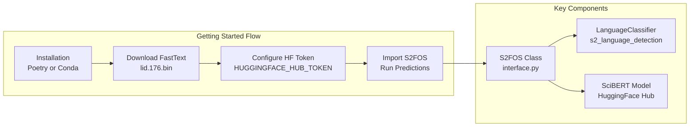
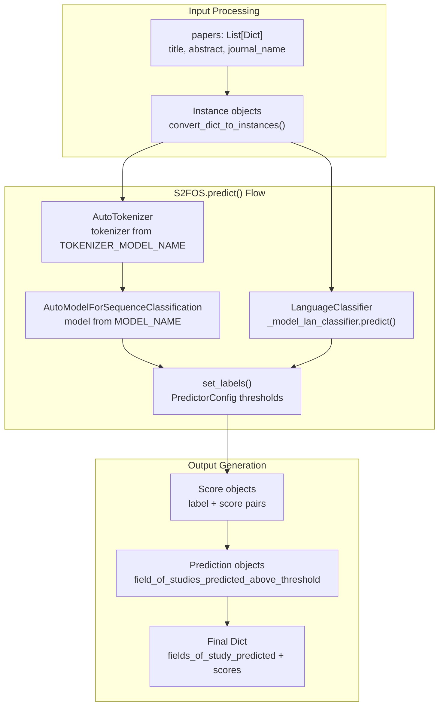

<!-- source: DeepWiki mcp.deepwiki.com · repo allenai/s2_fos · page 2 Getting Started · fetched 2026-10-26 -->

# Getting Started

<details>
<summary>Relevant source files</summary>

The following files were used as context for generating this wiki page:

- [.gitignore](.gitignore)
- [README.md](README.md)
- [src/s2_fos/interface.py](src/s2_fos/interface.py)

</details>


This document provides installation instructions, prerequisite setup, and basic usage examples for the s2_fos Field of Study classification system. It covers the essential steps to get the system running and performing inference on academic papers.

For detailed documentation of the S2FOS interface and prediction methods, see [S2FOS Interface](#3.1). For information about training models or generating training data, see [Training System](#4). For development environment setup and project configuration, see [Development](#5).

## Overview

The s2_fos system classifies academic papers into field of study categories using a fine-tuned SciBERT model. The system performs language detection first, then applies field of study classification only to English papers.



Sources: [README.md:1-68](), [src/s2_fos/interface.py:90-118]()

## Installation

### Method 1: Poetry (Recommended)

Poetry provides better dependency management and virtual environment isolation:

```bash
git clone https://github.com/allenai/s2_fos.git
cd s2_fos
# Install poetry
curl -sSL https://install.python-poetry.org | python3 -
poetry install
# Activate the virtual environment
poetry shell
# Due to the non-compliance of fasttext with PEP 518, 
# we need to install it manually
pip install fasttext
```

### Method 2: Anaconda

Alternative installation using conda environment:

```bash
git clone https://github.com/allenai/s2_fos.git
cd s2_fos
conda create -y --name s2fos python==3.8
conda activate s2fos
pip install -e .
pip install fasttext
```

**Note**: FastText requires manual installation due to PEP 518 non-compliance issues with both installation methods.

Sources: [README.md:9-35]()

## Prerequisites Setup

### FastText Language Detection Model

Download the required language identification model:

```bash
# Download the Language identification model from fasttext
cd data && wget https://dl.fbaipublicfiles.com/fasttext/supervised-models/lid.176.bin
```

This model is used by the `LanguageClassifier` component to filter non-English papers before field of study classification.

### Hugging Face Authentication

The system requires access to protected models and datasets on Hugging Face Hub:

1. Create a [Hugging Face account](https://huggingface.co) if you don't have one
2. Generate [a Hugging Face token](https://huggingface.co/settings/tokens)
3. Accept license agreements for:
   - Model weights: [allenai/scibert_scivocab_uncased_field_of_study](https://huggingface.co/allenai/scibert_scivocab_uncased_field_of_study)
   - Training data: [allenai/fos_model_training_data_open_ai_annotations](https://huggingface.co/datasets/allenai/fos_model_training_data_open_ai_annotations)

4. Set the token as an environment variable:

```bash
export HUGGINGFACE_HUB_TOKEN=<your_token>
```

Or set it programmatically before importing:

```python
import os
os.environ['HUGGINGFACE_HUB_TOKEN'] = '<your_token>'
```

Sources: [README.md:37-66]()

## Basic Usage

### Inference Example

```python
from s2_fos import S2FOS

# Example paper data
# note that journal_name is just a convention - it can be any venue like NeurIPS, arxiv, etc
papers = [{
    'title': "A Prototype-Based Few-Shot Named Entity Recognition",
    'abstract': ("Few-shot Named Entity Recognition (NER) task focuses on identifying named entities with "
                 "a small amount of supervised training data. Work based on prototype networks shows "
                 "strong adaptability for the few-shot NER task. We believe that the core idea of these "
                 "approaches is to learn how to aggregate the representation of token mappings in vector "
                 "space around entity classes. However, to our knowledge, no work has investigated its "
                 "effect. Therefore, we propose ClusLoss and ProEuroLoss, aiming to enhance the model's "
                 "ability to aggregate semantic information spatially, thus helping the model "
                 "better distinguish between entity types. Experimental results show that ProEuroLoss achieves "
                 "state-of-the-art performance on average F1 scores for both 1-shot and 5-shot NER "
                 "tasks, while ClusLoss has competitive performance in such tasks."),
    'journal_name': "Proceedings of the 8th International Conference on Computing and Artificial Intelligence",
}]

# Initialize the predictor
predictor = S2FOS()

# Predict the fields of study
print(predictor.predict(papers))
```

### Expected Output Structure

The `predict` method returns a dictionary with two keys:

| Key | Type | Description |
|-----|------|-------------|
| `fields_of_study_predicted` | List[List[str]] | Field of study labels above threshold for each paper |
| `scores` | List[List[Dict]] | All field of study scores for each paper |

Sources: [README.md:68-95](), [src/s2_fos/interface.py:277-286]()

## Inference Pipeline Architecture



Sources: [src/s2_fos/interface.py:205-286](), [src/s2_fos/interface.py:90-118]()

## Verification

### Test the Installation

Run the test suite to verify everything is working correctly:

**With Poetry:**
```bash
poetry shell
poetry run pytest
```

**With Anaconda:**
```bash
pip install pytest
pytest test
```

### Validate Model Loading

Ensure the system can load models and perform basic inference:

```python
from s2_fos import S2FOS

# This should complete without errors
predictor = S2FOS()

# Test with minimal data
test_paper = [{'title': 'Test Paper', 'abstract': 'Test abstract'}]
result = predictor.predict(test_paper)
print(f"Prediction completed: {len(result['scores'][0])} field scores returned")
```

Sources: [README.md:97-110]()

## Key Configuration Classes

| Class | File | Purpose |
|-------|------|---------|
| `S2FOS` | [src/s2_fos/interface.py:90]() | Main inference interface |
| `Instance` | [src/s2_fos/interface.py:22]() | Input data model for papers |
| `Prediction` | [src/s2_fos/interface.py:57]() | Output prediction model |
| `PredictorConfig` | [src/s2_fos/interface.py:72]() | Threshold configuration |

Sources: [src/s2_fos/interface.py:22-89]()

## Next Steps

- **For detailed API documentation**: See [S2FOS Interface](#3.1) for comprehensive method documentation
- **For model training**: See [Training System](#4) to learn about fine-tuning SciBERT models
- **For development setup**: See [Development](#5) for contributing guidelines and project structure
- **For language detection details**: See [Language Detection](#3.2) for LanguageClassifier specifics

Sources: [README.md:112-145]()

---

