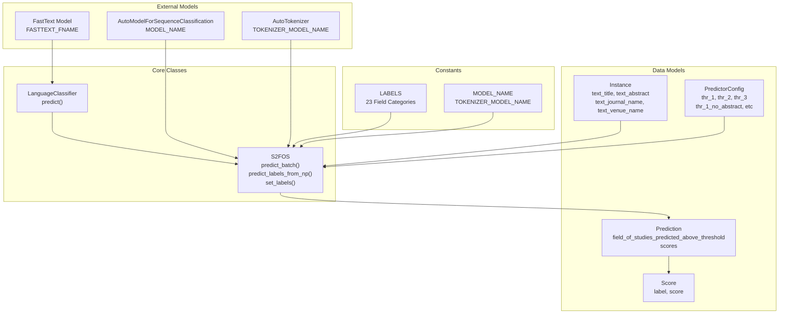
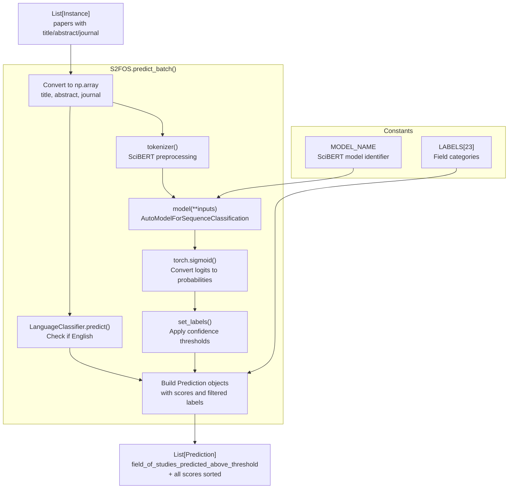

<!-- source: DeepWiki mcp.deepwiki.com · repo allenai/s2_fos · page 3 Core System · fetched 2026-10-26 -->

# Core System

Relevant source files

The following files were used as context for generating this wiki page:

- [src/s2_fos/constants.py](src/s2_fos/constants.py)
- [src/s2_fos/interface.py](src/s2_fos/interface.py)

This document covers the main inference and prediction components of the s2_fos system. The core system handles the runtime classification of academic papers into Fields of Study categories, consisting of the primary inference interface, language detection, and model prediction logic.

For detailed information about training new models, see [Training System](#4). For setup and basic usage instructions, see [Getting Started](#2).

## System Overview

The core system implements a two-stage classification pipeline that first filters papers by language (English only) and then performs multi-label Field of Study classification using a fine-tuned SciBERT model. The system is designed around the `S2FOS` class which orchestrates language detection, text preprocessing, model inference, and threshold-based label assignment.

## Core Components

The core system consists of three primary components that work together to perform inference:

**Sources:** [src/s2_fos/interface.py:22-89](), [src/s2_fos/interface.py:90-118](), [src/s2_fos/constants.py:1-39]()

### Data Models

The system uses Pydantic models to define the interface contracts:

| Model | Purpose | Key Fields |
|-------|---------|------------|
| `Instance` | Input paper data | `text_title`, `text_abstract`, `text_journal_name`, `text_venue_name` |
| `Score` | Individual field prediction | `label`, `score` |
| `Prediction` | Complete prediction result | `field_of_studies_predicted_above_threshold`, `scores` |
| `PredictorConfig` | Threshold configuration | `thr_1`, `thr_2`, `thr_3` with abstract/no-abstract variants |

### Core Classes

- **`S2FOS`**: Main interface class that orchestrates the entire prediction pipeline
- **`LanguageClassifier`**: Handles language detection using FastText models
- **SciBERT Integration**: Uses Hugging Face transformers for the underlying classification model

## Prediction Pipeline

The core system implements a multi-stage prediction pipeline that processes academic papers through language detection, text preprocessing, model inference, and threshold-based filtering:

**Sources:** [src/s2_fos/interface.py:205-264](), [src/s2_fos/interface.py:176-203](), [src/s2_fos/interface.py:119-174]()

## Component Integration

The core system integrates multiple components through the `S2FOS` class constructor and prediction methods:

### Initialization Process

1. **Configuration Loading**: `PredictorConfig` loads threshold values from environment or defaults
2. **Language Model Setup**: `LanguageClassifier` initializes with FastText model 
3. **SciBERT Loading**: `AutoModelForSequenceClassification.from_pretrained()` loads the fine-tuned model
4. **Tokenizer Setup**: `AutoTokenizer.from_pretrained()` configures text preprocessing
5. **Device Management**: Automatic GPU/CPU detection and model placement

### Prediction Workflow

The `predict_batch()` method coordinates all components:

1. **Data Preparation**: Convert `Instance` objects to numpy arrays [src/s2_fos/interface.py:222-232]()
2. **Language Filtering**: Use `LanguageClassifier.predict()` to detect non-English papers [src/s2_fos/interface.py:233]()
3. **Model Inference**: Process through SciBERT tokenizer and model [src/s2_fos/interface.py:235]()
4. **Threshold Application**: Apply confidence thresholds via `set_labels()` [src/s2_fos/interface.py:236]()
5. **Result Assembly**: Build `Prediction` objects with filtered labels and all scores [src/s2_fos/interface.py:239-263]()

### Threshold Logic

The `set_labels()` method implements a multi-tier threshold system:

- **Tier 1**: Highest confidence prediction uses `thr_1` threshold
- **Tier 2**: Second through fifth predictions use `thr_2` threshold  
- **Tier 3**: Lower confidence predictions use `thr_3` threshold
- **Abstract-dependent**: Different thresholds for papers with/without abstracts

**Sources:** [src/s2_fos/interface.py:98-118](), [src/s2_fos/interface.py:119-174](), [src/s2_fos/interface.py:205-264](), [src/s2_fos/constants.py:5-31]()

---

