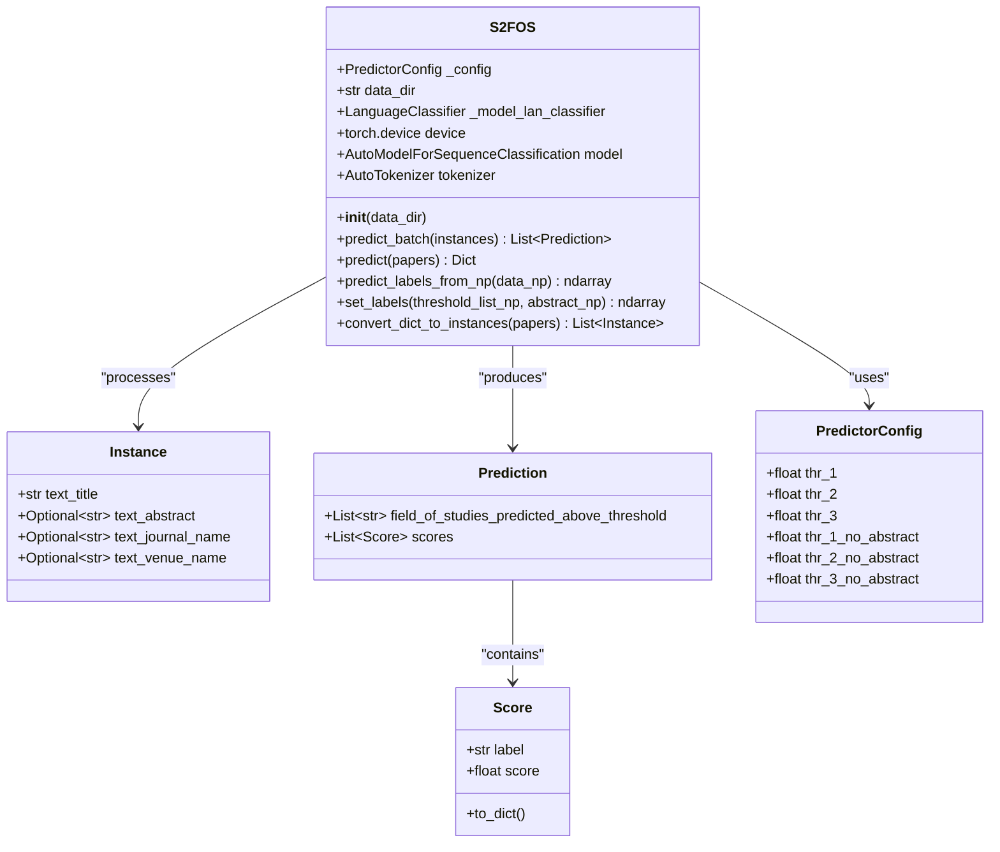
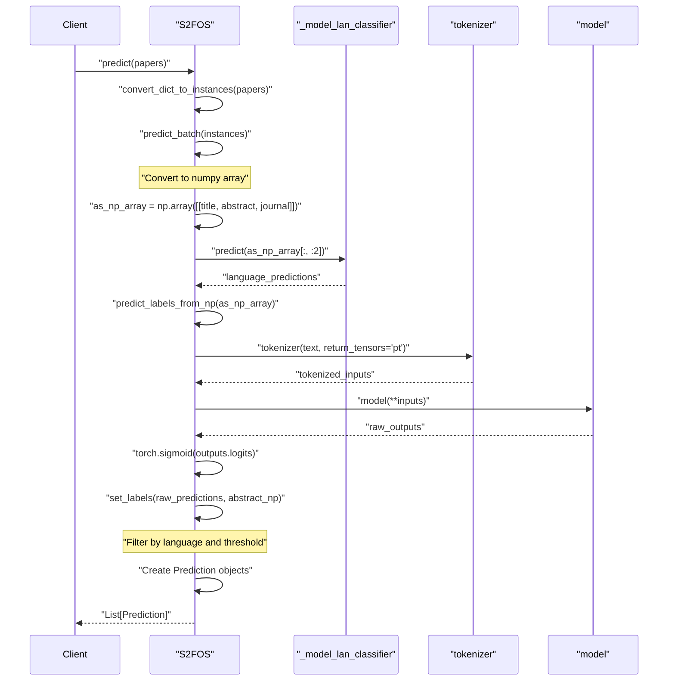
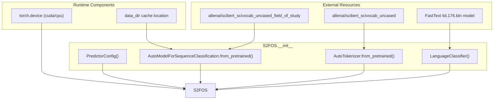

<!-- source: DeepWiki mcp.deepwiki.com · repo allenai/s2_fos · page 3.1 S2FOS Interface · fetched 2026-10-26 -->

# S2FOS Interface

Relevant source files

The following files were used as context for generating this wiki page:

- [src/s2_fos/constants.py](src/s2_fos/constants.py)
- [src/s2_fos/interface.py](src/s2_fos/interface.py)

This document covers the `S2FOS` class, which serves as the primary interface for performing Field of Study classification on academic papers. The S2FOS interface handles model loading, text preprocessing, language detection, and inference orchestration to predict academic fields of study from paper metadata.

For information about the underlying language detection system, see [Language Detection](#3.2). For details about the constants and field of study labels used by this interface, see [Constants and Labels](#3.3).

## Overview

The `S2FOS` class in [src/s2_fos/interface.py:90-118]() provides the main entry point for field of study prediction. It integrates a fine-tuned SciBERT model with language detection to classify academic papers into 23 field of study categories.

**Sources:** [src/s2_fos/interface.py:22-89](), [src/s2_fos/interface.py:90-118]()

## Data Models

The interface defines several Pydantic models to structure input and output data:

### Instance Model

The `Instance` class [src/s2_fos/interface.py:22-37]() represents input data for a single academic paper:

| Field | Type | Description | Required |
|-------|------|-------------|----------|
| `text_title` | `str` | Paper title | Yes |
| `text_abstract` | `Optional[str]` | Paper abstract | No |
| `text_journal_name` | `Optional[str]` | Journal name | No |
| `text_venue_name` | `Optional[str]` | Venue name | No |

### Score Model

The `Score` class [src/s2_fos/interface.py:39-55]() represents confidence scores for individual field of study predictions:

| Field | Type | Description |
|-------|------|-------------|
| `label` | `str` | Field of study name |
| `score` | `float` | Confidence score (0.0-1.0) |

### Prediction Model

The `Prediction` class [src/s2_fos/interface.py:57-70]() contains the complete prediction output:

| Field | Type | Description |
|-------|------|-------------|
| `field_of_studies_predicted_above_threshold` | `List[str]` | Fields predicted above confidence threshold |
| `scores` | `List[Score]` | All 23 field scores sorted by confidence |

**Sources:** [src/s2_fos/interface.py:22-70]()

## Prediction Workflow

The prediction process follows a multi-stage pipeline that processes input papers through language detection, text preprocessing, model inference, and threshold application:

**Sources:** [src/s2_fos/interface.py:205-264](), [src/s2_fos/interface.py:277-286]()

## Configuration and Thresholds

The `PredictorConfig` class [src/s2_fos/interface.py:72-88]() manages confidence thresholds that determine which field of study predictions are considered positive. The system uses different thresholds based on prediction ranking and whether an abstract is present:

### Threshold Configuration

| Parameter | Default | Description |
|-----------|---------|-------------|
| `thr_1` | 0.552 | Threshold for top-ranked prediction (with abstract) |
| `thr_2` | 0.621 | Threshold for 2nd-5th ranked predictions (with abstract) |
| `thr_3` | 0.7 | Threshold for remaining predictions (with abstract) |
| `thr_1_no_abstract` | 0.621 | Threshold for top-ranked prediction (no abstract) |
| `thr_2_no_abstract` | 0.655 | Threshold for 2nd-5th ranked predictions (no abstract) |
| `thr_3_no_abstract` | 0.7 | Threshold for remaining predictions (no abstract) |

The `set_labels` method [src/s2_fos/interface.py:119-174]() applies these thresholds using a ranking-based approach where higher-ranked predictions (by confidence) use lower thresholds.

**Sources:** [src/s2_fos/interface.py:72-88](), [src/s2_fos/interface.py:119-174]()

## Core API Methods

### predict_batch

The `predict_batch` method [src/s2_fos/interface.py:205-264]() processes multiple `Instance` objects in a single batch:

1. Converts instances to numpy array format [src/s2_fos/interface.py:222-232]()
2. Performs language detection on title and abstract [src/s2_fos/interface.py:233]()
3. Generates raw probability predictions [src/s2_fos/interface.py:235]()
4. Applies confidence thresholds [src/s2_fos/interface.py:236]()
5. Filters non-English papers [src/s2_fos/interface.py:249-252]()
6. Returns sorted predictions [src/s2_fos/interface.py:254-263]()

### predict

The `predict` method [src/s2_fos/interface.py:277-286]() provides a dictionary-based interface that:

1. Converts dictionary inputs to `Instance` objects [src/s2_fos/interface.py:278]()
2. Calls `predict_batch` for inference
3. Returns results in dictionary format with `scores` and `fields_of_study_predicted` keys

### predict_labels_from_np

The `predict_labels_from_np` method [src/s2_fos/interface.py:176-203]() handles the core SciBERT inference:

1. Concatenates title, abstract, and journal with `sep_token` [src/s2_fos/interface.py:185-187]()
2. Tokenizes text with 128 token limit [src/s2_fos/interface.py:189-195]()
3. Runs model inference [src/s2_fos/interface.py:201]()
4. Applies sigmoid activation [src/s2_fos/interface.py:202]()

**Sources:** [src/s2_fos/interface.py:176-203](), [src/s2_fos/interface.py:205-264](), [src/s2_fos/interface.py:277-286]()

## Model Integration

The S2FOS interface integrates several external components during initialization [src/s2_fos/interface.py:98-118]():

The initialization process loads:
- Configuration thresholds from environment variables or defaults
- Language classifier with FastText model
- Fine-tuned SciBERT model from Hugging Face Hub
- SciBERT tokenizer for text preprocessing
- Appropriate device (CUDA/CPU) for inference

**Sources:** [src/s2_fos/interface.py:98-118](), [src/s2_fos/constants.py:5](), [src/s2_fos/constants.py:38]()

---

