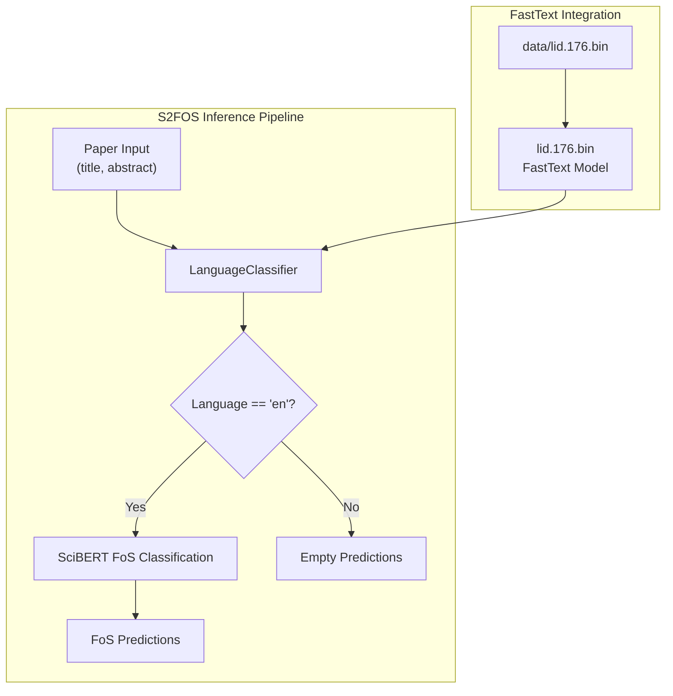
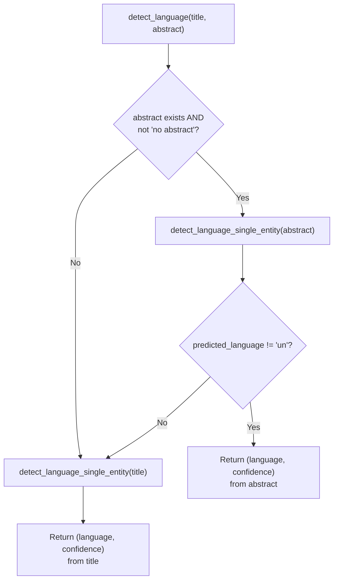
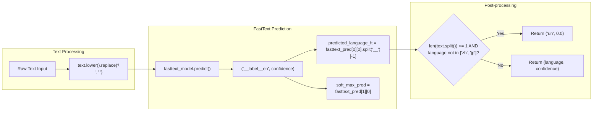

<!-- source: DeepWiki mcp.deepwiki.com · repo allenai/s2_fos · page 3.2 Language Detection · fetched 2026-10-26 -->

# Language Detection

Relevant source files

The following files were used as context for generating this wiki page:

- [src/s2_language_detection/language_classifier.py](src/s2_language_detection/language_classifier.py)

This document covers the language detection component of the s2_fos system, which filters academic papers by language before Field of Study classification. The language detection system uses FastText models to identify the language of paper titles and abstracts, with special logic for prioritizing abstracts over titles.

For information about the main inference interface that uses language detection, see [S2FOS Interface](#3.1). For details about system constants and model paths, see [Constants and Labels](#3.3).

## System Overview

The language detection system serves as a preprocessing filter in the s2_fos pipeline, ensuring that only English-language papers proceed to Field of Study classification. The system is implemented through the `LanguageClassifier` class, which wraps a pre-trained FastText language identification model.

**Language Detection in S2FOS Pipeline**

Sources: [src/s2_language_detection/language_classifier.py:1-73]()

## LanguageClassifier Class

The `LanguageClassifier` class provides the core language detection functionality through a FastText-based implementation. The class handles model loading, text preprocessing, and language prediction with confidence scores.

### Initialization and Model Loading

The classifier loads the FastText model during initialization, with configurable data directory paths:

| Parameter | Type | Default | Description |
|-----------|------|---------|-------------|
| `data_dir` | `str` | `None` | Custom directory for FastText model file |

When `data_dir` is `None`, the model path defaults to `PROJECT_ROOT_PATH/../data/FASTTEXT_FNAME`. The system validates model file existence and raises `FileNotFoundError` with download instructions if the model is missing.

Sources: [src/s2_language_detection/language_classifier.py:12-25]()

### Core Methods

The `LanguageClassifier` exposes three main methods for language detection:

#### predict(input_array)
Batch prediction method for arrays of paper data, where each input contains title and abstract text pairs.

#### detect_language(text_title, text_abstract)
Primary detection method with intelligent text prioritization logic. The method prefers abstract text over title text when available and valid.

#### detect_language_single_entity(text)
Low-level detection for individual text strings, handling edge cases for short text and specific languages.

Sources: [src/s2_language_detection/language_classifier.py:27-72]()

## Language Detection Workflow

The language detection process follows a hierarchical approach, prioritizing different text sources based on content quality and availability.

**Language Detection Decision Tree**

### Text Prioritization Logic

1. **Abstract First**: When abstracts are available and don't contain "no abstract", the system attempts detection on abstract text
2. **Fallback to Title**: If abstract detection returns "un" (uncertain) or no abstract exists, the system falls back to title detection
3. **Uncertain Handling**: Single-word texts (except Chinese/Japanese) return "un" with 0.0 confidence

Sources: [src/s2_language_detection/language_classifier.py:38-52]()

## FastText Integration

The language detection system integrates with the FastText library using the pre-trained `lid.176.bin` model for multi-language identification.

**FastText Processing Pipeline**

### Language Code Handling

The system processes FastText's `__label__` prefixed output to extract standard language codes. Special handling exists for Chinese (`zh`) and Japanese (`jp`) languages, which don't use whitespace for word separation.

### Confidence Scoring

FastText predictions include confidence scores (softmax probabilities) that the system returns alongside language predictions. Uncertain predictions receive a confidence score of 0.0.

Sources: [src/s2_language_detection/language_classifier.py:54-72]()

## Model Requirements

The language detection system requires the FastText language identification model `lid.176.bin`:

| Component | Requirement | Source |
|-----------|-------------|---------|
| Model File | `lid.176.bin` | https://fasttext.cc/docs/en/language-identification.html |
| Model Path | `{PROJECT_ROOT_PATH}/../data/lid.176.bin` | Configurable via `data_dir` parameter |
| Dependencies | `fasttext` Python package | Required for model loading and inference |

The system provides clear error messages with download instructions when the model file is missing, ensuring proper setup guidance for users.

Sources: [src/s2_language_detection/language_classifier.py:18-23]()

---

