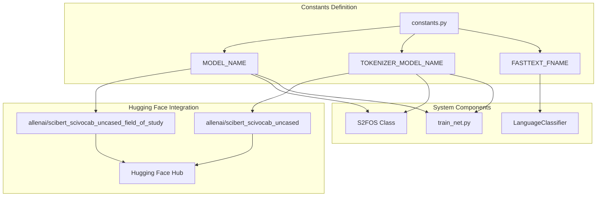
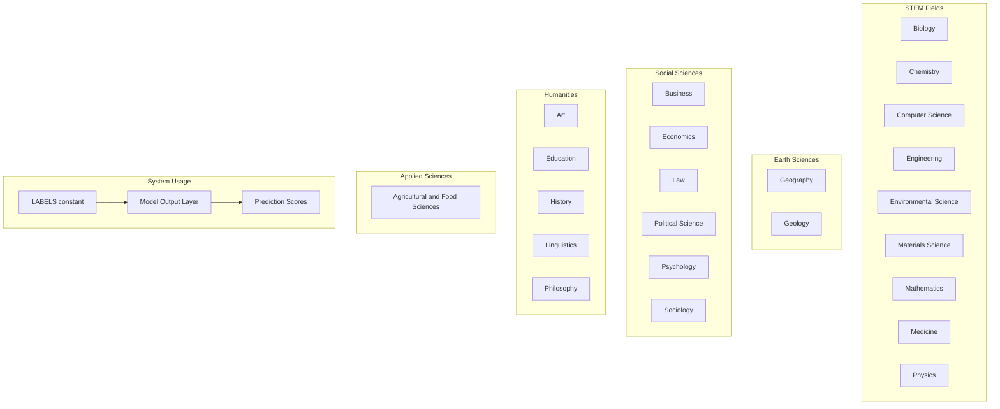
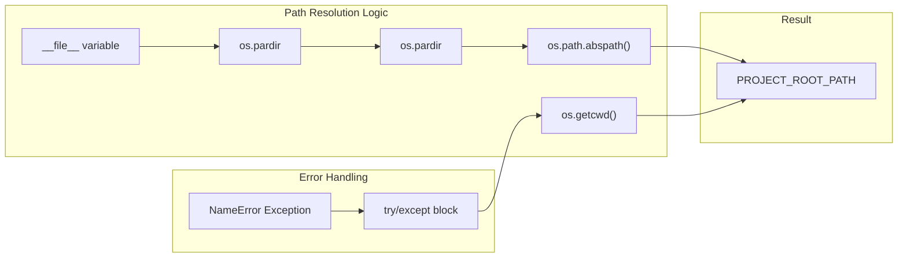
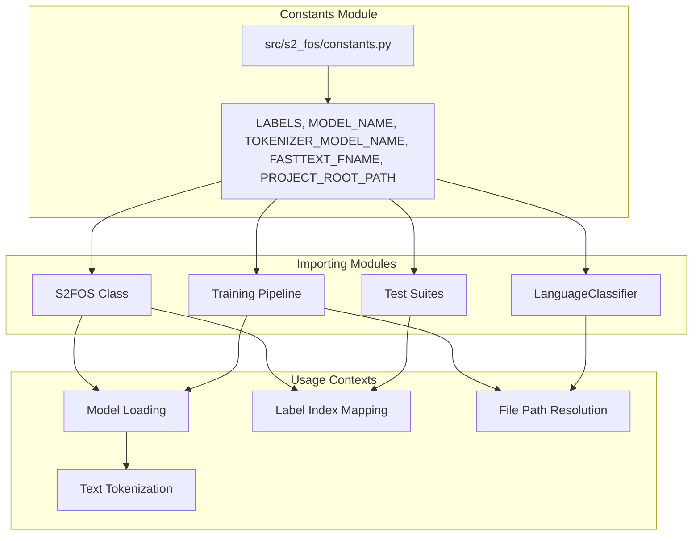

<!-- source: DeepWiki mcp.deepwiki.com · repo allenai/s2_fos · page 3.3 Constants and Labels · fetched 2026-10-26 -->

# Constants and Labels

Relevant source files

The following files were used as context for generating this wiki page:

- [src/s2_fos/constants.py](src/s2_fos/constants.py)

This page documents the central constants and labels used throughout the s2_fos system. These constants define model identifiers, field of study categories, file paths, and other system-wide configuration values that ensure consistency across the inference and training pipelines.

For information about how these constants are used in the main inference interface, see [S2FOS Interface](#3.1). For details about the training system configuration, see [Model Training](#4.1).

## Model Identifiers

The system relies on several pre-trained models from Hugging Face Hub, each identified by specific model names defined as constants.

| Constant | Value | Purpose |
|----------|-------|---------|
| `MODEL_NAME` | `"allenai/scibert_scivocab_uncased_field_of_study"` | Fine-tuned SciBERT model for field of study classification |
| `TOKENIZER_MODEL_NAME` | `"allenai/scibert_scivocab_uncased"` | Base SciBERT tokenizer for text preprocessing |
| `FASTTEXT_FNAME` | `"lid.176.bin"` | FastText language detection model filename |

### Model Identifier Usage Flow

Sources: [src/s2_fos/constants.py:5](), [src/s2_fos/constants.py:38](), [src/s2_fos/constants.py:3]()

## Field of Study Labels

The system classifies academic papers into 23 predefined field of study categories. These labels are defined in the `LABELS` constant as an ordered list that corresponds to the model's output layer.

### Complete Label Set

The 23 field of study categories are:

| Index | Field of Study |
|-------|----------------|
| 0 | Agricultural and Food Sciences |
| 1 | Art |
| 2 | Biology |
| 3 | Business |
| 4 | Chemistry |
| 5 | Computer Science |
| 6 | Economics |
| 7 | Education |
| 8 | Engineering |
| 9 | Environmental Science |
| 10 | Geography |
| 11 | Geology |
| 12 | History |
| 13 | Law |
| 14 | Linguistics |
| 15 | Materials Science |
| 16 | Mathematics |
| 17 | Medicine |
| 18 | Philosophy |
| 19 | Physics |
| 20 | Political Science |
| 21 | Psychology |
| 22 | Sociology |

### Label Classification Hierarchy

Sources: [src/s2_fos/constants.py:7-31]()

## System Paths

The constants file defines dynamic path resolution for locating project resources and configuration files.

### Project Root Path Resolution

The `PROJECT_ROOT_PATH` constant uses dynamic path calculation to locate the project root directory regardless of the execution context:

The path resolution follows this logic:
1. Primary: `os.path.abspath(os.path.join(__file__, os.pardir, os.pardir))`
2. Fallback: `os.path.abspath(os.path.join(os.getcwd()))` if `__file__` is undefined

Sources: [src/s2_fos/constants.py:33-36]()

## Usage Patterns

The constants are imported and used throughout the system to ensure consistency in model loading, label mapping, and file path resolution.

### Import and Usage Pattern

Key usage patterns include:
- **Model Initialization**: `MODEL_NAME` and `TOKENIZER_MODEL_NAME` for loading pre-trained models
- **Prediction Mapping**: `LABELS` list for converting model output indices to field of study names
- **Language Detection**: `FASTTEXT_FNAME` for locating the language classification model
- **File Operations**: `PROJECT_ROOT_PATH` for relative path calculations

Sources: [src/s2_fos/constants.py:1-39]()

---

